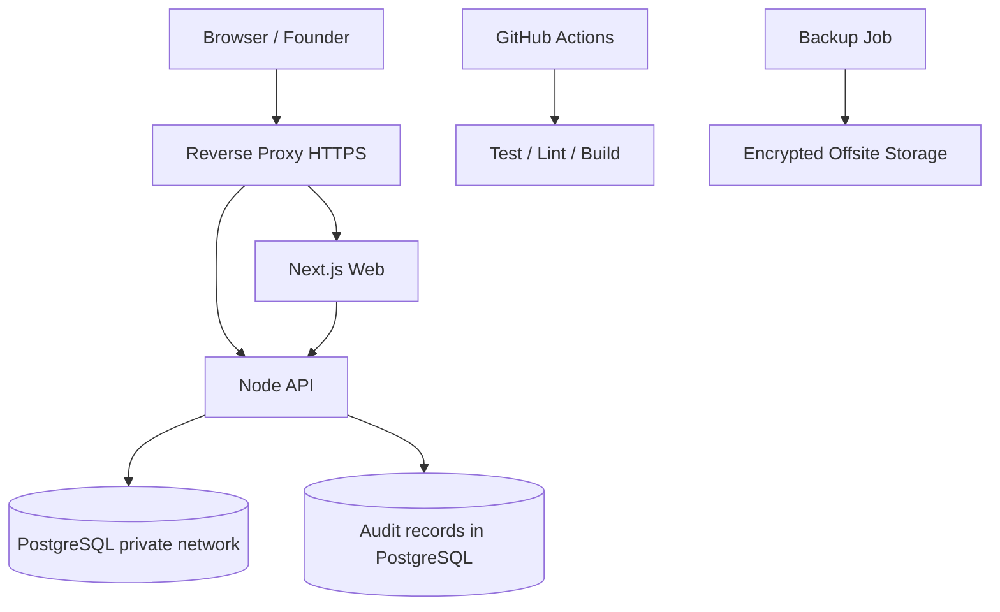

# NALARA — MASTER PRODUCT & ENGINEERING PRD

**Version:** 3.0 | **Date:** 2026-11-03 | **Status:** Founder review | **Format:** Markdown | **Implementation:** Claude Code + GitHub

> This is a FULL multi-phase product blueprint, NOT a request to implement all phases at once. Phase gates require founder approval. Never infer working external endpoints, subscription entitlements, licenses, or provider pricing.


# A. Canonical product PRD v1.0 (preserved)


# NALARA — Technical Product Requirements Document (PRD)

**Versi:** 1.0  
**Tanggal:** 3 November 2026  
**Status:** Draft implementasi untuk review founder; belum mengesahkan integrasi pihak ketiga  
**Tagline:** *Biar semua paham.*  
**Target implementasi:** Claude Code, bertahap, pada satu VPS Linux  
**Referensi:** NALARA Master Reference Blueprint v2.0

> **Aturan utama:** Jangan membangun semua fase sekaligus. Jangan mengasumsikan API, lisensi, biaya, domain, autentikasi Hermes, atau hak penggunaan gambar sudah terverifikasi. Jika belum pasti, buat *research spike* dan minta keputusan founder.

---

## 1. Executive summary

NALARA adalah platform media penjelas dan informasi publik Indonesia. Produk pertama terdiri dari **NALARA Media** (website publik berisi artikel yang jelas, berkonteks, dan bersumber) dan **NALARA OS** (dashboard privat untuk founder mengelola editorial, sumber, automasi, dan AI). Ekosistem masa depan mencakup NALARA Data, Tools, dan Labs, tetapi tidak dibangun dalam MVP.

NALARA **bukan agregator yang menyalin berita** dan bukan chatbot yang otomatis menerbitkan artikel. RSS digunakan untuk *discovery*; fakta diverifikasi melalui sumber primer atau referensi kredibel; founder menyetujui setiap publikasi. Hermes adalah kandidat AI Operator yang mengakses **tool gateway terbatas**, bukan database, SSH, atau shell secara langsung.

### 1.1 Problem statement

Pembaca sering menemukan berita tanpa konteks, sulit melacak sumber angka, dan harus membuka banyak situs untuk memahami kebijakan atau data publik. Founder solo membutuhkan alur editorial ringan, terukur, dan bisa dikendalikan dari web maupun Telegram tanpa mengorbankan keamanan.

### 1.2 Goals

| ID | Tujuan | Ukuran keberhasilan awal |
|---|---|---|
| G-01 | Pembaca memahami satu isu melalui artikel penjelas | Artikel menampilkan ringkasan, konteks, referensi, tanggal pembaruan |
| G-02 | Informasi dapat diperiksa | Setiap klaim material memiliki sumber; angka memiliki periode dan satuan |
| G-03 | Founder bisa menerbitkan sendiri | Draft → review → publish berjalan end-to-end tanpa akses database manual |
| G-04 | Discovery sumber lebih efisien | Feed terverifikasi masuk ke inbox, dedup dan error tercatat |
| G-05 | Operasi aman dan murah | Approval untuk aksi sensitif, backup teruji, biaya dipantau |

**Non-goals MVP:** pembayaran SaaS, akun pembaca, multi-tenant, multi-agent otonom, publikasi tanpa editor, API berbayar, rekomendasi algoritmik kompleks, aplikasi mobile native, crawler agresif, data lake skala besar.

### 1.3 Persona

1. **Pembaca:** mahasiswa/pekerja muda Indonesia yang ingin memahami isu ekonomi, teknologi, dan kebijakan dengan bahasa mudah serta sumber jelas.
2. **Founder/editor:** satu operator yang meneliti, mengedit, mempublikasikan, memonitor sumber, dan menyetujui aksi AI.

### 1.4 Prinsip produk

- **Explain, don't just aggregate:** konteks lebih penting daripada volume artikel.
- **Source-first:** sumber asli, tanggal, revisi, dan keterbatasan selalu dapat dilacak.
- **Human-in-the-loop:** AI membantu, founder memutuskan.
- **Modular monolith first:** satu codebase aplikasi, worker terpisah bila diperlukan.
- **Small VPS friendly:** tidak perlu Kubernetes atau banyak microservice.
- **Public ≠ private:** halaman publik tidak boleh mengekspos data OS.

---

## 2. Scope dan prioritas

| Area | P0 — wajib MVP | P1 — setelah MVP stabil | P2 — masa depan |
|---|---|---|---|
| Media publik | Home, kategori, detail artikel, sumber, SEO, responsive | Search, RSS publik, koreksi publik | Personalisasi pembaca |
| Newsroom OS | Login, daftar draft, editor, revisi, preview, approval, publish | Schedule publish, media library | Kolaborasi editor |
| Source Registry | Daftar sumber manual, verifikasi, status | RSS ingestion, health checks, connector API resmi | Katalog integrasi luas |
| Research | Catatan dan tautan sumber per draft | Research inbox dan AI-assisted draft | Riset data lanjutan |
| Automation | Status job dasar | Scheduler, retry, monitoring | Orkestrasi kompleks |
| AI Operator | Desain adapter dan kebijakan tool | Hermes PoC + Telegram + proposal/approval | Kemampuan tambahan terukur |
| Data | Referensi data pada artikel | Dataset catalog dan chart sederhana | NALARA Data penuh |
| Tools/Labs | Tidak dibangun | Tidak dibangun | Berdasar permintaan nyata |

**Urutan kerja:** Phase 0 → Phase 1 → Phase 2 → Phase 3 → Phase 4. Fitur P1 tidak boleh menghalangi peluncuran P0.

---

## 3. User journeys dan acceptance criteria

### 3.1 Pembaca: memahami isu

1. Buka home di ponsel → lihat headline dan kategori.
2. Buka artikel → baca ringkasan, apa yang terjadi, mengapa penting, konteks, dan sumber.
3. Klik referensi → diarahkan ke sumber asli; lihat waktu terbit dan pembaruan.
4. Jika artikel dikoreksi, pembaca dapat melihat catatan koreksi.

**AC-MEDIA-01:** Artikel published dapat diakses tanpa login, draft tidak bisa diakses publik.  
**AC-MEDIA-02:** Setiap artikel published memiliki judul, slug unik, kategori, isi, tanggal terbit, status, dan minimal satu sumber terverifikasi; pengecualian harus memerlukan alasan editorial eksplisit.  
**AC-MEDIA-03:** Angka penting ditampilkan dengan periode, unit, dan rujukan.  
**AC-MEDIA-04:** Metadata SEO, canonical URL, Open Graph, sitemap, dan mobile layout berfungsi.  
**AC-MEDIA-05:** Koreksi tidak menghapus riwayat internal; perubahan substansial ditandai secara publik.

### 3.2 Founder: menulis dan menerbitkan

1. Login ke `/os` dengan sesi aman dan MFA.
2. Buat draft, pilih kategori, tulis konten, lampirkan referensi.
3. Lihat preview, jalankan checklist sumber, ubah status menjadi `in_review`.
4. Setujui draft dengan identitas founder; publish atau jadwalkan.
5. Periksa artikel live dan histori revisi.

**AC-OS-01:** Draft tidak dapat dipublish hanya melalui perubahan request client; backend memverifikasi otorisasi dan state transition.  
**AC-OS-02:** Semua publikasi mencatat `approved_by`, waktu, revision ID, dan audit event.  
**AC-OS-03:** Konten editor disanitasi sebelum render; tidak ada script arbitrer.  
**AC-OS-04:** Login gagal berulang dikenai rate limit; MFA diwajibkan sebelum produksi.

### 3.3 Founder: mengelola sumber

1. Masukkan URL dan jenis sumber (RSS/API/dataset/dokumen/manual).
2. Backend menguji URL dan metadata tanpa mengaktifkan otomatis.
3. Founder memeriksa lisensi, atribusi, endpoint, rate limit, dan status.
4. Aktifkan sumber terverifikasi → worker mengambil metadata/item sesuai interval.
5. Lihat error dan jeda sumber bila bermasalah.

**AC-SRC-01:** `candidate` tidak dipolling sampai lolos verifikasi dan aktivasi.  
**AC-SRC-02:** URL internal/private IP, redirect ke alamat privat, dan protokol berbahaya ditolak (SSRF protection).  
**AC-SRC-03:** Duplikat canonical URL/fingerprint tidak membuat item baru.  
**AC-SRC-04:** Kegagalan feed tercatat dan tidak merusak job lain.

### 3.4 Founder: AI Operator

Contoh perintah: “Tambahkan sumber inflasi resmi” atau “Prioritaskan ekonomi dibanding hiburan.” Hermes mencari konteks dan membuat **proposal**, backend memvalidasi, founder approve, backend menjalankan aksi yang diizinkan. Agent tidak dapat menyetujui proposal sendiri.

**AC-AI-01:** Prompt injection dalam RSS/artikel/web tidak dapat memicu mutasi.  
**AC-AI-02:** Token approval sekali pakai, kedaluwarsa, terikat resource/action/version, dan tidak dapat di-replay.  
**AC-AI-03:** Telegram hanya menerima founder allowlisted; perubahan penting tetap memerlukan approval.  
**AC-AI-04:** Jika Hermes/OAuth tidak tersedia, sistem editorial tetap berfungsi manual.

---

## 4. Information architecture

### 4.1 Public routes

| Route | Fungsi |
|---|---|
| `/` | Beranda editorial |
| `/artikel/[slug]` | Detail artikel dan sitasi |
| `/topik/[slug]` | Artikel per topik |
| `/cari` | Pencarian (P1) |
| `/tentang` | Misi, metodologi, kontak |
| `/koreksi` | Daftar koreksi publik (P1) |
| `/rss.xml` | RSS publik (P1) |
| `/sitemap.xml`, `/robots.txt` | SEO |

### 4.2 Private routes

| Route | Fungsi |
|---|---|
| `/os/login` | Login founder |
| `/os` | Overview dan health |
| `/os/newsroom` | Artikel, draft, review, jadwal |
| `/os/newsroom/[id]` | Editor, sumber, preview, revisi |
| `/os/research` | Catatan riset dan inbox (P1) |
| `/os/sources` | Source Registry |
| `/os/data` | Data Center (P2) |
| `/os/ai` | AI Operator (P1) |
| `/os/automations` | Job status dan jadwal (P1) |
| `/os/settings` | Preferensi dan sistem |
| `/os/audit` | Audit trail |

Semua route `/os/*` kecuali login memerlukan autentikasi server-side. Tidak boleh ada data admin yang disisipkan ke HTML publik atau dikirim lewat API publik.

---

## 5. Design system dan branding

**Arah:** koran modern Indonesia, editorial kredibel, tidak tampak seperti template AI. Logo utama **wordmark `NALARA` kapital bergaya masthead koran modern**, satu identitas untuk seluruh lini. Tidak perlu monogram geometris, gradient, 3D, emas mencolok, atau ikon AI. Logo saat ini **konsep visual, belum final dalam aset vektor**; jangan menjadikan hasil generasi gambar sebagai SVG final tanpa review.

| Token | Warna | Penggunaan |
|---|---|---|
| `brand.forest` | `#172823` | Masthead, navigasi, identitas |
| `brand.ivory` | `#F5F0E6` | Background editorial |
| `brand.ink` | `#252A29` | Teks utama |
| `brand.sage` | `#A9B9AC` | UI sekunder |
| `brand.brass` | `#C2A77A` | Aksen opsional, bukan logo utama |

- Publik: light-first, kolom baca nyaman, hierarki headline kuat, tipografi serif untuk headline dan sans untuk UI.
- OS: dashboard ringkas, dark mode opsional, status sistem mudah dipindai.
- Aksesibilitas: kontras WCAG AA, navigasi keyboard, label form, alt text, reduced motion.
- Mobile: navigasi dan editor responsif; optimasi gambar, lazy loading, ukuran font terbaca.

---

## 6. Arsitektur teknis

### 6.1 Keputusan teknologi

| Komponen | Pilihan | Catatan |
|---|---|---|
| Web + OS | Next.js App Router, TypeScript, Tailwind | Satu aplikasi untuk MVP |
| Business logic | Node.js service layer dalam Next.js | Tidak perlu Express kedua kecuali ada kebutuhan terukur |
| Database | PostgreSQL | Migrasi ter-versioning; ORM dipilih saat Phase 0 |
| Background worker | Node.js process terpisah | Cron/DB queue sederhana dulu; Redis hanya bila perlu |
| AI integration | Hermes adapter + Tool Gateway | Service/process terisolasi |
| Telegram | Telegram Bot API | Founder-only; webhook tervalidasi atau polling aman |
| Deployment | Docker Compose di VPS Linux | **Tanpa Kubernetes** |
| HTTPS | Caddy atau Nginx reverse proxy | TLS otomatis bila memungkinkan |
| Media storage | Object storage kompatibel S3 atau local volume sementara | Strategi backup dan migrasi wajib |
| Observability | Structured logs + health endpoint + alert | Tanpa stack monitoring berat di awal |

**Catatan template:** meskipun generator menawarkan “Node.js (Express/Fastify)”, implementasi MVP sebaiknya tidak menduplikasi API Next.js dan Express. Jika template mewajibkan backend terpisah, gunakan satu Fastify service dan definisikan ownership API secara eksplisit; hindari dua sumber business logic.

### 6.2 Logical architecture

```text
Reader ──HTTPS──> Reverse Proxy ──> Next.js (public + /os)
                                         │
                                         ▼
                                Application services
                                         │
                                  PostgreSQL
                                         ▲
                                         │
                                  Worker / Scheduler
                                         │
                               Source connectors (allowlist)

Founder ──> NALARA OS ──> Auth/API ──> Proposal & Approval Engine
Founder ──> Telegram Bot ───────────> Auth/API ──> Tool Gateway
                                                 │
                                        Hermes Adapter (isolated)
```

**Trust boundaries:** internet, public frontend, private OS, database, worker fetcher, Telegram, AI runtime. Hanya backend memiliki kredensial DB. Hermes tidak mendapat akses langsung DB atau secrets.

### 6.3 Suggested repository structure

```text
nalara/
  apps/web/
    src/app/(public)/
    src/app/os/
    src/app/api/
    src/components/
  packages/core/
    src/articles/
    src/sources/
    src/approvals/
    src/audit/
    src/auth/
  packages/db/
    migrations/
    schema/
  services/worker/
    src/jobs/
    src/connectors/
  services/ai-adapter/         # P1; isolated runtime
  services/telegram/           # P1
  infra/
    compose.yaml
    Caddyfile
  docs/
    adr/
    threat-model.md
    runbooks/
    api-contracts.md
  tests/
    integration/
    e2e/
  .env.example
  README.md
```

Boleh sederhanakan struktur ini saat Phase 0 jika starter Next.js lebih cocok satu repository tanpa workspace. Jangan membuat paket kosong demi arsitektur terlihat besar.

---

## 7. Database design

**Konvensi:** UUID primary key, `created_at`/`updated_at` UTC, foreign key dan index untuk query penting, soft-delete hanya bila diperlukan. Simpan revision snapshot untuk artikel. Secrets **tidak** disimpan sebagai plaintext di tabel sumber.

### 7.1 Core tables

| Tabel | Field utama | Constraint/relasi |
|---|---|---|
| `users` | id, email, password_hash/auth_provider, mfa_enabled, role, active | Satu founder awal; email unik |
| `sessions` | id, user_id, token_hash, expires_at, revoked_at | FK user, token hashed |
| `categories` | id, slug, name, description | slug unik |
| `articles` | id, slug, title, excerpt, body, category_id, status, author_id, current_revision_id, published_at, updated_at | slug unik; FK |
| `article_revisions` | id, article_id, version, title, body, change_note, created_by, created_at | unique(article_id, version) |
| `article_sources` | id, article_id, source_id nullable, title, canonical_url, publisher, accessed_at, claim_note, verified_at | URL wajib, link per klaim bila memungkinkan |
| `publication_events` | id, article_id, revision_id, actor_id, action, approved_at, published_at | audit publikasi |
| `media_assets` | id, storage_key, mime_type, width, height, attribution, license, uploaded_by | Hak pakai dan alt text |
| `corrections` | id, article_id, revision_id, description, visible_at | Log koreksi publik |

**Article status machine:** `draft → in_review → approved → scheduled/published → archived`. `rejected → draft`. Perubahan konten setelah approval membatalkan approval revisi lama. Publishing selalu menunjuk revision yang disetujui.

### 7.2 Sources and ingestion

| Tabel | Field utama |
|---|---|
| `sources` | id, name, organization, type, official_url, endpoint_url, category, jurisdiction, auth_method, secret_ref, expected_format, poll_interval_minutes, license_status, attribution, redistribution_allowed, verification_evidence, status, last_success_at, last_error |
| `source_checks` | id, source_id, checked_at, http_status, result, latency_ms, error_code |
| `ingestion_runs` | id, source_id, started_at, finished_at, status, items_seen, items_created, error_summary |
| `discovered_items` | id, source_id, canonical_url, fingerprint, title, summary, published_at, discovered_at, status, raw_metadata_json |
| `job_definitions` | id, job_type, schedule, enabled, config_json, next_run_at |
| `job_runs` | id, job_id, started_at, finished_at, status, attempt, error_summary |

**Source status:** `candidate`, `verified`, `paused`, `disabled`. **Item status:** `new`, `triaged`, `linked_to_draft`, `ignored`.

### 7.3 AI, approvals, data

| Tabel | Field utama |
|---|---|
| `preferences` | key, value_json, version, updated_by, updated_at |
| `ai_conversations` | id, channel, founder_id, started_at, metadata_json |
| `ai_action_proposals` | id, actor, action_type, resource_type, resource_id, before_json, after_json, reason, risk_level, expected_version, status, expires_at, created_at |
| `approvals` | id, proposal_id, approver_id, token_hash, channel, used_at, expires_at, decision, decided_at |
| `audit_events` | id, actor_type, actor_id, action, resource_type, resource_id, request_id, before_hash, after_hash, result, created_at |
| `datasets` | id, title, source_id, metric, geography, units, methodology, license_status |
| `dataset_versions` | id, dataset_id, period, revision_date, source_url, retrieved_at, value_json, quality_notes |

Audit append-only di level aplikasi, DB role minimal, backup off-host; hash chaining opsional **bukan pengganti** isolasi akses database dan log. Simpan token approval hanya sebagai hash.

### 7.4 Index minimum

- `articles(slug)` unique, `articles(status, published_at DESC)`, `articles(category_id, status, published_at DESC)`.
- `article_revisions(article_id, version)` unique.
- `discovered_items(source_id, canonical_url)` unique bila canonical tersedia; fingerprint indexed.
- `job_runs(job_id, started_at DESC)`.
- `ai_action_proposals(status, expires_at)`.
- `audit_events(created_at DESC, resource_type, resource_id)`.

---

## 8. API contracts (proposed, versioned)

Gunakan JSON, validasi schema server-side (misalnya Zod), pagination cursor/limit, response error konsisten. Endpoint di bawah adalah **kontrak usulan**, bukan endpoint yang sudah tersedia.

### 8.1 Public API

| Method | Path | Tujuan |
|---|---|---|
| GET | `/api/v1/public/articles?cursor=&limit=&category=` | Daftar published |
| GET | `/api/v1/public/articles/:slug` | Detail published dan sitasi |
| GET | `/api/v1/public/categories` | Kategori |
| GET | `/api/v1/public/search?q=` | Search (P1) |
| GET | `/api/v1/public/corrections` | Koreksi (P1) |

### 8.2 OS API (auth required)

| Method | Path | Tujuan |
|---|---|---|
| POST | `/api/v1/os/articles` | Create draft |
| GET | `/api/v1/os/articles` | List by status |
| GET | `/api/v1/os/articles/:id` | Read draft/revisions |
| PATCH | `/api/v1/os/articles/:id` | Edit, optimistic version |
| POST | `/api/v1/os/articles/:id/submit-review` | Submit review |
| POST | `/api/v1/os/articles/:id/approve` | Approve revision |
| POST | `/api/v1/os/articles/:id/publish` | Publish approved revision |
| GET/POST | `/api/v1/os/sources` | List/create candidate |
| PATCH | `/api/v1/os/sources/:id` | Edit source |
| POST | `/api/v1/os/sources/:id/verify` | Test connector safely |
| POST | `/api/v1/os/sources/:id/activate` | Activate verified source |
| GET | `/api/v1/os/jobs` | Status jobs |
| GET | `/api/v1/os/audit` | Audit events |
| GET | `/api/v1/os/health` | Founder system health |

### 8.3 AI/approval API (P1)

| Method | Path | Tujuan |
|---|---|---|
| POST | `/api/v1/os/ai/messages` | Send command to adapter |
| POST | `/api/v1/internal/ai/proposals` | Create validated proposal (service auth) |
| GET | `/api/v1/os/proposals` | Founder reviews pending proposals |
| POST | `/api/v1/os/proposals/:id/approve` | Approve with MFA/verified session |
| POST | `/api/v1/os/proposals/:id/reject` | Reject |
| POST | `/api/v1/internal/telegram/webhook` | Telegram update (secret verified) |

### 8.4 Example proposal payload

```json
{
  "action_type": "sources.propose_update",
  "resource_type": "source",
  "resource_id": "<uuid>",
  "expected_version": 3,
  "changes": { "poll_interval_minutes": 60 },
  "reason": "Reduce request frequency after rate-limit errors",
  "evidence_urls": ["https://example.org/documentation"]
}
```

Backend maps `changes` through an allowlist; rejects unknown fields, stale versions, unsafe URLs, and unsupported actions. Never execute raw code or arbitrary SQL from a proposal.

---

## 9. Editorial workflow and content policy

1. **Discover:** manual pitch or verified feed item.
2. **Research:** collect sources, primary documentation, dates, and competing interpretations.
3. **Draft:** editor writes; AI may assist but must not fabricate quotes, sources, numbers, or images.
4. **Verify:** checklist for claims, source links, unit/period, copyright, privacy, legal sensitivity.
5. **Review:** founder approves a specific immutable revision.
6. **Publish:** backend records event, invalidates cache, updates sitemap.
7. **Correct:** corrections add new revision and public note when material.

**Article model:** headline, dek/ringkasan, lead, konteks, inti fakta, dampak/kenapa penting, sumber, catatan metode jika data, updated timestamp. Opini/analisis diberi label. Hindari plagiarisme; kutip singkat dengan atribusi; tidak menyalin artikel penuh dari RSS. Gambar hanya dari aset milik sendiri atau yang lisensinya mengizinkan, dengan atribusi sesuai ketentuan.

**Publish gate:** no source → block by default; unverified statistics → block; AI-only unverified claim → block; revision changed since approval → block; media license unknown → block penggunaan media tersebut.

---

## 10. Source Registry and ingestion

### 10.1 Candidate sources — verify before activation

| Organisasi | Landing page resmi | Kegunaan |
|---|---|---|
| Satu Data Indonesia | https://data.go.id/ | Penemuan dataset |
| BPS WebAPI | https://webapi.bps.go.id/developer/ | Statistik resmi |
| BMKG Open Data | https://data.bmkg.go.id/ | Cuaca/gempa |
| Bank Indonesia | https://www.bi.go.id/ | Moneter/statistik |
| OJK | https://www.ojk.go.id/ | Regulasi keuangan |
| Kementerian Keuangan | https://www.kemenkeu.go.id/ | APBN/kebijakan fiskal |
| LKPP SiRUP | https://sirup.lkpp.go.id/ | Rencana pengadaan |
| Peraturan BPK | https://peraturan.bpk.go.id/ | Regulasi |
| Media/penerbit | Feed resmi masing-masing, perlu verifikasi | Discovery topik saja |

**Penting:** URL di atas adalah *landing pages*, bukan jaminan endpoint API/RSS. Developer harus memverifikasi endpoint, token, rate limit, syarat penggunaan, attribution, dan hak redistribusi satu per satu.

### 10.2 Connector contract

```ts
type SourceConnector = {
  type: 'rss' | 'api' | 'dataset' | 'document' | 'manual';
  verify(sourceId: string): Promise<VerificationResult>;
  fetch(sourceId: string, cursor?: string): Promise<DiscoveredItemBatch>;
};
```

- Fetch hanya HTTP(S) ke host yang tervalidasi, batas redirect, DNS revalidation, timeout, max response bytes, rate limit per host.
- Cache `ETag`/`Last-Modified` bila tersedia; user agent jelas dan patuh kebijakan situs.
- Dedup canonical URL dan hash; retry exponential backoff dengan jitter; quarantine setelah gagal berulang.
- Raw HTML eksternal dianggap **untrusted data**; tidak pernah menjadi instruksi AI/OS.
- Jangan gunakan scraping sebagai jalan pintas bila akses resmi tidak tersedia atau melanggar ketentuan.

---

## 11. Hermes AI Operator + Telegram

### 11.1 Scope

**P1 research spike** terlebih dahulu: verifikasi kompatibilitas versi Hermes yang dipilih dengan OpenAI Codex/ChatGPT OAuth, mekanisme resmi, terms, rate limits, serta kesesuaian untuk workload. **Langganan ChatGPT tidak otomatis berarti API unlimited atau biaya inferensi nol.** Jangan menyimpan cookies/password pengguna atau memakai cara autentikasi tidak resmi. Jika tidak kompatibel, AI tetap optional dan founder memutuskan provider berbayar secara eksplisit.

### 11.2 Tool allowlist

**Read-only:** `sources.list`, `sources.inspect`, `preferences.get`, `jobs.status`, `system.health`, `articles.list_pending`, `system.cost_summary`.

**Proposal:** `sources.propose_create`, `sources.propose_update`, `preferences.propose_update`, `jobs.propose_schedule`.

**Controlled write:** `articles.create_draft` (hanya draft; tidak publish), dibatasi kuota, validasi, dan audit.

**Forbidden:** raw SQL, shell, SSH, arbitrary HTTP to internal network, access to secrets, changing IAM, deleting audit logs, payment operations, self-approval, publishing articles.

### 11.3 Approval protocol

1. Hermes returns structured proposal; not an executable instruction.
2. Backend validates schema, risk level, URL safety, limits, and current resource version.
3. Founder sees readable diff and impact; approval requires authenticated dashboard or verified Telegram identity.
4. One-time approval token expires quickly and is atomically consumed.
5. Backend executes only named allowlisted action; writes audit event and outcome.
6. For failed operations, preserve error and rollback guidance; do not silently retry dangerous mutations.

### 11.4 Telegram security

- Allowlist numeric Telegram user ID and chat ID; no username-based trust.
- Validate webhook secret or secured polling; rate-limit commands.
- Inline approval callbacks bind proposal ID, nonce, expiry, and user; reject replay/stale version.
- Never send access tokens, full secret values, or sensitive internal stack traces to Telegram.
- On account compromise, revoke sessions and disable bot via kill switch.

---

## 12. Security, privacy, reliability

### 12.1 Threat model minimum

| Threat | Control |
|---|---|
| Unauthorized admin access | MFA, secure sessions, least privilege, rate limiting |
| CSRF/XSS | SameSite cookies, CSRF defense on mutations, output sanitization, CSP |
| SSRF via source URLs | Public-IP validation, DNS/redirect checks, network egress restrictions |
| Prompt injection | Untrusted-content boundaries, tool allowlist, human approval |
| Forged AI/Telegram approval | Backend verification, signed/hashed nonce, expiry, atomic consume |
| Secrets exposure | `.env` not committed, service-scoped credentials, secret rotation |
| Data loss | Daily off-host backups, restore drill, retention policy |
| Compromised worker/agent | Separate Unix/container identities, no Docker socket, no privileged containers |
| Malicious upload | MIME sniffing, size limit, image processing, object storage policy |

**Never** run all services as one passwordless-sudo user. Do not mount Docker socket into Hermes or public application. Database credentials should be separate by service role where practical. OS admin and AI service are distinct trust levels.

### 12.2 Operational targets (initial engineering targets, not SLAs)

- Public pages: target good Core Web Vitals; image optimization and server rendering.
- Availability: health endpoint and alerts; recover from single container restart.
- Backup: daily PostgreSQL + media metadata off-host; weekly restore test during launch preparation, then periodic.
- Recovery objectives (provisional): RPO ≤24 hours, RTO ≤8 hours; revisit after real traffic.
- Audit retention: propose ≥90 days; adjust for legal/privacy requirements.
- Cost guardrails: resource alerts, provider usage caps where supported, no auto-enabling paid AI fallback.

### 12.3 Data protection

Minimize personal data. Keep reader analytics privacy-preserving if implemented. Set retention and deletion policies for founder sessions, logs, Telegram updates, and AI conversations. Confirm applicable Indonesian privacy and publishing obligations before production.

---

## 13. Deployment and operations

### 13.1 MVP topology

One VPS Linux, Docker Compose, reverse proxy, `web`, `worker` (P1), `postgres`, optional `hermes-adapter` and `telegram` (P1). Redis omitted until measured need. Use Docker named volumes for persistent data; off-host encrypted backup. Restrict PostgreSQL to private Docker network. Only 80/443 publicly exposed; SSH hardened and restricted.

### 13.2 Configuration

`.env.example` must list names only, e.g. `DATABASE_URL`, `SESSION_SECRET`, `PUBLIC_BASE_URL`, `TELEGRAM_BOT_TOKEN` (P1), `TELEGRAM_ALLOWED_USER_IDS` (P1), `HERMES_PROVIDER_MODE` (P1), `BACKUP_DESTINATION`. Never commit actual values.

### 13.3 Deployment procedure

1. Provision VPS; non-root deploy account, firewall, SSH keys, OS updates.
2. Configure DNS and TLS; validate domain ownership before referencing it publicly.
3. Build immutable container images; run DB migrations with backup and rollback plan.
4. Start services with Compose; run health checks and smoke tests.
5. Verify login/MFA, publish flow, security headers, logs, backup and restore.
6. Document rollback and emergency disable for AI/Telegram.

### 13.4 Cost model

Budget planning should separate VPS, domain, off-host backup/object storage, monitoring, and AI inference. **No invented live prices.** Target modest single-VPS operating cost; record actual quotes and monthly spend before launch. Avoid Kubernetes, managed multi-node DB, and 24/7 expensive LLM usage in MVP.

---

## 14. Testing and quality gates

| ID | Test | Expected |
|---|---|---|
| T-01 | Anonymous reads published article | 200 and correct metadata |
| T-02 | Anonymous accesses draft/admin API | 401/403 or 404, no content leak |
| T-03 | Founder edits article after approval | Previous approval invalidated |
| T-04 | Publish without valid revision approval | Rejected |
| T-05 | XSS payload in editor/feed | Sanitized, no execution |
| T-06 | Source URL points to loopback/metadata IP | Rejected |
| T-07 | RSS duplicate or malformed item | Dedup/quarantine, log retained |
| T-08 | Worker fails or feed rate-limits | Backoff, visible health state |
| T-09 | Agent asks to run SQL or publish | Tool denied |
| T-10 | Telegram callback replay/expired/foreign user | Rejected and audited |
| T-11 | Two approvals race on stale resource | Only valid version applies |
| T-12 | Backup restore into clean environment | DB and critical assets recover |
| T-13 | Article contains statistic | Unit, period, provenance present |
| T-14 | Keyboard/mobile navigation | Usable at small viewport |
| T-15 | AI provider offline | Manual editorial still works |

**Test layers:** unit tests for state transitions/schema, integration tests for DB/API, e2e tests for publish flow, security tests for SSRF/auth/approval, restore drills. CI blocks merges on lint/typecheck/tests; secret scanning and dependency audit included.

---

## 15. Roadmap, deliverables, exit criteria

### Phase 0 — Planning & foundation

**Build:** repository, ADRs, stack decision, data model, migrations, auth architecture, threat model, CI, Compose baseline, design tokens, source verification policy.

**Exit:** app boots locally; DB migrations reproducible; founder login protected; test suite and lint pass; secrets absent from Git; critical security risks addressed or documented with blockers. **Do not start Phase 1 until founder accepts.**

### Phase 1 — NALARA Media + OS MVP

**Build:** homepage, category/article routes, editorial typography, OS dashboard, CMS draft/revision/review/publish, source citation, SEO, correction mechanism, initial manual Source Registry.

**Exit:** founder publishes 3 original, properly sourced sample articles end-to-end; anonymous cannot see drafts; published pages pass mobile/SEO checks; backup restore tested.

### Phase 2 — Ingestion, Hermes and Telegram

**Build:** verified RSS connector, discovered item inbox, scheduler, dedup, source health, Hermes research spike, adapter/tool gateway, proposal approval, Telegram notifications and commands.

**Exit:** 2–3 verified sources ingest reliably without duplication; invalid feeds quarantined; Telegram user spoof/replay tests pass; Hermes unavailable does not break CMS; no direct agent DB/SSH access.

### Phase 3 — NALARA Data v1

**Build:** dataset metadata registry, provenance, revisions, charts and article references, source methodology.

**Exit:** at least one real verified public dataset displayed with unit, period, source URL, revision metadata, and reproducible transform.

### Phase 4 — Product expansion (conditional)

**Explore:** NALARA Tools, Labs, developer API, revenue options, collaboration. Start only after audience demand, operational stability, and legal/licensing review.

---

## 16. Implementation backlog for Claude Code

| Ticket | Phase | Priority | Deliverable | Dependency |
|---|---|---|---|---|
| NAL-001 | 0 | P0 | Repo/bootstrap + README + `.env.example` | None |
| NAL-002 | 0 | P0 | DB schema/migrations and seed categories | 001 |
| NAL-003 | 0 | P0 | Auth, session, MFA plan, route protection | 001,002 |
| NAL-004 | 0 | P0 | Docker Compose, reverse proxy, health | 001 |
| NAL-005 | 0 | P0 | Design tokens, masthead prototype, mobile shell | 001 |
| NAL-006 | 1 | P0 | CMS draft CRUD + revision snapshots | 002,003 |
| NAL-007 | 1 | P0 | Editorial state machine and approval gate | 006 |
| NAL-008 | 1 | P0 | Public article/category pages + SEO | 005,006 |
| NAL-009 | 1 | P0 | Article sources, corrections, publish audit | 007,008 |
| NAL-010 | 1 | P0 | Source Registry manual verification UI | 003 |
| NAL-011 | 1 | P0 | E2E, security baseline, backup restore | 004,009 |
| NAL-012 | 2 | P1 | RSS connector, dedup, scheduler | 010 |
| NAL-013 | 2 | P1 | Source health + ingestion inbox | 012 |
| NAL-014 | 2 | P1 | Hermes OAuth feasibility spike | None; no prod dependency |
| NAL-015 | 2 | P1 | AI adapter + tool gateway + proposals | 003,014 |
| NAL-016 | 2 | P1 | Approval UI, Telegram founder bot | 015 |
| NAL-017 | 3 | P2 | Dataset catalog and provenance | 010 |
| NAL-018 | 3 | P2 | Verified chart and article embedding | 017 |

### Definition of done (every ticket)

- Requirement IDs and acceptance criteria linked.
- Migration/rollback described where applicable.
- Typecheck, lint, unit/integration/e2e tests appropriate to change pass.
- Security and permission impact reviewed.
- No hardcoded secrets or unverified third-party API claims.
- Docs/runbooks updated; founder review before next phase.

---

## 17. Open questions and research spikes

| ID | Pertanyaan | Default sampai diverifikasi |
|---|---|---|
| R-01 | Apakah domain/brand NALARA tersedia dan aman dipakai? | Jangan klaim kepemilikan |
| R-02 | Apakah Hermes mendukung Codex/ChatGPT OAuth secara resmi untuk use case ini? | AI opsional, tanpa auto billing |
| R-03 | Endpoint RSS/API mana yang benar-benar tersedia dan diizinkan? | Candidate/manual only |
| R-04 | Lisensi data dan gambar dari setiap sumber? | Jangan redistribusi tanpa izin |
| R-05 | Provider VPS dan biaya final? | Bandingkan quote aktual |
| R-06 | Rich-text editor dan ORM yang kompatibel dengan starter? | Pilih di Phase 0 melalui ADR |
| R-07 | Perlukah Express/Fastify terpisah? | Tidak untuk MVP kecuali starter mewajibkan |
| R-08 | Jadwal dan frekuensi editorial realistis? | Kualitas dan verifikasi diutamakan |
| R-09 | Logo final dalam format vektor? | Masthead editorial sebagai arahan, belum aset final |

---

## 18. Instructions for Claude Code (paste into development session)

```text
You are implementing NALARA based on NALARA_Technical_PRD_v1.0.md.
Read the full PRD before writing code. Work on exactly ONE phase at a time.
Start with Phase 0 only. First inspect the existing repository and template,
then propose an implementation plan, file tree, ADRs, security decisions,
tests, and exit criteria. Do not implement Phase 1+ without explicit founder approval.

Use Next.js + TypeScript + PostgreSQL + Docker Compose on one Linux VPS.
Prefer a modular monolith. Do not introduce Kubernetes, paid services,
multiple AI agents, or a second backend without documented need.

Treat external feeds and AI outputs as untrusted. Never give Hermes direct
DB write, SSH, shell, secrets, or self-approval. No AI autopublishing.
Do not invent APIs, licenses, prices, domains, or OAuth support.
Flag unknowns as research spikes and request a founder decision.

For each phase: report changed files, commands to run, tests/results,
security checks, open risks, and explicit PASS/FAIL exit criteria.
Stop and wait for founder confirmation before moving to the next phase.
```

---

## 19. Approval checklist

- [ ] Founder confirms MVP scope and defers Data/Tools/Labs.
- [ ] Founder confirms stack and no Kubernetes.
- [ ] Domain/trademark and source licensing research scheduled.
- [ ] Editorial publishing gate and AI permission boundaries accepted.
- [ ] VPS budget and backup destination decided before production.
- [ ] Phase 0 exit criteria approved before coding Phase 1.

**Document status:** Ready for founder review and Phase 0 planning; not production certification.


# B. Phase 0 implementation specification (preserved)


# NALARA — Phase 0 Implementation PRD v2.0

**Status:** Development-ready specification; founder review required before production.  
**Tanggal:** 3 November 2026  
**Scope:** PHASE 0 ONLY — architecture, repository, auth foundation, migrations, CI, Docker Compose, security baseline, tests, runbooks.  
**Audience:** Founder + Claude Code (GitHub connected).  
**Source of truth:** PRD v1.0 (included in Appendix A); this document refines Phase 0 and supersedes conflicting Phase 0 implementation guidance only.  
**Important:** Size is not a measure of quality. Do not implement future-phase features to meet document length.

## 0. Operating contract (MUST READ)

- Claude Code MUST inspect repository before modifying any file; if nonempty, preserve existing work and propose changes.
- Never run destructive commands (`rm -rf`, `git reset --hard`, dropping volumes, force pushes) without explicit founder approval.
- Work on a feature branch and small commits; do not push or create PR unless requested. Never assume GitHub permissions.
- Phase 0 is strictly infrastructure and security. NO production news CMS, RSS ingestion, Hermes runtime, Telegram bot, payment, Data/Tools/Labs, or publishing workflow.
- Create stubs/interfaces only where needed to enforce future boundaries. Do not build features behind a stub.
- Never put real secrets in prompts, tests, commits, logs, screenshots, or `.env.example`.
- Never assert a command passed unless actually executed and its output recorded. If blocked, say `NOT RUN` with reason.
- If a technology choice conflicts with repo reality, open an ADR and ask before changing foundational stack.
- The target deployment is **one Linux VPS + Docker Compose**; NOT Kubernetes.
- Founder-only identity; no public registration, no third-party auth required.
- Database is PostgreSQL. Backend is Node.js TypeScript; frontend Next.js TypeScript. Prefer one repo with `apps/web`, `apps/api`, `packages/*` and minimal shared tooling.
- Default to deny, least privilege, reproducible migrations, deterministic CI, explicit rollback.

## 1. Definition of Phase 0 success

A fresh contributor can clone the repo, copy `.env.example`, set local secrets, run one documented bootstrap command, access a public health landing page and a private `/os` route that redirects anonymous users to login; founder can log in through a secure local session. API and DB operate in containers, migrations are repeatable, CI passes, secrets remain private, backup/restore procedure is demonstrably viable, and founder signs the exit checklist.

**Not Phase 0:** writing an article, publishing, RSS polling, scheduling, Telegram commands, Hermes OAuth, scraping, search, analytics dashboard, multiuser roles, billing.

## 2. Frozen decisions and constraints

| ID | Decision | Rationale | Status |
|---|---|---|---|
| DEC-001 | Next.js App Router, TypeScript | SEO-ready future public website and protected OS UI | Approved concept; pin version at implementation |
| DEC-002 | Node.js TypeScript Fastify or Express | Explicit API boundary for future workers/tools | Choose one by ADR-002 |
| DEC-003 | PostgreSQL with SQL migrations | Transactional audit/auth data | Approved concept |
| DEC-004 | Docker Compose on one Linux VPS | Small-team operations, portability | Approved concept |
| DEC-005 | Single founder account; no self-signup | Reduced attack surface | Approved concept |
| DEC-006 | Cookie-based sessions; Argon2id password | Avoid localStorage bearer tokens | Proposed; validate dependencies |
| DEC-007 | MFA before public deployment | Protect founder access | Mandatory production gate |
| DEC-008 | No Redis in Phase 0 unless measured need | Keep memory footprint low | Default |
| DEC-009 | CI via GitHub Actions | Pull-request quality gates | Proposed |
| DEC-010 | Structured logs, request IDs, redaction | Debugging without leaking secrets | Mandatory |
| DEC-011 | Reverse proxy + TLS in VPS | Public HTTPS boundary | Mandatory deployment gate |
| DEC-012 | Private DB network, no public Postgres port | Prevent exposure | Mandatory |

**Open decisions:** exact Node/Next versions, package manager (pnpm recommended), ORM/migration engine (Drizzle or Prisma or SQL), Fastify vs Express, reverse proxy (Caddy recommended), session store, backup destination, hosting vendor, domain and DNS. Record each in an ADR before implementation. Do not guess domain ownership or live costs.

## 3. Founder workflow and GitHub

1. Confirm repository URL and default branch. Ask if missing; do not invent repository names.
2. Inspect `README.md`, `package.json`, `pnpm-workspace.yaml`, existing workflows, `.gitignore`, current branches and uncommitted changes.
3. Make `docs/phase-0/BASELINE.md` containing existing state, detected stack, potential conflicts, and proposed plan.
4. Propose `phase/00-foundation` branch; get consent before any destructive rewrite.
5. Execute tickets P0-001 through P0-016 sequentially; stop on critical failures.
6. For each ticket: write code, add tests, run scoped checks, commit only if requested, report changed files and evidence.
7. End with `docs/phase-0/ACCEPTANCE.md` with every gate PASS/FAIL/NOT RUN and command output summary.
8. Founder alone approves Phase 0 exit. Do not automatically start Phase 1.

## 4. Repository tree (target, not a license to overwrite)

```text
nalara/
├── .github/
│   ├── workflows/ci.yml
│   ├── dependabot.yml
│   └── PULL_REQUEST_TEMPLATE.md
├── .editorconfig
├── .env.example
├── .gitignore
├── .nvmrc
├── .dockerignore
├── README.md
├── SECURITY.md
├── CONTRIBUTING.md
├── package.json
├── pnpm-lock.yaml
├── pnpm-workspace.yaml
├── tsconfig.base.json
├── compose.yaml
├── compose.prod.yaml
├── apps/
│   ├── web/
│   │   ├── app/
│   │   │   ├── page.tsx                 # minimal landing / placeholder
│   │   │   ├── os/page.tsx              # authenticated placeholder
│   │   │   ├── os/login/page.tsx        # founder sign-in
│   │   │   └── layout.tsx
│   │   ├── middleware.ts               # route hint only; not sole auth control
│   │   ├── next.config.ts
│   │   ├── package.json
│   │   └── Dockerfile
│   └── api/
│       ├── src/
│       │   ├── index.ts
│       │   ├── app.ts
│       │   ├── config/env.ts
│       │   ├── plugins/{db,security,logger}.ts
│       │   ├── routes/{health,auth}.ts
│       │   ├── modules/auth/{service,repository,schemas}.ts
│       │   ├── modules/audit/{service,repository}.ts
│       │   └── lib/{errors,ids,clock}.ts
│       ├── tests/{unit,integration,security}/
│       ├── package.json
│       └── Dockerfile
├── packages/
│   ├── config/                         # shared lint/tsconfig only
│   ├── contracts/                      # minimal typed API schemas
│   └── ui/                             # brand tokens; no component library sprawl
├── db/
│   ├── migrations/
│   ├── seeds/                           # explicit local-only founder bootstrap
│   └── README.md
├── infra/
│   ├── caddy/Caddyfile
│   ├── scripts/{bootstrap,check,backup,restore}.sh
│   └── examples/
├── docs/
│   ├── adr/
│   ├── architecture/
│   ├── phase-0/
│   ├── security/
│   └── runbooks/
└── tests/
    └── smoke/
```

## 5. Architecture and trust boundaries



- Reverse proxy exposes only 80/443. SSH via controlled administrative access; do not expose API admin ports directly.
- API is authoritative for session validation and authorization. Next middleware is UX convenience, not a security boundary.
- DB accessible only on Compose internal network; no `ports:` mapping on production DB.
- Web-to-API internal calls should use private service DNS. Browser API requests should use same-origin reverse-proxy path when practical.
- Cookie scope and CSRF policy must match chosen topology; do not mix subdomains without an explicit ADR.
- Future Hermes/Telegram/worker processes are out of scope; architecture must allow bounded API access later without granting DB credentials.

## 6. Security baseline / non-negotiables

### 6.1 Authentication

- Founder bootstrap is one-time, explicit, idempotent and cannot run in production accidentally.
- Password: Argon2id with parameters tuned on VPS, minimum length policy and breached-password consideration; no plaintext persistence.
- Sessions: cryptographically random opaque identifiers, server-side hash in DB, HttpOnly Secure SameSite cookie, rotation on login and privilege change, expiration and revocation.
- MFA: TOTP or WebAuthn (choose via ADR); production login cannot be enabled until verified, tested MFA. Recovery codes hashed, one-use, displayed once, never logged.
- Login: generic failure message, rate limit by IP + account, no username enumeration, timing-safe verification where applicable.
- Logout invalidates session server-side; closing browser alone is not logout.
- All state-changing authenticated endpoints use CSRF protection or strict same-origin strategy backed by tests.
- Session lookup failures fail closed, including DB outage.

### 6.2 Authorization

- `requireFounder()` on every `/api/v1/os/*` route; never rely on UI route protection.
- Public `/health/live` returns minimal status; `/health/ready` may reveal only minimal readiness and be private or tightly scoped.
- Audit writes are append-only at application layer; no UI delete or update of audit rows.
- Bootstrap CLI is separate from web request handling.

### 6.3 Input / output / headers

- Validate request body/query/params with typed schemas and explicit size limits.
- Enforce request timeouts, payload limits, rate limits, secure response headers, CORS deny-by-default.
- No arbitrary URLs fetched in Phase 0; SSRF-safe source fetcher belongs to later phases.
- Avoid injecting user content into HTML; use framework escaping; no raw HTML rendering.
- Redact cookies, Authorization, passwords, tokens, MFA secrets, recovery codes, DB URLs in logs.
- `X-Request-ID` correlation across reverse proxy/API, with server-generated IDs if untrusted.

### 6.4 Infrastructure

- Non-root container users where feasible; read-only filesystem for runtime when practical; explicit writable tmp volumes.
- Pin image major versions and use lockfile; avoid `latest` tags in production.
- Healthchecks with reasonable startup grace periods.
- No secrets in Docker image layers, Compose files, build args, CI artifacts, or logs.
- `.env` is gitignored; `.env.example` contains placeholder names only.
- Production DB backup encrypted, access-controlled, retention documented, restoration rehearsed.
- UFW/firewall permits SSH, 80, 443 only; SSH keys, no password authentication where feasible; never disable access without confirming recovery.

## 7. Database Phase 0 schema (minimal)

```sql
-- Illustrative migration contract. Implement with chosen migration engine.
CREATE TABLE founders (
  id uuid PRIMARY KEY,
  email text NOT NULL UNIQUE,
  password_hash text NOT NULL,
  mfa_enabled boolean NOT NULL DEFAULT false,
  created_at timestamptz NOT NULL DEFAULT now(),
  updated_at timestamptz NOT NULL DEFAULT now()
);
CREATE TABLE sessions (
  id uuid PRIMARY KEY,
  founder_id uuid NOT NULL REFERENCES founders(id) ON DELETE CASCADE,
  token_hash text NOT NULL UNIQUE,
  expires_at timestamptz NOT NULL,
  revoked_at timestamptz,
  created_at timestamptz NOT NULL DEFAULT now(),
  last_seen_at timestamptz
);
CREATE INDEX sessions_founder_expires_idx ON sessions(founder_id, expires_at);
CREATE TABLE audit_events (
  id uuid PRIMARY KEY,
  actor_founder_id uuid REFERENCES founders(id),
  action text NOT NULL,
  target_type text,
  target_id text,
  request_id text,
  metadata jsonb NOT NULL DEFAULT '{}'::jsonb,
  occurred_at timestamptz NOT NULL DEFAULT now()
);
CREATE INDEX audit_events_occurred_idx ON audit_events(occurred_at DESC);
```

- Add MFA tables/columns only after chosen approach is documented; never store TOTP plaintext in DB without encryption at rest and key separation.
- All timestamps UTC in storage, formatted WIB only in UI.
- Do not seed real user emails/passwords in committed files.
- No article, source, job, or proposal tables in Phase 0.
- Audit metadata allowlist to prevent accidental secret capture.

## 8. Minimal API contracts (Phase 0 only)

| Method | Path | Access | Response / effect |
|---|---|---|---|
| GET | `/health/live` | public | `{status:"ok"}` no dependency details |
| GET | `/health/ready` | internal | ready only when DB reachable and migrations compatible |
| POST | `/api/v1/auth/login` | public, rate-limited | sets session cookie after MFA policy satisfied |
| POST | `/api/v1/auth/logout` | founder + CSRF | revokes current session and clears cookie |
| GET | `/api/v1/auth/me` | founder | safe profile, no secrets |
| POST | `/api/v1/auth/mfa/setup` | founder re-auth | initiates MFA enrollment; no logging secrets |
| POST | `/api/v1/auth/mfa/verify` | founder re-auth | verifies enrollment with replay controls |
| GET | `/api/v1/os/ping` | founder | minimal private API proof |

**MFA flow design must be explicit:** if using two-step login, initial password verification yields only a short-lived, scoped challenge (not a full founder session). MFA challenge expires, rate-limited, one-time, and session minted only after successful second factor. For WebAuthn, enforce origin/RP ID and challenge binding.

### Error format

```json
{"error":{"code":"UNAUTHORIZED","message":"Authentication required","requestId":"req_..."}}
```

Use stable codes; do not expose stack traces, SQL statements, secret env names, or account existence. All state-changing endpoints reject unsupported content types and oversized bodies.

## 9. Local development and deployment

### 9.1 Prerequisites

- Git, Docker Engine + Compose plugin, Node LTS matching `.nvmrc`, pnpm via Corepack.
- For local development, use Compose DB and optionally API/web containers. Document host-based alternative but choose one canonical path.
- `.env.example` variables: `NODE_ENV`, `APP_BASE_URL`, `API_BASE_URL`, `DATABASE_URL`, `SESSION_COOKIE_NAME`, `SESSION_SECRET`, `LOG_LEVEL`, `PORT`, `FOUNDER_EMAIL` (bootstrap only), `MFA_ENCRYPTION_KEY` if TOTP, `BACKUP_DESTINATION` (optional). Values placeholders only.
- Production secrets generated on host, permissions 0600, separate from repo; never paste into Claude chat.

### 9.2 Proposed commands (verify package scripts before claiming executable)

```bash
# inspect, do not blindly run in a nonempty repo
pwd && git status --short && git remote -v
node --version && corepack --version
docker version && docker compose version
# after scaffolding:
corepack enable
pnpm install --frozen-lockfile
pnpm lint
pnpm typecheck
pnpm test
pnpm build
docker compose config --quiet
docker compose up -d --build
docker compose ps
```

### 9.3 Deploy gates

- TLS certificate valid, HTTP redirects HTTPS; security headers checked.
- Production cookies `Secure` and `HttpOnly`; proxy trust configured explicitly.
- No public Postgres port or open development admin routes.
- DB migrations executed as an explicit, observable deployment step before switching traffic.
- Backups enabled and restore test evidence recorded.
- Restart policy, resource limits, disk free alerts and log rotation documented.
- Do not deploy to a live domain until founder confirms DNS and VPS access.

## 10. Brand tokens Phase 0 only

- Forest green `#172823`, ivory `#F5F0E6`, ink `#252A29`, sage `#A9B9AC`, brass `#C2A77A` (brass is optional accent; avoid metallic effects).
- Identity direction: modern Indonesian newspaper, flat editorial masthead `NALARA`, no generic AI-brain icon, gradients, glossy effects or 3D.
- UI typography: readable serif headline + neutral sans-serif UI; use licensed fonts or system fallbacks; do not bundle unlicensed font files.
- In Phase 0, create tokens and minimal accessible shell only; no article page designs.
- Contrast AA target for normal text; keyboard focus visible; mobile 320px baseline; reduced motion respected.

## 11. Phase 0 deliverable inventory

| Deliverable | Owner | Evidence |
|---|---|---|
| Baseline repo assessment | Claude + founder | `docs/phase-0/BASELINE.md` |
| ADRs 001–008 | Claude drafts, founder accepts | `docs/adr/*.md` |
| Architecture diagram + trust boundaries | Claude | `docs/architecture/phase-0.md` |
| Threat model and mitigations | Claude | `docs/security/threat-model.md` |
| Monorepo + lockfile | Claude | reproducible install |
| API health and auth endpoints | Claude | integration tests |
| Web public placeholder + OS protected shell | Claude | browser smoke tests |
| DB migrations | Claude | clean migration + repeat-run |
| Founder bootstrap CLI | Claude | one-time local-only test |
| MFA and session lifecycle | Claude | auth/security tests |
| Compose dev/prod | Claude | config validation + smoke |
| Reverse proxy template | Claude | TLS rehearsal and config check |
| CI pipeline | Claude | passing checks on PR |
| Security scan configuration | Claude | audit/SAST evidence |
| Backup/restore scripts and runbook | Claude | actual restore test |
| Acceptance report | Claude + founder | signed PASS/FAIL checklist |

## 12. Founder sign-off

- [ ] Architecture/ADRs reviewed and approved
- [ ] No Phase 1 features included
- [ ] Fresh clone setup succeeds on documented environment
- [ ] All migrations run on empty DB and after restart
- [ ] Founder bootstrap is safe and one-time
- [ ] MFA works; recovery path tested; no account enumeration
- [ ] Anonymous access to `/os` and `/api/v1/os/ping` denied
- [ ] Cookie flags, CSRF, rate limiting, session revocation tested
- [ ] DB inaccessible publicly; no plaintext secrets committed
- [ ] CI lint/typecheck/unit/integration/build pass
- [ ] Backup created, encrypted where required, and restored in isolated DB
- [ ] HTTPS reverse proxy validated in deployment environment
- [ ] Logs redact secrets and include request IDs
- [ ] `docs/phase-0/ACCEPTANCE.md` has command evidence and known risks
- [ ] Founder explicitly says: **PHASE 0 ACCEPTED**

**Stop rule:** If any mandatory gate fails, fix it or mark Phase 0 BLOCKED. Never move to Phase 1 automatically.


## 13. Implementation tickets — detailed execution contracts


### P0-001 — Repository reconnaissance

**Objective:** Inspect git status, remotes, branch, tracked files, installed dependencies, security risks. Produce BASELINE.md; do not change source.

**Prerequisites:** All prior blocking tickets PASS; inspect current files and tests first.  
**Deliverables:** Focused code/docs, matching tests, changelog entry in `docs/phase-0/PROGRESS.md`.  
**Acceptance:** Baseline contains exact existing paths, branch, runtime versions, gaps, risks.  
**Guardrail:** No destructive edits; report dirty worktree.

**Manual checklist:**

- [ ] Confirm current branch, clean/dirty status and ticket scope.
- [ ] Identify files to add/edit and note any incompatibility with existing repository.
- [ ] Write failing test or measurable validation before implementation when practical.
- [ ] Implement smallest secure solution with strict TypeScript and documented interfaces.
- [ ] Run scoped tests, lint, typecheck, and build; record exact commands and outcomes.
- [ ] Review secrets, logs, auth boundaries and external exposure.
- [ ] Update `docs/phase-0/PROGRESS.md` with PASS/FAIL/NOT RUN, evidence and next ticket.

**Claude Code task prompt:**

> Implement **P0-001 — Repository reconnaissance** for NALARA Phase 0 only. Read `NALARA_Phase_0_Claude_Code_Implementation_PRD_v2.md` and the existing repo. Inspect git status, remotes, branch, tracked files, installed dependencies, security risks. Produce BASELINE.md; do not change source. Acceptance: Baseline contains exact existing paths, branch, runtime versions, gaps, risks. Security constraint: No destructive edits; report dirty worktree. First provide a 5-step plan and exact files affected. Implement with tests; run checks; report observed results and blockers. Never implement Phase 1, never invent successful test results, and do not push without permission.

**Exit condition:** all acceptance tests PASS or ticket marked BLOCKED with reproducible evidence. No skipping blocker tickets.


### P0-002 — Architecture decision records

**Objective:** Write ADRs for API framework, package manager, migrations, auth/MFA, proxy, CI, backup, environment topology.

**Prerequisites:** All prior blocking tickets PASS; inspect current files and tests first.  
**Deliverables:** Focused code/docs, matching tests, changelog entry in `docs/phase-0/PROGRESS.md`.  
**Acceptance:** Every ADR has context, options, tradeoffs, decision, rollback.  
**Guardrail:** No assumptions about paid services or ownership.

**Manual checklist:**

- [ ] Confirm current branch, clean/dirty status and ticket scope.
- [ ] Identify files to add/edit and note any incompatibility with existing repository.
- [ ] Write failing test or measurable validation before implementation when practical.
- [ ] Implement smallest secure solution with strict TypeScript and documented interfaces.
- [ ] Run scoped tests, lint, typecheck, and build; record exact commands and outcomes.
- [ ] Review secrets, logs, auth boundaries and external exposure.
- [ ] Update `docs/phase-0/PROGRESS.md` with PASS/FAIL/NOT RUN, evidence and next ticket.

**Claude Code task prompt:**

> Implement **P0-002 — Architecture decision records** for NALARA Phase 0 only. Read `NALARA_Phase_0_Claude_Code_Implementation_PRD_v2.md` and the existing repo. Write ADRs for API framework, package manager, migrations, auth/MFA, proxy, CI, backup, environment topology. Acceptance: Every ADR has context, options, tradeoffs, decision, rollback. Security constraint: No assumptions about paid services or ownership. First provide a 5-step plan and exact files affected. Implement with tests; run checks; report observed results and blockers. Never implement Phase 1, never invent successful test results, and do not push without permission.

**Exit condition:** all acceptance tests PASS or ticket marked BLOCKED with reproducible evidence. No skipping blocker tickets.


### P0-003 — Workspace scaffold

**Objective:** Create pnpm workspaces and scripts, TypeScript strict mode, formatting, lint, build, lockfile.

**Prerequisites:** All prior blocking tickets PASS; inspect current files and tests first.  
**Deliverables:** Focused code/docs, matching tests, changelog entry in `docs/phase-0/PROGRESS.md`.  
**Acceptance:** Fresh install reproducible and scripts discoverable.  
**Guardrail:** Avoid excessive shared packages.

**Manual checklist:**

- [ ] Confirm current branch, clean/dirty status and ticket scope.
- [ ] Identify files to add/edit and note any incompatibility with existing repository.
- [ ] Write failing test or measurable validation before implementation when practical.
- [ ] Implement smallest secure solution with strict TypeScript and documented interfaces.
- [ ] Run scoped tests, lint, typecheck, and build; record exact commands and outcomes.
- [ ] Review secrets, logs, auth boundaries and external exposure.
- [ ] Update `docs/phase-0/PROGRESS.md` with PASS/FAIL/NOT RUN, evidence and next ticket.

**Claude Code task prompt:**

> Implement **P0-003 — Workspace scaffold** for NALARA Phase 0 only. Read `NALARA_Phase_0_Claude_Code_Implementation_PRD_v2.md` and the existing repo. Create pnpm workspaces and scripts, TypeScript strict mode, formatting, lint, build, lockfile. Acceptance: Fresh install reproducible and scripts discoverable. Security constraint: Avoid excessive shared packages. First provide a 5-step plan and exact files affected. Implement with tests; run checks; report observed results and blockers. Never implement Phase 1, never invent successful test results, and do not push without permission.

**Exit condition:** all acceptance tests PASS or ticket marked BLOCKED with reproducible evidence. No skipping blocker tickets.


### P0-004 — Environment validation

**Objective:** Add typed config parsing, .env.example, secret redaction and fail-fast validation.

**Prerequisites:** All prior blocking tickets PASS; inspect current files and tests first.  
**Deliverables:** Focused code/docs, matching tests, changelog entry in `docs/phase-0/PROGRESS.md`.  
**Acceptance:** Missing required secret prevents startup with safe error.  
**Guardrail:** No secret values in repository.

**Manual checklist:**

- [ ] Confirm current branch, clean/dirty status and ticket scope.
- [ ] Identify files to add/edit and note any incompatibility with existing repository.
- [ ] Write failing test or measurable validation before implementation when practical.
- [ ] Implement smallest secure solution with strict TypeScript and documented interfaces.
- [ ] Run scoped tests, lint, typecheck, and build; record exact commands and outcomes.
- [ ] Review secrets, logs, auth boundaries and external exposure.
- [ ] Update `docs/phase-0/PROGRESS.md` with PASS/FAIL/NOT RUN, evidence and next ticket.

**Claude Code task prompt:**

> Implement **P0-004 — Environment validation** for NALARA Phase 0 only. Read `NALARA_Phase_0_Claude_Code_Implementation_PRD_v2.md` and the existing repo. Add typed config parsing, .env.example, secret redaction and fail-fast validation. Acceptance: Missing required secret prevents startup with safe error. Security constraint: No secret values in repository. First provide a 5-step plan and exact files affected. Implement with tests; run checks; report observed results and blockers. Never implement Phase 1, never invent successful test results, and do not push without permission.

**Exit condition:** all acceptance tests PASS or ticket marked BLOCKED with reproducible evidence. No skipping blocker tickets.


### P0-005 — Database and migrations

**Objective:** Create DB adapter, minimal auth/session/audit migrations, migration script and docs.

**Prerequisites:** All prior blocking tickets PASS; inspect current files and tests first.  
**Deliverables:** Focused code/docs, matching tests, changelog entry in `docs/phase-0/PROGRESS.md`.  
**Acceptance:** Empty DB migrates; rerun is safe; schema verified.  
**Guardrail:** No article/source tables.

**Manual checklist:**

- [ ] Confirm current branch, clean/dirty status and ticket scope.
- [ ] Identify files to add/edit and note any incompatibility with existing repository.
- [ ] Write failing test or measurable validation before implementation when practical.
- [ ] Implement smallest secure solution with strict TypeScript and documented interfaces.
- [ ] Run scoped tests, lint, typecheck, and build; record exact commands and outcomes.
- [ ] Review secrets, logs, auth boundaries and external exposure.
- [ ] Update `docs/phase-0/PROGRESS.md` with PASS/FAIL/NOT RUN, evidence and next ticket.

**Claude Code task prompt:**

> Implement **P0-005 — Database and migrations** for NALARA Phase 0 only. Read `NALARA_Phase_0_Claude_Code_Implementation_PRD_v2.md` and the existing repo. Create DB adapter, minimal auth/session/audit migrations, migration script and docs. Acceptance: Empty DB migrates; rerun is safe; schema verified. Security constraint: No article/source tables. First provide a 5-step plan and exact files affected. Implement with tests; run checks; report observed results and blockers. Never implement Phase 1, never invent successful test results, and do not push without permission.

**Exit condition:** all acceptance tests PASS or ticket marked BLOCKED with reproducible evidence. No skipping blocker tickets.


### P0-006 — API skeleton

**Objective:** Implement health, error envelope, validation, request IDs, structured logging.

**Prerequisites:** All prior blocking tickets PASS; inspect current files and tests first.  
**Deliverables:** Focused code/docs, matching tests, changelog entry in `docs/phase-0/PROGRESS.md`.  
**Acceptance:** Health works, malformed requests rejected, logs redact secrets.  
**Guardrail:** No feature endpoints.

**Manual checklist:**

- [ ] Confirm current branch, clean/dirty status and ticket scope.
- [ ] Identify files to add/edit and note any incompatibility with existing repository.
- [ ] Write failing test or measurable validation before implementation when practical.
- [ ] Implement smallest secure solution with strict TypeScript and documented interfaces.
- [ ] Run scoped tests, lint, typecheck, and build; record exact commands and outcomes.
- [ ] Review secrets, logs, auth boundaries and external exposure.
- [ ] Update `docs/phase-0/PROGRESS.md` with PASS/FAIL/NOT RUN, evidence and next ticket.

**Claude Code task prompt:**

> Implement **P0-006 — API skeleton** for NALARA Phase 0 only. Read `NALARA_Phase_0_Claude_Code_Implementation_PRD_v2.md` and the existing repo. Implement health, error envelope, validation, request IDs, structured logging. Acceptance: Health works, malformed requests rejected, logs redact secrets. Security constraint: No feature endpoints. First provide a 5-step plan and exact files affected. Implement with tests; run checks; report observed results and blockers. Never implement Phase 1, never invent successful test results, and do not push without permission.

**Exit condition:** all acceptance tests PASS or ticket marked BLOCKED with reproducible evidence. No skipping blocker tickets.


### P0-007 — Founder bootstrap

**Objective:** Build local CLI to create exactly one founder with secure password input.

**Prerequisites:** All prior blocking tickets PASS; inspect current files and tests first.  
**Deliverables:** Focused code/docs, matching tests, changelog entry in `docs/phase-0/PROGRESS.md`.  
**Acceptance:** Second bootstrap refuses; secret never logged.  
**Guardrail:** No HTTP bootstrap endpoint.

**Manual checklist:**

- [ ] Confirm current branch, clean/dirty status and ticket scope.
- [ ] Identify files to add/edit and note any incompatibility with existing repository.
- [ ] Write failing test or measurable validation before implementation when practical.
- [ ] Implement smallest secure solution with strict TypeScript and documented interfaces.
- [ ] Run scoped tests, lint, typecheck, and build; record exact commands and outcomes.
- [ ] Review secrets, logs, auth boundaries and external exposure.
- [ ] Update `docs/phase-0/PROGRESS.md` with PASS/FAIL/NOT RUN, evidence and next ticket.

**Claude Code task prompt:**

> Implement **P0-007 — Founder bootstrap** for NALARA Phase 0 only. Read `NALARA_Phase_0_Claude_Code_Implementation_PRD_v2.md` and the existing repo. Build local CLI to create exactly one founder with secure password input. Acceptance: Second bootstrap refuses; secret never logged. Security constraint: No HTTP bootstrap endpoint. First provide a 5-step plan and exact files affected. Implement with tests; run checks; report observed results and blockers. Never implement Phase 1, never invent successful test results, and do not push without permission.

**Exit condition:** all acceptance tests PASS or ticket marked BLOCKED with reproducible evidence. No skipping blocker tickets.


### P0-008 — Password login

**Objective:** Implement Argon2id verification, generic failures, lockout/rate limits, challenge flow.

**Prerequisites:** All prior blocking tickets PASS; inspect current files and tests first.  
**Deliverables:** Focused code/docs, matching tests, changelog entry in `docs/phase-0/PROGRESS.md`.  
**Acceptance:** Valid/invalid cases covered and timing/enum checks.  
**Guardrail:** No full session before MFA.

**Manual checklist:**

- [ ] Confirm current branch, clean/dirty status and ticket scope.
- [ ] Identify files to add/edit and note any incompatibility with existing repository.
- [ ] Write failing test or measurable validation before implementation when practical.
- [ ] Implement smallest secure solution with strict TypeScript and documented interfaces.
- [ ] Run scoped tests, lint, typecheck, and build; record exact commands and outcomes.
- [ ] Review secrets, logs, auth boundaries and external exposure.
- [ ] Update `docs/phase-0/PROGRESS.md` with PASS/FAIL/NOT RUN, evidence and next ticket.

**Claude Code task prompt:**

> Implement **P0-008 — Password login** for NALARA Phase 0 only. Read `NALARA_Phase_0_Claude_Code_Implementation_PRD_v2.md` and the existing repo. Implement Argon2id verification, generic failures, lockout/rate limits, challenge flow. Acceptance: Valid/invalid cases covered and timing/enum checks. Security constraint: No full session before MFA. First provide a 5-step plan and exact files affected. Implement with tests; run checks; report observed results and blockers. Never implement Phase 1, never invent successful test results, and do not push without permission.

**Exit condition:** all acceptance tests PASS or ticket marked BLOCKED with reproducible evidence. No skipping blocker tickets.


### P0-009 — MFA enrollment and recovery

**Objective:** Implement chosen MFA, challenge TTL, replay resistance, recovery-code lifecycle.

**Prerequisites:** All prior blocking tickets PASS; inspect current files and tests first.  
**Deliverables:** Focused code/docs, matching tests, changelog entry in `docs/phase-0/PROGRESS.md`.  
**Acceptance:** Enrollment, rejection, recovery and reuse tests pass.  
**Guardrail:** No plaintext OTP secret logs.

**Manual checklist:**

- [ ] Confirm current branch, clean/dirty status and ticket scope.
- [ ] Identify files to add/edit and note any incompatibility with existing repository.
- [ ] Write failing test or measurable validation before implementation when practical.
- [ ] Implement smallest secure solution with strict TypeScript and documented interfaces.
- [ ] Run scoped tests, lint, typecheck, and build; record exact commands and outcomes.
- [ ] Review secrets, logs, auth boundaries and external exposure.
- [ ] Update `docs/phase-0/PROGRESS.md` with PASS/FAIL/NOT RUN, evidence and next ticket.

**Claude Code task prompt:**

> Implement **P0-009 — MFA enrollment and recovery** for NALARA Phase 0 only. Read `NALARA_Phase_0_Claude_Code_Implementation_PRD_v2.md` and the existing repo. Implement chosen MFA, challenge TTL, replay resistance, recovery-code lifecycle. Acceptance: Enrollment, rejection, recovery and reuse tests pass. Security constraint: No plaintext OTP secret logs. First provide a 5-step plan and exact files affected. Implement with tests; run checks; report observed results and blockers. Never implement Phase 1, never invent successful test results, and do not push without permission.

**Exit condition:** all acceptance tests PASS or ticket marked BLOCKED with reproducible evidence. No skipping blocker tickets.


### P0-010 — Session and CSRF

**Objective:** Implement opaque session storage, cookie flags, logout revocation, CSRF defenses.

**Prerequisites:** All prior blocking tickets PASS; inspect current files and tests first.  
**Deliverables:** Focused code/docs, matching tests, changelog entry in `docs/phase-0/PROGRESS.md`.  
**Acceptance:** Revoked/expired/replayed sessions fail; CSRF rejected.  
**Guardrail:** No localStorage auth token.

**Manual checklist:**

- [ ] Confirm current branch, clean/dirty status and ticket scope.
- [ ] Identify files to add/edit and note any incompatibility with existing repository.
- [ ] Write failing test or measurable validation before implementation when practical.
- [ ] Implement smallest secure solution with strict TypeScript and documented interfaces.
- [ ] Run scoped tests, lint, typecheck, and build; record exact commands and outcomes.
- [ ] Review secrets, logs, auth boundaries and external exposure.
- [ ] Update `docs/phase-0/PROGRESS.md` with PASS/FAIL/NOT RUN, evidence and next ticket.

**Claude Code task prompt:**

> Implement **P0-010 — Session and CSRF** for NALARA Phase 0 only. Read `NALARA_Phase_0_Claude_Code_Implementation_PRD_v2.md` and the existing repo. Implement opaque session storage, cookie flags, logout revocation, CSRF defenses. Acceptance: Revoked/expired/replayed sessions fail; CSRF rejected. Security constraint: No localStorage auth token. First provide a 5-step plan and exact files affected. Implement with tests; run checks; report observed results and blockers. Never implement Phase 1, never invent successful test results, and do not push without permission.

**Exit condition:** all acceptance tests PASS or ticket marked BLOCKED with reproducible evidence. No skipping blocker tickets.


### P0-011 — Protected web shell

**Objective:** Create minimal landing, /os/login and /os authenticated placeholder, accessibility baseline.

**Prerequisites:** All prior blocking tickets PASS; inspect current files and tests first.  
**Deliverables:** Focused code/docs, matching tests, changelog entry in `docs/phase-0/PROGRESS.md`.  
**Acceptance:** Anonymous redirected; API still enforces auth.  
**Guardrail:** No CMS/editor UI.

**Manual checklist:**

- [ ] Confirm current branch, clean/dirty status and ticket scope.
- [ ] Identify files to add/edit and note any incompatibility with existing repository.
- [ ] Write failing test or measurable validation before implementation when practical.
- [ ] Implement smallest secure solution with strict TypeScript and documented interfaces.
- [ ] Run scoped tests, lint, typecheck, and build; record exact commands and outcomes.
- [ ] Review secrets, logs, auth boundaries and external exposure.
- [ ] Update `docs/phase-0/PROGRESS.md` with PASS/FAIL/NOT RUN, evidence and next ticket.

**Claude Code task prompt:**

> Implement **P0-011 — Protected web shell** for NALARA Phase 0 only. Read `NALARA_Phase_0_Claude_Code_Implementation_PRD_v2.md` and the existing repo. Create minimal landing, /os/login and /os authenticated placeholder, accessibility baseline. Acceptance: Anonymous redirected; API still enforces auth. Security constraint: No CMS/editor UI. First provide a 5-step plan and exact files affected. Implement with tests; run checks; report observed results and blockers. Never implement Phase 1, never invent successful test results, and do not push without permission.

**Exit condition:** all acceptance tests PASS or ticket marked BLOCKED with reproducible evidence. No skipping blocker tickets.


### P0-012 — Compose topology

**Objective:** Implement app/API/Postgres with internal network, health checks, nonroot runtime.

**Prerequisites:** All prior blocking tickets PASS; inspect current files and tests first.  
**Deliverables:** Focused code/docs, matching tests, changelog entry in `docs/phase-0/PROGRESS.md`.  
**Acceptance:** Compose config valid; services start; DB not publicly exposed.  
**Guardrail:** No Kubernetes.

**Manual checklist:**

- [ ] Confirm current branch, clean/dirty status and ticket scope.
- [ ] Identify files to add/edit and note any incompatibility with existing repository.
- [ ] Write failing test or measurable validation before implementation when practical.
- [ ] Implement smallest secure solution with strict TypeScript and documented interfaces.
- [ ] Run scoped tests, lint, typecheck, and build; record exact commands and outcomes.
- [ ] Review secrets, logs, auth boundaries and external exposure.
- [ ] Update `docs/phase-0/PROGRESS.md` with PASS/FAIL/NOT RUN, evidence and next ticket.

**Claude Code task prompt:**

> Implement **P0-012 — Compose topology** for NALARA Phase 0 only. Read `NALARA_Phase_0_Claude_Code_Implementation_PRD_v2.md` and the existing repo. Implement app/API/Postgres with internal network, health checks, nonroot runtime. Acceptance: Compose config valid; services start; DB not publicly exposed. Security constraint: No Kubernetes. First provide a 5-step plan and exact files affected. Implement with tests; run checks; report observed results and blockers. Never implement Phase 1, never invent successful test results, and do not push without permission.

**Exit condition:** all acceptance tests PASS or ticket marked BLOCKED with reproducible evidence. No skipping blocker tickets.


### P0-013 — Reverse proxy and TLS

**Objective:** Provide Caddy or chosen proxy configuration and deployment guide.

**Prerequisites:** All prior blocking tickets PASS; inspect current files and tests first.  
**Deliverables:** Focused code/docs, matching tests, changelog entry in `docs/phase-0/PROGRESS.md`.  
**Acceptance:** Proxy config validated; HTTPS rehearsal documented.  
**Guardrail:** Do not modify live DNS without approval.

**Manual checklist:**

- [ ] Confirm current branch, clean/dirty status and ticket scope.
- [ ] Identify files to add/edit and note any incompatibility with existing repository.
- [ ] Write failing test or measurable validation before implementation when practical.
- [ ] Implement smallest secure solution with strict TypeScript and documented interfaces.
- [ ] Run scoped tests, lint, typecheck, and build; record exact commands and outcomes.
- [ ] Review secrets, logs, auth boundaries and external exposure.
- [ ] Update `docs/phase-0/PROGRESS.md` with PASS/FAIL/NOT RUN, evidence and next ticket.

**Claude Code task prompt:**

> Implement **P0-013 — Reverse proxy and TLS** for NALARA Phase 0 only. Read `NALARA_Phase_0_Claude_Code_Implementation_PRD_v2.md` and the existing repo. Provide Caddy or chosen proxy configuration and deployment guide. Acceptance: Proxy config validated; HTTPS rehearsal documented. Security constraint: Do not modify live DNS without approval. First provide a 5-step plan and exact files affected. Implement with tests; run checks; report observed results and blockers. Never implement Phase 1, never invent successful test results, and do not push without permission.

**Exit condition:** all acceptance tests PASS or ticket marked BLOCKED with reproducible evidence. No skipping blocker tickets.


### P0-014 — CI and dependency hygiene

**Objective:** Add GitHub Actions lint/typecheck/test/build, lockfile, secret/dependency scan.

**Prerequisites:** All prior blocking tickets PASS; inspect current files and tests first.  
**Deliverables:** Focused code/docs, matching tests, changelog entry in `docs/phase-0/PROGRESS.md`.  
**Acceptance:** CI reproducible and fails on deliberate bad code.  
**Guardrail:** Do not require paid CI services.

**Manual checklist:**

- [ ] Confirm current branch, clean/dirty status and ticket scope.
- [ ] Identify files to add/edit and note any incompatibility with existing repository.
- [ ] Write failing test or measurable validation before implementation when practical.
- [ ] Implement smallest secure solution with strict TypeScript and documented interfaces.
- [ ] Run scoped tests, lint, typecheck, and build; record exact commands and outcomes.
- [ ] Review secrets, logs, auth boundaries and external exposure.
- [ ] Update `docs/phase-0/PROGRESS.md` with PASS/FAIL/NOT RUN, evidence and next ticket.

**Claude Code task prompt:**

> Implement **P0-014 — CI and dependency hygiene** for NALARA Phase 0 only. Read `NALARA_Phase_0_Claude_Code_Implementation_PRD_v2.md` and the existing repo. Add GitHub Actions lint/typecheck/test/build, lockfile, secret/dependency scan. Acceptance: CI reproducible and fails on deliberate bad code. Security constraint: Do not require paid CI services. First provide a 5-step plan and exact files affected. Implement with tests; run checks; report observed results and blockers. Never implement Phase 1, never invent successful test results, and do not push without permission.

**Exit condition:** all acceptance tests PASS or ticket marked BLOCKED with reproducible evidence. No skipping blocker tickets.


### P0-015 — Backup and recovery

**Objective:** Create encrypted backup/restore scripts with retention docs and isolated restore test.

**Prerequisites:** All prior blocking tickets PASS; inspect current files and tests first.  
**Deliverables:** Focused code/docs, matching tests, changelog entry in `docs/phase-0/PROGRESS.md`.  
**Acceptance:** Restore reconstructs auth schema/data in test environment.  
**Guardrail:** Never overwrite production DB during tests.

**Manual checklist:**

- [ ] Confirm current branch, clean/dirty status and ticket scope.
- [ ] Identify files to add/edit and note any incompatibility with existing repository.
- [ ] Write failing test or measurable validation before implementation when practical.
- [ ] Implement smallest secure solution with strict TypeScript and documented interfaces.
- [ ] Run scoped tests, lint, typecheck, and build; record exact commands and outcomes.
- [ ] Review secrets, logs, auth boundaries and external exposure.
- [ ] Update `docs/phase-0/PROGRESS.md` with PASS/FAIL/NOT RUN, evidence and next ticket.

**Claude Code task prompt:**

> Implement **P0-015 — Backup and recovery** for NALARA Phase 0 only. Read `NALARA_Phase_0_Claude_Code_Implementation_PRD_v2.md` and the existing repo. Create encrypted backup/restore scripts with retention docs and isolated restore test. Acceptance: Restore reconstructs auth schema/data in test environment. Security constraint: Never overwrite production DB during tests. First provide a 5-step plan and exact files affected. Implement with tests; run checks; report observed results and blockers. Never implement Phase 1, never invent successful test results, and do not push without permission.

**Exit condition:** all acceptance tests PASS or ticket marked BLOCKED with reproducible evidence. No skipping blocker tickets.


### P0-016 — Exit audit and handoff

**Objective:** Run full matrix, write ACCEPTANCE.md, unresolved issues, rollback and ops runbook.

**Prerequisites:** All prior blocking tickets PASS; inspect current files and tests first.  
**Deliverables:** Focused code/docs, matching tests, changelog entry in `docs/phase-0/PROGRESS.md`.  
**Acceptance:** Founder can review exact PASS/FAIL/NOT RUN evidence.  
**Guardrail:** Do not proceed to Phase 1.

**Manual checklist:**

- [ ] Confirm current branch, clean/dirty status and ticket scope.
- [ ] Identify files to add/edit and note any incompatibility with existing repository.
- [ ] Write failing test or measurable validation before implementation when practical.
- [ ] Implement smallest secure solution with strict TypeScript and documented interfaces.
- [ ] Run scoped tests, lint, typecheck, and build; record exact commands and outcomes.
- [ ] Review secrets, logs, auth boundaries and external exposure.
- [ ] Update `docs/phase-0/PROGRESS.md` with PASS/FAIL/NOT RUN, evidence and next ticket.

**Claude Code task prompt:**

> Implement **P0-016 — Exit audit and handoff** for NALARA Phase 0 only. Read `NALARA_Phase_0_Claude_Code_Implementation_PRD_v2.md` and the existing repo. Run full matrix, write ACCEPTANCE.md, unresolved issues, rollback and ops runbook. Acceptance: Founder can review exact PASS/FAIL/NOT RUN evidence. Security constraint: Do not proceed to Phase 1. First provide a 5-step plan and exact files affected. Implement with tests; run checks; report observed results and blockers. Never implement Phase 1, never invent successful test results, and do not push without permission.

**Exit condition:** all acceptance tests PASS or ticket marked BLOCKED with reproducible evidence. No skipping blocker tickets.


## 14. Test strategy and security regression matrix

Each case below is a **test specification**, not a claim that code exists or tests have run. Prioritize implementation according to the associated ticket. For every case record fixture, command, observed status, and linked test file. All security failures are release blockers unless founder explicitly accepts a noncritical exception in writing.


### 14.1 REPO test cases


#### TEST-REPO-01 — dirty worktree preserved

- **Intent:** Prove the Phase 0 `repo` boundary behaves correctly for **dirty worktree preserved**.
- **Arrange:** Use isolated test credentials, disposable fixtures, deterministic clocks and local DB/container resources. Never use production secrets or mutate production data.
- **Act:** Exercise the relevant public interface or internal unit with this condition. Include both expected success and failure path when meaningful.
- **Assert:** Exact status/error semantics, authorization outcome, persisted state and absence of sensitive data in response/logs. Unexpected success in a negative security test is a blocker.
- **Evidence:** Test file path, test command, result, relevant redacted logs and timestamp; attach to acceptance report.
- **Priority:** P0 required.


#### TEST-REPO-02 — existing README respected

- **Intent:** Prove the Phase 0 `repo` boundary behaves correctly for **existing README respected**.
- **Arrange:** Use isolated test credentials, disposable fixtures, deterministic clocks and local DB/container resources. Never use production secrets or mutate production data.
- **Act:** Exercise the relevant public interface or internal unit with this condition. Include both expected success and failure path when meaningful.
- **Assert:** Exact status/error semantics, authorization outcome, persisted state and absence of sensitive data in response/logs. Unexpected success in a negative security test is a blocker.
- **Evidence:** Test file path, test command, result, relevant redacted logs and timestamp; attach to acceptance report.
- **Priority:** P0 required.


#### TEST-REPO-03 — lockfile pinned

- **Intent:** Prove the Phase 0 `repo` boundary behaves correctly for **lockfile pinned**.
- **Arrange:** Use isolated test credentials, disposable fixtures, deterministic clocks and local DB/container resources. Never use production secrets or mutate production data.
- **Act:** Exercise the relevant public interface or internal unit with this condition. Include both expected success and failure path when meaningful.
- **Assert:** Exact status/error semantics, authorization outcome, persisted state and absence of sensitive data in response/logs. Unexpected success in a negative security test is a blocker.
- **Evidence:** Test file path, test command, result, relevant redacted logs and timestamp; attach to acceptance report.
- **Priority:** P0 required.


#### TEST-REPO-04 — node version pinned

- **Intent:** Prove the Phase 0 `repo` boundary behaves correctly for **node version pinned**.
- **Arrange:** Use isolated test credentials, disposable fixtures, deterministic clocks and local DB/container resources. Never use production secrets or mutate production data.
- **Act:** Exercise the relevant public interface or internal unit with this condition. Include both expected success and failure path when meaningful.
- **Assert:** Exact status/error semantics, authorization outcome, persisted state and absence of sensitive data in response/logs. Unexpected success in a negative security test is a blocker.
- **Evidence:** Test file path, test command, result, relevant redacted logs and timestamp; attach to acceptance report.
- **Priority:** P0 required.


#### TEST-REPO-05 — no gitignored secrets tracked

- **Intent:** Prove the Phase 0 `repo` boundary behaves correctly for **no gitignored secrets tracked**.
- **Arrange:** Use isolated test credentials, disposable fixtures, deterministic clocks and local DB/container resources. Never use production secrets or mutate production data.
- **Act:** Exercise the relevant public interface or internal unit with this condition. Include both expected success and failure path when meaningful.
- **Assert:** Exact status/error semantics, authorization outcome, persisted state and absence of sensitive data in response/logs. Unexpected success in a negative security test is a blocker.
- **Evidence:** Test file path, test command, result, relevant redacted logs and timestamp; attach to acceptance report.
- **Priority:** P0 required.


#### TEST-REPO-06 — branch name recorded

- **Intent:** Prove the Phase 0 `repo` boundary behaves correctly for **branch name recorded**.
- **Arrange:** Use isolated test credentials, disposable fixtures, deterministic clocks and local DB/container resources. Never use production secrets or mutate production data.
- **Act:** Exercise the relevant public interface or internal unit with this condition. Include both expected success and failure path when meaningful.
- **Assert:** Exact status/error semantics, authorization outcome, persisted state and absence of sensitive data in response/logs. Unexpected success in a negative security test is a blocker.
- **Evidence:** Test file path, test command, result, relevant redacted logs and timestamp; attach to acceptance report.
- **Priority:** P0 required.


#### TEST-REPO-07 — CI config reviewed

- **Intent:** Prove the Phase 0 `repo` boundary behaves correctly for **CI config reviewed**.
- **Arrange:** Use isolated test credentials, disposable fixtures, deterministic clocks and local DB/container resources. Never use production secrets or mutate production data.
- **Act:** Exercise the relevant public interface or internal unit with this condition. Include both expected success and failure path when meaningful.
- **Assert:** Exact status/error semantics, authorization outcome, persisted state and absence of sensitive data in response/logs. Unexpected success in a negative security test is a blocker.
- **Evidence:** Test file path, test command, result, relevant redacted logs and timestamp; attach to acceptance report.
- **Priority:** P0 required.


#### TEST-REPO-08 — duplicate config avoided

- **Intent:** Prove the Phase 0 `repo` boundary behaves correctly for **duplicate config avoided**.
- **Arrange:** Use isolated test credentials, disposable fixtures, deterministic clocks and local DB/container resources. Never use production secrets or mutate production data.
- **Act:** Exercise the relevant public interface or internal unit with this condition. Include both expected success and failure path when meaningful.
- **Assert:** Exact status/error semantics, authorization outcome, persisted state and absence of sensitive data in response/logs. Unexpected success in a negative security test is a blocker.
- **Evidence:** Test file path, test command, result, relevant redacted logs and timestamp; attach to acceptance report.
- **Priority:** P0 required.


#### TEST-REPO-09 — fresh clone install works

- **Intent:** Prove the Phase 0 `repo` boundary behaves correctly for **fresh clone install works**.
- **Arrange:** Use isolated test credentials, disposable fixtures, deterministic clocks and local DB/container resources. Never use production secrets or mutate production data.
- **Act:** Exercise the relevant public interface or internal unit with this condition. Include both expected success and failure path when meaningful.
- **Assert:** Exact status/error semantics, authorization outcome, persisted state and absence of sensitive data in response/logs. Unexpected success in a negative security test is a blocker.
- **Evidence:** Test file path, test command, result, relevant redacted logs and timestamp; attach to acceptance report.
- **Priority:** P0 required.


#### TEST-REPO-10 — documentation paths resolve

- **Intent:** Prove the Phase 0 `repo` boundary behaves correctly for **documentation paths resolve**.
- **Arrange:** Use isolated test credentials, disposable fixtures, deterministic clocks and local DB/container resources. Never use production secrets or mutate production data.
- **Act:** Exercise the relevant public interface or internal unit with this condition. Include both expected success and failure path when meaningful.
- **Assert:** Exact status/error semantics, authorization outcome, persisted state and absence of sensitive data in response/logs. Unexpected success in a negative security test is a blocker.
- **Evidence:** Test file path, test command, result, relevant redacted logs and timestamp; attach to acceptance report.
- **Priority:** P0 required.


### 14.2 ENV test cases


#### TEST-ENV-01 — missing DATABASE_URL

- **Intent:** Prove the Phase 0 `env` boundary behaves correctly for **missing DATABASE_URL**.
- **Arrange:** Use isolated test credentials, disposable fixtures, deterministic clocks and local DB/container resources. Never use production secrets or mutate production data.
- **Act:** Exercise the relevant public interface or internal unit with this condition. Include both expected success and failure path when meaningful.
- **Assert:** Exact status/error semantics, authorization outcome, persisted state and absence of sensitive data in response/logs. Unexpected success in a negative security test is a blocker.
- **Evidence:** Test file path, test command, result, relevant redacted logs and timestamp; attach to acceptance report.
- **Priority:** P0 required.


#### TEST-ENV-02 — invalid DATABASE_URL

- **Intent:** Prove the Phase 0 `env` boundary behaves correctly for **invalid DATABASE_URL**.
- **Arrange:** Use isolated test credentials, disposable fixtures, deterministic clocks and local DB/container resources. Never use production secrets or mutate production data.
- **Act:** Exercise the relevant public interface or internal unit with this condition. Include both expected success and failure path when meaningful.
- **Assert:** Exact status/error semantics, authorization outcome, persisted state and absence of sensitive data in response/logs. Unexpected success in a negative security test is a blocker.
- **Evidence:** Test file path, test command, result, relevant redacted logs and timestamp; attach to acceptance report.
- **Priority:** P0 required.


#### TEST-ENV-03 — empty SESSION_SECRET

- **Intent:** Prove the Phase 0 `env` boundary behaves correctly for **empty SESSION_SECRET**.
- **Arrange:** Use isolated test credentials, disposable fixtures, deterministic clocks and local DB/container resources. Never use production secrets or mutate production data.
- **Act:** Exercise the relevant public interface or internal unit with this condition. Include both expected success and failure path when meaningful.
- **Assert:** Exact status/error semantics, authorization outcome, persisted state and absence of sensitive data in response/logs. Unexpected success in a negative security test is a blocker.
- **Evidence:** Test file path, test command, result, relevant redacted logs and timestamp; attach to acceptance report.
- **Priority:** P0 required.


#### TEST-ENV-04 — invalid APP_BASE_URL

- **Intent:** Prove the Phase 0 `env` boundary behaves correctly for **invalid APP_BASE_URL**.
- **Arrange:** Use isolated test credentials, disposable fixtures, deterministic clocks and local DB/container resources. Never use production secrets or mutate production data.
- **Act:** Exercise the relevant public interface or internal unit with this condition. Include both expected success and failure path when meaningful.
- **Assert:** Exact status/error semantics, authorization outcome, persisted state and absence of sensitive data in response/logs. Unexpected success in a negative security test is a blocker.
- **Evidence:** Test file path, test command, result, relevant redacted logs and timestamp; attach to acceptance report.
- **Priority:** P0 required.


#### TEST-ENV-05 — production debug flag

- **Intent:** Prove the Phase 0 `env` boundary behaves correctly for **production debug flag**.
- **Arrange:** Use isolated test credentials, disposable fixtures, deterministic clocks and local DB/container resources. Never use production secrets or mutate production data.
- **Act:** Exercise the relevant public interface or internal unit with this condition. Include both expected success and failure path when meaningful.
- **Assert:** Exact status/error semantics, authorization outcome, persisted state and absence of sensitive data in response/logs. Unexpected success in a negative security test is a blocker.
- **Evidence:** Test file path, test command, result, relevant redacted logs and timestamp; attach to acceptance report.
- **Priority:** P0 required.


#### TEST-ENV-06 — unknown env rejected

- **Intent:** Prove the Phase 0 `env` boundary behaves correctly for **unknown env rejected**.
- **Arrange:** Use isolated test credentials, disposable fixtures, deterministic clocks and local DB/container resources. Never use production secrets or mutate production data.
- **Act:** Exercise the relevant public interface or internal unit with this condition. Include both expected success and failure path when meaningful.
- **Assert:** Exact status/error semantics, authorization outcome, persisted state and absence of sensitive data in response/logs. Unexpected success in a negative security test is a blocker.
- **Evidence:** Test file path, test command, result, relevant redacted logs and timestamp; attach to acceptance report.
- **Priority:** P0 required.


#### TEST-ENV-07 — redaction on error

- **Intent:** Prove the Phase 0 `env` boundary behaves correctly for **redaction on error**.
- **Arrange:** Use isolated test credentials, disposable fixtures, deterministic clocks and local DB/container resources. Never use production secrets or mutate production data.
- **Act:** Exercise the relevant public interface or internal unit with this condition. Include both expected success and failure path when meaningful.
- **Assert:** Exact status/error semantics, authorization outcome, persisted state and absence of sensitive data in response/logs. Unexpected success in a negative security test is a blocker.
- **Evidence:** Test file path, test command, result, relevant redacted logs and timestamp; attach to acceptance report.
- **Priority:** P0 required.


#### TEST-ENV-08 — secret absent in startup log

- **Intent:** Prove the Phase 0 `env` boundary behaves correctly for **secret absent in startup log**.
- **Arrange:** Use isolated test credentials, disposable fixtures, deterministic clocks and local DB/container resources. Never use production secrets or mutate production data.
- **Act:** Exercise the relevant public interface or internal unit with this condition. Include both expected success and failure path when meaningful.
- **Assert:** Exact status/error semantics, authorization outcome, persisted state and absence of sensitive data in response/logs. Unexpected success in a negative security test is a blocker.
- **Evidence:** Test file path, test command, result, relevant redacted logs and timestamp; attach to acceptance report.
- **Priority:** P0 required.


#### TEST-ENV-09 — different dev/prod config

- **Intent:** Prove the Phase 0 `env` boundary behaves correctly for **different dev/prod config**.
- **Arrange:** Use isolated test credentials, disposable fixtures, deterministic clocks and local DB/container resources. Never use production secrets or mutate production data.
- **Act:** Exercise the relevant public interface or internal unit with this condition. Include both expected success and failure path when meaningful.
- **Assert:** Exact status/error semantics, authorization outcome, persisted state and absence of sensitive data in response/logs. Unexpected success in a negative security test is a blocker.
- **Evidence:** Test file path, test command, result, relevant redacted logs and timestamp; attach to acceptance report.
- **Priority:** P0 required.


#### TEST-ENV-10 — env example placeholders

- **Intent:** Prove the Phase 0 `env` boundary behaves correctly for **env example placeholders**.
- **Arrange:** Use isolated test credentials, disposable fixtures, deterministic clocks and local DB/container resources. Never use production secrets or mutate production data.
- **Act:** Exercise the relevant public interface or internal unit with this condition. Include both expected success and failure path when meaningful.
- **Assert:** Exact status/error semantics, authorization outcome, persisted state and absence of sensitive data in response/logs. Unexpected success in a negative security test is a blocker.
- **Evidence:** Test file path, test command, result, relevant redacted logs and timestamp; attach to acceptance report.
- **Priority:** P0 required.


### 14.3 DB test cases


#### TEST-DB-01 — empty migration

- **Intent:** Prove the Phase 0 `db` boundary behaves correctly for **empty migration**.
- **Arrange:** Use isolated test credentials, disposable fixtures, deterministic clocks and local DB/container resources. Never use production secrets or mutate production data.
- **Act:** Exercise the relevant public interface or internal unit with this condition. Include both expected success and failure path when meaningful.
- **Assert:** Exact status/error semantics, authorization outcome, persisted state and absence of sensitive data in response/logs. Unexpected success in a negative security test is a blocker.
- **Evidence:** Test file path, test command, result, relevant redacted logs and timestamp; attach to acceptance report.
- **Priority:** P0 critical.


#### TEST-DB-02 — repeat migration

- **Intent:** Prove the Phase 0 `db` boundary behaves correctly for **repeat migration**.
- **Arrange:** Use isolated test credentials, disposable fixtures, deterministic clocks and local DB/container resources. Never use production secrets or mutate production data.
- **Act:** Exercise the relevant public interface or internal unit with this condition. Include both expected success and failure path when meaningful.
- **Assert:** Exact status/error semantics, authorization outcome, persisted state and absence of sensitive data in response/logs. Unexpected success in a negative security test is a blocker.
- **Evidence:** Test file path, test command, result, relevant redacted logs and timestamp; attach to acceptance report.
- **Priority:** P0 critical.


#### TEST-DB-03 — migration checksum

- **Intent:** Prove the Phase 0 `db` boundary behaves correctly for **migration checksum**.
- **Arrange:** Use isolated test credentials, disposable fixtures, deterministic clocks and local DB/container resources. Never use production secrets or mutate production data.
- **Act:** Exercise the relevant public interface or internal unit with this condition. Include both expected success and failure path when meaningful.
- **Assert:** Exact status/error semantics, authorization outcome, persisted state and absence of sensitive data in response/logs. Unexpected success in a negative security test is a blocker.
- **Evidence:** Test file path, test command, result, relevant redacted logs and timestamp; attach to acceptance report.
- **Priority:** P0 critical.


#### TEST-DB-04 — schema version drift

- **Intent:** Prove the Phase 0 `db` boundary behaves correctly for **schema version drift**.
- **Arrange:** Use isolated test credentials, disposable fixtures, deterministic clocks and local DB/container resources. Never use production secrets or mutate production data.
- **Act:** Exercise the relevant public interface or internal unit with this condition. Include both expected success and failure path when meaningful.
- **Assert:** Exact status/error semantics, authorization outcome, persisted state and absence of sensitive data in response/logs. Unexpected success in a negative security test is a blocker.
- **Evidence:** Test file path, test command, result, relevant redacted logs and timestamp; attach to acceptance report.
- **Priority:** P0 critical.


#### TEST-DB-05 — unique founder email

- **Intent:** Prove the Phase 0 `db` boundary behaves correctly for **unique founder email**.
- **Arrange:** Use isolated test credentials, disposable fixtures, deterministic clocks and local DB/container resources. Never use production secrets or mutate production data.
- **Act:** Exercise the relevant public interface or internal unit with this condition. Include both expected success and failure path when meaningful.
- **Assert:** Exact status/error semantics, authorization outcome, persisted state and absence of sensitive data in response/logs. Unexpected success in a negative security test is a blocker.
- **Evidence:** Test file path, test command, result, relevant redacted logs and timestamp; attach to acceptance report.
- **Priority:** P0 critical.


#### TEST-DB-06 — session FK integrity

- **Intent:** Prove the Phase 0 `db` boundary behaves correctly for **session FK integrity**.
- **Arrange:** Use isolated test credentials, disposable fixtures, deterministic clocks and local DB/container resources. Never use production secrets or mutate production data.
- **Act:** Exercise the relevant public interface or internal unit with this condition. Include both expected success and failure path when meaningful.
- **Assert:** Exact status/error semantics, authorization outcome, persisted state and absence of sensitive data in response/logs. Unexpected success in a negative security test is a blocker.
- **Evidence:** Test file path, test command, result, relevant redacted logs and timestamp; attach to acceptance report.
- **Priority:** P0 critical.


#### TEST-DB-07 — audit event append

- **Intent:** Prove the Phase 0 `db` boundary behaves correctly for **audit event append**.
- **Arrange:** Use isolated test credentials, disposable fixtures, deterministic clocks and local DB/container resources. Never use production secrets or mutate production data.
- **Act:** Exercise the relevant public interface or internal unit with this condition. Include both expected success and failure path when meaningful.
- **Assert:** Exact status/error semantics, authorization outcome, persisted state and absence of sensitive data in response/logs. Unexpected success in a negative security test is a blocker.
- **Evidence:** Test file path, test command, result, relevant redacted logs and timestamp; attach to acceptance report.
- **Priority:** P0 critical.


#### TEST-DB-08 — transaction rollback

- **Intent:** Prove the Phase 0 `db` boundary behaves correctly for **transaction rollback**.
- **Arrange:** Use isolated test credentials, disposable fixtures, deterministic clocks and local DB/container resources. Never use production secrets or mutate production data.
- **Act:** Exercise the relevant public interface or internal unit with this condition. Include both expected success and failure path when meaningful.
- **Assert:** Exact status/error semantics, authorization outcome, persisted state and absence of sensitive data in response/logs. Unexpected success in a negative security test is a blocker.
- **Evidence:** Test file path, test command, result, relevant redacted logs and timestamp; attach to acceptance report.
- **Priority:** P0 critical.


#### TEST-DB-09 — DB connection timeout

- **Intent:** Prove the Phase 0 `db` boundary behaves correctly for **DB connection timeout**.
- **Arrange:** Use isolated test credentials, disposable fixtures, deterministic clocks and local DB/container resources. Never use production secrets or mutate production data.
- **Act:** Exercise the relevant public interface or internal unit with this condition. Include both expected success and failure path when meaningful.
- **Assert:** Exact status/error semantics, authorization outcome, persisted state and absence of sensitive data in response/logs. Unexpected success in a negative security test is a blocker.
- **Evidence:** Test file path, test command, result, relevant redacted logs and timestamp; attach to acceptance report.
- **Priority:** P0 critical.


#### TEST-DB-10 — pool exhaustion

- **Intent:** Prove the Phase 0 `db` boundary behaves correctly for **pool exhaustion**.
- **Arrange:** Use isolated test credentials, disposable fixtures, deterministic clocks and local DB/container resources. Never use production secrets or mutate production data.
- **Act:** Exercise the relevant public interface or internal unit with this condition. Include both expected success and failure path when meaningful.
- **Assert:** Exact status/error semantics, authorization outcome, persisted state and absence of sensitive data in response/logs. Unexpected success in a negative security test is a blocker.
- **Evidence:** Test file path, test command, result, relevant redacted logs and timestamp; attach to acceptance report.
- **Priority:** P0 critical.


### 14.4 AUTH test cases


#### TEST-AUTH-01 — valid password

- **Intent:** Prove the Phase 0 `auth` boundary behaves correctly for **valid password**.
- **Arrange:** Use isolated test credentials, disposable fixtures, deterministic clocks and local DB/container resources. Never use production secrets or mutate production data.
- **Act:** Exercise the relevant public interface or internal unit with this condition. Include both expected success and failure path when meaningful.
- **Assert:** Exact status/error semantics, authorization outcome, persisted state and absence of sensitive data in response/logs. Unexpected success in a negative security test is a blocker.
- **Evidence:** Test file path, test command, result, relevant redacted logs and timestamp; attach to acceptance report.
- **Priority:** P0 critical.


#### TEST-AUTH-02 — wrong password

- **Intent:** Prove the Phase 0 `auth` boundary behaves correctly for **wrong password**.
- **Arrange:** Use isolated test credentials, disposable fixtures, deterministic clocks and local DB/container resources. Never use production secrets or mutate production data.
- **Act:** Exercise the relevant public interface or internal unit with this condition. Include both expected success and failure path when meaningful.
- **Assert:** Exact status/error semantics, authorization outcome, persisted state and absence of sensitive data in response/logs. Unexpected success in a negative security test is a blocker.
- **Evidence:** Test file path, test command, result, relevant redacted logs and timestamp; attach to acceptance report.
- **Priority:** P0 critical.


#### TEST-AUTH-03 — unknown account

- **Intent:** Prove the Phase 0 `auth` boundary behaves correctly for **unknown account**.
- **Arrange:** Use isolated test credentials, disposable fixtures, deterministic clocks and local DB/container resources. Never use production secrets or mutate production data.
- **Act:** Exercise the relevant public interface or internal unit with this condition. Include both expected success and failure path when meaningful.
- **Assert:** Exact status/error semantics, authorization outcome, persisted state and absence of sensitive data in response/logs. Unexpected success in a negative security test is a blocker.
- **Evidence:** Test file path, test command, result, relevant redacted logs and timestamp; attach to acceptance report.
- **Priority:** P0 critical.


#### TEST-AUTH-04 — empty password

- **Intent:** Prove the Phase 0 `auth` boundary behaves correctly for **empty password**.
- **Arrange:** Use isolated test credentials, disposable fixtures, deterministic clocks and local DB/container resources. Never use production secrets or mutate production data.
- **Act:** Exercise the relevant public interface or internal unit with this condition. Include both expected success and failure path when meaningful.
- **Assert:** Exact status/error semantics, authorization outcome, persisted state and absence of sensitive data in response/logs. Unexpected success in a negative security test is a blocker.
- **Evidence:** Test file path, test command, result, relevant redacted logs and timestamp; attach to acceptance report.
- **Priority:** P0 critical.


#### TEST-AUTH-05 — oversized password

- **Intent:** Prove the Phase 0 `auth` boundary behaves correctly for **oversized password**.
- **Arrange:** Use isolated test credentials, disposable fixtures, deterministic clocks and local DB/container resources. Never use production secrets or mutate production data.
- **Act:** Exercise the relevant public interface or internal unit with this condition. Include both expected success and failure path when meaningful.
- **Assert:** Exact status/error semantics, authorization outcome, persisted state and absence of sensitive data in response/logs. Unexpected success in a negative security test is a blocker.
- **Evidence:** Test file path, test command, result, relevant redacted logs and timestamp; attach to acceptance report.
- **Priority:** P0 critical.


#### TEST-AUTH-06 — unicode password

- **Intent:** Prove the Phase 0 `auth` boundary behaves correctly for **unicode password**.
- **Arrange:** Use isolated test credentials, disposable fixtures, deterministic clocks and local DB/container resources. Never use production secrets or mutate production data.
- **Act:** Exercise the relevant public interface or internal unit with this condition. Include both expected success and failure path when meaningful.
- **Assert:** Exact status/error semantics, authorization outcome, persisted state and absence of sensitive data in response/logs. Unexpected success in a negative security test is a blocker.
- **Evidence:** Test file path, test command, result, relevant redacted logs and timestamp; attach to acceptance report.
- **Priority:** P0 critical.


#### TEST-AUTH-07 — rapid failures

- **Intent:** Prove the Phase 0 `auth` boundary behaves correctly for **rapid failures**.
- **Arrange:** Use isolated test credentials, disposable fixtures, deterministic clocks and local DB/container resources. Never use production secrets or mutate production data.
- **Act:** Exercise the relevant public interface or internal unit with this condition. Include both expected success and failure path when meaningful.
- **Assert:** Exact status/error semantics, authorization outcome, persisted state and absence of sensitive data in response/logs. Unexpected success in a negative security test is a blocker.
- **Evidence:** Test file path, test command, result, relevant redacted logs and timestamp; attach to acceptance report.
- **Priority:** P0 critical.


#### TEST-AUTH-08 — parallel login attempts

- **Intent:** Prove the Phase 0 `auth` boundary behaves correctly for **parallel login attempts**.
- **Arrange:** Use isolated test credentials, disposable fixtures, deterministic clocks and local DB/container resources. Never use production secrets or mutate production data.
- **Act:** Exercise the relevant public interface or internal unit with this condition. Include both expected success and failure path when meaningful.
- **Assert:** Exact status/error semantics, authorization outcome, persisted state and absence of sensitive data in response/logs. Unexpected success in a negative security test is a blocker.
- **Evidence:** Test file path, test command, result, relevant redacted logs and timestamp; attach to acceptance report.
- **Priority:** P0 critical.


#### TEST-AUTH-09 — hash verification

- **Intent:** Prove the Phase 0 `auth` boundary behaves correctly for **hash verification**.
- **Arrange:** Use isolated test credentials, disposable fixtures, deterministic clocks and local DB/container resources. Never use production secrets or mutate production data.
- **Act:** Exercise the relevant public interface or internal unit with this condition. Include both expected success and failure path when meaningful.
- **Assert:** Exact status/error semantics, authorization outcome, persisted state and absence of sensitive data in response/logs. Unexpected success in a negative security test is a blocker.
- **Evidence:** Test file path, test command, result, relevant redacted logs and timestamp; attach to acceptance report.
- **Priority:** P0 critical.


#### TEST-AUTH-10 — bootstrap once

- **Intent:** Prove the Phase 0 `auth` boundary behaves correctly for **bootstrap once**.
- **Arrange:** Use isolated test credentials, disposable fixtures, deterministic clocks and local DB/container resources. Never use production secrets or mutate production data.
- **Act:** Exercise the relevant public interface or internal unit with this condition. Include both expected success and failure path when meaningful.
- **Assert:** Exact status/error semantics, authorization outcome, persisted state and absence of sensitive data in response/logs. Unexpected success in a negative security test is a blocker.
- **Evidence:** Test file path, test command, result, relevant redacted logs and timestamp; attach to acceptance report.
- **Priority:** P0 critical.


### 14.5 MFA test cases


#### TEST-MFA-01 — valid TOTP

- **Intent:** Prove the Phase 0 `mfa` boundary behaves correctly for **valid TOTP**.
- **Arrange:** Use isolated test credentials, disposable fixtures, deterministic clocks and local DB/container resources. Never use production secrets or mutate production data.
- **Act:** Exercise the relevant public interface or internal unit with this condition. Include both expected success and failure path when meaningful.
- **Assert:** Exact status/error semantics, authorization outcome, persisted state and absence of sensitive data in response/logs. Unexpected success in a negative security test is a blocker.
- **Evidence:** Test file path, test command, result, relevant redacted logs and timestamp; attach to acceptance report.
- **Priority:** P0 critical.


#### TEST-MFA-02 — wrong TOTP

- **Intent:** Prove the Phase 0 `mfa` boundary behaves correctly for **wrong TOTP**.
- **Arrange:** Use isolated test credentials, disposable fixtures, deterministic clocks and local DB/container resources. Never use production secrets or mutate production data.
- **Act:** Exercise the relevant public interface or internal unit with this condition. Include both expected success and failure path when meaningful.
- **Assert:** Exact status/error semantics, authorization outcome, persisted state and absence of sensitive data in response/logs. Unexpected success in a negative security test is a blocker.
- **Evidence:** Test file path, test command, result, relevant redacted logs and timestamp; attach to acceptance report.
- **Priority:** P0 critical.


#### TEST-MFA-03 — expired challenge

- **Intent:** Prove the Phase 0 `mfa` boundary behaves correctly for **expired challenge**.
- **Arrange:** Use isolated test credentials, disposable fixtures, deterministic clocks and local DB/container resources. Never use production secrets or mutate production data.
- **Act:** Exercise the relevant public interface or internal unit with this condition. Include both expected success and failure path when meaningful.
- **Assert:** Exact status/error semantics, authorization outcome, persisted state and absence of sensitive data in response/logs. Unexpected success in a negative security test is a blocker.
- **Evidence:** Test file path, test command, result, relevant redacted logs and timestamp; attach to acceptance report.
- **Priority:** P0 critical.


#### TEST-MFA-04 — replayed challenge

- **Intent:** Prove the Phase 0 `mfa` boundary behaves correctly for **replayed challenge**.
- **Arrange:** Use isolated test credentials, disposable fixtures, deterministic clocks and local DB/container resources. Never use production secrets or mutate production data.
- **Act:** Exercise the relevant public interface or internal unit with this condition. Include both expected success and failure path when meaningful.
- **Assert:** Exact status/error semantics, authorization outcome, persisted state and absence of sensitive data in response/logs. Unexpected success in a negative security test is a blocker.
- **Evidence:** Test file path, test command, result, relevant redacted logs and timestamp; attach to acceptance report.
- **Priority:** P0 critical.


#### TEST-MFA-05 — wrong founder challenge

- **Intent:** Prove the Phase 0 `mfa` boundary behaves correctly for **wrong founder challenge**.
- **Arrange:** Use isolated test credentials, disposable fixtures, deterministic clocks and local DB/container resources. Never use production secrets or mutate production data.
- **Act:** Exercise the relevant public interface or internal unit with this condition. Include both expected success and failure path when meaningful.
- **Assert:** Exact status/error semantics, authorization outcome, persisted state and absence of sensitive data in response/logs. Unexpected success in a negative security test is a blocker.
- **Evidence:** Test file path, test command, result, relevant redacted logs and timestamp; attach to acceptance report.
- **Priority:** P0 critical.


#### TEST-MFA-06 — clock drift boundary

- **Intent:** Prove the Phase 0 `mfa` boundary behaves correctly for **clock drift boundary**.
- **Arrange:** Use isolated test credentials, disposable fixtures, deterministic clocks and local DB/container resources. Never use production secrets or mutate production data.
- **Act:** Exercise the relevant public interface or internal unit with this condition. Include both expected success and failure path when meaningful.
- **Assert:** Exact status/error semantics, authorization outcome, persisted state and absence of sensitive data in response/logs. Unexpected success in a negative security test is a blocker.
- **Evidence:** Test file path, test command, result, relevant redacted logs and timestamp; attach to acceptance report.
- **Priority:** P0 critical.


#### TEST-MFA-07 — invalid recovery code

- **Intent:** Prove the Phase 0 `mfa` boundary behaves correctly for **invalid recovery code**.
- **Arrange:** Use isolated test credentials, disposable fixtures, deterministic clocks and local DB/container resources. Never use production secrets or mutate production data.
- **Act:** Exercise the relevant public interface or internal unit with this condition. Include both expected success and failure path when meaningful.
- **Assert:** Exact status/error semantics, authorization outcome, persisted state and absence of sensitive data in response/logs. Unexpected success in a negative security test is a blocker.
- **Evidence:** Test file path, test command, result, relevant redacted logs and timestamp; attach to acceptance report.
- **Priority:** P0 critical.


#### TEST-MFA-08 — reused recovery code

- **Intent:** Prove the Phase 0 `mfa` boundary behaves correctly for **reused recovery code**.
- **Arrange:** Use isolated test credentials, disposable fixtures, deterministic clocks and local DB/container resources. Never use production secrets or mutate production data.
- **Act:** Exercise the relevant public interface or internal unit with this condition. Include both expected success and failure path when meaningful.
- **Assert:** Exact status/error semantics, authorization outcome, persisted state and absence of sensitive data in response/logs. Unexpected success in a negative security test is a blocker.
- **Evidence:** Test file path, test command, result, relevant redacted logs and timestamp; attach to acceptance report.
- **Priority:** P0 critical.


#### TEST-MFA-09 — recovery code rotation

- **Intent:** Prove the Phase 0 `mfa` boundary behaves correctly for **recovery code rotation**.
- **Arrange:** Use isolated test credentials, disposable fixtures, deterministic clocks and local DB/container resources. Never use production secrets or mutate production data.
- **Act:** Exercise the relevant public interface or internal unit with this condition. Include both expected success and failure path when meaningful.
- **Assert:** Exact status/error semantics, authorization outcome, persisted state and absence of sensitive data in response/logs. Unexpected success in a negative security test is a blocker.
- **Evidence:** Test file path, test command, result, relevant redacted logs and timestamp; attach to acceptance report.
- **Priority:** P0 critical.


#### TEST-MFA-10 — MFA setup cancellation

- **Intent:** Prove the Phase 0 `mfa` boundary behaves correctly for **MFA setup cancellation**.
- **Arrange:** Use isolated test credentials, disposable fixtures, deterministic clocks and local DB/container resources. Never use production secrets or mutate production data.
- **Act:** Exercise the relevant public interface or internal unit with this condition. Include both expected success and failure path when meaningful.
- **Assert:** Exact status/error semantics, authorization outcome, persisted state and absence of sensitive data in response/logs. Unexpected success in a negative security test is a blocker.
- **Evidence:** Test file path, test command, result, relevant redacted logs and timestamp; attach to acceptance report.
- **Priority:** P0 critical.


### 14.6 SESSION test cases


#### TEST-SESSION-01 — session issuance

- **Intent:** Prove the Phase 0 `session` boundary behaves correctly for **session issuance**.
- **Arrange:** Use isolated test credentials, disposable fixtures, deterministic clocks and local DB/container resources. Never use production secrets or mutate production data.
- **Act:** Exercise the relevant public interface or internal unit with this condition. Include both expected success and failure path when meaningful.
- **Assert:** Exact status/error semantics, authorization outcome, persisted state and absence of sensitive data in response/logs. Unexpected success in a negative security test is a blocker.
- **Evidence:** Test file path, test command, result, relevant redacted logs and timestamp; attach to acceptance report.
- **Priority:** P0 critical.


#### TEST-SESSION-02 — session cookie HttpOnly

- **Intent:** Prove the Phase 0 `session` boundary behaves correctly for **session cookie HttpOnly**.
- **Arrange:** Use isolated test credentials, disposable fixtures, deterministic clocks and local DB/container resources. Never use production secrets or mutate production data.
- **Act:** Exercise the relevant public interface or internal unit with this condition. Include both expected success and failure path when meaningful.
- **Assert:** Exact status/error semantics, authorization outcome, persisted state and absence of sensitive data in response/logs. Unexpected success in a negative security test is a blocker.
- **Evidence:** Test file path, test command, result, relevant redacted logs and timestamp; attach to acceptance report.
- **Priority:** P0 critical.


#### TEST-SESSION-03 — session cookie Secure

- **Intent:** Prove the Phase 0 `session` boundary behaves correctly for **session cookie Secure**.
- **Arrange:** Use isolated test credentials, disposable fixtures, deterministic clocks and local DB/container resources. Never use production secrets or mutate production data.
- **Act:** Exercise the relevant public interface or internal unit with this condition. Include both expected success and failure path when meaningful.
- **Assert:** Exact status/error semantics, authorization outcome, persisted state and absence of sensitive data in response/logs. Unexpected success in a negative security test is a blocker.
- **Evidence:** Test file path, test command, result, relevant redacted logs and timestamp; attach to acceptance report.
- **Priority:** P0 critical.


#### TEST-SESSION-04 — SameSite enforcement

- **Intent:** Prove the Phase 0 `session` boundary behaves correctly for **SameSite enforcement**.
- **Arrange:** Use isolated test credentials, disposable fixtures, deterministic clocks and local DB/container resources. Never use production secrets or mutate production data.
- **Act:** Exercise the relevant public interface or internal unit with this condition. Include both expected success and failure path when meaningful.
- **Assert:** Exact status/error semantics, authorization outcome, persisted state and absence of sensitive data in response/logs. Unexpected success in a negative security test is a blocker.
- **Evidence:** Test file path, test command, result, relevant redacted logs and timestamp; attach to acceptance report.
- **Priority:** P0 critical.


#### TEST-SESSION-05 — expired session

- **Intent:** Prove the Phase 0 `session` boundary behaves correctly for **expired session**.
- **Arrange:** Use isolated test credentials, disposable fixtures, deterministic clocks and local DB/container resources. Never use production secrets or mutate production data.
- **Act:** Exercise the relevant public interface or internal unit with this condition. Include both expected success and failure path when meaningful.
- **Assert:** Exact status/error semantics, authorization outcome, persisted state and absence of sensitive data in response/logs. Unexpected success in a negative security test is a blocker.
- **Evidence:** Test file path, test command, result, relevant redacted logs and timestamp; attach to acceptance report.
- **Priority:** P0 critical.


#### TEST-SESSION-06 — revoked session

- **Intent:** Prove the Phase 0 `session` boundary behaves correctly for **revoked session**.
- **Arrange:** Use isolated test credentials, disposable fixtures, deterministic clocks and local DB/container resources. Never use production secrets or mutate production data.
- **Act:** Exercise the relevant public interface or internal unit with this condition. Include both expected success and failure path when meaningful.
- **Assert:** Exact status/error semantics, authorization outcome, persisted state and absence of sensitive data in response/logs. Unexpected success in a negative security test is a blocker.
- **Evidence:** Test file path, test command, result, relevant redacted logs and timestamp; attach to acceptance report.
- **Priority:** P0 critical.


#### TEST-SESSION-07 — logout twice

- **Intent:** Prove the Phase 0 `session` boundary behaves correctly for **logout twice**.
- **Arrange:** Use isolated test credentials, disposable fixtures, deterministic clocks and local DB/container resources. Never use production secrets or mutate production data.
- **Act:** Exercise the relevant public interface or internal unit with this condition. Include both expected success and failure path when meaningful.
- **Assert:** Exact status/error semantics, authorization outcome, persisted state and absence of sensitive data in response/logs. Unexpected success in a negative security test is a blocker.
- **Evidence:** Test file path, test command, result, relevant redacted logs and timestamp; attach to acceptance report.
- **Priority:** P0 critical.


#### TEST-SESSION-08 — stolen malformed token

- **Intent:** Prove the Phase 0 `session` boundary behaves correctly for **stolen malformed token**.
- **Arrange:** Use isolated test credentials, disposable fixtures, deterministic clocks and local DB/container resources. Never use production secrets or mutate production data.
- **Act:** Exercise the relevant public interface or internal unit with this condition. Include both expected success and failure path when meaningful.
- **Assert:** Exact status/error semantics, authorization outcome, persisted state and absence of sensitive data in response/logs. Unexpected success in a negative security test is a blocker.
- **Evidence:** Test file path, test command, result, relevant redacted logs and timestamp; attach to acceptance report.
- **Priority:** P0 critical.


#### TEST-SESSION-09 — session rotation

- **Intent:** Prove the Phase 0 `session` boundary behaves correctly for **session rotation**.
- **Arrange:** Use isolated test credentials, disposable fixtures, deterministic clocks and local DB/container resources. Never use production secrets or mutate production data.
- **Act:** Exercise the relevant public interface or internal unit with this condition. Include both expected success and failure path when meaningful.
- **Assert:** Exact status/error semantics, authorization outcome, persisted state and absence of sensitive data in response/logs. Unexpected success in a negative security test is a blocker.
- **Evidence:** Test file path, test command, result, relevant redacted logs and timestamp; attach to acceptance report.
- **Priority:** P0 critical.


#### TEST-SESSION-10 — database outage fail closed

- **Intent:** Prove the Phase 0 `session` boundary behaves correctly for **database outage fail closed**.
- **Arrange:** Use isolated test credentials, disposable fixtures, deterministic clocks and local DB/container resources. Never use production secrets or mutate production data.
- **Act:** Exercise the relevant public interface or internal unit with this condition. Include both expected success and failure path when meaningful.
- **Assert:** Exact status/error semantics, authorization outcome, persisted state and absence of sensitive data in response/logs. Unexpected success in a negative security test is a blocker.
- **Evidence:** Test file path, test command, result, relevant redacted logs and timestamp; attach to acceptance report.
- **Priority:** P0 critical.


### 14.7 CSRF test cases


#### TEST-CSRF-01 — missing token

- **Intent:** Prove the Phase 0 `csrf` boundary behaves correctly for **missing token**.
- **Arrange:** Use isolated test credentials, disposable fixtures, deterministic clocks and local DB/container resources. Never use production secrets or mutate production data.
- **Act:** Exercise the relevant public interface or internal unit with this condition. Include both expected success and failure path when meaningful.
- **Assert:** Exact status/error semantics, authorization outcome, persisted state and absence of sensitive data in response/logs. Unexpected success in a negative security test is a blocker.
- **Evidence:** Test file path, test command, result, relevant redacted logs and timestamp; attach to acceptance report.
- **Priority:** P0 critical.


#### TEST-CSRF-02 — invalid token

- **Intent:** Prove the Phase 0 `csrf` boundary behaves correctly for **invalid token**.
- **Arrange:** Use isolated test credentials, disposable fixtures, deterministic clocks and local DB/container resources. Never use production secrets or mutate production data.
- **Act:** Exercise the relevant public interface or internal unit with this condition. Include both expected success and failure path when meaningful.
- **Assert:** Exact status/error semantics, authorization outcome, persisted state and absence of sensitive data in response/logs. Unexpected success in a negative security test is a blocker.
- **Evidence:** Test file path, test command, result, relevant redacted logs and timestamp; attach to acceptance report.
- **Priority:** P0 critical.


#### TEST-CSRF-03 — cross-origin POST

- **Intent:** Prove the Phase 0 `csrf` boundary behaves correctly for **cross-origin POST**.
- **Arrange:** Use isolated test credentials, disposable fixtures, deterministic clocks and local DB/container resources. Never use production secrets or mutate production data.
- **Act:** Exercise the relevant public interface or internal unit with this condition. Include both expected success and failure path when meaningful.
- **Assert:** Exact status/error semantics, authorization outcome, persisted state and absence of sensitive data in response/logs. Unexpected success in a negative security test is a blocker.
- **Evidence:** Test file path, test command, result, relevant redacted logs and timestamp; attach to acceptance report.
- **Priority:** P0 critical.


#### TEST-CSRF-04 — same-origin POST

- **Intent:** Prove the Phase 0 `csrf` boundary behaves correctly for **same-origin POST**.
- **Arrange:** Use isolated test credentials, disposable fixtures, deterministic clocks and local DB/container resources. Never use production secrets or mutate production data.
- **Act:** Exercise the relevant public interface or internal unit with this condition. Include both expected success and failure path when meaningful.
- **Assert:** Exact status/error semantics, authorization outcome, persisted state and absence of sensitive data in response/logs. Unexpected success in a negative security test is a blocker.
- **Evidence:** Test file path, test command, result, relevant redacted logs and timestamp; attach to acceptance report.
- **Priority:** P0 critical.


#### TEST-CSRF-05 — Origin header mismatch

- **Intent:** Prove the Phase 0 `csrf` boundary behaves correctly for **Origin header mismatch**.
- **Arrange:** Use isolated test credentials, disposable fixtures, deterministic clocks and local DB/container resources. Never use production secrets or mutate production data.
- **Act:** Exercise the relevant public interface or internal unit with this condition. Include both expected success and failure path when meaningful.
- **Assert:** Exact status/error semantics, authorization outcome, persisted state and absence of sensitive data in response/logs. Unexpected success in a negative security test is a blocker.
- **Evidence:** Test file path, test command, result, relevant redacted logs and timestamp; attach to acceptance report.
- **Priority:** P0 critical.


#### TEST-CSRF-06 — unsafe GET side effects

- **Intent:** Prove the Phase 0 `csrf` boundary behaves correctly for **unsafe GET side effects**.
- **Arrange:** Use isolated test credentials, disposable fixtures, deterministic clocks and local DB/container resources. Never use production secrets or mutate production data.
- **Act:** Exercise the relevant public interface or internal unit with this condition. Include both expected success and failure path when meaningful.
- **Assert:** Exact status/error semantics, authorization outcome, persisted state and absence of sensitive data in response/logs. Unexpected success in a negative security test is a blocker.
- **Evidence:** Test file path, test command, result, relevant redacted logs and timestamp; attach to acceptance report.
- **Priority:** P0 critical.


#### TEST-CSRF-07 — content type spoof

- **Intent:** Prove the Phase 0 `csrf` boundary behaves correctly for **content type spoof**.
- **Arrange:** Use isolated test credentials, disposable fixtures, deterministic clocks and local DB/container resources. Never use production secrets or mutate production data.
- **Act:** Exercise the relevant public interface or internal unit with this condition. Include both expected success and failure path when meaningful.
- **Assert:** Exact status/error semantics, authorization outcome, persisted state and absence of sensitive data in response/logs. Unexpected success in a negative security test is a blocker.
- **Evidence:** Test file path, test command, result, relevant redacted logs and timestamp; attach to acceptance report.
- **Priority:** P0 critical.


#### TEST-CSRF-08 — double-submit replay

- **Intent:** Prove the Phase 0 `csrf` boundary behaves correctly for **double-submit replay**.
- **Arrange:** Use isolated test credentials, disposable fixtures, deterministic clocks and local DB/container resources. Never use production secrets or mutate production data.
- **Act:** Exercise the relevant public interface or internal unit with this condition. Include both expected success and failure path when meaningful.
- **Assert:** Exact status/error semantics, authorization outcome, persisted state and absence of sensitive data in response/logs. Unexpected success in a negative security test is a blocker.
- **Evidence:** Test file path, test command, result, relevant redacted logs and timestamp; attach to acceptance report.
- **Priority:** P0 critical.


#### TEST-CSRF-09 — preflight unexpected origin

- **Intent:** Prove the Phase 0 `csrf` boundary behaves correctly for **preflight unexpected origin**.
- **Arrange:** Use isolated test credentials, disposable fixtures, deterministic clocks and local DB/container resources. Never use production secrets or mutate production data.
- **Act:** Exercise the relevant public interface or internal unit with this condition. Include both expected success and failure path when meaningful.
- **Assert:** Exact status/error semantics, authorization outcome, persisted state and absence of sensitive data in response/logs. Unexpected success in a negative security test is a blocker.
- **Evidence:** Test file path, test command, result, relevant redacted logs and timestamp; attach to acceptance report.
- **Priority:** P0 critical.


#### TEST-CSRF-10 — logout CSRF

- **Intent:** Prove the Phase 0 `csrf` boundary behaves correctly for **logout CSRF**.
- **Arrange:** Use isolated test credentials, disposable fixtures, deterministic clocks and local DB/container resources. Never use production secrets or mutate production data.
- **Act:** Exercise the relevant public interface or internal unit with this condition. Include both expected success and failure path when meaningful.
- **Assert:** Exact status/error semantics, authorization outcome, persisted state and absence of sensitive data in response/logs. Unexpected success in a negative security test is a blocker.
- **Evidence:** Test file path, test command, result, relevant redacted logs and timestamp; attach to acceptance report.
- **Priority:** P0 critical.


### 14.8 API test cases


#### TEST-API-01 — public liveness

- **Intent:** Prove the Phase 0 `api` boundary behaves correctly for **public liveness**.
- **Arrange:** Use isolated test credentials, disposable fixtures, deterministic clocks and local DB/container resources. Never use production secrets or mutate production data.
- **Act:** Exercise the relevant public interface or internal unit with this condition. Include both expected success and failure path when meaningful.
- **Assert:** Exact status/error semantics, authorization outcome, persisted state and absence of sensitive data in response/logs. Unexpected success in a negative security test is a blocker.
- **Evidence:** Test file path, test command, result, relevant redacted logs and timestamp; attach to acceptance report.
- **Priority:** P0 required.


#### TEST-API-02 — private readiness

- **Intent:** Prove the Phase 0 `api` boundary behaves correctly for **private readiness**.
- **Arrange:** Use isolated test credentials, disposable fixtures, deterministic clocks and local DB/container resources. Never use production secrets or mutate production data.
- **Act:** Exercise the relevant public interface or internal unit with this condition. Include both expected success and failure path when meaningful.
- **Assert:** Exact status/error semantics, authorization outcome, persisted state and absence of sensitive data in response/logs. Unexpected success in a negative security test is a blocker.
- **Evidence:** Test file path, test command, result, relevant redacted logs and timestamp; attach to acceptance report.
- **Priority:** P0 required.


#### TEST-API-03 — unknown route

- **Intent:** Prove the Phase 0 `api` boundary behaves correctly for **unknown route**.
- **Arrange:** Use isolated test credentials, disposable fixtures, deterministic clocks and local DB/container resources. Never use production secrets or mutate production data.
- **Act:** Exercise the relevant public interface or internal unit with this condition. Include both expected success and failure path when meaningful.
- **Assert:** Exact status/error semantics, authorization outcome, persisted state and absence of sensitive data in response/logs. Unexpected success in a negative security test is a blocker.
- **Evidence:** Test file path, test command, result, relevant redacted logs and timestamp; attach to acceptance report.
- **Priority:** P0 required.


#### TEST-API-04 — invalid JSON

- **Intent:** Prove the Phase 0 `api` boundary behaves correctly for **invalid JSON**.
- **Arrange:** Use isolated test credentials, disposable fixtures, deterministic clocks and local DB/container resources. Never use production secrets or mutate production data.
- **Act:** Exercise the relevant public interface or internal unit with this condition. Include both expected success and failure path when meaningful.
- **Assert:** Exact status/error semantics, authorization outcome, persisted state and absence of sensitive data in response/logs. Unexpected success in a negative security test is a blocker.
- **Evidence:** Test file path, test command, result, relevant redacted logs and timestamp; attach to acceptance report.
- **Priority:** P0 required.


#### TEST-API-05 — oversized payload

- **Intent:** Prove the Phase 0 `api` boundary behaves correctly for **oversized payload**.
- **Arrange:** Use isolated test credentials, disposable fixtures, deterministic clocks and local DB/container resources. Never use production secrets or mutate production data.
- **Act:** Exercise the relevant public interface or internal unit with this condition. Include both expected success and failure path when meaningful.
- **Assert:** Exact status/error semantics, authorization outcome, persisted state and absence of sensitive data in response/logs. Unexpected success in a negative security test is a blocker.
- **Evidence:** Test file path, test command, result, relevant redacted logs and timestamp; attach to acceptance report.
- **Priority:** P0 required.


#### TEST-API-06 — invalid schema

- **Intent:** Prove the Phase 0 `api` boundary behaves correctly for **invalid schema**.
- **Arrange:** Use isolated test credentials, disposable fixtures, deterministic clocks and local DB/container resources. Never use production secrets or mutate production data.
- **Act:** Exercise the relevant public interface or internal unit with this condition. Include both expected success and failure path when meaningful.
- **Assert:** Exact status/error semantics, authorization outcome, persisted state and absence of sensitive data in response/logs. Unexpected success in a negative security test is a blocker.
- **Evidence:** Test file path, test command, result, relevant redacted logs and timestamp; attach to acceptance report.
- **Priority:** P0 required.


#### TEST-API-07 — request ID generation

- **Intent:** Prove the Phase 0 `api` boundary behaves correctly for **request ID generation**.
- **Arrange:** Use isolated test credentials, disposable fixtures, deterministic clocks and local DB/container resources. Never use production secrets or mutate production data.
- **Act:** Exercise the relevant public interface or internal unit with this condition. Include both expected success and failure path when meaningful.
- **Assert:** Exact status/error semantics, authorization outcome, persisted state and absence of sensitive data in response/logs. Unexpected success in a negative security test is a blocker.
- **Evidence:** Test file path, test command, result, relevant redacted logs and timestamp; attach to acceptance report.
- **Priority:** P0 required.


#### TEST-API-08 — request ID propagation

- **Intent:** Prove the Phase 0 `api` boundary behaves correctly for **request ID propagation**.
- **Arrange:** Use isolated test credentials, disposable fixtures, deterministic clocks and local DB/container resources. Never use production secrets or mutate production data.
- **Act:** Exercise the relevant public interface or internal unit with this condition. Include both expected success and failure path when meaningful.
- **Assert:** Exact status/error semantics, authorization outcome, persisted state and absence of sensitive data in response/logs. Unexpected success in a negative security test is a blocker.
- **Evidence:** Test file path, test command, result, relevant redacted logs and timestamp; attach to acceptance report.
- **Priority:** P0 required.


#### TEST-API-09 — no stack traces

- **Intent:** Prove the Phase 0 `api` boundary behaves correctly for **no stack traces**.
- **Arrange:** Use isolated test credentials, disposable fixtures, deterministic clocks and local DB/container resources. Never use production secrets or mutate production data.
- **Act:** Exercise the relevant public interface or internal unit with this condition. Include both expected success and failure path when meaningful.
- **Assert:** Exact status/error semantics, authorization outcome, persisted state and absence of sensitive data in response/logs. Unexpected success in a negative security test is a blocker.
- **Evidence:** Test file path, test command, result, relevant redacted logs and timestamp; attach to acceptance report.
- **Priority:** P0 required.


#### TEST-API-10 — rate limit response

- **Intent:** Prove the Phase 0 `api` boundary behaves correctly for **rate limit response**.
- **Arrange:** Use isolated test credentials, disposable fixtures, deterministic clocks and local DB/container resources. Never use production secrets or mutate production data.
- **Act:** Exercise the relevant public interface or internal unit with this condition. Include both expected success and failure path when meaningful.
- **Assert:** Exact status/error semantics, authorization outcome, persisted state and absence of sensitive data in response/logs. Unexpected success in a negative security test is a blocker.
- **Evidence:** Test file path, test command, result, relevant redacted logs and timestamp; attach to acceptance report.
- **Priority:** P0 required.


### 14.9 WEB test cases


#### TEST-WEB-01 — public landing

- **Intent:** Prove the Phase 0 `web` boundary behaves correctly for **public landing**.
- **Arrange:** Use isolated test credentials, disposable fixtures, deterministic clocks and local DB/container resources. Never use production secrets or mutate production data.
- **Act:** Exercise the relevant public interface or internal unit with this condition. Include both expected success and failure path when meaningful.
- **Assert:** Exact status/error semantics, authorization outcome, persisted state and absence of sensitive data in response/logs. Unexpected success in a negative security test is a blocker.
- **Evidence:** Test file path, test command, result, relevant redacted logs and timestamp; attach to acceptance report.
- **Priority:** P0 required.


#### TEST-WEB-02 — private route redirect

- **Intent:** Prove the Phase 0 `web` boundary behaves correctly for **private route redirect**.
- **Arrange:** Use isolated test credentials, disposable fixtures, deterministic clocks and local DB/container resources. Never use production secrets or mutate production data.
- **Act:** Exercise the relevant public interface or internal unit with this condition. Include both expected success and failure path when meaningful.
- **Assert:** Exact status/error semantics, authorization outcome, persisted state and absence of sensitive data in response/logs. Unexpected success in a negative security test is a blocker.
- **Evidence:** Test file path, test command, result, relevant redacted logs and timestamp; attach to acceptance report.
- **Priority:** P0 required.


#### TEST-WEB-03 — logged in private shell

- **Intent:** Prove the Phase 0 `web` boundary behaves correctly for **logged in private shell**.
- **Arrange:** Use isolated test credentials, disposable fixtures, deterministic clocks and local DB/container resources. Never use production secrets or mutate production data.
- **Act:** Exercise the relevant public interface or internal unit with this condition. Include both expected success and failure path when meaningful.
- **Assert:** Exact status/error semantics, authorization outcome, persisted state and absence of sensitive data in response/logs. Unexpected success in a negative security test is a blocker.
- **Evidence:** Test file path, test command, result, relevant redacted logs and timestamp; attach to acceptance report.
- **Priority:** P0 required.


#### TEST-WEB-04 — expired session redirect

- **Intent:** Prove the Phase 0 `web` boundary behaves correctly for **expired session redirect**.
- **Arrange:** Use isolated test credentials, disposable fixtures, deterministic clocks and local DB/container resources. Never use production secrets or mutate production data.
- **Act:** Exercise the relevant public interface or internal unit with this condition. Include both expected success and failure path when meaningful.
- **Assert:** Exact status/error semantics, authorization outcome, persisted state and absence of sensitive data in response/logs. Unexpected success in a negative security test is a blocker.
- **Evidence:** Test file path, test command, result, relevant redacted logs and timestamp; attach to acceptance report.
- **Priority:** P0 required.


#### TEST-WEB-05 — keyboard navigation

- **Intent:** Prove the Phase 0 `web` boundary behaves correctly for **keyboard navigation**.
- **Arrange:** Use isolated test credentials, disposable fixtures, deterministic clocks and local DB/container resources. Never use production secrets or mutate production data.
- **Act:** Exercise the relevant public interface or internal unit with this condition. Include both expected success and failure path when meaningful.
- **Assert:** Exact status/error semantics, authorization outcome, persisted state and absence of sensitive data in response/logs. Unexpected success in a negative security test is a blocker.
- **Evidence:** Test file path, test command, result, relevant redacted logs and timestamp; attach to acceptance report.
- **Priority:** P0 required.


#### TEST-WEB-06 — mobile viewport

- **Intent:** Prove the Phase 0 `web` boundary behaves correctly for **mobile viewport**.
- **Arrange:** Use isolated test credentials, disposable fixtures, deterministic clocks and local DB/container resources. Never use production secrets or mutate production data.
- **Act:** Exercise the relevant public interface or internal unit with this condition. Include both expected success and failure path when meaningful.
- **Assert:** Exact status/error semantics, authorization outcome, persisted state and absence of sensitive data in response/logs. Unexpected success in a negative security test is a blocker.
- **Evidence:** Test file path, test command, result, relevant redacted logs and timestamp; attach to acceptance report.
- **Priority:** P0 required.


#### TEST-WEB-07 — visible focus

- **Intent:** Prove the Phase 0 `web` boundary behaves correctly for **visible focus**.
- **Arrange:** Use isolated test credentials, disposable fixtures, deterministic clocks and local DB/container resources. Never use production secrets or mutate production data.
- **Act:** Exercise the relevant public interface or internal unit with this condition. Include both expected success and failure path when meaningful.
- **Assert:** Exact status/error semantics, authorization outcome, persisted state and absence of sensitive data in response/logs. Unexpected success in a negative security test is a blocker.
- **Evidence:** Test file path, test command, result, relevant redacted logs and timestamp; attach to acceptance report.
- **Priority:** P0 required.


#### TEST-WEB-08 — contrast

- **Intent:** Prove the Phase 0 `web` boundary behaves correctly for **contrast**.
- **Arrange:** Use isolated test credentials, disposable fixtures, deterministic clocks and local DB/container resources. Never use production secrets or mutate production data.
- **Act:** Exercise the relevant public interface or internal unit with this condition. Include both expected success and failure path when meaningful.
- **Assert:** Exact status/error semantics, authorization outcome, persisted state and absence of sensitive data in response/logs. Unexpected success in a negative security test is a blocker.
- **Evidence:** Test file path, test command, result, relevant redacted logs and timestamp; attach to acceptance report.
- **Priority:** P0 required.


#### TEST-WEB-09 — no unescaped HTML

- **Intent:** Prove the Phase 0 `web` boundary behaves correctly for **no unescaped HTML**.
- **Arrange:** Use isolated test credentials, disposable fixtures, deterministic clocks and local DB/container resources. Never use production secrets or mutate production data.
- **Act:** Exercise the relevant public interface or internal unit with this condition. Include both expected success and failure path when meaningful.
- **Assert:** Exact status/error semantics, authorization outcome, persisted state and absence of sensitive data in response/logs. Unexpected success in a negative security test is a blocker.
- **Evidence:** Test file path, test command, result, relevant redacted logs and timestamp; attach to acceptance report.
- **Priority:** P0 required.


#### TEST-WEB-10 — error boundary

- **Intent:** Prove the Phase 0 `web` boundary behaves correctly for **error boundary**.
- **Arrange:** Use isolated test credentials, disposable fixtures, deterministic clocks and local DB/container resources. Never use production secrets or mutate production data.
- **Act:** Exercise the relevant public interface or internal unit with this condition. Include both expected success and failure path when meaningful.
- **Assert:** Exact status/error semantics, authorization outcome, persisted state and absence of sensitive data in response/logs. Unexpected success in a negative security test is a blocker.
- **Evidence:** Test file path, test command, result, relevant redacted logs and timestamp; attach to acceptance report.
- **Priority:** P0 required.


### 14.10 COMPOSE test cases


#### TEST-COMPOSE-01 — config valid

- **Intent:** Prove the Phase 0 `compose` boundary behaves correctly for **config valid**.
- **Arrange:** Use isolated test credentials, disposable fixtures, deterministic clocks and local DB/container resources. Never use production secrets or mutate production data.
- **Act:** Exercise the relevant public interface or internal unit with this condition. Include both expected success and failure path when meaningful.
- **Assert:** Exact status/error semantics, authorization outcome, persisted state and absence of sensitive data in response/logs. Unexpected success in a negative security test is a blocker.
- **Evidence:** Test file path, test command, result, relevant redacted logs and timestamp; attach to acceptance report.
- **Priority:** P0 critical.


#### TEST-COMPOSE-02 — private DB network

- **Intent:** Prove the Phase 0 `compose` boundary behaves correctly for **private DB network**.
- **Arrange:** Use isolated test credentials, disposable fixtures, deterministic clocks and local DB/container resources. Never use production secrets or mutate production data.
- **Act:** Exercise the relevant public interface or internal unit with this condition. Include both expected success and failure path when meaningful.
- **Assert:** Exact status/error semantics, authorization outcome, persisted state and absence of sensitive data in response/logs. Unexpected success in a negative security test is a blocker.
- **Evidence:** Test file path, test command, result, relevant redacted logs and timestamp; attach to acceptance report.
- **Priority:** P0 critical.


#### TEST-COMPOSE-03 — nonroot app user

- **Intent:** Prove the Phase 0 `compose` boundary behaves correctly for **nonroot app user**.
- **Arrange:** Use isolated test credentials, disposable fixtures, deterministic clocks and local DB/container resources. Never use production secrets or mutate production data.
- **Act:** Exercise the relevant public interface or internal unit with this condition. Include both expected success and failure path when meaningful.
- **Assert:** Exact status/error semantics, authorization outcome, persisted state and absence of sensitive data in response/logs. Unexpected success in a negative security test is a blocker.
- **Evidence:** Test file path, test command, result, relevant redacted logs and timestamp; attach to acceptance report.
- **Priority:** P0 critical.


#### TEST-COMPOSE-04 — no latest tags

- **Intent:** Prove the Phase 0 `compose` boundary behaves correctly for **no latest tags**.
- **Arrange:** Use isolated test credentials, disposable fixtures, deterministic clocks and local DB/container resources. Never use production secrets or mutate production data.
- **Act:** Exercise the relevant public interface or internal unit with this condition. Include both expected success and failure path when meaningful.
- **Assert:** Exact status/error semantics, authorization outcome, persisted state and absence of sensitive data in response/logs. Unexpected success in a negative security test is a blocker.
- **Evidence:** Test file path, test command, result, relevant redacted logs and timestamp; attach to acceptance report.
- **Priority:** P0 critical.


#### TEST-COMPOSE-05 — healthcheck

- **Intent:** Prove the Phase 0 `compose` boundary behaves correctly for **healthcheck**.
- **Arrange:** Use isolated test credentials, disposable fixtures, deterministic clocks and local DB/container resources. Never use production secrets or mutate production data.
- **Act:** Exercise the relevant public interface or internal unit with this condition. Include both expected success and failure path when meaningful.
- **Assert:** Exact status/error semantics, authorization outcome, persisted state and absence of sensitive data in response/logs. Unexpected success in a negative security test is a blocker.
- **Evidence:** Test file path, test command, result, relevant redacted logs and timestamp; attach to acceptance report.
- **Priority:** P0 critical.


#### TEST-COMPOSE-06 — restart policy

- **Intent:** Prove the Phase 0 `compose` boundary behaves correctly for **restart policy**.
- **Arrange:** Use isolated test credentials, disposable fixtures, deterministic clocks and local DB/container resources. Never use production secrets or mutate production data.
- **Act:** Exercise the relevant public interface or internal unit with this condition. Include both expected success and failure path when meaningful.
- **Assert:** Exact status/error semantics, authorization outcome, persisted state and absence of sensitive data in response/logs. Unexpected success in a negative security test is a blocker.
- **Evidence:** Test file path, test command, result, relevant redacted logs and timestamp; attach to acceptance report.
- **Priority:** P0 critical.


#### TEST-COMPOSE-07 — container stop

- **Intent:** Prove the Phase 0 `compose` boundary behaves correctly for **container stop**.
- **Arrange:** Use isolated test credentials, disposable fixtures, deterministic clocks and local DB/container resources. Never use production secrets or mutate production data.
- **Act:** Exercise the relevant public interface or internal unit with this condition. Include both expected success and failure path when meaningful.
- **Assert:** Exact status/error semantics, authorization outcome, persisted state and absence of sensitive data in response/logs. Unexpected success in a negative security test is a blocker.
- **Evidence:** Test file path, test command, result, relevant redacted logs and timestamp; attach to acceptance report.
- **Priority:** P0 critical.


#### TEST-COMPOSE-08 — container restart

- **Intent:** Prove the Phase 0 `compose` boundary behaves correctly for **container restart**.
- **Arrange:** Use isolated test credentials, disposable fixtures, deterministic clocks and local DB/container resources. Never use production secrets or mutate production data.
- **Act:** Exercise the relevant public interface or internal unit with this condition. Include both expected success and failure path when meaningful.
- **Assert:** Exact status/error semantics, authorization outcome, persisted state and absence of sensitive data in response/logs. Unexpected success in a negative security test is a blocker.
- **Evidence:** Test file path, test command, result, relevant redacted logs and timestamp; attach to acceptance report.
- **Priority:** P0 critical.


#### TEST-COMPOSE-09 — read-only mounts

- **Intent:** Prove the Phase 0 `compose` boundary behaves correctly for **read-only mounts**.
- **Arrange:** Use isolated test credentials, disposable fixtures, deterministic clocks and local DB/container resources. Never use production secrets or mutate production data.
- **Act:** Exercise the relevant public interface or internal unit with this condition. Include both expected success and failure path when meaningful.
- **Assert:** Exact status/error semantics, authorization outcome, persisted state and absence of sensitive data in response/logs. Unexpected success in a negative security test is a blocker.
- **Evidence:** Test file path, test command, result, relevant redacted logs and timestamp; attach to acceptance report.
- **Priority:** P0 critical.


#### TEST-COMPOSE-10 — no secrets in image

- **Intent:** Prove the Phase 0 `compose` boundary behaves correctly for **no secrets in image**.
- **Arrange:** Use isolated test credentials, disposable fixtures, deterministic clocks and local DB/container resources. Never use production secrets or mutate production data.
- **Act:** Exercise the relevant public interface or internal unit with this condition. Include both expected success and failure path when meaningful.
- **Assert:** Exact status/error semantics, authorization outcome, persisted state and absence of sensitive data in response/logs. Unexpected success in a negative security test is a blocker.
- **Evidence:** Test file path, test command, result, relevant redacted logs and timestamp; attach to acceptance report.
- **Priority:** P0 critical.


### 14.11 CI test cases


#### TEST-CI-01 — lint failure blocks

- **Intent:** Prove the Phase 0 `ci` boundary behaves correctly for **lint failure blocks**.
- **Arrange:** Use isolated test credentials, disposable fixtures, deterministic clocks and local DB/container resources. Never use production secrets or mutate production data.
- **Act:** Exercise the relevant public interface or internal unit with this condition. Include both expected success and failure path when meaningful.
- **Assert:** Exact status/error semantics, authorization outcome, persisted state and absence of sensitive data in response/logs. Unexpected success in a negative security test is a blocker.
- **Evidence:** Test file path, test command, result, relevant redacted logs and timestamp; attach to acceptance report.
- **Priority:** P0 required.


#### TEST-CI-02 — type error blocks

- **Intent:** Prove the Phase 0 `ci` boundary behaves correctly for **type error blocks**.
- **Arrange:** Use isolated test credentials, disposable fixtures, deterministic clocks and local DB/container resources. Never use production secrets or mutate production data.
- **Act:** Exercise the relevant public interface or internal unit with this condition. Include both expected success and failure path when meaningful.
- **Assert:** Exact status/error semantics, authorization outcome, persisted state and absence of sensitive data in response/logs. Unexpected success in a negative security test is a blocker.
- **Evidence:** Test file path, test command, result, relevant redacted logs and timestamp; attach to acceptance report.
- **Priority:** P0 required.


#### TEST-CI-03 — unit failure blocks

- **Intent:** Prove the Phase 0 `ci` boundary behaves correctly for **unit failure blocks**.
- **Arrange:** Use isolated test credentials, disposable fixtures, deterministic clocks and local DB/container resources. Never use production secrets or mutate production data.
- **Act:** Exercise the relevant public interface or internal unit with this condition. Include both expected success and failure path when meaningful.
- **Assert:** Exact status/error semantics, authorization outcome, persisted state and absence of sensitive data in response/logs. Unexpected success in a negative security test is a blocker.
- **Evidence:** Test file path, test command, result, relevant redacted logs and timestamp; attach to acceptance report.
- **Priority:** P0 required.


#### TEST-CI-04 — integration failure blocks

- **Intent:** Prove the Phase 0 `ci` boundary behaves correctly for **integration failure blocks**.
- **Arrange:** Use isolated test credentials, disposable fixtures, deterministic clocks and local DB/container resources. Never use production secrets or mutate production data.
- **Act:** Exercise the relevant public interface or internal unit with this condition. Include both expected success and failure path when meaningful.
- **Assert:** Exact status/error semantics, authorization outcome, persisted state and absence of sensitive data in response/logs. Unexpected success in a negative security test is a blocker.
- **Evidence:** Test file path, test command, result, relevant redacted logs and timestamp; attach to acceptance report.
- **Priority:** P0 required.


#### TEST-CI-05 — build failure blocks

- **Intent:** Prove the Phase 0 `ci` boundary behaves correctly for **build failure blocks**.
- **Arrange:** Use isolated test credentials, disposable fixtures, deterministic clocks and local DB/container resources. Never use production secrets or mutate production data.
- **Act:** Exercise the relevant public interface or internal unit with this condition. Include both expected success and failure path when meaningful.
- **Assert:** Exact status/error semantics, authorization outcome, persisted state and absence of sensitive data in response/logs. Unexpected success in a negative security test is a blocker.
- **Evidence:** Test file path, test command, result, relevant redacted logs and timestamp; attach to acceptance report.
- **Priority:** P0 required.


#### TEST-CI-06 — lockfile mismatch blocks

- **Intent:** Prove the Phase 0 `ci` boundary behaves correctly for **lockfile mismatch blocks**.
- **Arrange:** Use isolated test credentials, disposable fixtures, deterministic clocks and local DB/container resources. Never use production secrets or mutate production data.
- **Act:** Exercise the relevant public interface or internal unit with this condition. Include both expected success and failure path when meaningful.
- **Assert:** Exact status/error semantics, authorization outcome, persisted state and absence of sensitive data in response/logs. Unexpected success in a negative security test is a blocker.
- **Evidence:** Test file path, test command, result, relevant redacted logs and timestamp; attach to acceptance report.
- **Priority:** P0 required.


#### TEST-CI-07 — secret scan warning

- **Intent:** Prove the Phase 0 `ci` boundary behaves correctly for **secret scan warning**.
- **Arrange:** Use isolated test credentials, disposable fixtures, deterministic clocks and local DB/container resources. Never use production secrets or mutate production data.
- **Act:** Exercise the relevant public interface or internal unit with this condition. Include both expected success and failure path when meaningful.
- **Assert:** Exact status/error semantics, authorization outcome, persisted state and absence of sensitive data in response/logs. Unexpected success in a negative security test is a blocker.
- **Evidence:** Test file path, test command, result, relevant redacted logs and timestamp; attach to acceptance report.
- **Priority:** P0 required.


#### TEST-CI-08 — dependency audit

- **Intent:** Prove the Phase 0 `ci` boundary behaves correctly for **dependency audit**.
- **Arrange:** Use isolated test credentials, disposable fixtures, deterministic clocks and local DB/container resources. Never use production secrets or mutate production data.
- **Act:** Exercise the relevant public interface or internal unit with this condition. Include both expected success and failure path when meaningful.
- **Assert:** Exact status/error semantics, authorization outcome, persisted state and absence of sensitive data in response/logs. Unexpected success in a negative security test is a blocker.
- **Evidence:** Test file path, test command, result, relevant redacted logs and timestamp; attach to acceptance report.
- **Priority:** P0 required.


#### TEST-CI-09 — cache correctness

- **Intent:** Prove the Phase 0 `ci` boundary behaves correctly for **cache correctness**.
- **Arrange:** Use isolated test credentials, disposable fixtures, deterministic clocks and local DB/container resources. Never use production secrets or mutate production data.
- **Act:** Exercise the relevant public interface or internal unit with this condition. Include both expected success and failure path when meaningful.
- **Assert:** Exact status/error semantics, authorization outcome, persisted state and absence of sensitive data in response/logs. Unexpected success in a negative security test is a blocker.
- **Evidence:** Test file path, test command, result, relevant redacted logs and timestamp; attach to acceptance report.
- **Priority:** P0 required.


#### TEST-CI-10 — PR workflow scope

- **Intent:** Prove the Phase 0 `ci` boundary behaves correctly for **PR workflow scope**.
- **Arrange:** Use isolated test credentials, disposable fixtures, deterministic clocks and local DB/container resources. Never use production secrets or mutate production data.
- **Act:** Exercise the relevant public interface or internal unit with this condition. Include both expected success and failure path when meaningful.
- **Assert:** Exact status/error semantics, authorization outcome, persisted state and absence of sensitive data in response/logs. Unexpected success in a negative security test is a blocker.
- **Evidence:** Test file path, test command, result, relevant redacted logs and timestamp; attach to acceptance report.
- **Priority:** P0 required.


### 14.12 BACKUP test cases


#### TEST-BACKUP-01 — backup created

- **Intent:** Prove the Phase 0 `backup` boundary behaves correctly for **backup created**.
- **Arrange:** Use isolated test credentials, disposable fixtures, deterministic clocks and local DB/container resources. Never use production secrets or mutate production data.
- **Act:** Exercise the relevant public interface or internal unit with this condition. Include both expected success and failure path when meaningful.
- **Assert:** Exact status/error semantics, authorization outcome, persisted state and absence of sensitive data in response/logs. Unexpected success in a negative security test is a blocker.
- **Evidence:** Test file path, test command, result, relevant redacted logs and timestamp; attach to acceptance report.
- **Priority:** P0 critical.


#### TEST-BACKUP-02 — backup encrypted

- **Intent:** Prove the Phase 0 `backup` boundary behaves correctly for **backup encrypted**.
- **Arrange:** Use isolated test credentials, disposable fixtures, deterministic clocks and local DB/container resources. Never use production secrets or mutate production data.
- **Act:** Exercise the relevant public interface or internal unit with this condition. Include both expected success and failure path when meaningful.
- **Assert:** Exact status/error semantics, authorization outcome, persisted state and absence of sensitive data in response/logs. Unexpected success in a negative security test is a blocker.
- **Evidence:** Test file path, test command, result, relevant redacted logs and timestamp; attach to acceptance report.
- **Priority:** P0 critical.


#### TEST-BACKUP-03 — wrong key rejected

- **Intent:** Prove the Phase 0 `backup` boundary behaves correctly for **wrong key rejected**.
- **Arrange:** Use isolated test credentials, disposable fixtures, deterministic clocks and local DB/container resources. Never use production secrets or mutate production data.
- **Act:** Exercise the relevant public interface or internal unit with this condition. Include both expected success and failure path when meaningful.
- **Assert:** Exact status/error semantics, authorization outcome, persisted state and absence of sensitive data in response/logs. Unexpected success in a negative security test is a blocker.
- **Evidence:** Test file path, test command, result, relevant redacted logs and timestamp; attach to acceptance report.
- **Priority:** P0 critical.


#### TEST-BACKUP-04 — restore isolated

- **Intent:** Prove the Phase 0 `backup` boundary behaves correctly for **restore isolated**.
- **Arrange:** Use isolated test credentials, disposable fixtures, deterministic clocks and local DB/container resources. Never use production secrets or mutate production data.
- **Act:** Exercise the relevant public interface or internal unit with this condition. Include both expected success and failure path when meaningful.
- **Assert:** Exact status/error semantics, authorization outcome, persisted state and absence of sensitive data in response/logs. Unexpected success in a negative security test is a blocker.
- **Evidence:** Test file path, test command, result, relevant redacted logs and timestamp; attach to acceptance report.
- **Priority:** P0 critical.


#### TEST-BACKUP-05 — restore schema

- **Intent:** Prove the Phase 0 `backup` boundary behaves correctly for **restore schema**.
- **Arrange:** Use isolated test credentials, disposable fixtures, deterministic clocks and local DB/container resources. Never use production secrets or mutate production data.
- **Act:** Exercise the relevant public interface or internal unit with this condition. Include both expected success and failure path when meaningful.
- **Assert:** Exact status/error semantics, authorization outcome, persisted state and absence of sensitive data in response/logs. Unexpected success in a negative security test is a blocker.
- **Evidence:** Test file path, test command, result, relevant redacted logs and timestamp; attach to acceptance report.
- **Priority:** P0 critical.


#### TEST-BACKUP-06 — restore data

- **Intent:** Prove the Phase 0 `backup` boundary behaves correctly for **restore data**.
- **Arrange:** Use isolated test credentials, disposable fixtures, deterministic clocks and local DB/container resources. Never use production secrets or mutate production data.
- **Act:** Exercise the relevant public interface or internal unit with this condition. Include both expected success and failure path when meaningful.
- **Assert:** Exact status/error semantics, authorization outcome, persisted state and absence of sensitive data in response/logs. Unexpected success in a negative security test is a blocker.
- **Evidence:** Test file path, test command, result, relevant redacted logs and timestamp; attach to acceptance report.
- **Priority:** P0 critical.


#### TEST-BACKUP-07 — corrupted archive rejected

- **Intent:** Prove the Phase 0 `backup` boundary behaves correctly for **corrupted archive rejected**.
- **Arrange:** Use isolated test credentials, disposable fixtures, deterministic clocks and local DB/container resources. Never use production secrets or mutate production data.
- **Act:** Exercise the relevant public interface or internal unit with this condition. Include both expected success and failure path when meaningful.
- **Assert:** Exact status/error semantics, authorization outcome, persisted state and absence of sensitive data in response/logs. Unexpected success in a negative security test is a blocker.
- **Evidence:** Test file path, test command, result, relevant redacted logs and timestamp; attach to acceptance report.
- **Priority:** P0 critical.


#### TEST-BACKUP-08 — retention pruning dry run

- **Intent:** Prove the Phase 0 `backup` boundary behaves correctly for **retention pruning dry run**.
- **Arrange:** Use isolated test credentials, disposable fixtures, deterministic clocks and local DB/container resources. Never use production secrets or mutate production data.
- **Act:** Exercise the relevant public interface or internal unit with this condition. Include both expected success and failure path when meaningful.
- **Assert:** Exact status/error semantics, authorization outcome, persisted state and absence of sensitive data in response/logs. Unexpected success in a negative security test is a blocker.
- **Evidence:** Test file path, test command, result, relevant redacted logs and timestamp; attach to acceptance report.
- **Priority:** P0 critical.


#### TEST-BACKUP-09 — permissions 0600

- **Intent:** Prove the Phase 0 `backup` boundary behaves correctly for **permissions 0600**.
- **Arrange:** Use isolated test credentials, disposable fixtures, deterministic clocks and local DB/container resources. Never use production secrets or mutate production data.
- **Act:** Exercise the relevant public interface or internal unit with this condition. Include both expected success and failure path when meaningful.
- **Assert:** Exact status/error semantics, authorization outcome, persisted state and absence of sensitive data in response/logs. Unexpected success in a negative security test is a blocker.
- **Evidence:** Test file path, test command, result, relevant redacted logs and timestamp; attach to acceptance report.
- **Priority:** P0 critical.


#### TEST-BACKUP-10 — backup missing alert

- **Intent:** Prove the Phase 0 `backup` boundary behaves correctly for **backup missing alert**.
- **Arrange:** Use isolated test credentials, disposable fixtures, deterministic clocks and local DB/container resources. Never use production secrets or mutate production data.
- **Act:** Exercise the relevant public interface or internal unit with this condition. Include both expected success and failure path when meaningful.
- **Assert:** Exact status/error semantics, authorization outcome, persisted state and absence of sensitive data in response/logs. Unexpected success in a negative security test is a blocker.
- **Evidence:** Test file path, test command, result, relevant redacted logs and timestamp; attach to acceptance report.
- **Priority:** P0 critical.


### 14.13 OPS test cases


#### TEST-OPS-01 — HTTP to HTTPS

- **Intent:** Prove the Phase 0 `ops` boundary behaves correctly for **HTTP to HTTPS**.
- **Arrange:** Use isolated test credentials, disposable fixtures, deterministic clocks and local DB/container resources. Never use production secrets or mutate production data.
- **Act:** Exercise the relevant public interface or internal unit with this condition. Include both expected success and failure path when meaningful.
- **Assert:** Exact status/error semantics, authorization outcome, persisted state and absence of sensitive data in response/logs. Unexpected success in a negative security test is a blocker.
- **Evidence:** Test file path, test command, result, relevant redacted logs and timestamp; attach to acceptance report.
- **Priority:** P0 required.


#### TEST-OPS-02 — TLS cert validity

- **Intent:** Prove the Phase 0 `ops` boundary behaves correctly for **TLS cert validity**.
- **Arrange:** Use isolated test credentials, disposable fixtures, deterministic clocks and local DB/container resources. Never use production secrets or mutate production data.
- **Act:** Exercise the relevant public interface or internal unit with this condition. Include both expected success and failure path when meaningful.
- **Assert:** Exact status/error semantics, authorization outcome, persisted state and absence of sensitive data in response/logs. Unexpected success in a negative security test is a blocker.
- **Evidence:** Test file path, test command, result, relevant redacted logs and timestamp; attach to acceptance report.
- **Priority:** P0 required.


#### TEST-OPS-03 — reverse proxy headers

- **Intent:** Prove the Phase 0 `ops` boundary behaves correctly for **reverse proxy headers**.
- **Arrange:** Use isolated test credentials, disposable fixtures, deterministic clocks and local DB/container resources. Never use production secrets or mutate production data.
- **Act:** Exercise the relevant public interface or internal unit with this condition. Include both expected success and failure path when meaningful.
- **Assert:** Exact status/error semantics, authorization outcome, persisted state and absence of sensitive data in response/logs. Unexpected success in a negative security test is a blocker.
- **Evidence:** Test file path, test command, result, relevant redacted logs and timestamp; attach to acceptance report.
- **Priority:** P0 required.


#### TEST-OPS-04 — API direct port closed

- **Intent:** Prove the Phase 0 `ops` boundary behaves correctly for **API direct port closed**.
- **Arrange:** Use isolated test credentials, disposable fixtures, deterministic clocks and local DB/container resources. Never use production secrets or mutate production data.
- **Act:** Exercise the relevant public interface or internal unit with this condition. Include both expected success and failure path when meaningful.
- **Assert:** Exact status/error semantics, authorization outcome, persisted state and absence of sensitive data in response/logs. Unexpected success in a negative security test is a blocker.
- **Evidence:** Test file path, test command, result, relevant redacted logs and timestamp; attach to acceptance report.
- **Priority:** P0 required.


#### TEST-OPS-05 — Postgres direct port closed

- **Intent:** Prove the Phase 0 `ops` boundary behaves correctly for **Postgres direct port closed**.
- **Arrange:** Use isolated test credentials, disposable fixtures, deterministic clocks and local DB/container resources. Never use production secrets or mutate production data.
- **Act:** Exercise the relevant public interface or internal unit with this condition. Include both expected success and failure path when meaningful.
- **Assert:** Exact status/error semantics, authorization outcome, persisted state and absence of sensitive data in response/logs. Unexpected success in a negative security test is a blocker.
- **Evidence:** Test file path, test command, result, relevant redacted logs and timestamp; attach to acceptance report.
- **Priority:** P0 required.


#### TEST-OPS-06 — log rotation

- **Intent:** Prove the Phase 0 `ops` boundary behaves correctly for **log rotation**.
- **Arrange:** Use isolated test credentials, disposable fixtures, deterministic clocks and local DB/container resources. Never use production secrets or mutate production data.
- **Act:** Exercise the relevant public interface or internal unit with this condition. Include both expected success and failure path when meaningful.
- **Assert:** Exact status/error semantics, authorization outcome, persisted state and absence of sensitive data in response/logs. Unexpected success in a negative security test is a blocker.
- **Evidence:** Test file path, test command, result, relevant redacted logs and timestamp; attach to acceptance report.
- **Priority:** P0 required.


#### TEST-OPS-07 — disk threshold

- **Intent:** Prove the Phase 0 `ops` boundary behaves correctly for **disk threshold**.
- **Arrange:** Use isolated test credentials, disposable fixtures, deterministic clocks and local DB/container resources. Never use production secrets or mutate production data.
- **Act:** Exercise the relevant public interface or internal unit with this condition. Include both expected success and failure path when meaningful.
- **Assert:** Exact status/error semantics, authorization outcome, persisted state and absence of sensitive data in response/logs. Unexpected success in a negative security test is a blocker.
- **Evidence:** Test file path, test command, result, relevant redacted logs and timestamp; attach to acceptance report.
- **Priority:** P0 required.


#### TEST-OPS-08 — restart recovery

- **Intent:** Prove the Phase 0 `ops` boundary behaves correctly for **restart recovery**.
- **Arrange:** Use isolated test credentials, disposable fixtures, deterministic clocks and local DB/container resources. Never use production secrets or mutate production data.
- **Act:** Exercise the relevant public interface or internal unit with this condition. Include both expected success and failure path when meaningful.
- **Assert:** Exact status/error semantics, authorization outcome, persisted state and absence of sensitive data in response/logs. Unexpected success in a negative security test is a blocker.
- **Evidence:** Test file path, test command, result, relevant redacted logs and timestamp; attach to acceptance report.
- **Priority:** P0 required.


#### TEST-OPS-09 — SSH access preservation

- **Intent:** Prove the Phase 0 `ops` boundary behaves correctly for **SSH access preservation**.
- **Arrange:** Use isolated test credentials, disposable fixtures, deterministic clocks and local DB/container resources. Never use production secrets or mutate production data.
- **Act:** Exercise the relevant public interface or internal unit with this condition. Include both expected success and failure path when meaningful.
- **Assert:** Exact status/error semantics, authorization outcome, persisted state and absence of sensitive data in response/logs. Unexpected success in a negative security test is a blocker.
- **Evidence:** Test file path, test command, result, relevant redacted logs and timestamp; attach to acceptance report.
- **Priority:** P0 required.


#### TEST-OPS-10 — incident runbook exists

- **Intent:** Prove the Phase 0 `ops` boundary behaves correctly for **incident runbook exists**.
- **Arrange:** Use isolated test credentials, disposable fixtures, deterministic clocks and local DB/container resources. Never use production secrets or mutate production data.
- **Act:** Exercise the relevant public interface or internal unit with this condition. Include both expected success and failure path when meaningful.
- **Assert:** Exact status/error semantics, authorization outcome, persisted state and absence of sensitive data in response/logs. Unexpected success in a negative security test is a blocker.
- **Evidence:** Test file path, test command, result, relevant redacted logs and timestamp; attach to acceptance report.
- **Priority:** P0 required.


## 15. Manual VPS hardening and safe deployment runbook

**Do not execute commands on a live VPS before checking distribution, network, SSH access and provider recovery console.** Commands are examples for Ubuntu; adapt to actual host. Never lock yourself out.

```bash
# READ-ONLY discovery
uname -a
cat /etc/os-release
id
free -h
df -h
ss -tulpen
sudo ufw status verbose || true
# confirm provider console / SSH key login before modifying firewall
```

**Sequence:** create nonroot deploy account; configure SSH key auth; confirm new SSH login in separate terminal; install Docker from trusted official instructions; configure firewall; create `/opt/nalara` with restrictive ownership; supply secrets via protected host file; deploy Compose; validate proxy/TLS; run migrations; create founder via controlled CLI; enroll MFA; smoke test; perform backup and restore rehearsal.

**Do not blindly execute** `curl | bash` installers, unattended package upgrades, firewall disable/enable sequences, or automatic Docker socket exposure. Docker group grants root-equivalent capabilities; document this risk and minimize membership.

### Release checklist

```text
[ ] Version and commit SHA recorded
[ ] Last CI green
[ ] Backup completed before migration
[ ] DB migration plan reviewed
[ ] Compose diff reviewed
[ ] TLS and DNS confirmed
[ ] Health/readiness smoke tests PASS
[ ] Founder login + MFA PASS
[ ] Public access cannot reach /os APIs without session
[ ] Postgres has no public listener
[ ] Rollback plan tested
[ ] Founder authorizes deploy
```

### Rollback protocol

1. Stop traffic switch; preserve logs and current deployment metadata.
2. If code-only failure, redeploy previous immutable image digest and rerun smoke tests.
3. If DB migration is incompatible, do **not** assume reversible down-migration; restore from verified backup to isolated environment and seek founder approval before production restore.
4. Report data-loss window and incident timeline explicitly.
5. Record root cause and remediation before retry.

## 16. Claude Code orchestration — paste these prompts in order

### Prompt A: audit and plan only

```text
You are the lead engineer for NALARA Phase 0. Read the attached Phase 0 PRD v2.0 and existing repository. First perform a READ-ONLY audit: git status, tree, package manifests, workflows, existing architecture, dependency versions, secrets exposure risks. Write a proposed implementation plan with ADR decisions and ticket ordering P0-001..P0-016. Do not edit code yet. Ask me only for blockers such as repository ambiguity or architecture conflict. Never work on Phase 1.
```

### Prompt B: implement one ticket

```text
Implement ONLY the next approved Phase 0 ticket. Before editing, summarize the exact files, tests, security risks, and rollback. Preserve existing work. Use TypeScript strict mode and the PRD contracts. Write or update tests, run relevant checks, and report observed results with commands. Do not push or deploy without explicit approval. Update docs/phase-0/PROGRESS.md. STOP after this ticket.
```

### Prompt C: quality and security audit

```text
Audit Phase 0 against every acceptance gate and the security regression matrix. Independently verify: anonymous API denial, MFA and session lifecycle, CSRF, secrets/log redaction, DB network isolation, Compose config, CI, migration repeatability, backup restore. Produce docs/phase-0/ACCEPTANCE.md with PASS/FAIL/NOT RUN, evidence, severity, owner and remediation. Do not fix findings without a scoped follow-up plan. Never claim a test passed unless it was executed.
```

### Prompt D: founder handoff

```text
Prepare Phase 0 handoff only: README setup instructions, production prerequisites, environment variable inventory (names only), runbooks, ADR list, known limitations, exact acceptance evidence, and a founder sign-off request. Explicitly state that Phase 1 is blocked until I write PHASE 0 ACCEPTED. Do not start Phase 1.
```

## 17. ADR templates

Every ADR uses: ID, title, status proposed/accepted/superseded, date, context, alternatives, decision, positive consequences, negative consequences, security impact, performance/cost impact, rollback path, approver.

| ADR | Question to resolve |
|---|---|
| ADR-001 | Package manager + Node LTS + workspace convention |
| ADR-002 | Fastify vs Express and typed validation |
| ADR-003 | ORM/migration tool and transactional migrations |
| ADR-004 | Session storage, cookie scope, CSRF approach |
| ADR-005 | MFA TOTP vs WebAuthn and recovery policy |
| ADR-006 | Caddy vs Nginx, TLS, same-origin routing |
| ADR-007 | Backup encryption, retention, restore, offsite destination |
| ADR-008 | GitHub Actions security checks and branch protection |

## 18. Threat model (minimum STRIDE worksheet)

| Threat | Asset | Entry point | Control | Verification |
|---|---|---|---|---|
| Credential stuffing | Founder identity | Login | Rate limit, MFA, logs | AUTH + MFA tests |
| Session theft | Session | Browser/network | Secure HttpOnly cookie, TTL, revocation | SESSION tests |
| CSRF | Authenticated mutations | Browser | Origin/CSRF defense | CSRF tests |
| Broken auth | OS data | API | requireFounder backend | API tests |
| SQL injection | DB | Input | Parameterized SQL, schema validation | DB/API tests |
| Secret leakage | Credentials | Git/logs/CI | Redaction, ignore, scan | ENV/CI tests |
| Supply chain | Code | Dependencies/images | Lockfile, pin, audit | CI tests |
| Public DB exposure | DB | Network | Internal network, firewall | COMPOSE/OPS tests |
| Backup compromise | Data | Storage | Encryption, permissions | BACKUP tests |
| Audit tampering | Accountability | API/DB | Append-only application interface, restricted DB role | DB tests |
| MFA bypass | Identity | Challenge endpoint | One-time challenge, binding, TTL | MFA tests |
| SSRF (future) | Internal network | Source URLs | No fetch endpoint in Phase 0; future denylist + DNS checks | Scope audit |

## 19. Definition of done and evidence format

```markdown
### P0-XXX — Ticket title
- Commit SHA: [actual SHA or NOT COMMITTED]
- Changed files: [actual paths]
- Tests run: [exact commands]
- Result: PASS / FAIL / NOT RUN
- Security review: PASS / FAIL / NOT RUN
- Manual validation: PASS / FAIL / NOT RUN
- Known issues: [concrete]
- Founder decision: PENDING / ACCEPTED / BLOCKED
```

**Evidence discipline:** Screenshots or command outputs can supplement, not replace, reproducible tests. Every FAIL has a reproduction and owner. Every NOT RUN has a reason and required environment. Tests with external services must be marked NOT RUN when credentials or network are unavailable.

## 20. Questions founder must answer before production (not before read-only audit)

1. Exact GitHub repository URL and whether it already has code.
2. Local development OS and whether Docker is installed.
3. VPS provider, CPU/RAM/disk, Ubuntu version, public domain and DNS control.
4. Preferred MFA (TOTP authenticator or passkey) and safe recovery process.
5. Where encrypted offsite backups will live and who controls credentials.
6. Whether production deployment is in scope now or only local foundation.

Do not collect passwords, recovery codes, SSH private keys, or OAuth tokens in chat. Ask for secret **names/configuration status**, not values.

## 21. Explicit out-of-scope inventory

Do not create: article table, article editor, publishing API, source ingestion scheduler, RSS parser, web scraper, Hermes tool gateway, Telegram bot, multi-agent system, payments, subscriptions, reader accounts, public data charts, personalization, recommendation engine, search index, mobile app, Kubernetes manifests, Kafka, microservice mesh. Any scaffolding for future integration should be limited to documented interface boundaries and no active implementation.


## Appendix A — Original NALARA Technical PRD v1.0 (reference, not Phase 0 implementation authorization)

> Included to preserve original product context. Its Phase 1–4 descriptions are informational ONLY. The Phase 0 stop rule overrides any broad implementation language below.

# NALARA — Technical Product Requirements Document (PRD)

**Versi:** 1.0  
**Tanggal:** 3 November 2026  
**Status:** Draft implementasi untuk review founder; belum mengesahkan integrasi pihak ketiga  
**Tagline:** *Biar semua paham.*  
**Target implementasi:** Claude Code, bertahap, pada satu VPS Linux  
**Referensi:** NALARA Master Reference Blueprint v2.0

> **Aturan utama:** Jangan membangun semua fase sekaligus. Jangan mengasumsikan API, lisensi, biaya, domain, autentikasi Hermes, atau hak penggunaan gambar sudah terverifikasi. Jika belum pasti, buat *research spike* dan minta keputusan founder.

---

## 1. Executive summary

NALARA adalah platform media penjelas dan informasi publik Indonesia. Produk pertama terdiri dari **NALARA Media** (website publik berisi artikel yang jelas, berkonteks, dan bersumber) dan **NALARA OS** (dashboard privat untuk founder mengelola editorial, sumber, automasi, dan AI). Ekosistem masa depan mencakup NALARA Data, Tools, dan Labs, tetapi tidak dibangun dalam MVP.

NALARA **bukan agregator yang menyalin berita** dan bukan chatbot yang otomatis menerbitkan artikel. RSS digunakan untuk *discovery*; fakta diverifikasi melalui sumber primer atau referensi kredibel; founder menyetujui setiap publikasi. Hermes adalah kandidat AI Operator yang mengakses **tool gateway terbatas**, bukan database, SSH, atau shell secara langsung.

### 1.1 Problem statement

Pembaca sering menemukan berita tanpa konteks, sulit melacak sumber angka, dan harus membuka banyak situs untuk memahami kebijakan atau data publik. Founder solo membutuhkan alur editorial ringan, terukur, dan bisa dikendalikan dari web maupun Telegram tanpa mengorbankan keamanan.

### 1.2 Goals

| ID | Tujuan | Ukuran keberhasilan awal |
|---|---|---|
| G-01 | Pembaca memahami satu isu melalui artikel penjelas | Artikel menampilkan ringkasan, konteks, referensi, tanggal pembaruan |
| G-02 | Informasi dapat diperiksa | Setiap klaim material memiliki sumber; angka memiliki periode dan satuan |
| G-03 | Founder bisa menerbitkan sendiri | Draft → review → publish berjalan end-to-end tanpa akses database manual |
| G-04 | Discovery sumber lebih efisien | Feed terverifikasi masuk ke inbox, dedup dan error tercatat |
| G-05 | Operasi aman dan murah | Approval untuk aksi sensitif, backup teruji, biaya dipantau |

**Non-goals MVP:** pembayaran SaaS, akun pembaca, multi-tenant, multi-agent otonom, publikasi tanpa editor, API berbayar, rekomendasi algoritmik kompleks, aplikasi mobile native, crawler agresif, data lake skala besar.

### 1.3 Persona

1. **Pembaca:** mahasiswa/pekerja muda Indonesia yang ingin memahami isu ekonomi, teknologi, dan kebijakan dengan bahasa mudah serta sumber jelas.
2. **Founder/editor:** satu operator yang meneliti, mengedit, mempublikasikan, memonitor sumber, dan menyetujui aksi AI.

### 1.4 Prinsip produk

- **Explain, don't just aggregate:** konteks lebih penting daripada volume artikel.
- **Source-first:** sumber asli, tanggal, revisi, dan keterbatasan selalu dapat dilacak.
- **Human-in-the-loop:** AI membantu, founder memutuskan.
- **Modular monolith first:** satu codebase aplikasi, worker terpisah bila diperlukan.
- **Small VPS friendly:** tidak perlu Kubernetes atau banyak microservice.
- **Public ≠ private:** halaman publik tidak boleh mengekspos data OS.

---

## 2. Scope dan prioritas

| Area | P0 — wajib MVP | P1 — setelah MVP stabil | P2 — masa depan |
|---|---|---|---|
| Media publik | Home, kategori, detail artikel, sumber, SEO, responsive | Search, RSS publik, koreksi publik | Personalisasi pembaca |
| Newsroom OS | Login, daftar draft, editor, revisi, preview, approval, publish | Schedule publish, media library | Kolaborasi editor |
| Source Registry | Daftar sumber manual, verifikasi, status | RSS ingestion, health checks, connector API resmi | Katalog integrasi luas |
| Research | Catatan dan tautan sumber per draft | Research inbox dan AI-assisted draft | Riset data lanjutan |
| Automation | Status job dasar | Scheduler, retry, monitoring | Orkestrasi kompleks |
| AI Operator | Desain adapter dan kebijakan tool | Hermes PoC + Telegram + proposal/approval | Kemampuan tambahan terukur |
| Data | Referensi data pada artikel | Dataset catalog dan chart sederhana | NALARA Data penuh |
| Tools/Labs | Tidak dibangun | Tidak dibangun | Berdasar permintaan nyata |

**Urutan kerja:** Phase 0 → Phase 1 → Phase 2 → Phase 3 → Phase 4. Fitur P1 tidak boleh menghalangi peluncuran P0.

---

## 3. User journeys dan acceptance criteria

### 3.1 Pembaca: memahami isu

1. Buka home di ponsel → lihat headline dan kategori.
2. Buka artikel → baca ringkasan, apa yang terjadi, mengapa penting, konteks, dan sumber.
3. Klik referensi → diarahkan ke sumber asli; lihat waktu terbit dan pembaruan.
4. Jika artikel dikoreksi, pembaca dapat melihat catatan koreksi.

**AC-MEDIA-01:** Artikel published dapat diakses tanpa login, draft tidak bisa diakses publik.  
**AC-MEDIA-02:** Setiap artikel published memiliki judul, slug unik, kategori, isi, tanggal terbit, status, dan minimal satu sumber terverifikasi; pengecualian harus memerlukan alasan editorial eksplisit.  
**AC-MEDIA-03:** Angka penting ditampilkan dengan periode, unit, dan rujukan.  
**AC-MEDIA-04:** Metadata SEO, canonical URL, Open Graph, sitemap, dan mobile layout berfungsi.  
**AC-MEDIA-05:** Koreksi tidak menghapus riwayat internal; perubahan substansial ditandai secara publik.

### 3.2 Founder: menulis dan menerbitkan

1. Login ke `/os` dengan sesi aman dan MFA.
2. Buat draft, pilih kategori, tulis konten, lampirkan referensi.
3. Lihat preview, jalankan checklist sumber, ubah status menjadi `in_review`.
4. Setujui draft dengan identitas founder; publish atau jadwalkan.
5. Periksa artikel live dan histori revisi.

**AC-OS-01:** Draft tidak dapat dipublish hanya melalui perubahan request client; backend memverifikasi otorisasi dan state transition.  
**AC-OS-02:** Semua publikasi mencatat `approved_by`, waktu, revision ID, dan audit event.  
**AC-OS-03:** Konten editor disanitasi sebelum render; tidak ada script arbitrer.  
**AC-OS-04:** Login gagal berulang dikenai rate limit; MFA diwajibkan sebelum produksi.

### 3.3 Founder: mengelola sumber

1. Masukkan URL dan jenis sumber (RSS/API/dataset/dokumen/manual).
2. Backend menguji URL dan metadata tanpa mengaktifkan otomatis.
3. Founder memeriksa lisensi, atribusi, endpoint, rate limit, dan status.
4. Aktifkan sumber terverifikasi → worker mengambil metadata/item sesuai interval.
5. Lihat error dan jeda sumber bila bermasalah.

**AC-SRC-01:** `candidate` tidak dipolling sampai lolos verifikasi dan aktivasi.  
**AC-SRC-02:** URL internal/private IP, redirect ke alamat privat, dan protokol berbahaya ditolak (SSRF protection).  
**AC-SRC-03:** Duplikat canonical URL/fingerprint tidak membuat item baru.  
**AC-SRC-04:** Kegagalan feed tercatat dan tidak merusak job lain.

### 3.4 Founder: AI Operator

Contoh perintah: “Tambahkan sumber inflasi resmi” atau “Prioritaskan ekonomi dibanding hiburan.” Hermes mencari konteks dan membuat **proposal**, backend memvalidasi, founder approve, backend menjalankan aksi yang diizinkan. Agent tidak dapat menyetujui proposal sendiri.

**AC-AI-01:** Prompt injection dalam RSS/artikel/web tidak dapat memicu mutasi.  
**AC-AI-02:** Token approval sekali pakai, kedaluwarsa, terikat resource/action/version, dan tidak dapat di-replay.  
**AC-AI-03:** Telegram hanya menerima founder allowlisted; perubahan penting tetap memerlukan approval.  
**AC-AI-04:** Jika Hermes/OAuth tidak tersedia, sistem editorial tetap berfungsi manual.

---

## 4. Information architecture

### 4.1 Public routes

| Route | Fungsi |
|---|---|
| `/` | Beranda editorial |
| `/artikel/[slug]` | Detail artikel dan sitasi |
| `/topik/[slug]` | Artikel per topik |
| `/cari` | Pencarian (P1) |
| `/tentang` | Misi, metodologi, kontak |
| `/koreksi` | Daftar koreksi publik (P1) |
| `/rss.xml` | RSS publik (P1) |
| `/sitemap.xml`, `/robots.txt` | SEO |

### 4.2 Private routes

| Route | Fungsi |
|---|---|
| `/os/login` | Login founder |
| `/os` | Overview dan health |
| `/os/newsroom` | Artikel, draft, review, jadwal |
| `/os/newsroom/[id]` | Editor, sumber, preview, revisi |
| `/os/research` | Catatan riset dan inbox (P1) |
| `/os/sources` | Source Registry |
| `/os/data` | Data Center (P2) |
| `/os/ai` | AI Operator (P1) |
| `/os/automations` | Job status dan jadwal (P1) |
| `/os/settings` | Preferensi dan sistem |
| `/os/audit` | Audit trail |

Semua route `/os/*` kecuali login memerlukan autentikasi server-side. Tidak boleh ada data admin yang disisipkan ke HTML publik atau dikirim lewat API publik.

---

## 5. Design system dan branding

**Arah:** koran modern Indonesia, editorial kredibel, tidak tampak seperti template AI. Logo utama **wordmark `NALARA` kapital bergaya masthead koran modern**, satu identitas untuk seluruh lini. Tidak perlu monogram geometris, gradient, 3D, emas mencolok, atau ikon AI. Logo saat ini **konsep visual, belum final dalam aset vektor**; jangan menjadikan hasil generasi gambar sebagai SVG final tanpa review.

| Token | Warna | Penggunaan |
|---|---|---|
| `brand.forest` | `#172823` | Masthead, navigasi, identitas |
| `brand.ivory` | `#F5F0E6` | Background editorial |
| `brand.ink` | `#252A29` | Teks utama |
| `brand.sage` | `#A9B9AC` | UI sekunder |
| `brand.brass` | `#C2A77A` | Aksen opsional, bukan logo utama |

- Publik: light-first, kolom baca nyaman, hierarki headline kuat, tipografi serif untuk headline dan sans untuk UI.
- OS: dashboard ringkas, dark mode opsional, status sistem mudah dipindai.
- Aksesibilitas: kontras WCAG AA, navigasi keyboard, label form, alt text, reduced motion.
- Mobile: navigasi dan editor responsif; optimasi gambar, lazy loading, ukuran font terbaca.

---

## 6. Arsitektur teknis

### 6.1 Keputusan teknologi

| Komponen | Pilihan | Catatan |
|---|---|---|
| Web + OS | Next.js App Router, TypeScript, Tailwind | Satu aplikasi untuk MVP |
| Business logic | Node.js service layer dalam Next.js | Tidak perlu Express kedua kecuali ada kebutuhan terukur |
| Database | PostgreSQL | Migrasi ter-versioning; ORM dipilih saat Phase 0 |
| Background worker | Node.js process terpisah | Cron/DB queue sederhana dulu; Redis hanya bila perlu |
| AI integration | Hermes adapter + Tool Gateway | Service/process terisolasi |
| Telegram | Telegram Bot API | Founder-only; webhook tervalidasi atau polling aman |
| Deployment | Docker Compose di VPS Linux | **Tanpa Kubernetes** |
| HTTPS | Caddy atau Nginx reverse proxy | TLS otomatis bila memungkinkan |
| Media storage | Object storage kompatibel S3 atau local volume sementara | Strategi backup dan migrasi wajib |
| Observability | Structured logs + health endpoint + alert | Tanpa stack monitoring berat di awal |

**Catatan template:** meskipun generator menawarkan “Node.js (Express/Fastify)”, implementasi MVP sebaiknya tidak menduplikasi API Next.js dan Express. Jika template mewajibkan backend terpisah, gunakan satu Fastify service dan definisikan ownership API secara eksplisit; hindari dua sumber business logic.

### 6.2 Logical architecture

```text
Reader ──HTTPS──> Reverse Proxy ──> Next.js (public + /os)
                                         │
                                         ▼
                                Application services
                                         │
                                  PostgreSQL
                                         ▲
                                         │
                                  Worker / Scheduler
                                         │
                               Source connectors (allowlist)

Founder ──> NALARA OS ──> Auth/API ──> Proposal & Approval Engine
Founder ──> Telegram Bot ───────────> Auth/API ──> Tool Gateway
                                                 │
                                        Hermes Adapter (isolated)
```

**Trust boundaries:** internet, public frontend, private OS, database, worker fetcher, Telegram, AI runtime. Hanya backend memiliki kredensial DB. Hermes tidak mendapat akses langsung DB atau secrets.

### 6.3 Suggested repository structure

```text
nalara/
  apps/web/
    src/app/(public)/
    src/app/os/
    src/app/api/
    src/components/
  packages/core/
    src/articles/
    src/sources/
    src/approvals/
    src/audit/
    src/auth/
  packages/db/
    migrations/
    schema/
  services/worker/
    src/jobs/
    src/connectors/
  services/ai-adapter/         # P1; isolated runtime
  services/telegram/           # P1
  infra/
    compose.yaml
    Caddyfile
  docs/
    adr/
    threat-model.md
    runbooks/
    api-contracts.md
  tests/
    integration/
    e2e/
  .env.example
  README.md
```

Boleh sederhanakan struktur ini saat Phase 0 jika starter Next.js lebih cocok satu repository tanpa workspace. Jangan membuat paket kosong demi arsitektur terlihat besar.

---

## 7. Database design

**Konvensi:** UUID primary key, `created_at`/`updated_at` UTC, foreign key dan index untuk query penting, soft-delete hanya bila diperlukan. Simpan revision snapshot untuk artikel. Secrets **tidak** disimpan sebagai plaintext di tabel sumber.

### 7.1 Core tables

| Tabel | Field utama | Constraint/relasi |
|---|---|---|
| `users` | id, email, password_hash/auth_provider, mfa_enabled, role, active | Satu founder awal; email unik |
| `sessions` | id, user_id, token_hash, expires_at, revoked_at | FK user, token hashed |
| `categories` | id, slug, name, description | slug unik |
| `articles` | id, slug, title, excerpt, body, category_id, status, author_id, current_revision_id, published_at, updated_at | slug unik; FK |
| `article_revisions` | id, article_id, version, title, body, change_note, created_by, created_at | unique(article_id, version) |
| `article_sources` | id, article_id, source_id nullable, title, canonical_url, publisher, accessed_at, claim_note, verified_at | URL wajib, link per klaim bila memungkinkan |
| `publication_events` | id, article_id, revision_id, actor_id, action, approved_at, published_at | audit publikasi |
| `media_assets` | id, storage_key, mime_type, width, height, attribution, license, uploaded_by | Hak pakai dan alt text |
| `corrections` | id, article_id, revision_id, description, visible_at | Log koreksi publik |

**Article status machine:** `draft → in_review → approved → scheduled/published → archived`. `rejected → draft`. Perubahan konten setelah approval membatalkan approval revisi lama. Publishing selalu menunjuk revision yang disetujui.

### 7.2 Sources and ingestion

| Tabel | Field utama |
|---|---|
| `sources` | id, name, organization, type, official_url, endpoint_url, category, jurisdiction, auth_method, secret_ref, expected_format, poll_interval_minutes, license_status, attribution, redistribution_allowed, verification_evidence, status, last_success_at, last_error |
| `source_checks` | id, source_id, checked_at, http_status, result, latency_ms, error_code |
| `ingestion_runs` | id, source_id, started_at, finished_at, status, items_seen, items_created, error_summary |
| `discovered_items` | id, source_id, canonical_url, fingerprint, title, summary, published_at, discovered_at, status, raw_metadata_json |
| `job_definitions` | id, job_type, schedule, enabled, config_json, next_run_at |
| `job_runs` | id, job_id, started_at, finished_at, status, attempt, error_summary |

**Source status:** `candidate`, `verified`, `paused`, `disabled`. **Item status:** `new`, `triaged`, `linked_to_draft`, `ignored`.

### 7.3 AI, approvals, data

| Tabel | Field utama |
|---|---|
| `preferences` | key, value_json, version, updated_by, updated_at |
| `ai_conversations` | id, channel, founder_id, started_at, metadata_json |
| `ai_action_proposals` | id, actor, action_type, resource_type, resource_id, before_json, after_json, reason, risk_level, expected_version, status, expires_at, created_at |
| `approvals` | id, proposal_id, approver_id, token_hash, channel, used_at, expires_at, decision, decided_at |
| `audit_events` | id, actor_type, actor_id, action, resource_type, resource_id, request_id, before_hash, after_hash, result, created_at |
| `datasets` | id, title, source_id, metric, geography, units, methodology, license_status |
| `dataset_versions` | id, dataset_id, period, revision_date, source_url, retrieved_at, value_json, quality_notes |

Audit append-only di level aplikasi, DB role minimal, backup off-host; hash chaining opsional **bukan pengganti** isolasi akses database dan log. Simpan token approval hanya sebagai hash.

### 7.4 Index minimum

- `articles(slug)` unique, `articles(status, published_at DESC)`, `articles(category_id, status, published_at DESC)`.
- `article_revisions(article_id, version)` unique.
- `discovered_items(source_id, canonical_url)` unique bila canonical tersedia; fingerprint indexed.
- `job_runs(job_id, started_at DESC)`.
- `ai_action_proposals(status, expires_at)`.
- `audit_events(created_at DESC, resource_type, resource_id)`.

---

## 8. API contracts (proposed, versioned)

Gunakan JSON, validasi schema server-side (misalnya Zod), pagination cursor/limit, response error konsisten. Endpoint di bawah adalah **kontrak usulan**, bukan endpoint yang sudah tersedia.

### 8.1 Public API

| Method | Path | Tujuan |
|---|---|---|
| GET | `/api/v1/public/articles?cursor=&limit=&category=` | Daftar published |
| GET | `/api/v1/public/articles/:slug` | Detail published dan sitasi |
| GET | `/api/v1/public/categories` | Kategori |
| GET | `/api/v1/public/search?q=` | Search (P1) |
| GET | `/api/v1/public/corrections` | Koreksi (P1) |

### 8.2 OS API (auth required)

| Method | Path | Tujuan |
|---|---|---|
| POST | `/api/v1/os/articles` | Create draft |
| GET | `/api/v1/os/articles` | List by status |
| GET | `/api/v1/os/articles/:id` | Read draft/revisions |
| PATCH | `/api/v1/os/articles/:id` | Edit, optimistic version |
| POST | `/api/v1/os/articles/:id/submit-review` | Submit review |
| POST | `/api/v1/os/articles/:id/approve` | Approve revision |
| POST | `/api/v1/os/articles/:id/publish` | Publish approved revision |
| GET/POST | `/api/v1/os/sources` | List/create candidate |
| PATCH | `/api/v1/os/sources/:id` | Edit source |
| POST | `/api/v1/os/sources/:id/verify` | Test connector safely |
| POST | `/api/v1/os/sources/:id/activate` | Activate verified source |
| GET | `/api/v1/os/jobs` | Status jobs |
| GET | `/api/v1/os/audit` | Audit events |
| GET | `/api/v1/os/health` | Founder system health |

### 8.3 AI/approval API (P1)

| Method | Path | Tujuan |
|---|---|---|
| POST | `/api/v1/os/ai/messages` | Send command to adapter |
| POST | `/api/v1/internal/ai/proposals` | Create validated proposal (service auth) |
| GET | `/api/v1/os/proposals` | Founder reviews pending proposals |
| POST | `/api/v1/os/proposals/:id/approve` | Approve with MFA/verified session |
| POST | `/api/v1/os/proposals/:id/reject` | Reject |
| POST | `/api/v1/internal/telegram/webhook` | Telegram update (secret verified) |

### 8.4 Example proposal payload

```json
{
  "action_type": "sources.propose_update",
  "resource_type": "source",
  "resource_id": "<uuid>",
  "expected_version": 3,
  "changes": { "poll_interval_minutes": 60 },
  "reason": "Reduce request frequency after rate-limit errors",
  "evidence_urls": ["https://example.org/documentation"]
}
```

Backend maps `changes` through an allowlist; rejects unknown fields, stale versions, unsafe URLs, and unsupported actions. Never execute raw code or arbitrary SQL from a proposal.

---

## 9. Editorial workflow and content policy

1. **Discover:** manual pitch or verified feed item.
2. **Research:** collect sources, primary documentation, dates, and competing interpretations.
3. **Draft:** editor writes; AI may assist but must not fabricate quotes, sources, numbers, or images.
4. **Verify:** checklist for claims, source links, unit/period, copyright, privacy, legal sensitivity.
5. **Review:** founder approves a specific immutable revision.
6. **Publish:** backend records event, invalidates cache, updates sitemap.
7. **Correct:** corrections add new revision and public note when material.

**Article model:** headline, dek/ringkasan, lead, konteks, inti fakta, dampak/kenapa penting, sumber, catatan metode jika data, updated timestamp. Opini/analisis diberi label. Hindari plagiarisme; kutip singkat dengan atribusi; tidak menyalin artikel penuh dari RSS. Gambar hanya dari aset milik sendiri atau yang lisensinya mengizinkan, dengan atribusi sesuai ketentuan.

**Publish gate:** no source → block by default; unverified statistics → block; AI-only unverified claim → block; revision changed since approval → block; media license unknown → block penggunaan media tersebut.

---

## 10. Source Registry and ingestion

### 10.1 Candidate sources — verify before activation

| Organisasi | Landing page resmi | Kegunaan |
|---|---|---|
| Satu Data Indonesia | https://data.go.id/ | Penemuan dataset |
| BPS WebAPI | https://webapi.bps.go.id/developer/ | Statistik resmi |
| BMKG Open Data | https://data.bmkg.go.id/ | Cuaca/gempa |
| Bank Indonesia | https://www.bi.go.id/ | Moneter/statistik |
| OJK | https://www.ojk.go.id/ | Regulasi keuangan |
| Kementerian Keuangan | https://www.kemenkeu.go.id/ | APBN/kebijakan fiskal |
| LKPP SiRUP | https://sirup.lkpp.go.id/ | Rencana pengadaan |
| Peraturan BPK | https://peraturan.bpk.go.id/ | Regulasi |
| Media/penerbit | Feed resmi masing-masing, perlu verifikasi | Discovery topik saja |

**Penting:** URL di atas adalah *landing pages*, bukan jaminan endpoint API/RSS. Developer harus memverifikasi endpoint, token, rate limit, syarat penggunaan, attribution, dan hak redistribusi satu per satu.

### 10.2 Connector contract

```ts
type SourceConnector = {
  type: 'rss' | 'api' | 'dataset' | 'document' | 'manual';
  verify(sourceId: string): Promise<VerificationResult>;
  fetch(sourceId: string, cursor?: string): Promise<DiscoveredItemBatch>;
};
```

- Fetch hanya HTTP(S) ke host yang tervalidasi, batas redirect, DNS revalidation, timeout, max response bytes, rate limit per host.
- Cache `ETag`/`Last-Modified` bila tersedia; user agent jelas dan patuh kebijakan situs.
- Dedup canonical URL dan hash; retry exponential backoff dengan jitter; quarantine setelah gagal berulang.
- Raw HTML eksternal dianggap **untrusted data**; tidak pernah menjadi instruksi AI/OS.
- Jangan gunakan scraping sebagai jalan pintas bila akses resmi tidak tersedia atau melanggar ketentuan.

---

## 11. Hermes AI Operator + Telegram

### 11.1 Scope

**P1 research spike** terlebih dahulu: verifikasi kompatibilitas versi Hermes yang dipilih dengan OpenAI Codex/ChatGPT OAuth, mekanisme resmi, terms, rate limits, serta kesesuaian untuk workload. **Langganan ChatGPT tidak otomatis berarti API unlimited atau biaya inferensi nol.** Jangan menyimpan cookies/password pengguna atau memakai cara autentikasi tidak resmi. Jika tidak kompatibel, AI tetap optional dan founder memutuskan provider berbayar secara eksplisit.

### 11.2 Tool allowlist

**Read-only:** `sources.list`, `sources.inspect`, `preferences.get`, `jobs.status`, `system.health`, `articles.list_pending`, `system.cost_summary`.

**Proposal:** `sources.propose_create`, `sources.propose_update`, `preferences.propose_update`, `jobs.propose_schedule`.

**Controlled write:** `articles.create_draft` (hanya draft; tidak publish), dibatasi kuota, validasi, dan audit.

**Forbidden:** raw SQL, shell, SSH, arbitrary HTTP to internal network, access to secrets, changing IAM, deleting audit logs, payment operations, self-approval, publishing articles.

### 11.3 Approval protocol

1. Hermes returns structured proposal; not an executable instruction.
2. Backend validates schema, risk level, URL safety, limits, and current resource version.
3. Founder sees readable diff and impact; approval requires authenticated dashboard or verified Telegram identity.
4. One-time approval token expires quickly and is atomically consumed.
5. Backend executes only named allowlisted action; writes audit event and outcome.
6. For failed operations, preserve error and rollback guidance; do not silently retry dangerous mutations.

### 11.4 Telegram security

- Allowlist numeric Telegram user ID and chat ID; no username-based trust.
- Validate webhook secret or secured polling; rate-limit commands.
- Inline approval callbacks bind proposal ID, nonce, expiry, and user; reject replay/stale version.
- Never send access tokens, full secret values, or sensitive internal stack traces to Telegram.
- On account compromise, revoke sessions and disable bot via kill switch.

---

## 12. Security, privacy, reliability

### 12.1 Threat model minimum

| Threat | Control |
|---|---|
| Unauthorized admin access | MFA, secure sessions, least privilege, rate limiting |
| CSRF/XSS | SameSite cookies, CSRF defense on mutations, output sanitization, CSP |
| SSRF via source URLs | Public-IP validation, DNS/redirect checks, network egress restrictions |
| Prompt injection | Untrusted-content boundaries, tool allowlist, human approval |
| Forged AI/Telegram approval | Backend verification, signed/hashed nonce, expiry, atomic consume |
| Secrets exposure | `.env` not committed, service-scoped credentials, secret rotation |
| Data loss | Daily off-host backups, restore drill, retention policy |
| Compromised worker/agent | Separate Unix/container identities, no Docker socket, no privileged containers |
| Malicious upload | MIME sniffing, size limit, image processing, object storage policy |

**Never** run all services as one passwordless-sudo user. Do not mount Docker socket into Hermes or public application. Database credentials should be separate by service role where practical. OS admin and AI service are distinct trust levels.

### 12.2 Operational targets (initial engineering targets, not SLAs)

- Public pages: target good Core Web Vitals; image optimization and server rendering.
- Availability: health endpoint and alerts; recover from single container restart.
- Backup: daily PostgreSQL + media metadata off-host; weekly restore test during launch preparation, then periodic.
- Recovery objectives (provisional): RPO ≤24 hours, RTO ≤8 hours; revisit after real traffic.
- Audit retention: propose ≥90 days; adjust for legal/privacy requirements.
- Cost guardrails: resource alerts, provider usage caps where supported, no auto-enabling paid AI fallback.

### 12.3 Data protection

Minimize personal data. Keep reader analytics privacy-preserving if implemented. Set retention and deletion policies for founder sessions, logs, Telegram updates, and AI conversations. Confirm applicable Indonesian privacy and publishing obligations before production.

---

## 13. Deployment and operations

### 13.1 MVP topology

One VPS Linux, Docker Compose, reverse proxy, `web`, `worker` (P1), `postgres`, optional `hermes-adapter` and `telegram` (P1). Redis omitted until measured need. Use Docker named volumes for persistent data; off-host encrypted backup. Restrict PostgreSQL to private Docker network. Only 80/443 publicly exposed; SSH hardened and restricted.

### 13.2 Configuration

`.env.example` must list names only, e.g. `DATABASE_URL`, `SESSION_SECRET`, `PUBLIC_BASE_URL`, `TELEGRAM_BOT_TOKEN` (P1), `TELEGRAM_ALLOWED_USER_IDS` (P1), `HERMES_PROVIDER_MODE` (P1), `BACKUP_DESTINATION`. Never commit actual values.

### 13.3 Deployment procedure

1. Provision VPS; non-root deploy account, firewall, SSH keys, OS updates.
2. Configure DNS and TLS; validate domain ownership before referencing it publicly.
3. Build immutable container images; run DB migrations with backup and rollback plan.
4. Start services with Compose; run health checks and smoke tests.
5. Verify login/MFA, publish flow, security headers, logs, backup and restore.
6. Document rollback and emergency disable for AI/Telegram.

### 13.4 Cost model

Budget planning should separate VPS, domain, off-host backup/object storage, monitoring, and AI inference. **No invented live prices.** Target modest single-VPS operating cost; record actual quotes and monthly spend before launch. Avoid Kubernetes, managed multi-node DB, and 24/7 expensive LLM usage in MVP.

---

## 14. Testing and quality gates

| ID | Test | Expected |
|---|---|---|
| T-01 | Anonymous reads published article | 200 and correct metadata |
| T-02 | Anonymous accesses draft/admin API | 401/403 or 404, no content leak |
| T-03 | Founder edits article after approval | Previous approval invalidated |
| T-04 | Publish without valid revision approval | Rejected |
| T-05 | XSS payload in editor/feed | Sanitized, no execution |
| T-06 | Source URL points to loopback/metadata IP | Rejected |
| T-07 | RSS duplicate or malformed item | Dedup/quarantine, log retained |
| T-08 | Worker fails or feed rate-limits | Backoff, visible health state |
| T-09 | Agent asks to run SQL or publish | Tool denied |
| T-10 | Telegram callback replay/expired/foreign user | Rejected and audited |
| T-11 | Two approvals race on stale resource | Only valid version applies |
| T-12 | Backup restore into clean environment | DB and critical assets recover |
| T-13 | Article contains statistic | Unit, period, provenance present |
| T-14 | Keyboard/mobile navigation | Usable at small viewport |
| T-15 | AI provider offline | Manual editorial still works |

**Test layers:** unit tests for state transitions/schema, integration tests for DB/API, e2e tests for publish flow, security tests for SSRF/auth/approval, restore drills. CI blocks merges on lint/typecheck/tests; secret scanning and dependency audit included.

---

## 15. Roadmap, deliverables, exit criteria

### Phase 0 — Planning & foundation

**Build:** repository, ADRs, stack decision, data model, migrations, auth architecture, threat model, CI, Compose baseline, design tokens, source verification policy.

**Exit:** app boots locally; DB migrations reproducible; founder login protected; test suite and lint pass; secrets absent from Git; critical security risks addressed or documented with blockers. **Do not start Phase 1 until founder accepts.**

### Phase 1 — NALARA Media + OS MVP

**Build:** homepage, category/article routes, editorial typography, OS dashboard, CMS draft/revision/review/publish, source citation, SEO, correction mechanism, initial manual Source Registry.

**Exit:** founder publishes 3 original, properly sourced sample articles end-to-end; anonymous cannot see drafts; published pages pass mobile/SEO checks; backup restore tested.

### Phase 2 — Ingestion, Hermes and Telegram

**Build:** verified RSS connector, discovered item inbox, scheduler, dedup, source health, Hermes research spike, adapter/tool gateway, proposal approval, Telegram notifications and commands.

**Exit:** 2–3 verified sources ingest reliably without duplication; invalid feeds quarantined; Telegram user spoof/replay tests pass; Hermes unavailable does not break CMS; no direct agent DB/SSH access.

### Phase 3 — NALARA Data v1

**Build:** dataset metadata registry, provenance, revisions, charts and article references, source methodology.

**Exit:** at least one real verified public dataset displayed with unit, period, source URL, revision metadata, and reproducible transform.

### Phase 4 — Product expansion (conditional)

**Explore:** NALARA Tools, Labs, developer API, revenue options, collaboration. Start only after audience demand, operational stability, and legal/licensing review.

---

## 16. Implementation backlog for Claude Code

| Ticket | Phase | Priority | Deliverable | Dependency |
|---|---|---|---|---|
| NAL-001 | 0 | P0 | Repo/bootstrap + README + `.env.example` | None |
| NAL-002 | 0 | P0 | DB schema/migrations and seed categories | 001 |
| NAL-003 | 0 | P0 | Auth, session, MFA plan, route protection | 001,002 |
| NAL-004 | 0 | P0 | Docker Compose, reverse proxy, health | 001 |
| NAL-005 | 0 | P0 | Design tokens, masthead prototype, mobile shell | 001 |
| NAL-006 | 1 | P0 | CMS draft CRUD + revision snapshots | 002,003 |
| NAL-007 | 1 | P0 | Editorial state machine and approval gate | 006 |
| NAL-008 | 1 | P0 | Public article/category pages + SEO | 005,006 |
| NAL-009 | 1 | P0 | Article sources, corrections, publish audit | 007,008 |
| NAL-010 | 1 | P0 | Source Registry manual verification UI | 003 |
| NAL-011 | 1 | P0 | E2E, security baseline, backup restore | 004,009 |
| NAL-012 | 2 | P1 | RSS connector, dedup, scheduler | 010 |
| NAL-013 | 2 | P1 | Source health + ingestion inbox | 012 |
| NAL-014 | 2 | P1 | Hermes OAuth feasibility spike | None; no prod dependency |
| NAL-015 | 2 | P1 | AI adapter + tool gateway + proposals | 003,014 |
| NAL-016 | 2 | P1 | Approval UI, Telegram founder bot | 015 |
| NAL-017 | 3 | P2 | Dataset catalog and provenance | 010 |
| NAL-018 | 3 | P2 | Verified chart and article embedding | 017 |

### Definition of done (every ticket)

- Requirement IDs and acceptance criteria linked.
- Migration/rollback described where applicable.
- Typecheck, lint, unit/integration/e2e tests appropriate to change pass.
- Security and permission impact reviewed.
- No hardcoded secrets or unverified third-party API claims.
- Docs/runbooks updated; founder review before next phase.

---

## 17. Open questions and research spikes

| ID | Pertanyaan | Default sampai diverifikasi |
|---|---|---|
| R-01 | Apakah domain/brand NALARA tersedia dan aman dipakai? | Jangan klaim kepemilikan |
| R-02 | Apakah Hermes mendukung Codex/ChatGPT OAuth secara resmi untuk use case ini? | AI opsional, tanpa auto billing |
| R-03 | Endpoint RSS/API mana yang benar-benar tersedia dan diizinkan? | Candidate/manual only |
| R-04 | Lisensi data dan gambar dari setiap sumber? | Jangan redistribusi tanpa izin |
| R-05 | Provider VPS dan biaya final? | Bandingkan quote aktual |
| R-06 | Rich-text editor dan ORM yang kompatibel dengan starter? | Pilih di Phase 0 melalui ADR |
| R-07 | Perlukah Express/Fastify terpisah? | Tidak untuk MVP kecuali starter mewajibkan |
| R-08 | Jadwal dan frekuensi editorial realistis? | Kualitas dan verifikasi diutamakan |
| R-09 | Logo final dalam format vektor? | Masthead editorial sebagai arahan, belum aset final |

---

## 18. Instructions for Claude Code (paste into development session)

```text
You are implementing NALARA based on NALARA_Technical_PRD_v1.0.md.
Read the full PRD before writing code. Work on exactly ONE phase at a time.
Start with Phase 0 only. First inspect the existing repository and template,
then propose an implementation plan, file tree, ADRs, security decisions,
tests, and exit criteria. Do not implement Phase 1+ without explicit founder approval.

Use Next.js + TypeScript + PostgreSQL + Docker Compose on one Linux VPS.
Prefer a modular monolith. Do not introduce Kubernetes, paid services,
multiple AI agents, or a second backend without documented need.

Treat external feeds and AI outputs as untrusted. Never give Hermes direct
DB write, SSH, shell, secrets, or self-approval. No AI autopublishing.
Do not invent APIs, licenses, prices, domains, or OAuth support.
Flag unknowns as research spikes and request a founder decision.

For each phase: report changed files, commands to run, tests/results,
security checks, open risks, and explicit PASS/FAIL exit criteria.
Stop and wait for founder confirmation before moving to the next phase.
```

---

## 19. Approval checklist

- [ ] Founder confirms MVP scope and defers Data/Tools/Labs.
- [ ] Founder confirms stack and no Kubernetes.
- [ ] Domain/trademark and source licensing research scheduled.
- [ ] Editorial publishing gate and AI permission boundaries accepted.
- [ ] VPS budget and backup destination decided before production.
- [ ] Phase 0 exit criteria approved before coding Phase 1.

**Document status:** Ready for founder review and Phase 0 planning; not production certification.


# C. End-to-end implementation expansion: Phases 1–9


## Phase 01 — NALARA Media public & editorial CMS

**Objective:** Deliver a coherent, secure, testable slice of NALARA Media public & editorial CMS. The founder must approve the preceding phase before work begins. Do not create placeholder production claims.

**Entry gate:** Previous phase accepted; CI green; database backup and migration plan documented; unresolved critical vulnerabilities = 0.

**Phase delivery rules:** Implement one ticket per PR; include architecture decision notes, migrations, API contract changes, tests, documentation, security review and rollback plan. Do not silently expand scope.


### P01-001 — Public homepage and navigation

**User story:** As the relevant NALARA user or founder, I need public homepage and navigation so that the product delivers a verifiable, maintainable outcome without bypassing editorial or security controls.

**Scope and implementation:**
1. Inspect existing repository patterns and current schema before proposing changes. Reuse stable modules and avoid duplicate abstractions.
2. Write a small ADR describing interface boundaries, affected routes, database tables, authorization policy, expected data lifecycle, and operational risks.
3. Define explicit request/response schemas, error states, validation rules, logging redaction, and deterministic behavior for retries.
4. Implement behind a controlled rollout flag when it changes public behavior; include empty/loading/error/unauthorized states.
5. Document operational steps, recovery instructions, observability signals, and founder acceptance evidence.

**Data contract:** Every persisted record must define an immutable identifier, created/updated timestamps, ownership/visibility, source/provenance where relevant, and migration strategy. No secrets or sensitive raw content in logs. Never fabricate external data.

**Security:** Enforce server-side authorization and object-level access, input limits, output escaping, rate limits on exposed endpoints, CSRF protections for browser mutations, and audit entries for sensitive changes. External content is untrusted. AI cannot override approval gates.

**Acceptance criteria:**
- AC1: Public homepage and navigation behaves as specified with valid inputs, without manual DB manipulation.
- AC2: Invalid, missing, duplicate, stale, and malicious inputs fail safely and visibly.
- AC3: Unauthorized access cannot read or modify protected records; test both direct API and UI access.
- AC4: Success and failure paths produce useful observability without leaking secrets.
- AC5: Documentation and rollback instructions are accurate on a clean environment.

**Required tests:** unit validation and state transitions; integration against isolated PostgreSQL; negative authorization; browser accessibility and mobile layout where applicable; regression on existing routes; restart/retry idempotency where applicable. Record actual commands and output in PR description.

**Claude Code execution prompt:** Implement only ticket `P01-001` (Public homepage and navigation) using the canonical PRD. First audit the repository and report assumptions, proposed files, migrations, security concerns, test strategy, and rollback. Stop for founder approval before destructive changes. After approval, implement with focused commits, run tests, and provide a concise evidence report. Do not begin another ticket.

**Definition of done:** code reviewed, tests green, docs updated, no unresolved critical security findings, founder approval recorded.


### P01-002 — Category listing and pagination

**User story:** As the relevant NALARA user or founder, I need category listing and pagination so that the product delivers a verifiable, maintainable outcome without bypassing editorial or security controls.

**Scope and implementation:**
1. Inspect existing repository patterns and current schema before proposing changes. Reuse stable modules and avoid duplicate abstractions.
2. Write a small ADR describing interface boundaries, affected routes, database tables, authorization policy, expected data lifecycle, and operational risks.
3. Define explicit request/response schemas, error states, validation rules, logging redaction, and deterministic behavior for retries.
4. Implement behind a controlled rollout flag when it changes public behavior; include empty/loading/error/unauthorized states.
5. Document operational steps, recovery instructions, observability signals, and founder acceptance evidence.

**Data contract:** Every persisted record must define an immutable identifier, created/updated timestamps, ownership/visibility, source/provenance where relevant, and migration strategy. No secrets or sensitive raw content in logs. Never fabricate external data.

**Security:** Enforce server-side authorization and object-level access, input limits, output escaping, rate limits on exposed endpoints, CSRF protections for browser mutations, and audit entries for sensitive changes. External content is untrusted. AI cannot override approval gates.

**Acceptance criteria:**
- AC1: Category listing and pagination behaves as specified with valid inputs, without manual DB manipulation.
- AC2: Invalid, missing, duplicate, stale, and malicious inputs fail safely and visibly.
- AC3: Unauthorized access cannot read or modify protected records; test both direct API and UI access.
- AC4: Success and failure paths produce useful observability without leaking secrets.
- AC5: Documentation and rollback instructions are accurate on a clean environment.

**Required tests:** unit validation and state transitions; integration against isolated PostgreSQL; negative authorization; browser accessibility and mobile layout where applicable; regression on existing routes; restart/retry idempotency where applicable. Record actual commands and output in PR description.

**Claude Code execution prompt:** Implement only ticket `P01-002` (Category listing and pagination) using the canonical PRD. First audit the repository and report assumptions, proposed files, migrations, security concerns, test strategy, and rollback. Stop for founder approval before destructive changes. After approval, implement with focused commits, run tests, and provide a concise evidence report. Do not begin another ticket.

**Definition of done:** code reviewed, tests green, docs updated, no unresolved critical security findings, founder approval recorded.


### P01-003 — Article reading page

**User story:** As the relevant NALARA user or founder, I need article reading page so that the product delivers a verifiable, maintainable outcome without bypassing editorial or security controls.

**Scope and implementation:**
1. Inspect existing repository patterns and current schema before proposing changes. Reuse stable modules and avoid duplicate abstractions.
2. Write a small ADR describing interface boundaries, affected routes, database tables, authorization policy, expected data lifecycle, and operational risks.
3. Define explicit request/response schemas, error states, validation rules, logging redaction, and deterministic behavior for retries.
4. Implement behind a controlled rollout flag when it changes public behavior; include empty/loading/error/unauthorized states.
5. Document operational steps, recovery instructions, observability signals, and founder acceptance evidence.

**Data contract:** Every persisted record must define an immutable identifier, created/updated timestamps, ownership/visibility, source/provenance where relevant, and migration strategy. No secrets or sensitive raw content in logs. Never fabricate external data.

**Security:** Enforce server-side authorization and object-level access, input limits, output escaping, rate limits on exposed endpoints, CSRF protections for browser mutations, and audit entries for sensitive changes. External content is untrusted. AI cannot override approval gates.

**Acceptance criteria:**
- AC1: Article reading page behaves as specified with valid inputs, without manual DB manipulation.
- AC2: Invalid, missing, duplicate, stale, and malicious inputs fail safely and visibly.
- AC3: Unauthorized access cannot read or modify protected records; test both direct API and UI access.
- AC4: Success and failure paths produce useful observability without leaking secrets.
- AC5: Documentation and rollback instructions are accurate on a clean environment.

**Required tests:** unit validation and state transitions; integration against isolated PostgreSQL; negative authorization; browser accessibility and mobile layout where applicable; regression on existing routes; restart/retry idempotency where applicable. Record actual commands and output in PR description.

**Claude Code execution prompt:** Implement only ticket `P01-003` (Article reading page) using the canonical PRD. First audit the repository and report assumptions, proposed files, migrations, security concerns, test strategy, and rollback. Stop for founder approval before destructive changes. After approval, implement with focused commits, run tests, and provide a concise evidence report. Do not begin another ticket.

**Definition of done:** code reviewed, tests green, docs updated, no unresolved critical security findings, founder approval recorded.


### P01-004 — Editorial content schema and revision history

**User story:** As the relevant NALARA user or founder, I need editorial content schema and revision history so that the product delivers a verifiable, maintainable outcome without bypassing editorial or security controls.

**Scope and implementation:**
1. Inspect existing repository patterns and current schema before proposing changes. Reuse stable modules and avoid duplicate abstractions.
2. Write a small ADR describing interface boundaries, affected routes, database tables, authorization policy, expected data lifecycle, and operational risks.
3. Define explicit request/response schemas, error states, validation rules, logging redaction, and deterministic behavior for retries.
4. Implement behind a controlled rollout flag when it changes public behavior; include empty/loading/error/unauthorized states.
5. Document operational steps, recovery instructions, observability signals, and founder acceptance evidence.

**Data contract:** Every persisted record must define an immutable identifier, created/updated timestamps, ownership/visibility, source/provenance where relevant, and migration strategy. No secrets or sensitive raw content in logs. Never fabricate external data.

**Security:** Enforce server-side authorization and object-level access, input limits, output escaping, rate limits on exposed endpoints, CSRF protections for browser mutations, and audit entries for sensitive changes. External content is untrusted. AI cannot override approval gates.

**Acceptance criteria:**
- AC1: Editorial content schema and revision history behaves as specified with valid inputs, without manual DB manipulation.
- AC2: Invalid, missing, duplicate, stale, and malicious inputs fail safely and visibly.
- AC3: Unauthorized access cannot read or modify protected records; test both direct API and UI access.
- AC4: Success and failure paths produce useful observability without leaking secrets.
- AC5: Documentation and rollback instructions are accurate on a clean environment.

**Required tests:** unit validation and state transitions; integration against isolated PostgreSQL; negative authorization; browser accessibility and mobile layout where applicable; regression on existing routes; restart/retry idempotency where applicable. Record actual commands and output in PR description.

**Claude Code execution prompt:** Implement only ticket `P01-004` (Editorial content schema and revision history) using the canonical PRD. First audit the repository and report assumptions, proposed files, migrations, security concerns, test strategy, and rollback. Stop for founder approval before destructive changes. After approval, implement with focused commits, run tests, and provide a concise evidence report. Do not begin another ticket.

**Definition of done:** code reviewed, tests green, docs updated, no unresolved critical security findings, founder approval recorded.


### P01-005 — Draft review publish state machine

**User story:** As the relevant NALARA user or founder, I need draft review publish state machine so that the product delivers a verifiable, maintainable outcome without bypassing editorial or security controls.

**Scope and implementation:**
1. Inspect existing repository patterns and current schema before proposing changes. Reuse stable modules and avoid duplicate abstractions.
2. Write a small ADR describing interface boundaries, affected routes, database tables, authorization policy, expected data lifecycle, and operational risks.
3. Define explicit request/response schemas, error states, validation rules, logging redaction, and deterministic behavior for retries.
4. Implement behind a controlled rollout flag when it changes public behavior; include empty/loading/error/unauthorized states.
5. Document operational steps, recovery instructions, observability signals, and founder acceptance evidence.

**Data contract:** Every persisted record must define an immutable identifier, created/updated timestamps, ownership/visibility, source/provenance where relevant, and migration strategy. No secrets or sensitive raw content in logs. Never fabricate external data.

**Security:** Enforce server-side authorization and object-level access, input limits, output escaping, rate limits on exposed endpoints, CSRF protections for browser mutations, and audit entries for sensitive changes. External content is untrusted. AI cannot override approval gates.

**Acceptance criteria:**
- AC1: Draft review publish state machine behaves as specified with valid inputs, without manual DB manipulation.
- AC2: Invalid, missing, duplicate, stale, and malicious inputs fail safely and visibly.
- AC3: Unauthorized access cannot read or modify protected records; test both direct API and UI access.
- AC4: Success and failure paths produce useful observability without leaking secrets.
- AC5: Documentation and rollback instructions are accurate on a clean environment.

**Required tests:** unit validation and state transitions; integration against isolated PostgreSQL; negative authorization; browser accessibility and mobile layout where applicable; regression on existing routes; restart/retry idempotency where applicable. Record actual commands and output in PR description.

**Claude Code execution prompt:** Implement only ticket `P01-005` (Draft review publish state machine) using the canonical PRD. First audit the repository and report assumptions, proposed files, migrations, security concerns, test strategy, and rollback. Stop for founder approval before destructive changes. After approval, implement with focused commits, run tests, and provide a concise evidence report. Do not begin another ticket.

**Definition of done:** code reviewed, tests green, docs updated, no unresolved critical security findings, founder approval recorded.


### P01-006 — Citations and source provenance

**User story:** As the relevant NALARA user or founder, I need citations and source provenance so that the product delivers a verifiable, maintainable outcome without bypassing editorial or security controls.

**Scope and implementation:**
1. Inspect existing repository patterns and current schema before proposing changes. Reuse stable modules and avoid duplicate abstractions.
2. Write a small ADR describing interface boundaries, affected routes, database tables, authorization policy, expected data lifecycle, and operational risks.
3. Define explicit request/response schemas, error states, validation rules, logging redaction, and deterministic behavior for retries.
4. Implement behind a controlled rollout flag when it changes public behavior; include empty/loading/error/unauthorized states.
5. Document operational steps, recovery instructions, observability signals, and founder acceptance evidence.

**Data contract:** Every persisted record must define an immutable identifier, created/updated timestamps, ownership/visibility, source/provenance where relevant, and migration strategy. No secrets or sensitive raw content in logs. Never fabricate external data.

**Security:** Enforce server-side authorization and object-level access, input limits, output escaping, rate limits on exposed endpoints, CSRF protections for browser mutations, and audit entries for sensitive changes. External content is untrusted. AI cannot override approval gates.

**Acceptance criteria:**
- AC1: Citations and source provenance behaves as specified with valid inputs, without manual DB manipulation.
- AC2: Invalid, missing, duplicate, stale, and malicious inputs fail safely and visibly.
- AC3: Unauthorized access cannot read or modify protected records; test both direct API and UI access.
- AC4: Success and failure paths produce useful observability without leaking secrets.
- AC5: Documentation and rollback instructions are accurate on a clean environment.

**Required tests:** unit validation and state transitions; integration against isolated PostgreSQL; negative authorization; browser accessibility and mobile layout where applicable; regression on existing routes; restart/retry idempotency where applicable. Record actual commands and output in PR description.

**Claude Code execution prompt:** Implement only ticket `P01-006` (Citations and source provenance) using the canonical PRD. First audit the repository and report assumptions, proposed files, migrations, security concerns, test strategy, and rollback. Stop for founder approval before destructive changes. After approval, implement with focused commits, run tests, and provide a concise evidence report. Do not begin another ticket.

**Definition of done:** code reviewed, tests green, docs updated, no unresolved critical security findings, founder approval recorded.


### P01-007 — Correction notices and changelog

**User story:** As the relevant NALARA user or founder, I need correction notices and changelog so that the product delivers a verifiable, maintainable outcome without bypassing editorial or security controls.

**Scope and implementation:**
1. Inspect existing repository patterns and current schema before proposing changes. Reuse stable modules and avoid duplicate abstractions.
2. Write a small ADR describing interface boundaries, affected routes, database tables, authorization policy, expected data lifecycle, and operational risks.
3. Define explicit request/response schemas, error states, validation rules, logging redaction, and deterministic behavior for retries.
4. Implement behind a controlled rollout flag when it changes public behavior; include empty/loading/error/unauthorized states.
5. Document operational steps, recovery instructions, observability signals, and founder acceptance evidence.

**Data contract:** Every persisted record must define an immutable identifier, created/updated timestamps, ownership/visibility, source/provenance where relevant, and migration strategy. No secrets or sensitive raw content in logs. Never fabricate external data.

**Security:** Enforce server-side authorization and object-level access, input limits, output escaping, rate limits on exposed endpoints, CSRF protections for browser mutations, and audit entries for sensitive changes. External content is untrusted. AI cannot override approval gates.

**Acceptance criteria:**
- AC1: Correction notices and changelog behaves as specified with valid inputs, without manual DB manipulation.
- AC2: Invalid, missing, duplicate, stale, and malicious inputs fail safely and visibly.
- AC3: Unauthorized access cannot read or modify protected records; test both direct API and UI access.
- AC4: Success and failure paths produce useful observability without leaking secrets.
- AC5: Documentation and rollback instructions are accurate on a clean environment.

**Required tests:** unit validation and state transitions; integration against isolated PostgreSQL; negative authorization; browser accessibility and mobile layout where applicable; regression on existing routes; restart/retry idempotency where applicable. Record actual commands and output in PR description.

**Claude Code execution prompt:** Implement only ticket `P01-007` (Correction notices and changelog) using the canonical PRD. First audit the repository and report assumptions, proposed files, migrations, security concerns, test strategy, and rollback. Stop for founder approval before destructive changes. After approval, implement with focused commits, run tests, and provide a concise evidence report. Do not begin another ticket.

**Definition of done:** code reviewed, tests green, docs updated, no unresolved critical security findings, founder approval recorded.


### P01-008 — SEO metadata sitemap robots canonical

**User story:** As the relevant NALARA user or founder, I need seo metadata sitemap robots canonical so that the product delivers a verifiable, maintainable outcome without bypassing editorial or security controls.

**Scope and implementation:**
1. Inspect existing repository patterns and current schema before proposing changes. Reuse stable modules and avoid duplicate abstractions.
2. Write a small ADR describing interface boundaries, affected routes, database tables, authorization policy, expected data lifecycle, and operational risks.
3. Define explicit request/response schemas, error states, validation rules, logging redaction, and deterministic behavior for retries.
4. Implement behind a controlled rollout flag when it changes public behavior; include empty/loading/error/unauthorized states.
5. Document operational steps, recovery instructions, observability signals, and founder acceptance evidence.

**Data contract:** Every persisted record must define an immutable identifier, created/updated timestamps, ownership/visibility, source/provenance where relevant, and migration strategy. No secrets or sensitive raw content in logs. Never fabricate external data.

**Security:** Enforce server-side authorization and object-level access, input limits, output escaping, rate limits on exposed endpoints, CSRF protections for browser mutations, and audit entries for sensitive changes. External content is untrusted. AI cannot override approval gates.

**Acceptance criteria:**
- AC1: SEO metadata sitemap robots canonical behaves as specified with valid inputs, without manual DB manipulation.
- AC2: Invalid, missing, duplicate, stale, and malicious inputs fail safely and visibly.
- AC3: Unauthorized access cannot read or modify protected records; test both direct API and UI access.
- AC4: Success and failure paths produce useful observability without leaking secrets.
- AC5: Documentation and rollback instructions are accurate on a clean environment.

**Required tests:** unit validation and state transitions; integration against isolated PostgreSQL; negative authorization; browser accessibility and mobile layout where applicable; regression on existing routes; restart/retry idempotency where applicable. Record actual commands and output in PR description.

**Claude Code execution prompt:** Implement only ticket `P01-008` (SEO metadata sitemap robots canonical) using the canonical PRD. First audit the repository and report assumptions, proposed files, migrations, security concerns, test strategy, and rollback. Stop for founder approval before destructive changes. After approval, implement with focused commits, run tests, and provide a concise evidence report. Do not begin another ticket.

**Definition of done:** code reviewed, tests green, docs updated, no unresolved critical security findings, founder approval recorded.


### P01-009 — Media asset licensing and alt text

**User story:** As the relevant NALARA user or founder, I need media asset licensing and alt text so that the product delivers a verifiable, maintainable outcome without bypassing editorial or security controls.

**Scope and implementation:**
1. Inspect existing repository patterns and current schema before proposing changes. Reuse stable modules and avoid duplicate abstractions.
2. Write a small ADR describing interface boundaries, affected routes, database tables, authorization policy, expected data lifecycle, and operational risks.
3. Define explicit request/response schemas, error states, validation rules, logging redaction, and deterministic behavior for retries.
4. Implement behind a controlled rollout flag when it changes public behavior; include empty/loading/error/unauthorized states.
5. Document operational steps, recovery instructions, observability signals, and founder acceptance evidence.

**Data contract:** Every persisted record must define an immutable identifier, created/updated timestamps, ownership/visibility, source/provenance where relevant, and migration strategy. No secrets or sensitive raw content in logs. Never fabricate external data.

**Security:** Enforce server-side authorization and object-level access, input limits, output escaping, rate limits on exposed endpoints, CSRF protections for browser mutations, and audit entries for sensitive changes. External content is untrusted. AI cannot override approval gates.

**Acceptance criteria:**
- AC1: Media asset licensing and alt text behaves as specified with valid inputs, without manual DB manipulation.
- AC2: Invalid, missing, duplicate, stale, and malicious inputs fail safely and visibly.
- AC3: Unauthorized access cannot read or modify protected records; test both direct API and UI access.
- AC4: Success and failure paths produce useful observability without leaking secrets.
- AC5: Documentation and rollback instructions are accurate on a clean environment.

**Required tests:** unit validation and state transitions; integration against isolated PostgreSQL; negative authorization; browser accessibility and mobile layout where applicable; regression on existing routes; restart/retry idempotency where applicable. Record actual commands and output in PR description.

**Claude Code execution prompt:** Implement only ticket `P01-009` (Media asset licensing and alt text) using the canonical PRD. First audit the repository and report assumptions, proposed files, migrations, security concerns, test strategy, and rollback. Stop for founder approval before destructive changes. After approval, implement with focused commits, run tests, and provide a concise evidence report. Do not begin another ticket.

**Definition of done:** code reviewed, tests green, docs updated, no unresolved critical security findings, founder approval recorded.


### P01-010 — Responsive editorial design and accessibility

**User story:** As the relevant NALARA user or founder, I need responsive editorial design and accessibility so that the product delivers a verifiable, maintainable outcome without bypassing editorial or security controls.

**Scope and implementation:**
1. Inspect existing repository patterns and current schema before proposing changes. Reuse stable modules and avoid duplicate abstractions.
2. Write a small ADR describing interface boundaries, affected routes, database tables, authorization policy, expected data lifecycle, and operational risks.
3. Define explicit request/response schemas, error states, validation rules, logging redaction, and deterministic behavior for retries.
4. Implement behind a controlled rollout flag when it changes public behavior; include empty/loading/error/unauthorized states.
5. Document operational steps, recovery instructions, observability signals, and founder acceptance evidence.

**Data contract:** Every persisted record must define an immutable identifier, created/updated timestamps, ownership/visibility, source/provenance where relevant, and migration strategy. No secrets or sensitive raw content in logs. Never fabricate external data.

**Security:** Enforce server-side authorization and object-level access, input limits, output escaping, rate limits on exposed endpoints, CSRF protections for browser mutations, and audit entries for sensitive changes. External content is untrusted. AI cannot override approval gates.

**Acceptance criteria:**
- AC1: Responsive editorial design and accessibility behaves as specified with valid inputs, without manual DB manipulation.
- AC2: Invalid, missing, duplicate, stale, and malicious inputs fail safely and visibly.
- AC3: Unauthorized access cannot read or modify protected records; test both direct API and UI access.
- AC4: Success and failure paths produce useful observability without leaking secrets.
- AC5: Documentation and rollback instructions are accurate on a clean environment.

**Required tests:** unit validation and state transitions; integration against isolated PostgreSQL; negative authorization; browser accessibility and mobile layout where applicable; regression on existing routes; restart/retry idempotency where applicable. Record actual commands and output in PR description.

**Claude Code execution prompt:** Implement only ticket `P01-010` (Responsive editorial design and accessibility) using the canonical PRD. First audit the repository and report assumptions, proposed files, migrations, security concerns, test strategy, and rollback. Stop for founder approval before destructive changes. After approval, implement with focused commits, run tests, and provide a concise evidence report. Do not begin another ticket.

**Definition of done:** code reviewed, tests green, docs updated, no unresolved critical security findings, founder approval recorded.


### Phase 01 verification matrix

| Gate | Required evidence | Blocker condition |
|---|---|---|
| Functionality | Demo each of the ten deliverables with reproducible steps | Any core path incomplete |
| Security | Authorization negative tests and threat review | Critical exploit or secret exposure |
| Reliability | Restart, retry, timeout and backup checks | Data loss or unrecoverable state |
| Quality | CI lint/typecheck/unit/integration/e2e | Flaky or failing required suite |
| Documentation | ADR, README, API contract, operator runbook | Unclear deploy or rollback |
| Founder | Written go/no-go approval | No explicit approval |

**Exit criteria:** All tickets P01-001 through P01-010 accepted, demonstrations recorded, critical defects fixed, and founder explicitly authorizes the next phase.


## Phase 02 — NALARA OS founder command center

**Objective:** Deliver a coherent, secure, testable slice of NALARA OS founder command center. The founder must approve the preceding phase before work begins. Do not create placeholder production claims.

**Entry gate:** Previous phase accepted; CI green; database backup and migration plan documented; unresolved critical vulnerabilities = 0.

**Phase delivery rules:** Implement one ticket per PR; include architecture decision notes, migrations, API contract changes, tests, documentation, security review and rollback plan. Do not silently expand scope.


### P02-001 — Private dashboard shell and navigation

**User story:** As the relevant NALARA user or founder, I need private dashboard shell and navigation so that the product delivers a verifiable, maintainable outcome without bypassing editorial or security controls.

**Scope and implementation:**
1. Inspect existing repository patterns and current schema before proposing changes. Reuse stable modules and avoid duplicate abstractions.
2. Write a small ADR describing interface boundaries, affected routes, database tables, authorization policy, expected data lifecycle, and operational risks.
3. Define explicit request/response schemas, error states, validation rules, logging redaction, and deterministic behavior for retries.
4. Implement behind a controlled rollout flag when it changes public behavior; include empty/loading/error/unauthorized states.
5. Document operational steps, recovery instructions, observability signals, and founder acceptance evidence.

**Data contract:** Every persisted record must define an immutable identifier, created/updated timestamps, ownership/visibility, source/provenance where relevant, and migration strategy. No secrets or sensitive raw content in logs. Never fabricate external data.

**Security:** Enforce server-side authorization and object-level access, input limits, output escaping, rate limits on exposed endpoints, CSRF protections for browser mutations, and audit entries for sensitive changes. External content is untrusted. AI cannot override approval gates.

**Acceptance criteria:**
- AC1: Private dashboard shell and navigation behaves as specified with valid inputs, without manual DB manipulation.
- AC2: Invalid, missing, duplicate, stale, and malicious inputs fail safely and visibly.
- AC3: Unauthorized access cannot read or modify protected records; test both direct API and UI access.
- AC4: Success and failure paths produce useful observability without leaking secrets.
- AC5: Documentation and rollback instructions are accurate on a clean environment.

**Required tests:** unit validation and state transitions; integration against isolated PostgreSQL; negative authorization; browser accessibility and mobile layout where applicable; regression on existing routes; restart/retry idempotency where applicable. Record actual commands and output in PR description.

**Claude Code execution prompt:** Implement only ticket `P02-001` (Private dashboard shell and navigation) using the canonical PRD. First audit the repository and report assumptions, proposed files, migrations, security concerns, test strategy, and rollback. Stop for founder approval before destructive changes. After approval, implement with focused commits, run tests, and provide a concise evidence report. Do not begin another ticket.

**Definition of done:** code reviewed, tests green, docs updated, no unresolved critical security findings, founder approval recorded.


### P02-002 — Founder role-based authorization

**User story:** As the relevant NALARA user or founder, I need founder role-based authorization so that the product delivers a verifiable, maintainable outcome without bypassing editorial or security controls.

**Scope and implementation:**
1. Inspect existing repository patterns and current schema before proposing changes. Reuse stable modules and avoid duplicate abstractions.
2. Write a small ADR describing interface boundaries, affected routes, database tables, authorization policy, expected data lifecycle, and operational risks.
3. Define explicit request/response schemas, error states, validation rules, logging redaction, and deterministic behavior for retries.
4. Implement behind a controlled rollout flag when it changes public behavior; include empty/loading/error/unauthorized states.
5. Document operational steps, recovery instructions, observability signals, and founder acceptance evidence.

**Data contract:** Every persisted record must define an immutable identifier, created/updated timestamps, ownership/visibility, source/provenance where relevant, and migration strategy. No secrets or sensitive raw content in logs. Never fabricate external data.

**Security:** Enforce server-side authorization and object-level access, input limits, output escaping, rate limits on exposed endpoints, CSRF protections for browser mutations, and audit entries for sensitive changes. External content is untrusted. AI cannot override approval gates.

**Acceptance criteria:**
- AC1: Founder role-based authorization behaves as specified with valid inputs, without manual DB manipulation.
- AC2: Invalid, missing, duplicate, stale, and malicious inputs fail safely and visibly.
- AC3: Unauthorized access cannot read or modify protected records; test both direct API and UI access.
- AC4: Success and failure paths produce useful observability without leaking secrets.
- AC5: Documentation and rollback instructions are accurate on a clean environment.

**Required tests:** unit validation and state transitions; integration against isolated PostgreSQL; negative authorization; browser accessibility and mobile layout where applicable; regression on existing routes; restart/retry idempotency where applicable. Record actual commands and output in PR description.

**Claude Code execution prompt:** Implement only ticket `P02-002` (Founder role-based authorization) using the canonical PRD. First audit the repository and report assumptions, proposed files, migrations, security concerns, test strategy, and rollback. Stop for founder approval before destructive changes. After approval, implement with focused commits, run tests, and provide a concise evidence report. Do not begin another ticket.

**Definition of done:** code reviewed, tests green, docs updated, no unresolved critical security findings, founder approval recorded.


### P02-003 — Editorial work queue and filters

**User story:** As the relevant NALARA user or founder, I need editorial work queue and filters so that the product delivers a verifiable, maintainable outcome without bypassing editorial or security controls.

**Scope and implementation:**
1. Inspect existing repository patterns and current schema before proposing changes. Reuse stable modules and avoid duplicate abstractions.
2. Write a small ADR describing interface boundaries, affected routes, database tables, authorization policy, expected data lifecycle, and operational risks.
3. Define explicit request/response schemas, error states, validation rules, logging redaction, and deterministic behavior for retries.
4. Implement behind a controlled rollout flag when it changes public behavior; include empty/loading/error/unauthorized states.
5. Document operational steps, recovery instructions, observability signals, and founder acceptance evidence.

**Data contract:** Every persisted record must define an immutable identifier, created/updated timestamps, ownership/visibility, source/provenance where relevant, and migration strategy. No secrets or sensitive raw content in logs. Never fabricate external data.

**Security:** Enforce server-side authorization and object-level access, input limits, output escaping, rate limits on exposed endpoints, CSRF protections for browser mutations, and audit entries for sensitive changes. External content is untrusted. AI cannot override approval gates.

**Acceptance criteria:**
- AC1: Editorial work queue and filters behaves as specified with valid inputs, without manual DB manipulation.
- AC2: Invalid, missing, duplicate, stale, and malicious inputs fail safely and visibly.
- AC3: Unauthorized access cannot read or modify protected records; test both direct API and UI access.
- AC4: Success and failure paths produce useful observability without leaking secrets.
- AC5: Documentation and rollback instructions are accurate on a clean environment.

**Required tests:** unit validation and state transitions; integration against isolated PostgreSQL; negative authorization; browser accessibility and mobile layout where applicable; regression on existing routes; restart/retry idempotency where applicable. Record actual commands and output in PR description.

**Claude Code execution prompt:** Implement only ticket `P02-003` (Editorial work queue and filters) using the canonical PRD. First audit the repository and report assumptions, proposed files, migrations, security concerns, test strategy, and rollback. Stop for founder approval before destructive changes. After approval, implement with focused commits, run tests, and provide a concise evidence report. Do not begin another ticket.

**Definition of done:** code reviewed, tests green, docs updated, no unresolved critical security findings, founder approval recorded.


### P02-004 — Research workspace and evidence records

**User story:** As the relevant NALARA user or founder, I need research workspace and evidence records so that the product delivers a verifiable, maintainable outcome without bypassing editorial or security controls.

**Scope and implementation:**
1. Inspect existing repository patterns and current schema before proposing changes. Reuse stable modules and avoid duplicate abstractions.
2. Write a small ADR describing interface boundaries, affected routes, database tables, authorization policy, expected data lifecycle, and operational risks.
3. Define explicit request/response schemas, error states, validation rules, logging redaction, and deterministic behavior for retries.
4. Implement behind a controlled rollout flag when it changes public behavior; include empty/loading/error/unauthorized states.
5. Document operational steps, recovery instructions, observability signals, and founder acceptance evidence.

**Data contract:** Every persisted record must define an immutable identifier, created/updated timestamps, ownership/visibility, source/provenance where relevant, and migration strategy. No secrets or sensitive raw content in logs. Never fabricate external data.

**Security:** Enforce server-side authorization and object-level access, input limits, output escaping, rate limits on exposed endpoints, CSRF protections for browser mutations, and audit entries for sensitive changes. External content is untrusted. AI cannot override approval gates.

**Acceptance criteria:**
- AC1: Research workspace and evidence records behaves as specified with valid inputs, without manual DB manipulation.
- AC2: Invalid, missing, duplicate, stale, and malicious inputs fail safely and visibly.
- AC3: Unauthorized access cannot read or modify protected records; test both direct API and UI access.
- AC4: Success and failure paths produce useful observability without leaking secrets.
- AC5: Documentation and rollback instructions are accurate on a clean environment.

**Required tests:** unit validation and state transitions; integration against isolated PostgreSQL; negative authorization; browser accessibility and mobile layout where applicable; regression on existing routes; restart/retry idempotency where applicable. Record actual commands and output in PR description.

**Claude Code execution prompt:** Implement only ticket `P02-004` (Research workspace and evidence records) using the canonical PRD. First audit the repository and report assumptions, proposed files, migrations, security concerns, test strategy, and rollback. Stop for founder approval before destructive changes. After approval, implement with focused commits, run tests, and provide a concise evidence report. Do not begin another ticket.

**Definition of done:** code reviewed, tests green, docs updated, no unresolved critical security findings, founder approval recorded.


### P02-005 — Source Registry manual CRUD

**User story:** As the relevant NALARA user or founder, I need source registry manual crud so that the product delivers a verifiable, maintainable outcome without bypassing editorial or security controls.

**Scope and implementation:**
1. Inspect existing repository patterns and current schema before proposing changes. Reuse stable modules and avoid duplicate abstractions.
2. Write a small ADR describing interface boundaries, affected routes, database tables, authorization policy, expected data lifecycle, and operational risks.
3. Define explicit request/response schemas, error states, validation rules, logging redaction, and deterministic behavior for retries.
4. Implement behind a controlled rollout flag when it changes public behavior; include empty/loading/error/unauthorized states.
5. Document operational steps, recovery instructions, observability signals, and founder acceptance evidence.

**Data contract:** Every persisted record must define an immutable identifier, created/updated timestamps, ownership/visibility, source/provenance where relevant, and migration strategy. No secrets or sensitive raw content in logs. Never fabricate external data.

**Security:** Enforce server-side authorization and object-level access, input limits, output escaping, rate limits on exposed endpoints, CSRF protections for browser mutations, and audit entries for sensitive changes. External content is untrusted. AI cannot override approval gates.

**Acceptance criteria:**
- AC1: Source Registry manual CRUD behaves as specified with valid inputs, without manual DB manipulation.
- AC2: Invalid, missing, duplicate, stale, and malicious inputs fail safely and visibly.
- AC3: Unauthorized access cannot read or modify protected records; test both direct API and UI access.
- AC4: Success and failure paths produce useful observability without leaking secrets.
- AC5: Documentation and rollback instructions are accurate on a clean environment.

**Required tests:** unit validation and state transitions; integration against isolated PostgreSQL; negative authorization; browser accessibility and mobile layout where applicable; regression on existing routes; restart/retry idempotency where applicable. Record actual commands and output in PR description.

**Claude Code execution prompt:** Implement only ticket `P02-005` (Source Registry manual CRUD) using the canonical PRD. First audit the repository and report assumptions, proposed files, migrations, security concerns, test strategy, and rollback. Stop for founder approval before destructive changes. After approval, implement with focused commits, run tests, and provide a concise evidence report. Do not begin another ticket.

**Definition of done:** code reviewed, tests green, docs updated, no unresolved critical security findings, founder approval recorded.


### P02-006 — Preferences and feature flags

**User story:** As the relevant NALARA user or founder, I need preferences and feature flags so that the product delivers a verifiable, maintainable outcome without bypassing editorial or security controls.

**Scope and implementation:**
1. Inspect existing repository patterns and current schema before proposing changes. Reuse stable modules and avoid duplicate abstractions.
2. Write a small ADR describing interface boundaries, affected routes, database tables, authorization policy, expected data lifecycle, and operational risks.
3. Define explicit request/response schemas, error states, validation rules, logging redaction, and deterministic behavior for retries.
4. Implement behind a controlled rollout flag when it changes public behavior; include empty/loading/error/unauthorized states.
5. Document operational steps, recovery instructions, observability signals, and founder acceptance evidence.

**Data contract:** Every persisted record must define an immutable identifier, created/updated timestamps, ownership/visibility, source/provenance where relevant, and migration strategy. No secrets or sensitive raw content in logs. Never fabricate external data.

**Security:** Enforce server-side authorization and object-level access, input limits, output escaping, rate limits on exposed endpoints, CSRF protections for browser mutations, and audit entries for sensitive changes. External content is untrusted. AI cannot override approval gates.

**Acceptance criteria:**
- AC1: Preferences and feature flags behaves as specified with valid inputs, without manual DB manipulation.
- AC2: Invalid, missing, duplicate, stale, and malicious inputs fail safely and visibly.
- AC3: Unauthorized access cannot read or modify protected records; test both direct API and UI access.
- AC4: Success and failure paths produce useful observability without leaking secrets.
- AC5: Documentation and rollback instructions are accurate on a clean environment.

**Required tests:** unit validation and state transitions; integration against isolated PostgreSQL; negative authorization; browser accessibility and mobile layout where applicable; regression on existing routes; restart/retry idempotency where applicable. Record actual commands and output in PR description.

**Claude Code execution prompt:** Implement only ticket `P02-006` (Preferences and feature flags) using the canonical PRD. First audit the repository and report assumptions, proposed files, migrations, security concerns, test strategy, and rollback. Stop for founder approval before destructive changes. After approval, implement with focused commits, run tests, and provide a concise evidence report. Do not begin another ticket.

**Definition of done:** code reviewed, tests green, docs updated, no unresolved critical security findings, founder approval recorded.


### P02-007 — System health and audit viewer

**User story:** As the relevant NALARA user or founder, I need system health and audit viewer so that the product delivers a verifiable, maintainable outcome without bypassing editorial or security controls.

**Scope and implementation:**
1. Inspect existing repository patterns and current schema before proposing changes. Reuse stable modules and avoid duplicate abstractions.
2. Write a small ADR describing interface boundaries, affected routes, database tables, authorization policy, expected data lifecycle, and operational risks.
3. Define explicit request/response schemas, error states, validation rules, logging redaction, and deterministic behavior for retries.
4. Implement behind a controlled rollout flag when it changes public behavior; include empty/loading/error/unauthorized states.
5. Document operational steps, recovery instructions, observability signals, and founder acceptance evidence.

**Data contract:** Every persisted record must define an immutable identifier, created/updated timestamps, ownership/visibility, source/provenance where relevant, and migration strategy. No secrets or sensitive raw content in logs. Never fabricate external data.

**Security:** Enforce server-side authorization and object-level access, input limits, output escaping, rate limits on exposed endpoints, CSRF protections for browser mutations, and audit entries for sensitive changes. External content is untrusted. AI cannot override approval gates.

**Acceptance criteria:**
- AC1: System health and audit viewer behaves as specified with valid inputs, without manual DB manipulation.
- AC2: Invalid, missing, duplicate, stale, and malicious inputs fail safely and visibly.
- AC3: Unauthorized access cannot read or modify protected records; test both direct API and UI access.
- AC4: Success and failure paths produce useful observability without leaking secrets.
- AC5: Documentation and rollback instructions are accurate on a clean environment.

**Required tests:** unit validation and state transitions; integration against isolated PostgreSQL; negative authorization; browser accessibility and mobile layout where applicable; regression on existing routes; restart/retry idempotency where applicable. Record actual commands and output in PR description.

**Claude Code execution prompt:** Implement only ticket `P02-007` (System health and audit viewer) using the canonical PRD. First audit the repository and report assumptions, proposed files, migrations, security concerns, test strategy, and rollback. Stop for founder approval before destructive changes. After approval, implement with focused commits, run tests, and provide a concise evidence report. Do not begin another ticket.

**Definition of done:** code reviewed, tests green, docs updated, no unresolved critical security findings, founder approval recorded.


### P02-008 — Notification inbox and activity timeline

**User story:** As the relevant NALARA user or founder, I need notification inbox and activity timeline so that the product delivers a verifiable, maintainable outcome without bypassing editorial or security controls.

**Scope and implementation:**
1. Inspect existing repository patterns and current schema before proposing changes. Reuse stable modules and avoid duplicate abstractions.
2. Write a small ADR describing interface boundaries, affected routes, database tables, authorization policy, expected data lifecycle, and operational risks.
3. Define explicit request/response schemas, error states, validation rules, logging redaction, and deterministic behavior for retries.
4. Implement behind a controlled rollout flag when it changes public behavior; include empty/loading/error/unauthorized states.
5. Document operational steps, recovery instructions, observability signals, and founder acceptance evidence.

**Data contract:** Every persisted record must define an immutable identifier, created/updated timestamps, ownership/visibility, source/provenance where relevant, and migration strategy. No secrets or sensitive raw content in logs. Never fabricate external data.

**Security:** Enforce server-side authorization and object-level access, input limits, output escaping, rate limits on exposed endpoints, CSRF protections for browser mutations, and audit entries for sensitive changes. External content is untrusted. AI cannot override approval gates.

**Acceptance criteria:**
- AC1: Notification inbox and activity timeline behaves as specified with valid inputs, without manual DB manipulation.
- AC2: Invalid, missing, duplicate, stale, and malicious inputs fail safely and visibly.
- AC3: Unauthorized access cannot read or modify protected records; test both direct API and UI access.
- AC4: Success and failure paths produce useful observability without leaking secrets.
- AC5: Documentation and rollback instructions are accurate on a clean environment.

**Required tests:** unit validation and state transitions; integration against isolated PostgreSQL; negative authorization; browser accessibility and mobile layout where applicable; regression on existing routes; restart/retry idempotency where applicable. Record actual commands and output in PR description.

**Claude Code execution prompt:** Implement only ticket `P02-008` (Notification inbox and activity timeline) using the canonical PRD. First audit the repository and report assumptions, proposed files, migrations, security concerns, test strategy, and rollback. Stop for founder approval before destructive changes. After approval, implement with focused commits, run tests, and provide a concise evidence report. Do not begin another ticket.

**Definition of done:** code reviewed, tests green, docs updated, no unresolved critical security findings, founder approval recorded.


### P02-009 — Secure file attachments and storage policies

**User story:** As the relevant NALARA user or founder, I need secure file attachments and storage policies so that the product delivers a verifiable, maintainable outcome without bypassing editorial or security controls.

**Scope and implementation:**
1. Inspect existing repository patterns and current schema before proposing changes. Reuse stable modules and avoid duplicate abstractions.
2. Write a small ADR describing interface boundaries, affected routes, database tables, authorization policy, expected data lifecycle, and operational risks.
3. Define explicit request/response schemas, error states, validation rules, logging redaction, and deterministic behavior for retries.
4. Implement behind a controlled rollout flag when it changes public behavior; include empty/loading/error/unauthorized states.
5. Document operational steps, recovery instructions, observability signals, and founder acceptance evidence.

**Data contract:** Every persisted record must define an immutable identifier, created/updated timestamps, ownership/visibility, source/provenance where relevant, and migration strategy. No secrets or sensitive raw content in logs. Never fabricate external data.

**Security:** Enforce server-side authorization and object-level access, input limits, output escaping, rate limits on exposed endpoints, CSRF protections for browser mutations, and audit entries for sensitive changes. External content is untrusted. AI cannot override approval gates.

**Acceptance criteria:**
- AC1: Secure file attachments and storage policies behaves as specified with valid inputs, without manual DB manipulation.
- AC2: Invalid, missing, duplicate, stale, and malicious inputs fail safely and visibly.
- AC3: Unauthorized access cannot read or modify protected records; test both direct API and UI access.
- AC4: Success and failure paths produce useful observability without leaking secrets.
- AC5: Documentation and rollback instructions are accurate on a clean environment.

**Required tests:** unit validation and state transitions; integration against isolated PostgreSQL; negative authorization; browser accessibility and mobile layout where applicable; regression on existing routes; restart/retry idempotency where applicable. Record actual commands and output in PR description.

**Claude Code execution prompt:** Implement only ticket `P02-009` (Secure file attachments and storage policies) using the canonical PRD. First audit the repository and report assumptions, proposed files, migrations, security concerns, test strategy, and rollback. Stop for founder approval before destructive changes. After approval, implement with focused commits, run tests, and provide a concise evidence report. Do not begin another ticket.

**Definition of done:** code reviewed, tests green, docs updated, no unresolved critical security findings, founder approval recorded.


### P02-010 — Dashboard analytics with truthful metrics

**User story:** As the relevant NALARA user or founder, I need dashboard analytics with truthful metrics so that the product delivers a verifiable, maintainable outcome without bypassing editorial or security controls.

**Scope and implementation:**
1. Inspect existing repository patterns and current schema before proposing changes. Reuse stable modules and avoid duplicate abstractions.
2. Write a small ADR describing interface boundaries, affected routes, database tables, authorization policy, expected data lifecycle, and operational risks.
3. Define explicit request/response schemas, error states, validation rules, logging redaction, and deterministic behavior for retries.
4. Implement behind a controlled rollout flag when it changes public behavior; include empty/loading/error/unauthorized states.
5. Document operational steps, recovery instructions, observability signals, and founder acceptance evidence.

**Data contract:** Every persisted record must define an immutable identifier, created/updated timestamps, ownership/visibility, source/provenance where relevant, and migration strategy. No secrets or sensitive raw content in logs. Never fabricate external data.

**Security:** Enforce server-side authorization and object-level access, input limits, output escaping, rate limits on exposed endpoints, CSRF protections for browser mutations, and audit entries for sensitive changes. External content is untrusted. AI cannot override approval gates.

**Acceptance criteria:**
- AC1: Dashboard analytics with truthful metrics behaves as specified with valid inputs, without manual DB manipulation.
- AC2: Invalid, missing, duplicate, stale, and malicious inputs fail safely and visibly.
- AC3: Unauthorized access cannot read or modify protected records; test both direct API and UI access.
- AC4: Success and failure paths produce useful observability without leaking secrets.
- AC5: Documentation and rollback instructions are accurate on a clean environment.

**Required tests:** unit validation and state transitions; integration against isolated PostgreSQL; negative authorization; browser accessibility and mobile layout where applicable; regression on existing routes; restart/retry idempotency where applicable. Record actual commands and output in PR description.

**Claude Code execution prompt:** Implement only ticket `P02-010` (Dashboard analytics with truthful metrics) using the canonical PRD. First audit the repository and report assumptions, proposed files, migrations, security concerns, test strategy, and rollback. Stop for founder approval before destructive changes. After approval, implement with focused commits, run tests, and provide a concise evidence report. Do not begin another ticket.

**Definition of done:** code reviewed, tests green, docs updated, no unresolved critical security findings, founder approval recorded.


### Phase 02 verification matrix

| Gate | Required evidence | Blocker condition |
|---|---|---|
| Functionality | Demo each of the ten deliverables with reproducible steps | Any core path incomplete |
| Security | Authorization negative tests and threat review | Critical exploit or secret exposure |
| Reliability | Restart, retry, timeout and backup checks | Data loss or unrecoverable state |
| Quality | CI lint/typecheck/unit/integration/e2e | Flaky or failing required suite |
| Documentation | ADR, README, API contract, operator runbook | Unclear deploy or rollback |
| Founder | Written go/no-go approval | No explicit approval |

**Exit criteria:** All tickets P02-001 through P02-010 accepted, demonstrations recorded, critical defects fixed, and founder explicitly authorizes the next phase.


## Phase 03 — Source ingestion & data pipelines

**Objective:** Deliver a coherent, secure, testable slice of Source ingestion & data pipelines. The founder must approve the preceding phase before work begins. Do not create placeholder production claims.

**Entry gate:** Previous phase accepted; CI green; database backup and migration plan documented; unresolved critical vulnerabilities = 0.

**Phase delivery rules:** Implement one ticket per PR; include architecture decision notes, migrations, API contract changes, tests, documentation, security review and rollback plan. Do not silently expand scope.


### P03-001 — RSS Atom connector verification

**User story:** As the relevant NALARA user or founder, I need rss atom connector verification so that the product delivers a verifiable, maintainable outcome without bypassing editorial or security controls.

**Scope and implementation:**
1. Inspect existing repository patterns and current schema before proposing changes. Reuse stable modules and avoid duplicate abstractions.
2. Write a small ADR describing interface boundaries, affected routes, database tables, authorization policy, expected data lifecycle, and operational risks.
3. Define explicit request/response schemas, error states, validation rules, logging redaction, and deterministic behavior for retries.
4. Implement behind a controlled rollout flag when it changes public behavior; include empty/loading/error/unauthorized states.
5. Document operational steps, recovery instructions, observability signals, and founder acceptance evidence.

**Data contract:** Every persisted record must define an immutable identifier, created/updated timestamps, ownership/visibility, source/provenance where relevant, and migration strategy. No secrets or sensitive raw content in logs. Never fabricate external data.

**Security:** Enforce server-side authorization and object-level access, input limits, output escaping, rate limits on exposed endpoints, CSRF protections for browser mutations, and audit entries for sensitive changes. External content is untrusted. AI cannot override approval gates.

**Acceptance criteria:**
- AC1: RSS Atom connector verification behaves as specified with valid inputs, without manual DB manipulation.
- AC2: Invalid, missing, duplicate, stale, and malicious inputs fail safely and visibly.
- AC3: Unauthorized access cannot read or modify protected records; test both direct API and UI access.
- AC4: Success and failure paths produce useful observability without leaking secrets.
- AC5: Documentation and rollback instructions are accurate on a clean environment.

**Required tests:** unit validation and state transitions; integration against isolated PostgreSQL; negative authorization; browser accessibility and mobile layout where applicable; regression on existing routes; restart/retry idempotency where applicable. Record actual commands and output in PR description.

**Claude Code execution prompt:** Implement only ticket `P03-001` (RSS Atom connector verification) using the canonical PRD. First audit the repository and report assumptions, proposed files, migrations, security concerns, test strategy, and rollback. Stop for founder approval before destructive changes. After approval, implement with focused commits, run tests, and provide a concise evidence report. Do not begin another ticket.

**Definition of done:** code reviewed, tests green, docs updated, no unresolved critical security findings, founder approval recorded.


### P03-002 — Feed fetching with conditional HTTP requests

**User story:** As the relevant NALARA user or founder, I need feed fetching with conditional http requests so that the product delivers a verifiable, maintainable outcome without bypassing editorial or security controls.

**Scope and implementation:**
1. Inspect existing repository patterns and current schema before proposing changes. Reuse stable modules and avoid duplicate abstractions.
2. Write a small ADR describing interface boundaries, affected routes, database tables, authorization policy, expected data lifecycle, and operational risks.
3. Define explicit request/response schemas, error states, validation rules, logging redaction, and deterministic behavior for retries.
4. Implement behind a controlled rollout flag when it changes public behavior; include empty/loading/error/unauthorized states.
5. Document operational steps, recovery instructions, observability signals, and founder acceptance evidence.

**Data contract:** Every persisted record must define an immutable identifier, created/updated timestamps, ownership/visibility, source/provenance where relevant, and migration strategy. No secrets or sensitive raw content in logs. Never fabricate external data.

**Security:** Enforce server-side authorization and object-level access, input limits, output escaping, rate limits on exposed endpoints, CSRF protections for browser mutations, and audit entries for sensitive changes. External content is untrusted. AI cannot override approval gates.

**Acceptance criteria:**
- AC1: Feed fetching with conditional HTTP requests behaves as specified with valid inputs, without manual DB manipulation.
- AC2: Invalid, missing, duplicate, stale, and malicious inputs fail safely and visibly.
- AC3: Unauthorized access cannot read or modify protected records; test both direct API and UI access.
- AC4: Success and failure paths produce useful observability without leaking secrets.
- AC5: Documentation and rollback instructions are accurate on a clean environment.

**Required tests:** unit validation and state transitions; integration against isolated PostgreSQL; negative authorization; browser accessibility and mobile layout where applicable; regression on existing routes; restart/retry idempotency where applicable. Record actual commands and output in PR description.

**Claude Code execution prompt:** Implement only ticket `P03-002` (Feed fetching with conditional HTTP requests) using the canonical PRD. First audit the repository and report assumptions, proposed files, migrations, security concerns, test strategy, and rollback. Stop for founder approval before destructive changes. After approval, implement with focused commits, run tests, and provide a concise evidence report. Do not begin another ticket.

**Definition of done:** code reviewed, tests green, docs updated, no unresolved critical security findings, founder approval recorded.


### P03-003 — Parsing sanitization and normalized items

**User story:** As the relevant NALARA user or founder, I need parsing sanitization and normalized items so that the product delivers a verifiable, maintainable outcome without bypassing editorial or security controls.

**Scope and implementation:**
1. Inspect existing repository patterns and current schema before proposing changes. Reuse stable modules and avoid duplicate abstractions.
2. Write a small ADR describing interface boundaries, affected routes, database tables, authorization policy, expected data lifecycle, and operational risks.
3. Define explicit request/response schemas, error states, validation rules, logging redaction, and deterministic behavior for retries.
4. Implement behind a controlled rollout flag when it changes public behavior; include empty/loading/error/unauthorized states.
5. Document operational steps, recovery instructions, observability signals, and founder acceptance evidence.

**Data contract:** Every persisted record must define an immutable identifier, created/updated timestamps, ownership/visibility, source/provenance where relevant, and migration strategy. No secrets or sensitive raw content in logs. Never fabricate external data.

**Security:** Enforce server-side authorization and object-level access, input limits, output escaping, rate limits on exposed endpoints, CSRF protections for browser mutations, and audit entries for sensitive changes. External content is untrusted. AI cannot override approval gates.

**Acceptance criteria:**
- AC1: Parsing sanitization and normalized items behaves as specified with valid inputs, without manual DB manipulation.
- AC2: Invalid, missing, duplicate, stale, and malicious inputs fail safely and visibly.
- AC3: Unauthorized access cannot read or modify protected records; test both direct API and UI access.
- AC4: Success and failure paths produce useful observability without leaking secrets.
- AC5: Documentation and rollback instructions are accurate on a clean environment.

**Required tests:** unit validation and state transitions; integration against isolated PostgreSQL; negative authorization; browser accessibility and mobile layout where applicable; regression on existing routes; restart/retry idempotency where applicable. Record actual commands and output in PR description.

**Claude Code execution prompt:** Implement only ticket `P03-003` (Parsing sanitization and normalized items) using the canonical PRD. First audit the repository and report assumptions, proposed files, migrations, security concerns, test strategy, and rollback. Stop for founder approval before destructive changes. After approval, implement with focused commits, run tests, and provide a concise evidence report. Do not begin another ticket.

**Definition of done:** code reviewed, tests green, docs updated, no unresolved critical security findings, founder approval recorded.


### P03-004 — Deduplication and idempotency keys

**User story:** As the relevant NALARA user or founder, I need deduplication and idempotency keys so that the product delivers a verifiable, maintainable outcome without bypassing editorial or security controls.

**Scope and implementation:**
1. Inspect existing repository patterns and current schema before proposing changes. Reuse stable modules and avoid duplicate abstractions.
2. Write a small ADR describing interface boundaries, affected routes, database tables, authorization policy, expected data lifecycle, and operational risks.
3. Define explicit request/response schemas, error states, validation rules, logging redaction, and deterministic behavior for retries.
4. Implement behind a controlled rollout flag when it changes public behavior; include empty/loading/error/unauthorized states.
5. Document operational steps, recovery instructions, observability signals, and founder acceptance evidence.

**Data contract:** Every persisted record must define an immutable identifier, created/updated timestamps, ownership/visibility, source/provenance where relevant, and migration strategy. No secrets or sensitive raw content in logs. Never fabricate external data.

**Security:** Enforce server-side authorization and object-level access, input limits, output escaping, rate limits on exposed endpoints, CSRF protections for browser mutations, and audit entries for sensitive changes. External content is untrusted. AI cannot override approval gates.

**Acceptance criteria:**
- AC1: Deduplication and idempotency keys behaves as specified with valid inputs, without manual DB manipulation.
- AC2: Invalid, missing, duplicate, stale, and malicious inputs fail safely and visibly.
- AC3: Unauthorized access cannot read or modify protected records; test both direct API and UI access.
- AC4: Success and failure paths produce useful observability without leaking secrets.
- AC5: Documentation and rollback instructions are accurate on a clean environment.

**Required tests:** unit validation and state transitions; integration against isolated PostgreSQL; negative authorization; browser accessibility and mobile layout where applicable; regression on existing routes; restart/retry idempotency where applicable. Record actual commands and output in PR description.

**Claude Code execution prompt:** Implement only ticket `P03-004` (Deduplication and idempotency keys) using the canonical PRD. First audit the repository and report assumptions, proposed files, migrations, security concerns, test strategy, and rollback. Stop for founder approval before destructive changes. After approval, implement with focused commits, run tests, and provide a concise evidence report. Do not begin another ticket.

**Definition of done:** code reviewed, tests green, docs updated, no unresolved critical security findings, founder approval recorded.


### P03-005 — Job queue retry and dead-letter

**User story:** As the relevant NALARA user or founder, I need job queue retry and dead-letter so that the product delivers a verifiable, maintainable outcome without bypassing editorial or security controls.

**Scope and implementation:**
1. Inspect existing repository patterns and current schema before proposing changes. Reuse stable modules and avoid duplicate abstractions.
2. Write a small ADR describing interface boundaries, affected routes, database tables, authorization policy, expected data lifecycle, and operational risks.
3. Define explicit request/response schemas, error states, validation rules, logging redaction, and deterministic behavior for retries.
4. Implement behind a controlled rollout flag when it changes public behavior; include empty/loading/error/unauthorized states.
5. Document operational steps, recovery instructions, observability signals, and founder acceptance evidence.

**Data contract:** Every persisted record must define an immutable identifier, created/updated timestamps, ownership/visibility, source/provenance where relevant, and migration strategy. No secrets or sensitive raw content in logs. Never fabricate external data.

**Security:** Enforce server-side authorization and object-level access, input limits, output escaping, rate limits on exposed endpoints, CSRF protections for browser mutations, and audit entries for sensitive changes. External content is untrusted. AI cannot override approval gates.

**Acceptance criteria:**
- AC1: Job queue retry and dead-letter behaves as specified with valid inputs, without manual DB manipulation.
- AC2: Invalid, missing, duplicate, stale, and malicious inputs fail safely and visibly.
- AC3: Unauthorized access cannot read or modify protected records; test both direct API and UI access.
- AC4: Success and failure paths produce useful observability without leaking secrets.
- AC5: Documentation and rollback instructions are accurate on a clean environment.

**Required tests:** unit validation and state transitions; integration against isolated PostgreSQL; negative authorization; browser accessibility and mobile layout where applicable; regression on existing routes; restart/retry idempotency where applicable. Record actual commands and output in PR description.

**Claude Code execution prompt:** Implement only ticket `P03-005` (Job queue retry and dead-letter) using the canonical PRD. First audit the repository and report assumptions, proposed files, migrations, security concerns, test strategy, and rollback. Stop for founder approval before destructive changes. After approval, implement with focused commits, run tests, and provide a concise evidence report. Do not begin another ticket.

**Definition of done:** code reviewed, tests green, docs updated, no unresolved critical security findings, founder approval recorded.


### P03-006 — Polling schedule and jitter

**User story:** As the relevant NALARA user or founder, I need polling schedule and jitter so that the product delivers a verifiable, maintainable outcome without bypassing editorial or security controls.

**Scope and implementation:**
1. Inspect existing repository patterns and current schema before proposing changes. Reuse stable modules and avoid duplicate abstractions.
2. Write a small ADR describing interface boundaries, affected routes, database tables, authorization policy, expected data lifecycle, and operational risks.
3. Define explicit request/response schemas, error states, validation rules, logging redaction, and deterministic behavior for retries.
4. Implement behind a controlled rollout flag when it changes public behavior; include empty/loading/error/unauthorized states.
5. Document operational steps, recovery instructions, observability signals, and founder acceptance evidence.

**Data contract:** Every persisted record must define an immutable identifier, created/updated timestamps, ownership/visibility, source/provenance where relevant, and migration strategy. No secrets or sensitive raw content in logs. Never fabricate external data.

**Security:** Enforce server-side authorization and object-level access, input limits, output escaping, rate limits on exposed endpoints, CSRF protections for browser mutations, and audit entries for sensitive changes. External content is untrusted. AI cannot override approval gates.

**Acceptance criteria:**
- AC1: Polling schedule and jitter behaves as specified with valid inputs, without manual DB manipulation.
- AC2: Invalid, missing, duplicate, stale, and malicious inputs fail safely and visibly.
- AC3: Unauthorized access cannot read or modify protected records; test both direct API and UI access.
- AC4: Success and failure paths produce useful observability without leaking secrets.
- AC5: Documentation and rollback instructions are accurate on a clean environment.

**Required tests:** unit validation and state transitions; integration against isolated PostgreSQL; negative authorization; browser accessibility and mobile layout where applicable; regression on existing routes; restart/retry idempotency where applicable. Record actual commands and output in PR description.

**Claude Code execution prompt:** Implement only ticket `P03-006` (Polling schedule and jitter) using the canonical PRD. First audit the repository and report assumptions, proposed files, migrations, security concerns, test strategy, and rollback. Stop for founder approval before destructive changes. After approval, implement with focused commits, run tests, and provide a concise evidence report. Do not begin another ticket.

**Definition of done:** code reviewed, tests green, docs updated, no unresolved critical security findings, founder approval recorded.


### P03-007 — Source health and rate-limit control

**User story:** As the relevant NALARA user or founder, I need source health and rate-limit control so that the product delivers a verifiable, maintainable outcome without bypassing editorial or security controls.

**Scope and implementation:**
1. Inspect existing repository patterns and current schema before proposing changes. Reuse stable modules and avoid duplicate abstractions.
2. Write a small ADR describing interface boundaries, affected routes, database tables, authorization policy, expected data lifecycle, and operational risks.
3. Define explicit request/response schemas, error states, validation rules, logging redaction, and deterministic behavior for retries.
4. Implement behind a controlled rollout flag when it changes public behavior; include empty/loading/error/unauthorized states.
5. Document operational steps, recovery instructions, observability signals, and founder acceptance evidence.

**Data contract:** Every persisted record must define an immutable identifier, created/updated timestamps, ownership/visibility, source/provenance where relevant, and migration strategy. No secrets or sensitive raw content in logs. Never fabricate external data.

**Security:** Enforce server-side authorization and object-level access, input limits, output escaping, rate limits on exposed endpoints, CSRF protections for browser mutations, and audit entries for sensitive changes. External content is untrusted. AI cannot override approval gates.

**Acceptance criteria:**
- AC1: Source health and rate-limit control behaves as specified with valid inputs, without manual DB manipulation.
- AC2: Invalid, missing, duplicate, stale, and malicious inputs fail safely and visibly.
- AC3: Unauthorized access cannot read or modify protected records; test both direct API and UI access.
- AC4: Success and failure paths produce useful observability without leaking secrets.
- AC5: Documentation and rollback instructions are accurate on a clean environment.

**Required tests:** unit validation and state transitions; integration against isolated PostgreSQL; negative authorization; browser accessibility and mobile layout where applicable; regression on existing routes; restart/retry idempotency where applicable. Record actual commands and output in PR description.

**Claude Code execution prompt:** Implement only ticket `P03-007` (Source health and rate-limit control) using the canonical PRD. First audit the repository and report assumptions, proposed files, migrations, security concerns, test strategy, and rollback. Stop for founder approval before destructive changes. After approval, implement with focused commits, run tests, and provide a concise evidence report. Do not begin another ticket.

**Definition of done:** code reviewed, tests green, docs updated, no unresolved critical security findings, founder approval recorded.


### P03-008 — Official API adapter registry

**User story:** As the relevant NALARA user or founder, I need official api adapter registry so that the product delivers a verifiable, maintainable outcome without bypassing editorial or security controls.

**Scope and implementation:**
1. Inspect existing repository patterns and current schema before proposing changes. Reuse stable modules and avoid duplicate abstractions.
2. Write a small ADR describing interface boundaries, affected routes, database tables, authorization policy, expected data lifecycle, and operational risks.
3. Define explicit request/response schemas, error states, validation rules, logging redaction, and deterministic behavior for retries.
4. Implement behind a controlled rollout flag when it changes public behavior; include empty/loading/error/unauthorized states.
5. Document operational steps, recovery instructions, observability signals, and founder acceptance evidence.

**Data contract:** Every persisted record must define an immutable identifier, created/updated timestamps, ownership/visibility, source/provenance where relevant, and migration strategy. No secrets or sensitive raw content in logs. Never fabricate external data.

**Security:** Enforce server-side authorization and object-level access, input limits, output escaping, rate limits on exposed endpoints, CSRF protections for browser mutations, and audit entries for sensitive changes. External content is untrusted. AI cannot override approval gates.

**Acceptance criteria:**
- AC1: Official API adapter registry behaves as specified with valid inputs, without manual DB manipulation.
- AC2: Invalid, missing, duplicate, stale, and malicious inputs fail safely and visibly.
- AC3: Unauthorized access cannot read or modify protected records; test both direct API and UI access.
- AC4: Success and failure paths produce useful observability without leaking secrets.
- AC5: Documentation and rollback instructions are accurate on a clean environment.

**Required tests:** unit validation and state transitions; integration against isolated PostgreSQL; negative authorization; browser accessibility and mobile layout where applicable; regression on existing routes; restart/retry idempotency where applicable. Record actual commands and output in PR description.

**Claude Code execution prompt:** Implement only ticket `P03-008` (Official API adapter registry) using the canonical PRD. First audit the repository and report assumptions, proposed files, migrations, security concerns, test strategy, and rollback. Stop for founder approval before destructive changes. After approval, implement with focused commits, run tests, and provide a concise evidence report. Do not begin another ticket.

**Definition of done:** code reviewed, tests green, docs updated, no unresolved critical security findings, founder approval recorded.


### P03-009 — CSV JSON import validation

**User story:** As the relevant NALARA user or founder, I need csv json import validation so that the product delivers a verifiable, maintainable outcome without bypassing editorial or security controls.

**Scope and implementation:**
1. Inspect existing repository patterns and current schema before proposing changes. Reuse stable modules and avoid duplicate abstractions.
2. Write a small ADR describing interface boundaries, affected routes, database tables, authorization policy, expected data lifecycle, and operational risks.
3. Define explicit request/response schemas, error states, validation rules, logging redaction, and deterministic behavior for retries.
4. Implement behind a controlled rollout flag when it changes public behavior; include empty/loading/error/unauthorized states.
5. Document operational steps, recovery instructions, observability signals, and founder acceptance evidence.

**Data contract:** Every persisted record must define an immutable identifier, created/updated timestamps, ownership/visibility, source/provenance where relevant, and migration strategy. No secrets or sensitive raw content in logs. Never fabricate external data.

**Security:** Enforce server-side authorization and object-level access, input limits, output escaping, rate limits on exposed endpoints, CSRF protections for browser mutations, and audit entries for sensitive changes. External content is untrusted. AI cannot override approval gates.

**Acceptance criteria:**
- AC1: CSV JSON import validation behaves as specified with valid inputs, without manual DB manipulation.
- AC2: Invalid, missing, duplicate, stale, and malicious inputs fail safely and visibly.
- AC3: Unauthorized access cannot read or modify protected records; test both direct API and UI access.
- AC4: Success and failure paths produce useful observability without leaking secrets.
- AC5: Documentation and rollback instructions are accurate on a clean environment.

**Required tests:** unit validation and state transitions; integration against isolated PostgreSQL; negative authorization; browser accessibility and mobile layout where applicable; regression on existing routes; restart/retry idempotency where applicable. Record actual commands and output in PR description.

**Claude Code execution prompt:** Implement only ticket `P03-009` (CSV JSON import validation) using the canonical PRD. First audit the repository and report assumptions, proposed files, migrations, security concerns, test strategy, and rollback. Stop for founder approval before destructive changes. After approval, implement with focused commits, run tests, and provide a concise evidence report. Do not begin another ticket.

**Definition of done:** code reviewed, tests green, docs updated, no unresolved critical security findings, founder approval recorded.


### P03-010 — Source discovery inbox and editorial triage

**User story:** As the relevant NALARA user or founder, I need source discovery inbox and editorial triage so that the product delivers a verifiable, maintainable outcome without bypassing editorial or security controls.

**Scope and implementation:**
1. Inspect existing repository patterns and current schema before proposing changes. Reuse stable modules and avoid duplicate abstractions.
2. Write a small ADR describing interface boundaries, affected routes, database tables, authorization policy, expected data lifecycle, and operational risks.
3. Define explicit request/response schemas, error states, validation rules, logging redaction, and deterministic behavior for retries.
4. Implement behind a controlled rollout flag when it changes public behavior; include empty/loading/error/unauthorized states.
5. Document operational steps, recovery instructions, observability signals, and founder acceptance evidence.

**Data contract:** Every persisted record must define an immutable identifier, created/updated timestamps, ownership/visibility, source/provenance where relevant, and migration strategy. No secrets or sensitive raw content in logs. Never fabricate external data.

**Security:** Enforce server-side authorization and object-level access, input limits, output escaping, rate limits on exposed endpoints, CSRF protections for browser mutations, and audit entries for sensitive changes. External content is untrusted. AI cannot override approval gates.

**Acceptance criteria:**
- AC1: Source discovery inbox and editorial triage behaves as specified with valid inputs, without manual DB manipulation.
- AC2: Invalid, missing, duplicate, stale, and malicious inputs fail safely and visibly.
- AC3: Unauthorized access cannot read or modify protected records; test both direct API and UI access.
- AC4: Success and failure paths produce useful observability without leaking secrets.
- AC5: Documentation and rollback instructions are accurate on a clean environment.

**Required tests:** unit validation and state transitions; integration against isolated PostgreSQL; negative authorization; browser accessibility and mobile layout where applicable; regression on existing routes; restart/retry idempotency where applicable. Record actual commands and output in PR description.

**Claude Code execution prompt:** Implement only ticket `P03-010` (Source discovery inbox and editorial triage) using the canonical PRD. First audit the repository and report assumptions, proposed files, migrations, security concerns, test strategy, and rollback. Stop for founder approval before destructive changes. After approval, implement with focused commits, run tests, and provide a concise evidence report. Do not begin another ticket.

**Definition of done:** code reviewed, tests green, docs updated, no unresolved critical security findings, founder approval recorded.


### Phase 03 verification matrix

| Gate | Required evidence | Blocker condition |
|---|---|---|
| Functionality | Demo each of the ten deliverables with reproducible steps | Any core path incomplete |
| Security | Authorization negative tests and threat review | Critical exploit or secret exposure |
| Reliability | Restart, retry, timeout and backup checks | Data loss or unrecoverable state |
| Quality | CI lint/typecheck/unit/integration/e2e | Flaky or failing required suite |
| Documentation | ADR, README, API contract, operator runbook | Unclear deploy or rollback |
| Founder | Written go/no-go approval | No explicit approval |

**Exit criteria:** All tickets P03-001 through P03-010 accepted, demonstrations recorded, critical defects fixed, and founder explicitly authorizes the next phase.


## Phase 04 — Hermes AI Operator & Telegram

**Objective:** Deliver a coherent, secure, testable slice of Hermes AI Operator & Telegram. The founder must approve the preceding phase before work begins. Do not create placeholder production claims.

**Entry gate:** Previous phase accepted; CI green; database backup and migration plan documented; unresolved critical vulnerabilities = 0.

**Phase delivery rules:** Implement one ticket per PR; include architecture decision notes, migrations, API contract changes, tests, documentation, security review and rollback plan. Do not silently expand scope.


### P04-001 — Provider compatibility research spike

**User story:** As the relevant NALARA user or founder, I need provider compatibility research spike so that the product delivers a verifiable, maintainable outcome without bypassing editorial or security controls.

**Scope and implementation:**
1. Inspect existing repository patterns and current schema before proposing changes. Reuse stable modules and avoid duplicate abstractions.
2. Write a small ADR describing interface boundaries, affected routes, database tables, authorization policy, expected data lifecycle, and operational risks.
3. Define explicit request/response schemas, error states, validation rules, logging redaction, and deterministic behavior for retries.
4. Implement behind a controlled rollout flag when it changes public behavior; include empty/loading/error/unauthorized states.
5. Document operational steps, recovery instructions, observability signals, and founder acceptance evidence.

**Data contract:** Every persisted record must define an immutable identifier, created/updated timestamps, ownership/visibility, source/provenance where relevant, and migration strategy. No secrets or sensitive raw content in logs. Never fabricate external data.

**Security:** Enforce server-side authorization and object-level access, input limits, output escaping, rate limits on exposed endpoints, CSRF protections for browser mutations, and audit entries for sensitive changes. External content is untrusted. AI cannot override approval gates.

**Acceptance criteria:**
- AC1: Provider compatibility research spike behaves as specified with valid inputs, without manual DB manipulation.
- AC2: Invalid, missing, duplicate, stale, and malicious inputs fail safely and visibly.
- AC3: Unauthorized access cannot read or modify protected records; test both direct API and UI access.
- AC4: Success and failure paths produce useful observability without leaking secrets.
- AC5: Documentation and rollback instructions are accurate on a clean environment.

**Required tests:** unit validation and state transitions; integration against isolated PostgreSQL; negative authorization; browser accessibility and mobile layout where applicable; regression on existing routes; restart/retry idempotency where applicable. Record actual commands and output in PR description.

**Claude Code execution prompt:** Implement only ticket `P04-001` (Provider compatibility research spike) using the canonical PRD. First audit the repository and report assumptions, proposed files, migrations, security concerns, test strategy, and rollback. Stop for founder approval before destructive changes. After approval, implement with focused commits, run tests, and provide a concise evidence report. Do not begin another ticket.

**Definition of done:** code reviewed, tests green, docs updated, no unresolved critical security findings, founder approval recorded.


### P04-002 — Isolated AI adapter and cost budget

**User story:** As the relevant NALARA user or founder, I need isolated ai adapter and cost budget so that the product delivers a verifiable, maintainable outcome without bypassing editorial or security controls.

**Scope and implementation:**
1. Inspect existing repository patterns and current schema before proposing changes. Reuse stable modules and avoid duplicate abstractions.
2. Write a small ADR describing interface boundaries, affected routes, database tables, authorization policy, expected data lifecycle, and operational risks.
3. Define explicit request/response schemas, error states, validation rules, logging redaction, and deterministic behavior for retries.
4. Implement behind a controlled rollout flag when it changes public behavior; include empty/loading/error/unauthorized states.
5. Document operational steps, recovery instructions, observability signals, and founder acceptance evidence.

**Data contract:** Every persisted record must define an immutable identifier, created/updated timestamps, ownership/visibility, source/provenance where relevant, and migration strategy. No secrets or sensitive raw content in logs. Never fabricate external data.

**Security:** Enforce server-side authorization and object-level access, input limits, output escaping, rate limits on exposed endpoints, CSRF protections for browser mutations, and audit entries for sensitive changes. External content is untrusted. AI cannot override approval gates.

**Acceptance criteria:**
- AC1: Isolated AI adapter and cost budget behaves as specified with valid inputs, without manual DB manipulation.
- AC2: Invalid, missing, duplicate, stale, and malicious inputs fail safely and visibly.
- AC3: Unauthorized access cannot read or modify protected records; test both direct API and UI access.
- AC4: Success and failure paths produce useful observability without leaking secrets.
- AC5: Documentation and rollback instructions are accurate on a clean environment.

**Required tests:** unit validation and state transitions; integration against isolated PostgreSQL; negative authorization; browser accessibility and mobile layout where applicable; regression on existing routes; restart/retry idempotency where applicable. Record actual commands and output in PR description.

**Claude Code execution prompt:** Implement only ticket `P04-002` (Isolated AI adapter and cost budget) using the canonical PRD. First audit the repository and report assumptions, proposed files, migrations, security concerns, test strategy, and rollback. Stop for founder approval before destructive changes. After approval, implement with focused commits, run tests, and provide a concise evidence report. Do not begin another ticket.

**Definition of done:** code reviewed, tests green, docs updated, no unresolved critical security findings, founder approval recorded.


### P04-003 — Restricted tool registry and schema validation

**User story:** As the relevant NALARA user or founder, I need restricted tool registry and schema validation so that the product delivers a verifiable, maintainable outcome without bypassing editorial or security controls.

**Scope and implementation:**
1. Inspect existing repository patterns and current schema before proposing changes. Reuse stable modules and avoid duplicate abstractions.
2. Write a small ADR describing interface boundaries, affected routes, database tables, authorization policy, expected data lifecycle, and operational risks.
3. Define explicit request/response schemas, error states, validation rules, logging redaction, and deterministic behavior for retries.
4. Implement behind a controlled rollout flag when it changes public behavior; include empty/loading/error/unauthorized states.
5. Document operational steps, recovery instructions, observability signals, and founder acceptance evidence.

**Data contract:** Every persisted record must define an immutable identifier, created/updated timestamps, ownership/visibility, source/provenance where relevant, and migration strategy. No secrets or sensitive raw content in logs. Never fabricate external data.

**Security:** Enforce server-side authorization and object-level access, input limits, output escaping, rate limits on exposed endpoints, CSRF protections for browser mutations, and audit entries for sensitive changes. External content is untrusted. AI cannot override approval gates.

**Acceptance criteria:**
- AC1: Restricted tool registry and schema validation behaves as specified with valid inputs, without manual DB manipulation.
- AC2: Invalid, missing, duplicate, stale, and malicious inputs fail safely and visibly.
- AC3: Unauthorized access cannot read or modify protected records; test both direct API and UI access.
- AC4: Success and failure paths produce useful observability without leaking secrets.
- AC5: Documentation and rollback instructions are accurate on a clean environment.

**Required tests:** unit validation and state transitions; integration against isolated PostgreSQL; negative authorization; browser accessibility and mobile layout where applicable; regression on existing routes; restart/retry idempotency where applicable. Record actual commands and output in PR description.

**Claude Code execution prompt:** Implement only ticket `P04-003` (Restricted tool registry and schema validation) using the canonical PRD. First audit the repository and report assumptions, proposed files, migrations, security concerns, test strategy, and rollback. Stop for founder approval before destructive changes. After approval, implement with focused commits, run tests, and provide a concise evidence report. Do not begin another ticket.

**Definition of done:** code reviewed, tests green, docs updated, no unresolved critical security findings, founder approval recorded.


### P04-004 — Read-only research tools

**User story:** As the relevant NALARA user or founder, I need read-only research tools so that the product delivers a verifiable, maintainable outcome without bypassing editorial or security controls.

**Scope and implementation:**
1. Inspect existing repository patterns and current schema before proposing changes. Reuse stable modules and avoid duplicate abstractions.
2. Write a small ADR describing interface boundaries, affected routes, database tables, authorization policy, expected data lifecycle, and operational risks.
3. Define explicit request/response schemas, error states, validation rules, logging redaction, and deterministic behavior for retries.
4. Implement behind a controlled rollout flag when it changes public behavior; include empty/loading/error/unauthorized states.
5. Document operational steps, recovery instructions, observability signals, and founder acceptance evidence.

**Data contract:** Every persisted record must define an immutable identifier, created/updated timestamps, ownership/visibility, source/provenance where relevant, and migration strategy. No secrets or sensitive raw content in logs. Never fabricate external data.

**Security:** Enforce server-side authorization and object-level access, input limits, output escaping, rate limits on exposed endpoints, CSRF protections for browser mutations, and audit entries for sensitive changes. External content is untrusted. AI cannot override approval gates.

**Acceptance criteria:**
- AC1: Read-only research tools behaves as specified with valid inputs, without manual DB manipulation.
- AC2: Invalid, missing, duplicate, stale, and malicious inputs fail safely and visibly.
- AC3: Unauthorized access cannot read or modify protected records; test both direct API and UI access.
- AC4: Success and failure paths produce useful observability without leaking secrets.
- AC5: Documentation and rollback instructions are accurate on a clean environment.

**Required tests:** unit validation and state transitions; integration against isolated PostgreSQL; negative authorization; browser accessibility and mobile layout where applicable; regression on existing routes; restart/retry idempotency where applicable. Record actual commands and output in PR description.

**Claude Code execution prompt:** Implement only ticket `P04-004` (Read-only research tools) using the canonical PRD. First audit the repository and report assumptions, proposed files, migrations, security concerns, test strategy, and rollback. Stop for founder approval before destructive changes. After approval, implement with focused commits, run tests, and provide a concise evidence report. Do not begin another ticket.

**Definition of done:** code reviewed, tests green, docs updated, no unresolved critical security findings, founder approval recorded.


### P04-005 — Proposal workflow for configuration changes

**User story:** As the relevant NALARA user or founder, I need proposal workflow for configuration changes so that the product delivers a verifiable, maintainable outcome without bypassing editorial or security controls.

**Scope and implementation:**
1. Inspect existing repository patterns and current schema before proposing changes. Reuse stable modules and avoid duplicate abstractions.
2. Write a small ADR describing interface boundaries, affected routes, database tables, authorization policy, expected data lifecycle, and operational risks.
3. Define explicit request/response schemas, error states, validation rules, logging redaction, and deterministic behavior for retries.
4. Implement behind a controlled rollout flag when it changes public behavior; include empty/loading/error/unauthorized states.
5. Document operational steps, recovery instructions, observability signals, and founder acceptance evidence.

**Data contract:** Every persisted record must define an immutable identifier, created/updated timestamps, ownership/visibility, source/provenance where relevant, and migration strategy. No secrets or sensitive raw content in logs. Never fabricate external data.

**Security:** Enforce server-side authorization and object-level access, input limits, output escaping, rate limits on exposed endpoints, CSRF protections for browser mutations, and audit entries for sensitive changes. External content is untrusted. AI cannot override approval gates.

**Acceptance criteria:**
- AC1: Proposal workflow for configuration changes behaves as specified with valid inputs, without manual DB manipulation.
- AC2: Invalid, missing, duplicate, stale, and malicious inputs fail safely and visibly.
- AC3: Unauthorized access cannot read or modify protected records; test both direct API and UI access.
- AC4: Success and failure paths produce useful observability without leaking secrets.
- AC5: Documentation and rollback instructions are accurate on a clean environment.

**Required tests:** unit validation and state transitions; integration against isolated PostgreSQL; negative authorization; browser accessibility and mobile layout where applicable; regression on existing routes; restart/retry idempotency where applicable. Record actual commands and output in PR description.

**Claude Code execution prompt:** Implement only ticket `P04-005` (Proposal workflow for configuration changes) using the canonical PRD. First audit the repository and report assumptions, proposed files, migrations, security concerns, test strategy, and rollback. Stop for founder approval before destructive changes. After approval, implement with focused commits, run tests, and provide a concise evidence report. Do not begin another ticket.

**Definition of done:** code reviewed, tests green, docs updated, no unresolved critical security findings, founder approval recorded.


### P04-006 — Founder approval one-time signed action

**User story:** As the relevant NALARA user or founder, I need founder approval one-time signed action so that the product delivers a verifiable, maintainable outcome without bypassing editorial or security controls.

**Scope and implementation:**
1. Inspect existing repository patterns and current schema before proposing changes. Reuse stable modules and avoid duplicate abstractions.
2. Write a small ADR describing interface boundaries, affected routes, database tables, authorization policy, expected data lifecycle, and operational risks.
3. Define explicit request/response schemas, error states, validation rules, logging redaction, and deterministic behavior for retries.
4. Implement behind a controlled rollout flag when it changes public behavior; include empty/loading/error/unauthorized states.
5. Document operational steps, recovery instructions, observability signals, and founder acceptance evidence.

**Data contract:** Every persisted record must define an immutable identifier, created/updated timestamps, ownership/visibility, source/provenance where relevant, and migration strategy. No secrets or sensitive raw content in logs. Never fabricate external data.

**Security:** Enforce server-side authorization and object-level access, input limits, output escaping, rate limits on exposed endpoints, CSRF protections for browser mutations, and audit entries for sensitive changes. External content is untrusted. AI cannot override approval gates.

**Acceptance criteria:**
- AC1: Founder approval one-time signed action behaves as specified with valid inputs, without manual DB manipulation.
- AC2: Invalid, missing, duplicate, stale, and malicious inputs fail safely and visibly.
- AC3: Unauthorized access cannot read or modify protected records; test both direct API and UI access.
- AC4: Success and failure paths produce useful observability without leaking secrets.
- AC5: Documentation and rollback instructions are accurate on a clean environment.

**Required tests:** unit validation and state transitions; integration against isolated PostgreSQL; negative authorization; browser accessibility and mobile layout where applicable; regression on existing routes; restart/retry idempotency where applicable. Record actual commands and output in PR description.

**Claude Code execution prompt:** Implement only ticket `P04-006` (Founder approval one-time signed action) using the canonical PRD. First audit the repository and report assumptions, proposed files, migrations, security concerns, test strategy, and rollback. Stop for founder approval before destructive changes. After approval, implement with focused commits, run tests, and provide a concise evidence report. Do not begin another ticket.

**Definition of done:** code reviewed, tests green, docs updated, no unresolved critical security findings, founder approval recorded.


### P04-007 — Telegram identity and chat binding

**User story:** As the relevant NALARA user or founder, I need telegram identity and chat binding so that the product delivers a verifiable, maintainable outcome without bypassing editorial or security controls.

**Scope and implementation:**
1. Inspect existing repository patterns and current schema before proposing changes. Reuse stable modules and avoid duplicate abstractions.
2. Write a small ADR describing interface boundaries, affected routes, database tables, authorization policy, expected data lifecycle, and operational risks.
3. Define explicit request/response schemas, error states, validation rules, logging redaction, and deterministic behavior for retries.
4. Implement behind a controlled rollout flag when it changes public behavior; include empty/loading/error/unauthorized states.
5. Document operational steps, recovery instructions, observability signals, and founder acceptance evidence.

**Data contract:** Every persisted record must define an immutable identifier, created/updated timestamps, ownership/visibility, source/provenance where relevant, and migration strategy. No secrets or sensitive raw content in logs. Never fabricate external data.

**Security:** Enforce server-side authorization and object-level access, input limits, output escaping, rate limits on exposed endpoints, CSRF protections for browser mutations, and audit entries for sensitive changes. External content is untrusted. AI cannot override approval gates.

**Acceptance criteria:**
- AC1: Telegram identity and chat binding behaves as specified with valid inputs, without manual DB manipulation.
- AC2: Invalid, missing, duplicate, stale, and malicious inputs fail safely and visibly.
- AC3: Unauthorized access cannot read or modify protected records; test both direct API and UI access.
- AC4: Success and failure paths produce useful observability without leaking secrets.
- AC5: Documentation and rollback instructions are accurate on a clean environment.

**Required tests:** unit validation and state transitions; integration against isolated PostgreSQL; negative authorization; browser accessibility and mobile layout where applicable; regression on existing routes; restart/retry idempotency where applicable. Record actual commands and output in PR description.

**Claude Code execution prompt:** Implement only ticket `P04-007` (Telegram identity and chat binding) using the canonical PRD. First audit the repository and report assumptions, proposed files, migrations, security concerns, test strategy, and rollback. Stop for founder approval before destructive changes. After approval, implement with focused commits, run tests, and provide a concise evidence report. Do not begin another ticket.

**Definition of done:** code reviewed, tests green, docs updated, no unresolved critical security findings, founder approval recorded.


### P04-008 — Telegram command parsing and confirmation

**User story:** As the relevant NALARA user or founder, I need telegram command parsing and confirmation so that the product delivers a verifiable, maintainable outcome without bypassing editorial or security controls.

**Scope and implementation:**
1. Inspect existing repository patterns and current schema before proposing changes. Reuse stable modules and avoid duplicate abstractions.
2. Write a small ADR describing interface boundaries, affected routes, database tables, authorization policy, expected data lifecycle, and operational risks.
3. Define explicit request/response schemas, error states, validation rules, logging redaction, and deterministic behavior for retries.
4. Implement behind a controlled rollout flag when it changes public behavior; include empty/loading/error/unauthorized states.
5. Document operational steps, recovery instructions, observability signals, and founder acceptance evidence.

**Data contract:** Every persisted record must define an immutable identifier, created/updated timestamps, ownership/visibility, source/provenance where relevant, and migration strategy. No secrets or sensitive raw content in logs. Never fabricate external data.

**Security:** Enforce server-side authorization and object-level access, input limits, output escaping, rate limits on exposed endpoints, CSRF protections for browser mutations, and audit entries for sensitive changes. External content is untrusted. AI cannot override approval gates.

**Acceptance criteria:**
- AC1: Telegram command parsing and confirmation behaves as specified with valid inputs, without manual DB manipulation.
- AC2: Invalid, missing, duplicate, stale, and malicious inputs fail safely and visibly.
- AC3: Unauthorized access cannot read or modify protected records; test both direct API and UI access.
- AC4: Success and failure paths produce useful observability without leaking secrets.
- AC5: Documentation and rollback instructions are accurate on a clean environment.

**Required tests:** unit validation and state transitions; integration against isolated PostgreSQL; negative authorization; browser accessibility and mobile layout where applicable; regression on existing routes; restart/retry idempotency where applicable. Record actual commands and output in PR description.

**Claude Code execution prompt:** Implement only ticket `P04-008` (Telegram command parsing and confirmation) using the canonical PRD. First audit the repository and report assumptions, proposed files, migrations, security concerns, test strategy, and rollback. Stop for founder approval before destructive changes. After approval, implement with focused commits, run tests, and provide a concise evidence report. Do not begin another ticket.

**Definition of done:** code reviewed, tests green, docs updated, no unresolved critical security findings, founder approval recorded.


### P04-009 — Prompt injection and untrusted source defenses

**User story:** As the relevant NALARA user or founder, I need prompt injection and untrusted source defenses so that the product delivers a verifiable, maintainable outcome without bypassing editorial or security controls.

**Scope and implementation:**
1. Inspect existing repository patterns and current schema before proposing changes. Reuse stable modules and avoid duplicate abstractions.
2. Write a small ADR describing interface boundaries, affected routes, database tables, authorization policy, expected data lifecycle, and operational risks.
3. Define explicit request/response schemas, error states, validation rules, logging redaction, and deterministic behavior for retries.
4. Implement behind a controlled rollout flag when it changes public behavior; include empty/loading/error/unauthorized states.
5. Document operational steps, recovery instructions, observability signals, and founder acceptance evidence.

**Data contract:** Every persisted record must define an immutable identifier, created/updated timestamps, ownership/visibility, source/provenance where relevant, and migration strategy. No secrets or sensitive raw content in logs. Never fabricate external data.

**Security:** Enforce server-side authorization and object-level access, input limits, output escaping, rate limits on exposed endpoints, CSRF protections for browser mutations, and audit entries for sensitive changes. External content is untrusted. AI cannot override approval gates.

**Acceptance criteria:**
- AC1: Prompt injection and untrusted source defenses behaves as specified with valid inputs, without manual DB manipulation.
- AC2: Invalid, missing, duplicate, stale, and malicious inputs fail safely and visibly.
- AC3: Unauthorized access cannot read or modify protected records; test both direct API and UI access.
- AC4: Success and failure paths produce useful observability without leaking secrets.
- AC5: Documentation and rollback instructions are accurate on a clean environment.

**Required tests:** unit validation and state transitions; integration against isolated PostgreSQL; negative authorization; browser accessibility and mobile layout where applicable; regression on existing routes; restart/retry idempotency where applicable. Record actual commands and output in PR description.

**Claude Code execution prompt:** Implement only ticket `P04-009` (Prompt injection and untrusted source defenses) using the canonical PRD. First audit the repository and report assumptions, proposed files, migrations, security concerns, test strategy, and rollback. Stop for founder approval before destructive changes. After approval, implement with focused commits, run tests, and provide a concise evidence report. Do not begin another ticket.

**Definition of done:** code reviewed, tests green, docs updated, no unresolved critical security findings, founder approval recorded.


### P04-010 — AI audit replay and failure containment

**User story:** As the relevant NALARA user or founder, I need ai audit replay and failure containment so that the product delivers a verifiable, maintainable outcome without bypassing editorial or security controls.

**Scope and implementation:**
1. Inspect existing repository patterns and current schema before proposing changes. Reuse stable modules and avoid duplicate abstractions.
2. Write a small ADR describing interface boundaries, affected routes, database tables, authorization policy, expected data lifecycle, and operational risks.
3. Define explicit request/response schemas, error states, validation rules, logging redaction, and deterministic behavior for retries.
4. Implement behind a controlled rollout flag when it changes public behavior; include empty/loading/error/unauthorized states.
5. Document operational steps, recovery instructions, observability signals, and founder acceptance evidence.

**Data contract:** Every persisted record must define an immutable identifier, created/updated timestamps, ownership/visibility, source/provenance where relevant, and migration strategy. No secrets or sensitive raw content in logs. Never fabricate external data.

**Security:** Enforce server-side authorization and object-level access, input limits, output escaping, rate limits on exposed endpoints, CSRF protections for browser mutations, and audit entries for sensitive changes. External content is untrusted. AI cannot override approval gates.

**Acceptance criteria:**
- AC1: AI audit replay and failure containment behaves as specified with valid inputs, without manual DB manipulation.
- AC2: Invalid, missing, duplicate, stale, and malicious inputs fail safely and visibly.
- AC3: Unauthorized access cannot read or modify protected records; test both direct API and UI access.
- AC4: Success and failure paths produce useful observability without leaking secrets.
- AC5: Documentation and rollback instructions are accurate on a clean environment.

**Required tests:** unit validation and state transitions; integration against isolated PostgreSQL; negative authorization; browser accessibility and mobile layout where applicable; regression on existing routes; restart/retry idempotency where applicable. Record actual commands and output in PR description.

**Claude Code execution prompt:** Implement only ticket `P04-010` (AI audit replay and failure containment) using the canonical PRD. First audit the repository and report assumptions, proposed files, migrations, security concerns, test strategy, and rollback. Stop for founder approval before destructive changes. After approval, implement with focused commits, run tests, and provide a concise evidence report. Do not begin another ticket.

**Definition of done:** code reviewed, tests green, docs updated, no unresolved critical security findings, founder approval recorded.


### Phase 04 verification matrix

| Gate | Required evidence | Blocker condition |
|---|---|---|
| Functionality | Demo each of the ten deliverables with reproducible steps | Any core path incomplete |
| Security | Authorization negative tests and threat review | Critical exploit or secret exposure |
| Reliability | Restart, retry, timeout and backup checks | Data loss or unrecoverable state |
| Quality | CI lint/typecheck/unit/integration/e2e | Flaky or failing required suite |
| Documentation | ADR, README, API contract, operator runbook | Unclear deploy or rollback |
| Founder | Written go/no-go approval | No explicit approval |

**Exit criteria:** All tickets P04-001 through P04-010 accepted, demonstrations recorded, critical defects fixed, and founder explicitly authorizes the next phase.


## Phase 05 — NALARA Data explorer

**Objective:** Deliver a coherent, secure, testable slice of NALARA Data explorer. The founder must approve the preceding phase before work begins. Do not create placeholder production claims.

**Entry gate:** Previous phase accepted; CI green; database backup and migration plan documented; unresolved critical vulnerabilities = 0.

**Phase delivery rules:** Implement one ticket per PR; include architecture decision notes, migrations, API contract changes, tests, documentation, security review and rollback plan. Do not silently expand scope.


### P05-001 — Dataset catalog and metadata

**User story:** As the relevant NALARA user or founder, I need dataset catalog and metadata so that the product delivers a verifiable, maintainable outcome without bypassing editorial or security controls.

**Scope and implementation:**
1. Inspect existing repository patterns and current schema before proposing changes. Reuse stable modules and avoid duplicate abstractions.
2. Write a small ADR describing interface boundaries, affected routes, database tables, authorization policy, expected data lifecycle, and operational risks.
3. Define explicit request/response schemas, error states, validation rules, logging redaction, and deterministic behavior for retries.
4. Implement behind a controlled rollout flag when it changes public behavior; include empty/loading/error/unauthorized states.
5. Document operational steps, recovery instructions, observability signals, and founder acceptance evidence.

**Data contract:** Every persisted record must define an immutable identifier, created/updated timestamps, ownership/visibility, source/provenance where relevant, and migration strategy. No secrets or sensitive raw content in logs. Never fabricate external data.

**Security:** Enforce server-side authorization and object-level access, input limits, output escaping, rate limits on exposed endpoints, CSRF protections for browser mutations, and audit entries for sensitive changes. External content is untrusted. AI cannot override approval gates.

**Acceptance criteria:**
- AC1: Dataset catalog and metadata behaves as specified with valid inputs, without manual DB manipulation.
- AC2: Invalid, missing, duplicate, stale, and malicious inputs fail safely and visibly.
- AC3: Unauthorized access cannot read or modify protected records; test both direct API and UI access.
- AC4: Success and failure paths produce useful observability without leaking secrets.
- AC5: Documentation and rollback instructions are accurate on a clean environment.

**Required tests:** unit validation and state transitions; integration against isolated PostgreSQL; negative authorization; browser accessibility and mobile layout where applicable; regression on existing routes; restart/retry idempotency where applicable. Record actual commands and output in PR description.

**Claude Code execution prompt:** Implement only ticket `P05-001` (Dataset catalog and metadata) using the canonical PRD. First audit the repository and report assumptions, proposed files, migrations, security concerns, test strategy, and rollback. Stop for founder approval before destructive changes. After approval, implement with focused commits, run tests, and provide a concise evidence report. Do not begin another ticket.

**Definition of done:** code reviewed, tests green, docs updated, no unresolved critical security findings, founder approval recorded.


### P05-002 — License and provenance ledger

**User story:** As the relevant NALARA user or founder, I need license and provenance ledger so that the product delivers a verifiable, maintainable outcome without bypassing editorial or security controls.

**Scope and implementation:**
1. Inspect existing repository patterns and current schema before proposing changes. Reuse stable modules and avoid duplicate abstractions.
2. Write a small ADR describing interface boundaries, affected routes, database tables, authorization policy, expected data lifecycle, and operational risks.
3. Define explicit request/response schemas, error states, validation rules, logging redaction, and deterministic behavior for retries.
4. Implement behind a controlled rollout flag when it changes public behavior; include empty/loading/error/unauthorized states.
5. Document operational steps, recovery instructions, observability signals, and founder acceptance evidence.

**Data contract:** Every persisted record must define an immutable identifier, created/updated timestamps, ownership/visibility, source/provenance where relevant, and migration strategy. No secrets or sensitive raw content in logs. Never fabricate external data.

**Security:** Enforce server-side authorization and object-level access, input limits, output escaping, rate limits on exposed endpoints, CSRF protections for browser mutations, and audit entries for sensitive changes. External content is untrusted. AI cannot override approval gates.

**Acceptance criteria:**
- AC1: License and provenance ledger behaves as specified with valid inputs, without manual DB manipulation.
- AC2: Invalid, missing, duplicate, stale, and malicious inputs fail safely and visibly.
- AC3: Unauthorized access cannot read or modify protected records; test both direct API and UI access.
- AC4: Success and failure paths produce useful observability without leaking secrets.
- AC5: Documentation and rollback instructions are accurate on a clean environment.

**Required tests:** unit validation and state transitions; integration against isolated PostgreSQL; negative authorization; browser accessibility and mobile layout where applicable; regression on existing routes; restart/retry idempotency where applicable. Record actual commands and output in PR description.

**Claude Code execution prompt:** Implement only ticket `P05-002` (License and provenance ledger) using the canonical PRD. First audit the repository and report assumptions, proposed files, migrations, security concerns, test strategy, and rollback. Stop for founder approval before destructive changes. After approval, implement with focused commits, run tests, and provide a concise evidence report. Do not begin another ticket.

**Definition of done:** code reviewed, tests green, docs updated, no unresolved critical security findings, founder approval recorded.


### P05-003 — Dataset ingestion validation

**User story:** As the relevant NALARA user or founder, I need dataset ingestion validation so that the product delivers a verifiable, maintainable outcome without bypassing editorial or security controls.

**Scope and implementation:**
1. Inspect existing repository patterns and current schema before proposing changes. Reuse stable modules and avoid duplicate abstractions.
2. Write a small ADR describing interface boundaries, affected routes, database tables, authorization policy, expected data lifecycle, and operational risks.
3. Define explicit request/response schemas, error states, validation rules, logging redaction, and deterministic behavior for retries.
4. Implement behind a controlled rollout flag when it changes public behavior; include empty/loading/error/unauthorized states.
5. Document operational steps, recovery instructions, observability signals, and founder acceptance evidence.

**Data contract:** Every persisted record must define an immutable identifier, created/updated timestamps, ownership/visibility, source/provenance where relevant, and migration strategy. No secrets or sensitive raw content in logs. Never fabricate external data.

**Security:** Enforce server-side authorization and object-level access, input limits, output escaping, rate limits on exposed endpoints, CSRF protections for browser mutations, and audit entries for sensitive changes. External content is untrusted. AI cannot override approval gates.

**Acceptance criteria:**
- AC1: Dataset ingestion validation behaves as specified with valid inputs, without manual DB manipulation.
- AC2: Invalid, missing, duplicate, stale, and malicious inputs fail safely and visibly.
- AC3: Unauthorized access cannot read or modify protected records; test both direct API and UI access.
- AC4: Success and failure paths produce useful observability without leaking secrets.
- AC5: Documentation and rollback instructions are accurate on a clean environment.

**Required tests:** unit validation and state transitions; integration against isolated PostgreSQL; negative authorization; browser accessibility and mobile layout where applicable; regression on existing routes; restart/retry idempotency where applicable. Record actual commands and output in PR description.

**Claude Code execution prompt:** Implement only ticket `P05-003` (Dataset ingestion validation) using the canonical PRD. First audit the repository and report assumptions, proposed files, migrations, security concerns, test strategy, and rollback. Stop for founder approval before destructive changes. After approval, implement with focused commits, run tests, and provide a concise evidence report. Do not begin another ticket.

**Definition of done:** code reviewed, tests green, docs updated, no unresolved critical security findings, founder approval recorded.


### P05-004 — Tabular browsing and pagination

**User story:** As the relevant NALARA user or founder, I need tabular browsing and pagination so that the product delivers a verifiable, maintainable outcome without bypassing editorial or security controls.

**Scope and implementation:**
1. Inspect existing repository patterns and current schema before proposing changes. Reuse stable modules and avoid duplicate abstractions.
2. Write a small ADR describing interface boundaries, affected routes, database tables, authorization policy, expected data lifecycle, and operational risks.
3. Define explicit request/response schemas, error states, validation rules, logging redaction, and deterministic behavior for retries.
4. Implement behind a controlled rollout flag when it changes public behavior; include empty/loading/error/unauthorized states.
5. Document operational steps, recovery instructions, observability signals, and founder acceptance evidence.

**Data contract:** Every persisted record must define an immutable identifier, created/updated timestamps, ownership/visibility, source/provenance where relevant, and migration strategy. No secrets or sensitive raw content in logs. Never fabricate external data.

**Security:** Enforce server-side authorization and object-level access, input limits, output escaping, rate limits on exposed endpoints, CSRF protections for browser mutations, and audit entries for sensitive changes. External content is untrusted. AI cannot override approval gates.

**Acceptance criteria:**
- AC1: Tabular browsing and pagination behaves as specified with valid inputs, without manual DB manipulation.
- AC2: Invalid, missing, duplicate, stale, and malicious inputs fail safely and visibly.
- AC3: Unauthorized access cannot read or modify protected records; test both direct API and UI access.
- AC4: Success and failure paths produce useful observability without leaking secrets.
- AC5: Documentation and rollback instructions are accurate on a clean environment.

**Required tests:** unit validation and state transitions; integration against isolated PostgreSQL; negative authorization; browser accessibility and mobile layout where applicable; regression on existing routes; restart/retry idempotency where applicable. Record actual commands and output in PR description.

**Claude Code execution prompt:** Implement only ticket `P05-004` (Tabular browsing and pagination) using the canonical PRD. First audit the repository and report assumptions, proposed files, migrations, security concerns, test strategy, and rollback. Stop for founder approval before destructive changes. After approval, implement with focused commits, run tests, and provide a concise evidence report. Do not begin another ticket.

**Definition of done:** code reviewed, tests green, docs updated, no unresolved critical security findings, founder approval recorded.


### P05-005 — Data visualization accessible charts

**User story:** As the relevant NALARA user or founder, I need data visualization accessible charts so that the product delivers a verifiable, maintainable outcome without bypassing editorial or security controls.

**Scope and implementation:**
1. Inspect existing repository patterns and current schema before proposing changes. Reuse stable modules and avoid duplicate abstractions.
2. Write a small ADR describing interface boundaries, affected routes, database tables, authorization policy, expected data lifecycle, and operational risks.
3. Define explicit request/response schemas, error states, validation rules, logging redaction, and deterministic behavior for retries.
4. Implement behind a controlled rollout flag when it changes public behavior; include empty/loading/error/unauthorized states.
5. Document operational steps, recovery instructions, observability signals, and founder acceptance evidence.

**Data contract:** Every persisted record must define an immutable identifier, created/updated timestamps, ownership/visibility, source/provenance where relevant, and migration strategy. No secrets or sensitive raw content in logs. Never fabricate external data.

**Security:** Enforce server-side authorization and object-level access, input limits, output escaping, rate limits on exposed endpoints, CSRF protections for browser mutations, and audit entries for sensitive changes. External content is untrusted. AI cannot override approval gates.

**Acceptance criteria:**
- AC1: Data visualization accessible charts behaves as specified with valid inputs, without manual DB manipulation.
- AC2: Invalid, missing, duplicate, stale, and malicious inputs fail safely and visibly.
- AC3: Unauthorized access cannot read or modify protected records; test both direct API and UI access.
- AC4: Success and failure paths produce useful observability without leaking secrets.
- AC5: Documentation and rollback instructions are accurate on a clean environment.

**Required tests:** unit validation and state transitions; integration against isolated PostgreSQL; negative authorization; browser accessibility and mobile layout where applicable; regression on existing routes; restart/retry idempotency where applicable. Record actual commands and output in PR description.

**Claude Code execution prompt:** Implement only ticket `P05-005` (Data visualization accessible charts) using the canonical PRD. First audit the repository and report assumptions, proposed files, migrations, security concerns, test strategy, and rollback. Stop for founder approval before destructive changes. After approval, implement with focused commits, run tests, and provide a concise evidence report. Do not begin another ticket.

**Definition of done:** code reviewed, tests green, docs updated, no unresolved critical security findings, founder approval recorded.


### P05-006 — Download and attribution controls

**User story:** As the relevant NALARA user or founder, I need download and attribution controls so that the product delivers a verifiable, maintainable outcome without bypassing editorial or security controls.

**Scope and implementation:**
1. Inspect existing repository patterns and current schema before proposing changes. Reuse stable modules and avoid duplicate abstractions.
2. Write a small ADR describing interface boundaries, affected routes, database tables, authorization policy, expected data lifecycle, and operational risks.
3. Define explicit request/response schemas, error states, validation rules, logging redaction, and deterministic behavior for retries.
4. Implement behind a controlled rollout flag when it changes public behavior; include empty/loading/error/unauthorized states.
5. Document operational steps, recovery instructions, observability signals, and founder acceptance evidence.

**Data contract:** Every persisted record must define an immutable identifier, created/updated timestamps, ownership/visibility, source/provenance where relevant, and migration strategy. No secrets or sensitive raw content in logs. Never fabricate external data.

**Security:** Enforce server-side authorization and object-level access, input limits, output escaping, rate limits on exposed endpoints, CSRF protections for browser mutations, and audit entries for sensitive changes. External content is untrusted. AI cannot override approval gates.

**Acceptance criteria:**
- AC1: Download and attribution controls behaves as specified with valid inputs, without manual DB manipulation.
- AC2: Invalid, missing, duplicate, stale, and malicious inputs fail safely and visibly.
- AC3: Unauthorized access cannot read or modify protected records; test both direct API and UI access.
- AC4: Success and failure paths produce useful observability without leaking secrets.
- AC5: Documentation and rollback instructions are accurate on a clean environment.

**Required tests:** unit validation and state transitions; integration against isolated PostgreSQL; negative authorization; browser accessibility and mobile layout where applicable; regression on existing routes; restart/retry idempotency where applicable. Record actual commands and output in PR description.

**Claude Code execution prompt:** Implement only ticket `P05-006` (Download and attribution controls) using the canonical PRD. First audit the repository and report assumptions, proposed files, migrations, security concerns, test strategy, and rollback. Stop for founder approval before destructive changes. After approval, implement with focused commits, run tests, and provide a concise evidence report. Do not begin another ticket.

**Definition of done:** code reviewed, tests green, docs updated, no unresolved critical security findings, founder approval recorded.


### P05-007 — Version and update history

**User story:** As the relevant NALARA user or founder, I need version and update history so that the product delivers a verifiable, maintainable outcome without bypassing editorial or security controls.

**Scope and implementation:**
1. Inspect existing repository patterns and current schema before proposing changes. Reuse stable modules and avoid duplicate abstractions.
2. Write a small ADR describing interface boundaries, affected routes, database tables, authorization policy, expected data lifecycle, and operational risks.
3. Define explicit request/response schemas, error states, validation rules, logging redaction, and deterministic behavior for retries.
4. Implement behind a controlled rollout flag when it changes public behavior; include empty/loading/error/unauthorized states.
5. Document operational steps, recovery instructions, observability signals, and founder acceptance evidence.

**Data contract:** Every persisted record must define an immutable identifier, created/updated timestamps, ownership/visibility, source/provenance where relevant, and migration strategy. No secrets or sensitive raw content in logs. Never fabricate external data.

**Security:** Enforce server-side authorization and object-level access, input limits, output escaping, rate limits on exposed endpoints, CSRF protections for browser mutations, and audit entries for sensitive changes. External content is untrusted. AI cannot override approval gates.

**Acceptance criteria:**
- AC1: Version and update history behaves as specified with valid inputs, without manual DB manipulation.
- AC2: Invalid, missing, duplicate, stale, and malicious inputs fail safely and visibly.
- AC3: Unauthorized access cannot read or modify protected records; test both direct API and UI access.
- AC4: Success and failure paths produce useful observability without leaking secrets.
- AC5: Documentation and rollback instructions are accurate on a clean environment.

**Required tests:** unit validation and state transitions; integration against isolated PostgreSQL; negative authorization; browser accessibility and mobile layout where applicable; regression on existing routes; restart/retry idempotency where applicable. Record actual commands and output in PR description.

**Claude Code execution prompt:** Implement only ticket `P05-007` (Version and update history) using the canonical PRD. First audit the repository and report assumptions, proposed files, migrations, security concerns, test strategy, and rollback. Stop for founder approval before destructive changes. After approval, implement with focused commits, run tests, and provide a concise evidence report. Do not begin another ticket.

**Definition of done:** code reviewed, tests green, docs updated, no unresolved critical security findings, founder approval recorded.


### P05-008 — Dataset quality checks

**User story:** As the relevant NALARA user or founder, I need dataset quality checks so that the product delivers a verifiable, maintainable outcome without bypassing editorial or security controls.

**Scope and implementation:**
1. Inspect existing repository patterns and current schema before proposing changes. Reuse stable modules and avoid duplicate abstractions.
2. Write a small ADR describing interface boundaries, affected routes, database tables, authorization policy, expected data lifecycle, and operational risks.
3. Define explicit request/response schemas, error states, validation rules, logging redaction, and deterministic behavior for retries.
4. Implement behind a controlled rollout flag when it changes public behavior; include empty/loading/error/unauthorized states.
5. Document operational steps, recovery instructions, observability signals, and founder acceptance evidence.

**Data contract:** Every persisted record must define an immutable identifier, created/updated timestamps, ownership/visibility, source/provenance where relevant, and migration strategy. No secrets or sensitive raw content in logs. Never fabricate external data.

**Security:** Enforce server-side authorization and object-level access, input limits, output escaping, rate limits on exposed endpoints, CSRF protections for browser mutations, and audit entries for sensitive changes. External content is untrusted. AI cannot override approval gates.

**Acceptance criteria:**
- AC1: Dataset quality checks behaves as specified with valid inputs, without manual DB manipulation.
- AC2: Invalid, missing, duplicate, stale, and malicious inputs fail safely and visibly.
- AC3: Unauthorized access cannot read or modify protected records; test both direct API and UI access.
- AC4: Success and failure paths produce useful observability without leaking secrets.
- AC5: Documentation and rollback instructions are accurate on a clean environment.

**Required tests:** unit validation and state transitions; integration against isolated PostgreSQL; negative authorization; browser accessibility and mobile layout where applicable; regression on existing routes; restart/retry idempotency where applicable. Record actual commands and output in PR description.

**Claude Code execution prompt:** Implement only ticket `P05-008` (Dataset quality checks) using the canonical PRD. First audit the repository and report assumptions, proposed files, migrations, security concerns, test strategy, and rollback. Stop for founder approval before destructive changes. After approval, implement with focused commits, run tests, and provide a concise evidence report. Do not begin another ticket.

**Definition of done:** code reviewed, tests green, docs updated, no unresolved critical security findings, founder approval recorded.


### P05-009 — Public data search and filtering

**User story:** As the relevant NALARA user or founder, I need public data search and filtering so that the product delivers a verifiable, maintainable outcome without bypassing editorial or security controls.

**Scope and implementation:**
1. Inspect existing repository patterns and current schema before proposing changes. Reuse stable modules and avoid duplicate abstractions.
2. Write a small ADR describing interface boundaries, affected routes, database tables, authorization policy, expected data lifecycle, and operational risks.
3. Define explicit request/response schemas, error states, validation rules, logging redaction, and deterministic behavior for retries.
4. Implement behind a controlled rollout flag when it changes public behavior; include empty/loading/error/unauthorized states.
5. Document operational steps, recovery instructions, observability signals, and founder acceptance evidence.

**Data contract:** Every persisted record must define an immutable identifier, created/updated timestamps, ownership/visibility, source/provenance where relevant, and migration strategy. No secrets or sensitive raw content in logs. Never fabricate external data.

**Security:** Enforce server-side authorization and object-level access, input limits, output escaping, rate limits on exposed endpoints, CSRF protections for browser mutations, and audit entries for sensitive changes. External content is untrusted. AI cannot override approval gates.

**Acceptance criteria:**
- AC1: Public data search and filtering behaves as specified with valid inputs, without manual DB manipulation.
- AC2: Invalid, missing, duplicate, stale, and malicious inputs fail safely and visibly.
- AC3: Unauthorized access cannot read or modify protected records; test both direct API and UI access.
- AC4: Success and failure paths produce useful observability without leaking secrets.
- AC5: Documentation and rollback instructions are accurate on a clean environment.

**Required tests:** unit validation and state transitions; integration against isolated PostgreSQL; negative authorization; browser accessibility and mobile layout where applicable; regression on existing routes; restart/retry idempotency where applicable. Record actual commands and output in PR description.

**Claude Code execution prompt:** Implement only ticket `P05-009` (Public data search and filtering) using the canonical PRD. First audit the repository and report assumptions, proposed files, migrations, security concerns, test strategy, and rollback. Stop for founder approval before destructive changes. After approval, implement with focused commits, run tests, and provide a concise evidence report. Do not begin another ticket.

**Definition of done:** code reviewed, tests green, docs updated, no unresolved critical security findings, founder approval recorded.


### P05-010 — Dataset correction and takedown

**User story:** As the relevant NALARA user or founder, I need dataset correction and takedown so that the product delivers a verifiable, maintainable outcome without bypassing editorial or security controls.

**Scope and implementation:**
1. Inspect existing repository patterns and current schema before proposing changes. Reuse stable modules and avoid duplicate abstractions.
2. Write a small ADR describing interface boundaries, affected routes, database tables, authorization policy, expected data lifecycle, and operational risks.
3. Define explicit request/response schemas, error states, validation rules, logging redaction, and deterministic behavior for retries.
4. Implement behind a controlled rollout flag when it changes public behavior; include empty/loading/error/unauthorized states.
5. Document operational steps, recovery instructions, observability signals, and founder acceptance evidence.

**Data contract:** Every persisted record must define an immutable identifier, created/updated timestamps, ownership/visibility, source/provenance where relevant, and migration strategy. No secrets or sensitive raw content in logs. Never fabricate external data.

**Security:** Enforce server-side authorization and object-level access, input limits, output escaping, rate limits on exposed endpoints, CSRF protections for browser mutations, and audit entries for sensitive changes. External content is untrusted. AI cannot override approval gates.

**Acceptance criteria:**
- AC1: Dataset correction and takedown behaves as specified with valid inputs, without manual DB manipulation.
- AC2: Invalid, missing, duplicate, stale, and malicious inputs fail safely and visibly.
- AC3: Unauthorized access cannot read or modify protected records; test both direct API and UI access.
- AC4: Success and failure paths produce useful observability without leaking secrets.
- AC5: Documentation and rollback instructions are accurate on a clean environment.

**Required tests:** unit validation and state transitions; integration against isolated PostgreSQL; negative authorization; browser accessibility and mobile layout where applicable; regression on existing routes; restart/retry idempotency where applicable. Record actual commands and output in PR description.

**Claude Code execution prompt:** Implement only ticket `P05-010` (Dataset correction and takedown) using the canonical PRD. First audit the repository and report assumptions, proposed files, migrations, security concerns, test strategy, and rollback. Stop for founder approval before destructive changes. After approval, implement with focused commits, run tests, and provide a concise evidence report. Do not begin another ticket.

**Definition of done:** code reviewed, tests green, docs updated, no unresolved critical security findings, founder approval recorded.


### Phase 05 verification matrix

| Gate | Required evidence | Blocker condition |
|---|---|---|
| Functionality | Demo each of the ten deliverables with reproducible steps | Any core path incomplete |
| Security | Authorization negative tests and threat review | Critical exploit or secret exposure |
| Reliability | Restart, retry, timeout and backup checks | Data loss or unrecoverable state |
| Quality | CI lint/typecheck/unit/integration/e2e | Flaky or failing required suite |
| Documentation | ADR, README, API contract, operator runbook | Unclear deploy or rollback |
| Founder | Written go/no-go approval | No explicit approval |

**Exit criteria:** All tickets P05-001 through P05-010 accepted, demonstrations recorded, critical defects fixed, and founder explicitly authorizes the next phase.


## Phase 06 — NALARA Tools utilities

**Objective:** Deliver a coherent, secure, testable slice of NALARA Tools utilities. The founder must approve the preceding phase before work begins. Do not create placeholder production claims.

**Entry gate:** Previous phase accepted; CI green; database backup and migration plan documented; unresolved critical vulnerabilities = 0.

**Phase delivery rules:** Implement one ticket per PR; include architecture decision notes, migrations, API contract changes, tests, documentation, security review and rollback plan. Do not silently expand scope.


### P06-001 — Tools discovery and categorization

**User story:** As the relevant NALARA user or founder, I need tools discovery and categorization so that the product delivers a verifiable, maintainable outcome without bypassing editorial or security controls.

**Scope and implementation:**
1. Inspect existing repository patterns and current schema before proposing changes. Reuse stable modules and avoid duplicate abstractions.
2. Write a small ADR describing interface boundaries, affected routes, database tables, authorization policy, expected data lifecycle, and operational risks.
3. Define explicit request/response schemas, error states, validation rules, logging redaction, and deterministic behavior for retries.
4. Implement behind a controlled rollout flag when it changes public behavior; include empty/loading/error/unauthorized states.
5. Document operational steps, recovery instructions, observability signals, and founder acceptance evidence.

**Data contract:** Every persisted record must define an immutable identifier, created/updated timestamps, ownership/visibility, source/provenance where relevant, and migration strategy. No secrets or sensitive raw content in logs. Never fabricate external data.

**Security:** Enforce server-side authorization and object-level access, input limits, output escaping, rate limits on exposed endpoints, CSRF protections for browser mutations, and audit entries for sensitive changes. External content is untrusted. AI cannot override approval gates.

**Acceptance criteria:**
- AC1: Tools discovery and categorization behaves as specified with valid inputs, without manual DB manipulation.
- AC2: Invalid, missing, duplicate, stale, and malicious inputs fail safely and visibly.
- AC3: Unauthorized access cannot read or modify protected records; test both direct API and UI access.
- AC4: Success and failure paths produce useful observability without leaking secrets.
- AC5: Documentation and rollback instructions are accurate on a clean environment.

**Required tests:** unit validation and state transitions; integration against isolated PostgreSQL; negative authorization; browser accessibility and mobile layout where applicable; regression on existing routes; restart/retry idempotency where applicable. Record actual commands and output in PR description.

**Claude Code execution prompt:** Implement only ticket `P06-001` (Tools discovery and categorization) using the canonical PRD. First audit the repository and report assumptions, proposed files, migrations, security concerns, test strategy, and rollback. Stop for founder approval before destructive changes. After approval, implement with focused commits, run tests, and provide a concise evidence report. Do not begin another ticket.

**Definition of done:** code reviewed, tests green, docs updated, no unresolved critical security findings, founder approval recorded.


### P06-002 — Public calculator framework

**User story:** As the relevant NALARA user or founder, I need public calculator framework so that the product delivers a verifiable, maintainable outcome without bypassing editorial or security controls.

**Scope and implementation:**
1. Inspect existing repository patterns and current schema before proposing changes. Reuse stable modules and avoid duplicate abstractions.
2. Write a small ADR describing interface boundaries, affected routes, database tables, authorization policy, expected data lifecycle, and operational risks.
3. Define explicit request/response schemas, error states, validation rules, logging redaction, and deterministic behavior for retries.
4. Implement behind a controlled rollout flag when it changes public behavior; include empty/loading/error/unauthorized states.
5. Document operational steps, recovery instructions, observability signals, and founder acceptance evidence.

**Data contract:** Every persisted record must define an immutable identifier, created/updated timestamps, ownership/visibility, source/provenance where relevant, and migration strategy. No secrets or sensitive raw content in logs. Never fabricate external data.

**Security:** Enforce server-side authorization and object-level access, input limits, output escaping, rate limits on exposed endpoints, CSRF protections for browser mutations, and audit entries for sensitive changes. External content is untrusted. AI cannot override approval gates.

**Acceptance criteria:**
- AC1: Public calculator framework behaves as specified with valid inputs, without manual DB manipulation.
- AC2: Invalid, missing, duplicate, stale, and malicious inputs fail safely and visibly.
- AC3: Unauthorized access cannot read or modify protected records; test both direct API and UI access.
- AC4: Success and failure paths produce useful observability without leaking secrets.
- AC5: Documentation and rollback instructions are accurate on a clean environment.

**Required tests:** unit validation and state transitions; integration against isolated PostgreSQL; negative authorization; browser accessibility and mobile layout where applicable; regression on existing routes; restart/retry idempotency where applicable. Record actual commands and output in PR description.

**Claude Code execution prompt:** Implement only ticket `P06-002` (Public calculator framework) using the canonical PRD. First audit the repository and report assumptions, proposed files, migrations, security concerns, test strategy, and rollback. Stop for founder approval before destructive changes. After approval, implement with focused commits, run tests, and provide a concise evidence report. Do not begin another ticket.

**Definition of done:** code reviewed, tests green, docs updated, no unresolved critical security findings, founder approval recorded.


### P06-003 — Data unit and date utilities

**User story:** As the relevant NALARA user or founder, I need data unit and date utilities so that the product delivers a verifiable, maintainable outcome without bypassing editorial or security controls.

**Scope and implementation:**
1. Inspect existing repository patterns and current schema before proposing changes. Reuse stable modules and avoid duplicate abstractions.
2. Write a small ADR describing interface boundaries, affected routes, database tables, authorization policy, expected data lifecycle, and operational risks.
3. Define explicit request/response schemas, error states, validation rules, logging redaction, and deterministic behavior for retries.
4. Implement behind a controlled rollout flag when it changes public behavior; include empty/loading/error/unauthorized states.
5. Document operational steps, recovery instructions, observability signals, and founder acceptance evidence.

**Data contract:** Every persisted record must define an immutable identifier, created/updated timestamps, ownership/visibility, source/provenance where relevant, and migration strategy. No secrets or sensitive raw content in logs. Never fabricate external data.

**Security:** Enforce server-side authorization and object-level access, input limits, output escaping, rate limits on exposed endpoints, CSRF protections for browser mutations, and audit entries for sensitive changes. External content is untrusted. AI cannot override approval gates.

**Acceptance criteria:**
- AC1: Data unit and date utilities behaves as specified with valid inputs, without manual DB manipulation.
- AC2: Invalid, missing, duplicate, stale, and malicious inputs fail safely and visibly.
- AC3: Unauthorized access cannot read or modify protected records; test both direct API and UI access.
- AC4: Success and failure paths produce useful observability without leaking secrets.
- AC5: Documentation and rollback instructions are accurate on a clean environment.

**Required tests:** unit validation and state transitions; integration against isolated PostgreSQL; negative authorization; browser accessibility and mobile layout where applicable; regression on existing routes; restart/retry idempotency where applicable. Record actual commands and output in PR description.

**Claude Code execution prompt:** Implement only ticket `P06-003` (Data unit and date utilities) using the canonical PRD. First audit the repository and report assumptions, proposed files, migrations, security concerns, test strategy, and rollback. Stop for founder approval before destructive changes. After approval, implement with focused commits, run tests, and provide a concise evidence report. Do not begin another ticket.

**Definition of done:** code reviewed, tests green, docs updated, no unresolved critical security findings, founder approval recorded.


### P06-004 — CSV preview and basic transforms

**User story:** As the relevant NALARA user or founder, I need csv preview and basic transforms so that the product delivers a verifiable, maintainable outcome without bypassing editorial or security controls.

**Scope and implementation:**
1. Inspect existing repository patterns and current schema before proposing changes. Reuse stable modules and avoid duplicate abstractions.
2. Write a small ADR describing interface boundaries, affected routes, database tables, authorization policy, expected data lifecycle, and operational risks.
3. Define explicit request/response schemas, error states, validation rules, logging redaction, and deterministic behavior for retries.
4. Implement behind a controlled rollout flag when it changes public behavior; include empty/loading/error/unauthorized states.
5. Document operational steps, recovery instructions, observability signals, and founder acceptance evidence.

**Data contract:** Every persisted record must define an immutable identifier, created/updated timestamps, ownership/visibility, source/provenance where relevant, and migration strategy. No secrets or sensitive raw content in logs. Never fabricate external data.

**Security:** Enforce server-side authorization and object-level access, input limits, output escaping, rate limits on exposed endpoints, CSRF protections for browser mutations, and audit entries for sensitive changes. External content is untrusted. AI cannot override approval gates.

**Acceptance criteria:**
- AC1: CSV preview and basic transforms behaves as specified with valid inputs, without manual DB manipulation.
- AC2: Invalid, missing, duplicate, stale, and malicious inputs fail safely and visibly.
- AC3: Unauthorized access cannot read or modify protected records; test both direct API and UI access.
- AC4: Success and failure paths produce useful observability without leaking secrets.
- AC5: Documentation and rollback instructions are accurate on a clean environment.

**Required tests:** unit validation and state transitions; integration against isolated PostgreSQL; negative authorization; browser accessibility and mobile layout where applicable; regression on existing routes; restart/retry idempotency where applicable. Record actual commands and output in PR description.

**Claude Code execution prompt:** Implement only ticket `P06-004` (CSV preview and basic transforms) using the canonical PRD. First audit the repository and report assumptions, proposed files, migrations, security concerns, test strategy, and rollback. Stop for founder approval before destructive changes. After approval, implement with focused commits, run tests, and provide a concise evidence report. Do not begin another ticket.

**Definition of done:** code reviewed, tests green, docs updated, no unresolved critical security findings, founder approval recorded.


### P06-005 — Input limits and abuse prevention

**User story:** As the relevant NALARA user or founder, I need input limits and abuse prevention so that the product delivers a verifiable, maintainable outcome without bypassing editorial or security controls.

**Scope and implementation:**
1. Inspect existing repository patterns and current schema before proposing changes. Reuse stable modules and avoid duplicate abstractions.
2. Write a small ADR describing interface boundaries, affected routes, database tables, authorization policy, expected data lifecycle, and operational risks.
3. Define explicit request/response schemas, error states, validation rules, logging redaction, and deterministic behavior for retries.
4. Implement behind a controlled rollout flag when it changes public behavior; include empty/loading/error/unauthorized states.
5. Document operational steps, recovery instructions, observability signals, and founder acceptance evidence.

**Data contract:** Every persisted record must define an immutable identifier, created/updated timestamps, ownership/visibility, source/provenance where relevant, and migration strategy. No secrets or sensitive raw content in logs. Never fabricate external data.

**Security:** Enforce server-side authorization and object-level access, input limits, output escaping, rate limits on exposed endpoints, CSRF protections for browser mutations, and audit entries for sensitive changes. External content is untrusted. AI cannot override approval gates.

**Acceptance criteria:**
- AC1: Input limits and abuse prevention behaves as specified with valid inputs, without manual DB manipulation.
- AC2: Invalid, missing, duplicate, stale, and malicious inputs fail safely and visibly.
- AC3: Unauthorized access cannot read or modify protected records; test both direct API and UI access.
- AC4: Success and failure paths produce useful observability without leaking secrets.
- AC5: Documentation and rollback instructions are accurate on a clean environment.

**Required tests:** unit validation and state transitions; integration against isolated PostgreSQL; negative authorization; browser accessibility and mobile layout where applicable; regression on existing routes; restart/retry idempotency where applicable. Record actual commands and output in PR description.

**Claude Code execution prompt:** Implement only ticket `P06-005` (Input limits and abuse prevention) using the canonical PRD. First audit the repository and report assumptions, proposed files, migrations, security concerns, test strategy, and rollback. Stop for founder approval before destructive changes. After approval, implement with focused commits, run tests, and provide a concise evidence report. Do not begin another ticket.

**Definition of done:** code reviewed, tests green, docs updated, no unresolved critical security findings, founder approval recorded.


### P06-006 — Privacy-preserving processing

**User story:** As the relevant NALARA user or founder, I need privacy-preserving processing so that the product delivers a verifiable, maintainable outcome without bypassing editorial or security controls.

**Scope and implementation:**
1. Inspect existing repository patterns and current schema before proposing changes. Reuse stable modules and avoid duplicate abstractions.
2. Write a small ADR describing interface boundaries, affected routes, database tables, authorization policy, expected data lifecycle, and operational risks.
3. Define explicit request/response schemas, error states, validation rules, logging redaction, and deterministic behavior for retries.
4. Implement behind a controlled rollout flag when it changes public behavior; include empty/loading/error/unauthorized states.
5. Document operational steps, recovery instructions, observability signals, and founder acceptance evidence.

**Data contract:** Every persisted record must define an immutable identifier, created/updated timestamps, ownership/visibility, source/provenance where relevant, and migration strategy. No secrets or sensitive raw content in logs. Never fabricate external data.

**Security:** Enforce server-side authorization and object-level access, input limits, output escaping, rate limits on exposed endpoints, CSRF protections for browser mutations, and audit entries for sensitive changes. External content is untrusted. AI cannot override approval gates.

**Acceptance criteria:**
- AC1: Privacy-preserving processing behaves as specified with valid inputs, without manual DB manipulation.
- AC2: Invalid, missing, duplicate, stale, and malicious inputs fail safely and visibly.
- AC3: Unauthorized access cannot read or modify protected records; test both direct API and UI access.
- AC4: Success and failure paths produce useful observability without leaking secrets.
- AC5: Documentation and rollback instructions are accurate on a clean environment.

**Required tests:** unit validation and state transitions; integration against isolated PostgreSQL; negative authorization; browser accessibility and mobile layout where applicable; regression on existing routes; restart/retry idempotency where applicable. Record actual commands and output in PR description.

**Claude Code execution prompt:** Implement only ticket `P06-006` (Privacy-preserving processing) using the canonical PRD. First audit the repository and report assumptions, proposed files, migrations, security concerns, test strategy, and rollback. Stop for founder approval before destructive changes. After approval, implement with focused commits, run tests, and provide a concise evidence report. Do not begin another ticket.

**Definition of done:** code reviewed, tests green, docs updated, no unresolved critical security findings, founder approval recorded.


### P06-007 — Tool-specific documentation

**User story:** As the relevant NALARA user or founder, I need tool-specific documentation so that the product delivers a verifiable, maintainable outcome without bypassing editorial or security controls.

**Scope and implementation:**
1. Inspect existing repository patterns and current schema before proposing changes. Reuse stable modules and avoid duplicate abstractions.
2. Write a small ADR describing interface boundaries, affected routes, database tables, authorization policy, expected data lifecycle, and operational risks.
3. Define explicit request/response schemas, error states, validation rules, logging redaction, and deterministic behavior for retries.
4. Implement behind a controlled rollout flag when it changes public behavior; include empty/loading/error/unauthorized states.
5. Document operational steps, recovery instructions, observability signals, and founder acceptance evidence.

**Data contract:** Every persisted record must define an immutable identifier, created/updated timestamps, ownership/visibility, source/provenance where relevant, and migration strategy. No secrets or sensitive raw content in logs. Never fabricate external data.

**Security:** Enforce server-side authorization and object-level access, input limits, output escaping, rate limits on exposed endpoints, CSRF protections for browser mutations, and audit entries for sensitive changes. External content is untrusted. AI cannot override approval gates.

**Acceptance criteria:**
- AC1: Tool-specific documentation behaves as specified with valid inputs, without manual DB manipulation.
- AC2: Invalid, missing, duplicate, stale, and malicious inputs fail safely and visibly.
- AC3: Unauthorized access cannot read or modify protected records; test both direct API and UI access.
- AC4: Success and failure paths produce useful observability without leaking secrets.
- AC5: Documentation and rollback instructions are accurate on a clean environment.

**Required tests:** unit validation and state transitions; integration against isolated PostgreSQL; negative authorization; browser accessibility and mobile layout where applicable; regression on existing routes; restart/retry idempotency where applicable. Record actual commands and output in PR description.

**Claude Code execution prompt:** Implement only ticket `P06-007` (Tool-specific documentation) using the canonical PRD. First audit the repository and report assumptions, proposed files, migrations, security concerns, test strategy, and rollback. Stop for founder approval before destructive changes. After approval, implement with focused commits, run tests, and provide a concise evidence report. Do not begin another ticket.

**Definition of done:** code reviewed, tests green, docs updated, no unresolved critical security findings, founder approval recorded.


### P06-008 — Shareable deterministic outputs

**User story:** As the relevant NALARA user or founder, I need shareable deterministic outputs so that the product delivers a verifiable, maintainable outcome without bypassing editorial or security controls.

**Scope and implementation:**
1. Inspect existing repository patterns and current schema before proposing changes. Reuse stable modules and avoid duplicate abstractions.
2. Write a small ADR describing interface boundaries, affected routes, database tables, authorization policy, expected data lifecycle, and operational risks.
3. Define explicit request/response schemas, error states, validation rules, logging redaction, and deterministic behavior for retries.
4. Implement behind a controlled rollout flag when it changes public behavior; include empty/loading/error/unauthorized states.
5. Document operational steps, recovery instructions, observability signals, and founder acceptance evidence.

**Data contract:** Every persisted record must define an immutable identifier, created/updated timestamps, ownership/visibility, source/provenance where relevant, and migration strategy. No secrets or sensitive raw content in logs. Never fabricate external data.

**Security:** Enforce server-side authorization and object-level access, input limits, output escaping, rate limits on exposed endpoints, CSRF protections for browser mutations, and audit entries for sensitive changes. External content is untrusted. AI cannot override approval gates.

**Acceptance criteria:**
- AC1: Shareable deterministic outputs behaves as specified with valid inputs, without manual DB manipulation.
- AC2: Invalid, missing, duplicate, stale, and malicious inputs fail safely and visibly.
- AC3: Unauthorized access cannot read or modify protected records; test both direct API and UI access.
- AC4: Success and failure paths produce useful observability without leaking secrets.
- AC5: Documentation and rollback instructions are accurate on a clean environment.

**Required tests:** unit validation and state transitions; integration against isolated PostgreSQL; negative authorization; browser accessibility and mobile layout where applicable; regression on existing routes; restart/retry idempotency where applicable. Record actual commands and output in PR description.

**Claude Code execution prompt:** Implement only ticket `P06-008` (Shareable deterministic outputs) using the canonical PRD. First audit the repository and report assumptions, proposed files, migrations, security concerns, test strategy, and rollback. Stop for founder approval before destructive changes. After approval, implement with focused commits, run tests, and provide a concise evidence report. Do not begin another ticket.

**Definition of done:** code reviewed, tests green, docs updated, no unresolved critical security findings, founder approval recorded.


### P06-009 — Accessibility and mobile UX

**User story:** As the relevant NALARA user or founder, I need accessibility and mobile ux so that the product delivers a verifiable, maintainable outcome without bypassing editorial or security controls.

**Scope and implementation:**
1. Inspect existing repository patterns and current schema before proposing changes. Reuse stable modules and avoid duplicate abstractions.
2. Write a small ADR describing interface boundaries, affected routes, database tables, authorization policy, expected data lifecycle, and operational risks.
3. Define explicit request/response schemas, error states, validation rules, logging redaction, and deterministic behavior for retries.
4. Implement behind a controlled rollout flag when it changes public behavior; include empty/loading/error/unauthorized states.
5. Document operational steps, recovery instructions, observability signals, and founder acceptance evidence.

**Data contract:** Every persisted record must define an immutable identifier, created/updated timestamps, ownership/visibility, source/provenance where relevant, and migration strategy. No secrets or sensitive raw content in logs. Never fabricate external data.

**Security:** Enforce server-side authorization and object-level access, input limits, output escaping, rate limits on exposed endpoints, CSRF protections for browser mutations, and audit entries for sensitive changes. External content is untrusted. AI cannot override approval gates.

**Acceptance criteria:**
- AC1: Accessibility and mobile UX behaves as specified with valid inputs, without manual DB manipulation.
- AC2: Invalid, missing, duplicate, stale, and malicious inputs fail safely and visibly.
- AC3: Unauthorized access cannot read or modify protected records; test both direct API and UI access.
- AC4: Success and failure paths produce useful observability without leaking secrets.
- AC5: Documentation and rollback instructions are accurate on a clean environment.

**Required tests:** unit validation and state transitions; integration against isolated PostgreSQL; negative authorization; browser accessibility and mobile layout where applicable; regression on existing routes; restart/retry idempotency where applicable. Record actual commands and output in PR description.

**Claude Code execution prompt:** Implement only ticket `P06-009` (Accessibility and mobile UX) using the canonical PRD. First audit the repository and report assumptions, proposed files, migrations, security concerns, test strategy, and rollback. Stop for founder approval before destructive changes. After approval, implement with focused commits, run tests, and provide a concise evidence report. Do not begin another ticket.

**Definition of done:** code reviewed, tests green, docs updated, no unresolved critical security findings, founder approval recorded.


### P06-010 — Usage metrics without invasive tracking

**User story:** As the relevant NALARA user or founder, I need usage metrics without invasive tracking so that the product delivers a verifiable, maintainable outcome without bypassing editorial or security controls.

**Scope and implementation:**
1. Inspect existing repository patterns and current schema before proposing changes. Reuse stable modules and avoid duplicate abstractions.
2. Write a small ADR describing interface boundaries, affected routes, database tables, authorization policy, expected data lifecycle, and operational risks.
3. Define explicit request/response schemas, error states, validation rules, logging redaction, and deterministic behavior for retries.
4. Implement behind a controlled rollout flag when it changes public behavior; include empty/loading/error/unauthorized states.
5. Document operational steps, recovery instructions, observability signals, and founder acceptance evidence.

**Data contract:** Every persisted record must define an immutable identifier, created/updated timestamps, ownership/visibility, source/provenance where relevant, and migration strategy. No secrets or sensitive raw content in logs. Never fabricate external data.

**Security:** Enforce server-side authorization and object-level access, input limits, output escaping, rate limits on exposed endpoints, CSRF protections for browser mutations, and audit entries for sensitive changes. External content is untrusted. AI cannot override approval gates.

**Acceptance criteria:**
- AC1: Usage metrics without invasive tracking behaves as specified with valid inputs, without manual DB manipulation.
- AC2: Invalid, missing, duplicate, stale, and malicious inputs fail safely and visibly.
- AC3: Unauthorized access cannot read or modify protected records; test both direct API and UI access.
- AC4: Success and failure paths produce useful observability without leaking secrets.
- AC5: Documentation and rollback instructions are accurate on a clean environment.

**Required tests:** unit validation and state transitions; integration against isolated PostgreSQL; negative authorization; browser accessibility and mobile layout where applicable; regression on existing routes; restart/retry idempotency where applicable. Record actual commands and output in PR description.

**Claude Code execution prompt:** Implement only ticket `P06-010` (Usage metrics without invasive tracking) using the canonical PRD. First audit the repository and report assumptions, proposed files, migrations, security concerns, test strategy, and rollback. Stop for founder approval before destructive changes. After approval, implement with focused commits, run tests, and provide a concise evidence report. Do not begin another ticket.

**Definition of done:** code reviewed, tests green, docs updated, no unresolved critical security findings, founder approval recorded.


### Phase 06 verification matrix

| Gate | Required evidence | Blocker condition |
|---|---|---|
| Functionality | Demo each of the ten deliverables with reproducible steps | Any core path incomplete |
| Security | Authorization negative tests and threat review | Critical exploit or secret exposure |
| Reliability | Restart, retry, timeout and backup checks | Data loss or unrecoverable state |
| Quality | CI lint/typecheck/unit/integration/e2e | Flaky or failing required suite |
| Documentation | ADR, README, API contract, operator runbook | Unclear deploy or rollback |
| Founder | Written go/no-go approval | No explicit approval |

**Exit criteria:** All tickets P06-001 through P06-010 accepted, demonstrations recorded, critical defects fixed, and founder explicitly authorizes the next phase.


## Phase 07 — NALARA Labs research & APIs

**Objective:** Deliver a coherent, secure, testable slice of NALARA Labs research & APIs. The founder must approve the preceding phase before work begins. Do not create placeholder production claims.

**Entry gate:** Previous phase accepted; CI green; database backup and migration plan documented; unresolved critical vulnerabilities = 0.

**Phase delivery rules:** Implement one ticket per PR; include architecture decision notes, migrations, API contract changes, tests, documentation, security review and rollback plan. Do not silently expand scope.


### P07-001 — Research publication schema

**User story:** As the relevant NALARA user or founder, I need research publication schema so that the product delivers a verifiable, maintainable outcome without bypassing editorial or security controls.

**Scope and implementation:**
1. Inspect existing repository patterns and current schema before proposing changes. Reuse stable modules and avoid duplicate abstractions.
2. Write a small ADR describing interface boundaries, affected routes, database tables, authorization policy, expected data lifecycle, and operational risks.
3. Define explicit request/response schemas, error states, validation rules, logging redaction, and deterministic behavior for retries.
4. Implement behind a controlled rollout flag when it changes public behavior; include empty/loading/error/unauthorized states.
5. Document operational steps, recovery instructions, observability signals, and founder acceptance evidence.

**Data contract:** Every persisted record must define an immutable identifier, created/updated timestamps, ownership/visibility, source/provenance where relevant, and migration strategy. No secrets or sensitive raw content in logs. Never fabricate external data.

**Security:** Enforce server-side authorization and object-level access, input limits, output escaping, rate limits on exposed endpoints, CSRF protections for browser mutations, and audit entries for sensitive changes. External content is untrusted. AI cannot override approval gates.

**Acceptance criteria:**
- AC1: Research publication schema behaves as specified with valid inputs, without manual DB manipulation.
- AC2: Invalid, missing, duplicate, stale, and malicious inputs fail safely and visibly.
- AC3: Unauthorized access cannot read or modify protected records; test both direct API and UI access.
- AC4: Success and failure paths produce useful observability without leaking secrets.
- AC5: Documentation and rollback instructions are accurate on a clean environment.

**Required tests:** unit validation and state transitions; integration against isolated PostgreSQL; negative authorization; browser accessibility and mobile layout where applicable; regression on existing routes; restart/retry idempotency where applicable. Record actual commands and output in PR description.

**Claude Code execution prompt:** Implement only ticket `P07-001` (Research publication schema) using the canonical PRD. First audit the repository and report assumptions, proposed files, migrations, security concerns, test strategy, and rollback. Stop for founder approval before destructive changes. After approval, implement with focused commits, run tests, and provide a concise evidence report. Do not begin another ticket.

**Definition of done:** code reviewed, tests green, docs updated, no unresolved critical security findings, founder approval recorded.


### P07-002 — Methodology and evidence appendix

**User story:** As the relevant NALARA user or founder, I need methodology and evidence appendix so that the product delivers a verifiable, maintainable outcome without bypassing editorial or security controls.

**Scope and implementation:**
1. Inspect existing repository patterns and current schema before proposing changes. Reuse stable modules and avoid duplicate abstractions.
2. Write a small ADR describing interface boundaries, affected routes, database tables, authorization policy, expected data lifecycle, and operational risks.
3. Define explicit request/response schemas, error states, validation rules, logging redaction, and deterministic behavior for retries.
4. Implement behind a controlled rollout flag when it changes public behavior; include empty/loading/error/unauthorized states.
5. Document operational steps, recovery instructions, observability signals, and founder acceptance evidence.

**Data contract:** Every persisted record must define an immutable identifier, created/updated timestamps, ownership/visibility, source/provenance where relevant, and migration strategy. No secrets or sensitive raw content in logs. Never fabricate external data.

**Security:** Enforce server-side authorization and object-level access, input limits, output escaping, rate limits on exposed endpoints, CSRF protections for browser mutations, and audit entries for sensitive changes. External content is untrusted. AI cannot override approval gates.

**Acceptance criteria:**
- AC1: Methodology and evidence appendix behaves as specified with valid inputs, without manual DB manipulation.
- AC2: Invalid, missing, duplicate, stale, and malicious inputs fail safely and visibly.
- AC3: Unauthorized access cannot read or modify protected records; test both direct API and UI access.
- AC4: Success and failure paths produce useful observability without leaking secrets.
- AC5: Documentation and rollback instructions are accurate on a clean environment.

**Required tests:** unit validation and state transitions; integration against isolated PostgreSQL; negative authorization; browser accessibility and mobile layout where applicable; regression on existing routes; restart/retry idempotency where applicable. Record actual commands and output in PR description.

**Claude Code execution prompt:** Implement only ticket `P07-002` (Methodology and evidence appendix) using the canonical PRD. First audit the repository and report assumptions, proposed files, migrations, security concerns, test strategy, and rollback. Stop for founder approval before destructive changes. After approval, implement with focused commits, run tests, and provide a concise evidence report. Do not begin another ticket.

**Definition of done:** code reviewed, tests green, docs updated, no unresolved critical security findings, founder approval recorded.


### P07-003 — Experiment registry

**User story:** As the relevant NALARA user or founder, I need experiment registry so that the product delivers a verifiable, maintainable outcome without bypassing editorial or security controls.

**Scope and implementation:**
1. Inspect existing repository patterns and current schema before proposing changes. Reuse stable modules and avoid duplicate abstractions.
2. Write a small ADR describing interface boundaries, affected routes, database tables, authorization policy, expected data lifecycle, and operational risks.
3. Define explicit request/response schemas, error states, validation rules, logging redaction, and deterministic behavior for retries.
4. Implement behind a controlled rollout flag when it changes public behavior; include empty/loading/error/unauthorized states.
5. Document operational steps, recovery instructions, observability signals, and founder acceptance evidence.

**Data contract:** Every persisted record must define an immutable identifier, created/updated timestamps, ownership/visibility, source/provenance where relevant, and migration strategy. No secrets or sensitive raw content in logs. Never fabricate external data.

**Security:** Enforce server-side authorization and object-level access, input limits, output escaping, rate limits on exposed endpoints, CSRF protections for browser mutations, and audit entries for sensitive changes. External content is untrusted. AI cannot override approval gates.

**Acceptance criteria:**
- AC1: Experiment registry behaves as specified with valid inputs, without manual DB manipulation.
- AC2: Invalid, missing, duplicate, stale, and malicious inputs fail safely and visibly.
- AC3: Unauthorized access cannot read or modify protected records; test both direct API and UI access.
- AC4: Success and failure paths produce useful observability without leaking secrets.
- AC5: Documentation and rollback instructions are accurate on a clean environment.

**Required tests:** unit validation and state transitions; integration against isolated PostgreSQL; negative authorization; browser accessibility and mobile layout where applicable; regression on existing routes; restart/retry idempotency where applicable. Record actual commands and output in PR description.

**Claude Code execution prompt:** Implement only ticket `P07-003` (Experiment registry) using the canonical PRD. First audit the repository and report assumptions, proposed files, migrations, security concerns, test strategy, and rollback. Stop for founder approval before destructive changes. After approval, implement with focused commits, run tests, and provide a concise evidence report. Do not begin another ticket.

**Definition of done:** code reviewed, tests green, docs updated, no unresolved critical security findings, founder approval recorded.


### P07-004 — Public API scope and governance

**User story:** As the relevant NALARA user or founder, I need public api scope and governance so that the product delivers a verifiable, maintainable outcome without bypassing editorial or security controls.

**Scope and implementation:**
1. Inspect existing repository patterns and current schema before proposing changes. Reuse stable modules and avoid duplicate abstractions.
2. Write a small ADR describing interface boundaries, affected routes, database tables, authorization policy, expected data lifecycle, and operational risks.
3. Define explicit request/response schemas, error states, validation rules, logging redaction, and deterministic behavior for retries.
4. Implement behind a controlled rollout flag when it changes public behavior; include empty/loading/error/unauthorized states.
5. Document operational steps, recovery instructions, observability signals, and founder acceptance evidence.

**Data contract:** Every persisted record must define an immutable identifier, created/updated timestamps, ownership/visibility, source/provenance where relevant, and migration strategy. No secrets or sensitive raw content in logs. Never fabricate external data.

**Security:** Enforce server-side authorization and object-level access, input limits, output escaping, rate limits on exposed endpoints, CSRF protections for browser mutations, and audit entries for sensitive changes. External content is untrusted. AI cannot override approval gates.

**Acceptance criteria:**
- AC1: Public API scope and governance behaves as specified with valid inputs, without manual DB manipulation.
- AC2: Invalid, missing, duplicate, stale, and malicious inputs fail safely and visibly.
- AC3: Unauthorized access cannot read or modify protected records; test both direct API and UI access.
- AC4: Success and failure paths produce useful observability without leaking secrets.
- AC5: Documentation and rollback instructions are accurate on a clean environment.

**Required tests:** unit validation and state transitions; integration against isolated PostgreSQL; negative authorization; browser accessibility and mobile layout where applicable; regression on existing routes; restart/retry idempotency where applicable. Record actual commands and output in PR description.

**Claude Code execution prompt:** Implement only ticket `P07-004` (Public API scope and governance) using the canonical PRD. First audit the repository and report assumptions, proposed files, migrations, security concerns, test strategy, and rollback. Stop for founder approval before destructive changes. After approval, implement with focused commits, run tests, and provide a concise evidence report. Do not begin another ticket.

**Definition of done:** code reviewed, tests green, docs updated, no unresolved critical security findings, founder approval recorded.


### P07-005 — API key issuance only if approved

**User story:** As the relevant NALARA user or founder, I need api key issuance only if approved so that the product delivers a verifiable, maintainable outcome without bypassing editorial or security controls.

**Scope and implementation:**
1. Inspect existing repository patterns and current schema before proposing changes. Reuse stable modules and avoid duplicate abstractions.
2. Write a small ADR describing interface boundaries, affected routes, database tables, authorization policy, expected data lifecycle, and operational risks.
3. Define explicit request/response schemas, error states, validation rules, logging redaction, and deterministic behavior for retries.
4. Implement behind a controlled rollout flag when it changes public behavior; include empty/loading/error/unauthorized states.
5. Document operational steps, recovery instructions, observability signals, and founder acceptance evidence.

**Data contract:** Every persisted record must define an immutable identifier, created/updated timestamps, ownership/visibility, source/provenance where relevant, and migration strategy. No secrets or sensitive raw content in logs. Never fabricate external data.

**Security:** Enforce server-side authorization and object-level access, input limits, output escaping, rate limits on exposed endpoints, CSRF protections for browser mutations, and audit entries for sensitive changes. External content is untrusted. AI cannot override approval gates.

**Acceptance criteria:**
- AC1: API key issuance only if approved behaves as specified with valid inputs, without manual DB manipulation.
- AC2: Invalid, missing, duplicate, stale, and malicious inputs fail safely and visibly.
- AC3: Unauthorized access cannot read or modify protected records; test both direct API and UI access.
- AC4: Success and failure paths produce useful observability without leaking secrets.
- AC5: Documentation and rollback instructions are accurate on a clean environment.

**Required tests:** unit validation and state transitions; integration against isolated PostgreSQL; negative authorization; browser accessibility and mobile layout where applicable; regression on existing routes; restart/retry idempotency where applicable. Record actual commands and output in PR description.

**Claude Code execution prompt:** Implement only ticket `P07-005` (API key issuance only if approved) using the canonical PRD. First audit the repository and report assumptions, proposed files, migrations, security concerns, test strategy, and rollback. Stop for founder approval before destructive changes. After approval, implement with focused commits, run tests, and provide a concise evidence report. Do not begin another ticket.

**Definition of done:** code reviewed, tests green, docs updated, no unresolved critical security findings, founder approval recorded.


### P07-006 — API rate limits and quotas

**User story:** As the relevant NALARA user or founder, I need api rate limits and quotas so that the product delivers a verifiable, maintainable outcome without bypassing editorial or security controls.

**Scope and implementation:**
1. Inspect existing repository patterns and current schema before proposing changes. Reuse stable modules and avoid duplicate abstractions.
2. Write a small ADR describing interface boundaries, affected routes, database tables, authorization policy, expected data lifecycle, and operational risks.
3. Define explicit request/response schemas, error states, validation rules, logging redaction, and deterministic behavior for retries.
4. Implement behind a controlled rollout flag when it changes public behavior; include empty/loading/error/unauthorized states.
5. Document operational steps, recovery instructions, observability signals, and founder acceptance evidence.

**Data contract:** Every persisted record must define an immutable identifier, created/updated timestamps, ownership/visibility, source/provenance where relevant, and migration strategy. No secrets or sensitive raw content in logs. Never fabricate external data.

**Security:** Enforce server-side authorization and object-level access, input limits, output escaping, rate limits on exposed endpoints, CSRF protections for browser mutations, and audit entries for sensitive changes. External content is untrusted. AI cannot override approval gates.

**Acceptance criteria:**
- AC1: API rate limits and quotas behaves as specified with valid inputs, without manual DB manipulation.
- AC2: Invalid, missing, duplicate, stale, and malicious inputs fail safely and visibly.
- AC3: Unauthorized access cannot read or modify protected records; test both direct API and UI access.
- AC4: Success and failure paths produce useful observability without leaking secrets.
- AC5: Documentation and rollback instructions are accurate on a clean environment.

**Required tests:** unit validation and state transitions; integration against isolated PostgreSQL; negative authorization; browser accessibility and mobile layout where applicable; regression on existing routes; restart/retry idempotency where applicable. Record actual commands and output in PR description.

**Claude Code execution prompt:** Implement only ticket `P07-006` (API rate limits and quotas) using the canonical PRD. First audit the repository and report assumptions, proposed files, migrations, security concerns, test strategy, and rollback. Stop for founder approval before destructive changes. After approval, implement with focused commits, run tests, and provide a concise evidence report. Do not begin another ticket.

**Definition of done:** code reviewed, tests green, docs updated, no unresolved critical security findings, founder approval recorded.


### P07-007 — API versioning and changelog

**User story:** As the relevant NALARA user or founder, I need api versioning and changelog so that the product delivers a verifiable, maintainable outcome without bypassing editorial or security controls.

**Scope and implementation:**
1. Inspect existing repository patterns and current schema before proposing changes. Reuse stable modules and avoid duplicate abstractions.
2. Write a small ADR describing interface boundaries, affected routes, database tables, authorization policy, expected data lifecycle, and operational risks.
3. Define explicit request/response schemas, error states, validation rules, logging redaction, and deterministic behavior for retries.
4. Implement behind a controlled rollout flag when it changes public behavior; include empty/loading/error/unauthorized states.
5. Document operational steps, recovery instructions, observability signals, and founder acceptance evidence.

**Data contract:** Every persisted record must define an immutable identifier, created/updated timestamps, ownership/visibility, source/provenance where relevant, and migration strategy. No secrets or sensitive raw content in logs. Never fabricate external data.

**Security:** Enforce server-side authorization and object-level access, input limits, output escaping, rate limits on exposed endpoints, CSRF protections for browser mutations, and audit entries for sensitive changes. External content is untrusted. AI cannot override approval gates.

**Acceptance criteria:**
- AC1: API versioning and changelog behaves as specified with valid inputs, without manual DB manipulation.
- AC2: Invalid, missing, duplicate, stale, and malicious inputs fail safely and visibly.
- AC3: Unauthorized access cannot read or modify protected records; test both direct API and UI access.
- AC4: Success and failure paths produce useful observability without leaking secrets.
- AC5: Documentation and rollback instructions are accurate on a clean environment.

**Required tests:** unit validation and state transitions; integration against isolated PostgreSQL; negative authorization; browser accessibility and mobile layout where applicable; regression on existing routes; restart/retry idempotency where applicable. Record actual commands and output in PR description.

**Claude Code execution prompt:** Implement only ticket `P07-007` (API versioning and changelog) using the canonical PRD. First audit the repository and report assumptions, proposed files, migrations, security concerns, test strategy, and rollback. Stop for founder approval before destructive changes. After approval, implement with focused commits, run tests, and provide a concise evidence report. Do not begin another ticket.

**Definition of done:** code reviewed, tests green, docs updated, no unresolved critical security findings, founder approval recorded.


### P07-008 — Reproducible notebooks policy

**User story:** As the relevant NALARA user or founder, I need reproducible notebooks policy so that the product delivers a verifiable, maintainable outcome without bypassing editorial or security controls.

**Scope and implementation:**
1. Inspect existing repository patterns and current schema before proposing changes. Reuse stable modules and avoid duplicate abstractions.
2. Write a small ADR describing interface boundaries, affected routes, database tables, authorization policy, expected data lifecycle, and operational risks.
3. Define explicit request/response schemas, error states, validation rules, logging redaction, and deterministic behavior for retries.
4. Implement behind a controlled rollout flag when it changes public behavior; include empty/loading/error/unauthorized states.
5. Document operational steps, recovery instructions, observability signals, and founder acceptance evidence.

**Data contract:** Every persisted record must define an immutable identifier, created/updated timestamps, ownership/visibility, source/provenance where relevant, and migration strategy. No secrets or sensitive raw content in logs. Never fabricate external data.

**Security:** Enforce server-side authorization and object-level access, input limits, output escaping, rate limits on exposed endpoints, CSRF protections for browser mutations, and audit entries for sensitive changes. External content is untrusted. AI cannot override approval gates.

**Acceptance criteria:**
- AC1: Reproducible notebooks policy behaves as specified with valid inputs, without manual DB manipulation.
- AC2: Invalid, missing, duplicate, stale, and malicious inputs fail safely and visibly.
- AC3: Unauthorized access cannot read or modify protected records; test both direct API and UI access.
- AC4: Success and failure paths produce useful observability without leaking secrets.
- AC5: Documentation and rollback instructions are accurate on a clean environment.

**Required tests:** unit validation and state transitions; integration against isolated PostgreSQL; negative authorization; browser accessibility and mobile layout where applicable; regression on existing routes; restart/retry idempotency where applicable. Record actual commands and output in PR description.

**Claude Code execution prompt:** Implement only ticket `P07-008` (Reproducible notebooks policy) using the canonical PRD. First audit the repository and report assumptions, proposed files, migrations, security concerns, test strategy, and rollback. Stop for founder approval before destructive changes. After approval, implement with focused commits, run tests, and provide a concise evidence report. Do not begin another ticket.

**Definition of done:** code reviewed, tests green, docs updated, no unresolved critical security findings, founder approval recorded.


### P07-009 — Research review and corrections

**User story:** As the relevant NALARA user or founder, I need research review and corrections so that the product delivers a verifiable, maintainable outcome without bypassing editorial or security controls.

**Scope and implementation:**
1. Inspect existing repository patterns and current schema before proposing changes. Reuse stable modules and avoid duplicate abstractions.
2. Write a small ADR describing interface boundaries, affected routes, database tables, authorization policy, expected data lifecycle, and operational risks.
3. Define explicit request/response schemas, error states, validation rules, logging redaction, and deterministic behavior for retries.
4. Implement behind a controlled rollout flag when it changes public behavior; include empty/loading/error/unauthorized states.
5. Document operational steps, recovery instructions, observability signals, and founder acceptance evidence.

**Data contract:** Every persisted record must define an immutable identifier, created/updated timestamps, ownership/visibility, source/provenance where relevant, and migration strategy. No secrets or sensitive raw content in logs. Never fabricate external data.

**Security:** Enforce server-side authorization and object-level access, input limits, output escaping, rate limits on exposed endpoints, CSRF protections for browser mutations, and audit entries for sensitive changes. External content is untrusted. AI cannot override approval gates.

**Acceptance criteria:**
- AC1: Research review and corrections behaves as specified with valid inputs, without manual DB manipulation.
- AC2: Invalid, missing, duplicate, stale, and malicious inputs fail safely and visibly.
- AC3: Unauthorized access cannot read or modify protected records; test both direct API and UI access.
- AC4: Success and failure paths produce useful observability without leaking secrets.
- AC5: Documentation and rollback instructions are accurate on a clean environment.

**Required tests:** unit validation and state transitions; integration against isolated PostgreSQL; negative authorization; browser accessibility and mobile layout where applicable; regression on existing routes; restart/retry idempotency where applicable. Record actual commands and output in PR description.

**Claude Code execution prompt:** Implement only ticket `P07-009` (Research review and corrections) using the canonical PRD. First audit the repository and report assumptions, proposed files, migrations, security concerns, test strategy, and rollback. Stop for founder approval before destructive changes. After approval, implement with focused commits, run tests, and provide a concise evidence report. Do not begin another ticket.

**Definition of done:** code reviewed, tests green, docs updated, no unresolved critical security findings, founder approval recorded.


### P07-010 — Public developer documentation

**User story:** As the relevant NALARA user or founder, I need public developer documentation so that the product delivers a verifiable, maintainable outcome without bypassing editorial or security controls.

**Scope and implementation:**
1. Inspect existing repository patterns and current schema before proposing changes. Reuse stable modules and avoid duplicate abstractions.
2. Write a small ADR describing interface boundaries, affected routes, database tables, authorization policy, expected data lifecycle, and operational risks.
3. Define explicit request/response schemas, error states, validation rules, logging redaction, and deterministic behavior for retries.
4. Implement behind a controlled rollout flag when it changes public behavior; include empty/loading/error/unauthorized states.
5. Document operational steps, recovery instructions, observability signals, and founder acceptance evidence.

**Data contract:** Every persisted record must define an immutable identifier, created/updated timestamps, ownership/visibility, source/provenance where relevant, and migration strategy. No secrets or sensitive raw content in logs. Never fabricate external data.

**Security:** Enforce server-side authorization and object-level access, input limits, output escaping, rate limits on exposed endpoints, CSRF protections for browser mutations, and audit entries for sensitive changes. External content is untrusted. AI cannot override approval gates.

**Acceptance criteria:**
- AC1: Public developer documentation behaves as specified with valid inputs, without manual DB manipulation.
- AC2: Invalid, missing, duplicate, stale, and malicious inputs fail safely and visibly.
- AC3: Unauthorized access cannot read or modify protected records; test both direct API and UI access.
- AC4: Success and failure paths produce useful observability without leaking secrets.
- AC5: Documentation and rollback instructions are accurate on a clean environment.

**Required tests:** unit validation and state transitions; integration against isolated PostgreSQL; negative authorization; browser accessibility and mobile layout where applicable; regression on existing routes; restart/retry idempotency where applicable. Record actual commands and output in PR description.

**Claude Code execution prompt:** Implement only ticket `P07-010` (Public developer documentation) using the canonical PRD. First audit the repository and report assumptions, proposed files, migrations, security concerns, test strategy, and rollback. Stop for founder approval before destructive changes. After approval, implement with focused commits, run tests, and provide a concise evidence report. Do not begin another ticket.

**Definition of done:** code reviewed, tests green, docs updated, no unresolved critical security findings, founder approval recorded.


### Phase 07 verification matrix

| Gate | Required evidence | Blocker condition |
|---|---|---|
| Functionality | Demo each of the ten deliverables with reproducible steps | Any core path incomplete |
| Security | Authorization negative tests and threat review | Critical exploit or secret exposure |
| Reliability | Restart, retry, timeout and backup checks | Data loss or unrecoverable state |
| Quality | CI lint/typecheck/unit/integration/e2e | Flaky or failing required suite |
| Documentation | ADR, README, API contract, operator runbook | Unclear deploy or rollback |
| Founder | Written go/no-go approval | No explicit approval |

**Exit criteria:** All tickets P07-001 through P07-010 accepted, demonstrations recorded, critical defects fixed, and founder explicitly authorizes the next phase.


## Phase 08 — Production hardening & launch

**Objective:** Deliver a coherent, secure, testable slice of Production hardening & launch. The founder must approve the preceding phase before work begins. Do not create placeholder production claims.

**Entry gate:** Previous phase accepted; CI green; database backup and migration plan documented; unresolved critical vulnerabilities = 0.

**Phase delivery rules:** Implement one ticket per PR; include architecture decision notes, migrations, API contract changes, tests, documentation, security review and rollback plan. Do not silently expand scope.


### P08-001 — Threat model update and penetration test

**User story:** As the relevant NALARA user or founder, I need threat model update and penetration test so that the product delivers a verifiable, maintainable outcome without bypassing editorial or security controls.

**Scope and implementation:**
1. Inspect existing repository patterns and current schema before proposing changes. Reuse stable modules and avoid duplicate abstractions.
2. Write a small ADR describing interface boundaries, affected routes, database tables, authorization policy, expected data lifecycle, and operational risks.
3. Define explicit request/response schemas, error states, validation rules, logging redaction, and deterministic behavior for retries.
4. Implement behind a controlled rollout flag when it changes public behavior; include empty/loading/error/unauthorized states.
5. Document operational steps, recovery instructions, observability signals, and founder acceptance evidence.

**Data contract:** Every persisted record must define an immutable identifier, created/updated timestamps, ownership/visibility, source/provenance where relevant, and migration strategy. No secrets or sensitive raw content in logs. Never fabricate external data.

**Security:** Enforce server-side authorization and object-level access, input limits, output escaping, rate limits on exposed endpoints, CSRF protections for browser mutations, and audit entries for sensitive changes. External content is untrusted. AI cannot override approval gates.

**Acceptance criteria:**
- AC1: Threat model update and penetration test behaves as specified with valid inputs, without manual DB manipulation.
- AC2: Invalid, missing, duplicate, stale, and malicious inputs fail safely and visibly.
- AC3: Unauthorized access cannot read or modify protected records; test both direct API and UI access.
- AC4: Success and failure paths produce useful observability without leaking secrets.
- AC5: Documentation and rollback instructions are accurate on a clean environment.

**Required tests:** unit validation and state transitions; integration against isolated PostgreSQL; negative authorization; browser accessibility and mobile layout where applicable; regression on existing routes; restart/retry idempotency where applicable. Record actual commands and output in PR description.

**Claude Code execution prompt:** Implement only ticket `P08-001` (Threat model update and penetration test) using the canonical PRD. First audit the repository and report assumptions, proposed files, migrations, security concerns, test strategy, and rollback. Stop for founder approval before destructive changes. After approval, implement with focused commits, run tests, and provide a concise evidence report. Do not begin another ticket.

**Definition of done:** code reviewed, tests green, docs updated, no unresolved critical security findings, founder approval recorded.


### P08-002 — Infrastructure hardening and least privilege

**User story:** As the relevant NALARA user or founder, I need infrastructure hardening and least privilege so that the product delivers a verifiable, maintainable outcome without bypassing editorial or security controls.

**Scope and implementation:**
1. Inspect existing repository patterns and current schema before proposing changes. Reuse stable modules and avoid duplicate abstractions.
2. Write a small ADR describing interface boundaries, affected routes, database tables, authorization policy, expected data lifecycle, and operational risks.
3. Define explicit request/response schemas, error states, validation rules, logging redaction, and deterministic behavior for retries.
4. Implement behind a controlled rollout flag when it changes public behavior; include empty/loading/error/unauthorized states.
5. Document operational steps, recovery instructions, observability signals, and founder acceptance evidence.

**Data contract:** Every persisted record must define an immutable identifier, created/updated timestamps, ownership/visibility, source/provenance where relevant, and migration strategy. No secrets or sensitive raw content in logs. Never fabricate external data.

**Security:** Enforce server-side authorization and object-level access, input limits, output escaping, rate limits on exposed endpoints, CSRF protections for browser mutations, and audit entries for sensitive changes. External content is untrusted. AI cannot override approval gates.

**Acceptance criteria:**
- AC1: Infrastructure hardening and least privilege behaves as specified with valid inputs, without manual DB manipulation.
- AC2: Invalid, missing, duplicate, stale, and malicious inputs fail safely and visibly.
- AC3: Unauthorized access cannot read or modify protected records; test both direct API and UI access.
- AC4: Success and failure paths produce useful observability without leaking secrets.
- AC5: Documentation and rollback instructions are accurate on a clean environment.

**Required tests:** unit validation and state transitions; integration against isolated PostgreSQL; negative authorization; browser accessibility and mobile layout where applicable; regression on existing routes; restart/retry idempotency where applicable. Record actual commands and output in PR description.

**Claude Code execution prompt:** Implement only ticket `P08-002` (Infrastructure hardening and least privilege) using the canonical PRD. First audit the repository and report assumptions, proposed files, migrations, security concerns, test strategy, and rollback. Stop for founder approval before destructive changes. After approval, implement with focused commits, run tests, and provide a concise evidence report. Do not begin another ticket.

**Definition of done:** code reviewed, tests green, docs updated, no unresolved critical security findings, founder approval recorded.


### P08-003 — Database restore disaster recovery drill

**User story:** As the relevant NALARA user or founder, I need database restore disaster recovery drill so that the product delivers a verifiable, maintainable outcome without bypassing editorial or security controls.

**Scope and implementation:**
1. Inspect existing repository patterns and current schema before proposing changes. Reuse stable modules and avoid duplicate abstractions.
2. Write a small ADR describing interface boundaries, affected routes, database tables, authorization policy, expected data lifecycle, and operational risks.
3. Define explicit request/response schemas, error states, validation rules, logging redaction, and deterministic behavior for retries.
4. Implement behind a controlled rollout flag when it changes public behavior; include empty/loading/error/unauthorized states.
5. Document operational steps, recovery instructions, observability signals, and founder acceptance evidence.

**Data contract:** Every persisted record must define an immutable identifier, created/updated timestamps, ownership/visibility, source/provenance where relevant, and migration strategy. No secrets or sensitive raw content in logs. Never fabricate external data.

**Security:** Enforce server-side authorization and object-level access, input limits, output escaping, rate limits on exposed endpoints, CSRF protections for browser mutations, and audit entries for sensitive changes. External content is untrusted. AI cannot override approval gates.

**Acceptance criteria:**
- AC1: Database restore disaster recovery drill behaves as specified with valid inputs, without manual DB manipulation.
- AC2: Invalid, missing, duplicate, stale, and malicious inputs fail safely and visibly.
- AC3: Unauthorized access cannot read or modify protected records; test both direct API and UI access.
- AC4: Success and failure paths produce useful observability without leaking secrets.
- AC5: Documentation and rollback instructions are accurate on a clean environment.

**Required tests:** unit validation and state transitions; integration against isolated PostgreSQL; negative authorization; browser accessibility and mobile layout where applicable; regression on existing routes; restart/retry idempotency where applicable. Record actual commands and output in PR description.

**Claude Code execution prompt:** Implement only ticket `P08-003` (Database restore disaster recovery drill) using the canonical PRD. First audit the repository and report assumptions, proposed files, migrations, security concerns, test strategy, and rollback. Stop for founder approval before destructive changes. After approval, implement with focused commits, run tests, and provide a concise evidence report. Do not begin another ticket.

**Definition of done:** code reviewed, tests green, docs updated, no unresolved critical security findings, founder approval recorded.


### P08-004 — Load and latency baselines

**User story:** As the relevant NALARA user or founder, I need load and latency baselines so that the product delivers a verifiable, maintainable outcome without bypassing editorial or security controls.

**Scope and implementation:**
1. Inspect existing repository patterns and current schema before proposing changes. Reuse stable modules and avoid duplicate abstractions.
2. Write a small ADR describing interface boundaries, affected routes, database tables, authorization policy, expected data lifecycle, and operational risks.
3. Define explicit request/response schemas, error states, validation rules, logging redaction, and deterministic behavior for retries.
4. Implement behind a controlled rollout flag when it changes public behavior; include empty/loading/error/unauthorized states.
5. Document operational steps, recovery instructions, observability signals, and founder acceptance evidence.

**Data contract:** Every persisted record must define an immutable identifier, created/updated timestamps, ownership/visibility, source/provenance where relevant, and migration strategy. No secrets or sensitive raw content in logs. Never fabricate external data.

**Security:** Enforce server-side authorization and object-level access, input limits, output escaping, rate limits on exposed endpoints, CSRF protections for browser mutations, and audit entries for sensitive changes. External content is untrusted. AI cannot override approval gates.

**Acceptance criteria:**
- AC1: Load and latency baselines behaves as specified with valid inputs, without manual DB manipulation.
- AC2: Invalid, missing, duplicate, stale, and malicious inputs fail safely and visibly.
- AC3: Unauthorized access cannot read or modify protected records; test both direct API and UI access.
- AC4: Success and failure paths produce useful observability without leaking secrets.
- AC5: Documentation and rollback instructions are accurate on a clean environment.

**Required tests:** unit validation and state transitions; integration against isolated PostgreSQL; negative authorization; browser accessibility and mobile layout where applicable; regression on existing routes; restart/retry idempotency where applicable. Record actual commands and output in PR description.

**Claude Code execution prompt:** Implement only ticket `P08-004` (Load and latency baselines) using the canonical PRD. First audit the repository and report assumptions, proposed files, migrations, security concerns, test strategy, and rollback. Stop for founder approval before destructive changes. After approval, implement with focused commits, run tests, and provide a concise evidence report. Do not begin another ticket.

**Definition of done:** code reviewed, tests green, docs updated, no unresolved critical security findings, founder approval recorded.


### P08-005 — Observability and incident runbooks

**User story:** As the relevant NALARA user or founder, I need observability and incident runbooks so that the product delivers a verifiable, maintainable outcome without bypassing editorial or security controls.

**Scope and implementation:**
1. Inspect existing repository patterns and current schema before proposing changes. Reuse stable modules and avoid duplicate abstractions.
2. Write a small ADR describing interface boundaries, affected routes, database tables, authorization policy, expected data lifecycle, and operational risks.
3. Define explicit request/response schemas, error states, validation rules, logging redaction, and deterministic behavior for retries.
4. Implement behind a controlled rollout flag when it changes public behavior; include empty/loading/error/unauthorized states.
5. Document operational steps, recovery instructions, observability signals, and founder acceptance evidence.

**Data contract:** Every persisted record must define an immutable identifier, created/updated timestamps, ownership/visibility, source/provenance where relevant, and migration strategy. No secrets or sensitive raw content in logs. Never fabricate external data.

**Security:** Enforce server-side authorization and object-level access, input limits, output escaping, rate limits on exposed endpoints, CSRF protections for browser mutations, and audit entries for sensitive changes. External content is untrusted. AI cannot override approval gates.

**Acceptance criteria:**
- AC1: Observability and incident runbooks behaves as specified with valid inputs, without manual DB manipulation.
- AC2: Invalid, missing, duplicate, stale, and malicious inputs fail safely and visibly.
- AC3: Unauthorized access cannot read or modify protected records; test both direct API and UI access.
- AC4: Success and failure paths produce useful observability without leaking secrets.
- AC5: Documentation and rollback instructions are accurate on a clean environment.

**Required tests:** unit validation and state transitions; integration against isolated PostgreSQL; negative authorization; browser accessibility and mobile layout where applicable; regression on existing routes; restart/retry idempotency where applicable. Record actual commands and output in PR description.

**Claude Code execution prompt:** Implement only ticket `P08-005` (Observability and incident runbooks) using the canonical PRD. First audit the repository and report assumptions, proposed files, migrations, security concerns, test strategy, and rollback. Stop for founder approval before destructive changes. After approval, implement with focused commits, run tests, and provide a concise evidence report. Do not begin another ticket.

**Definition of done:** code reviewed, tests green, docs updated, no unresolved critical security findings, founder approval recorded.


### P08-006 — Content moderation and legal review

**User story:** As the relevant NALARA user or founder, I need content moderation and legal review so that the product delivers a verifiable, maintainable outcome without bypassing editorial or security controls.

**Scope and implementation:**
1. Inspect existing repository patterns and current schema before proposing changes. Reuse stable modules and avoid duplicate abstractions.
2. Write a small ADR describing interface boundaries, affected routes, database tables, authorization policy, expected data lifecycle, and operational risks.
3. Define explicit request/response schemas, error states, validation rules, logging redaction, and deterministic behavior for retries.
4. Implement behind a controlled rollout flag when it changes public behavior; include empty/loading/error/unauthorized states.
5. Document operational steps, recovery instructions, observability signals, and founder acceptance evidence.

**Data contract:** Every persisted record must define an immutable identifier, created/updated timestamps, ownership/visibility, source/provenance where relevant, and migration strategy. No secrets or sensitive raw content in logs. Never fabricate external data.

**Security:** Enforce server-side authorization and object-level access, input limits, output escaping, rate limits on exposed endpoints, CSRF protections for browser mutations, and audit entries for sensitive changes. External content is untrusted. AI cannot override approval gates.

**Acceptance criteria:**
- AC1: Content moderation and legal review behaves as specified with valid inputs, without manual DB manipulation.
- AC2: Invalid, missing, duplicate, stale, and malicious inputs fail safely and visibly.
- AC3: Unauthorized access cannot read or modify protected records; test both direct API and UI access.
- AC4: Success and failure paths produce useful observability without leaking secrets.
- AC5: Documentation and rollback instructions are accurate on a clean environment.

**Required tests:** unit validation and state transitions; integration against isolated PostgreSQL; negative authorization; browser accessibility and mobile layout where applicable; regression on existing routes; restart/retry idempotency where applicable. Record actual commands and output in PR description.

**Claude Code execution prompt:** Implement only ticket `P08-006` (Content moderation and legal review) using the canonical PRD. First audit the repository and report assumptions, proposed files, migrations, security concerns, test strategy, and rollback. Stop for founder approval before destructive changes. After approval, implement with focused commits, run tests, and provide a concise evidence report. Do not begin another ticket.

**Definition of done:** code reviewed, tests green, docs updated, no unresolved critical security findings, founder approval recorded.


### P08-007 — SEO and accessibility audit

**User story:** As the relevant NALARA user or founder, I need seo and accessibility audit so that the product delivers a verifiable, maintainable outcome without bypassing editorial or security controls.

**Scope and implementation:**
1. Inspect existing repository patterns and current schema before proposing changes. Reuse stable modules and avoid duplicate abstractions.
2. Write a small ADR describing interface boundaries, affected routes, database tables, authorization policy, expected data lifecycle, and operational risks.
3. Define explicit request/response schemas, error states, validation rules, logging redaction, and deterministic behavior for retries.
4. Implement behind a controlled rollout flag when it changes public behavior; include empty/loading/error/unauthorized states.
5. Document operational steps, recovery instructions, observability signals, and founder acceptance evidence.

**Data contract:** Every persisted record must define an immutable identifier, created/updated timestamps, ownership/visibility, source/provenance where relevant, and migration strategy. No secrets or sensitive raw content in logs. Never fabricate external data.

**Security:** Enforce server-side authorization and object-level access, input limits, output escaping, rate limits on exposed endpoints, CSRF protections for browser mutations, and audit entries for sensitive changes. External content is untrusted. AI cannot override approval gates.

**Acceptance criteria:**
- AC1: SEO and accessibility audit behaves as specified with valid inputs, without manual DB manipulation.
- AC2: Invalid, missing, duplicate, stale, and malicious inputs fail safely and visibly.
- AC3: Unauthorized access cannot read or modify protected records; test both direct API and UI access.
- AC4: Success and failure paths produce useful observability without leaking secrets.
- AC5: Documentation and rollback instructions are accurate on a clean environment.

**Required tests:** unit validation and state transitions; integration against isolated PostgreSQL; negative authorization; browser accessibility and mobile layout where applicable; regression on existing routes; restart/retry idempotency where applicable. Record actual commands and output in PR description.

**Claude Code execution prompt:** Implement only ticket `P08-007` (SEO and accessibility audit) using the canonical PRD. First audit the repository and report assumptions, proposed files, migrations, security concerns, test strategy, and rollback. Stop for founder approval before destructive changes. After approval, implement with focused commits, run tests, and provide a concise evidence report. Do not begin another ticket.

**Definition of done:** code reviewed, tests green, docs updated, no unresolved critical security findings, founder approval recorded.


### P08-008 — Release and rollback rehearsal

**User story:** As the relevant NALARA user or founder, I need release and rollback rehearsal so that the product delivers a verifiable, maintainable outcome without bypassing editorial or security controls.

**Scope and implementation:**
1. Inspect existing repository patterns and current schema before proposing changes. Reuse stable modules and avoid duplicate abstractions.
2. Write a small ADR describing interface boundaries, affected routes, database tables, authorization policy, expected data lifecycle, and operational risks.
3. Define explicit request/response schemas, error states, validation rules, logging redaction, and deterministic behavior for retries.
4. Implement behind a controlled rollout flag when it changes public behavior; include empty/loading/error/unauthorized states.
5. Document operational steps, recovery instructions, observability signals, and founder acceptance evidence.

**Data contract:** Every persisted record must define an immutable identifier, created/updated timestamps, ownership/visibility, source/provenance where relevant, and migration strategy. No secrets or sensitive raw content in logs. Never fabricate external data.

**Security:** Enforce server-side authorization and object-level access, input limits, output escaping, rate limits on exposed endpoints, CSRF protections for browser mutations, and audit entries for sensitive changes. External content is untrusted. AI cannot override approval gates.

**Acceptance criteria:**
- AC1: Release and rollback rehearsal behaves as specified with valid inputs, without manual DB manipulation.
- AC2: Invalid, missing, duplicate, stale, and malicious inputs fail safely and visibly.
- AC3: Unauthorized access cannot read or modify protected records; test both direct API and UI access.
- AC4: Success and failure paths produce useful observability without leaking secrets.
- AC5: Documentation and rollback instructions are accurate on a clean environment.

**Required tests:** unit validation and state transitions; integration against isolated PostgreSQL; negative authorization; browser accessibility and mobile layout where applicable; regression on existing routes; restart/retry idempotency where applicable. Record actual commands and output in PR description.

**Claude Code execution prompt:** Implement only ticket `P08-008` (Release and rollback rehearsal) using the canonical PRD. First audit the repository and report assumptions, proposed files, migrations, security concerns, test strategy, and rollback. Stop for founder approval before destructive changes. After approval, implement with focused commits, run tests, and provide a concise evidence report. Do not begin another ticket.

**Definition of done:** code reviewed, tests green, docs updated, no unresolved critical security findings, founder approval recorded.


### P08-009 — Security disclosure and incident response

**User story:** As the relevant NALARA user or founder, I need security disclosure and incident response so that the product delivers a verifiable, maintainable outcome without bypassing editorial or security controls.

**Scope and implementation:**
1. Inspect existing repository patterns and current schema before proposing changes. Reuse stable modules and avoid duplicate abstractions.
2. Write a small ADR describing interface boundaries, affected routes, database tables, authorization policy, expected data lifecycle, and operational risks.
3. Define explicit request/response schemas, error states, validation rules, logging redaction, and deterministic behavior for retries.
4. Implement behind a controlled rollout flag when it changes public behavior; include empty/loading/error/unauthorized states.
5. Document operational steps, recovery instructions, observability signals, and founder acceptance evidence.

**Data contract:** Every persisted record must define an immutable identifier, created/updated timestamps, ownership/visibility, source/provenance where relevant, and migration strategy. No secrets or sensitive raw content in logs. Never fabricate external data.

**Security:** Enforce server-side authorization and object-level access, input limits, output escaping, rate limits on exposed endpoints, CSRF protections for browser mutations, and audit entries for sensitive changes. External content is untrusted. AI cannot override approval gates.

**Acceptance criteria:**
- AC1: Security disclosure and incident response behaves as specified with valid inputs, without manual DB manipulation.
- AC2: Invalid, missing, duplicate, stale, and malicious inputs fail safely and visibly.
- AC3: Unauthorized access cannot read or modify protected records; test both direct API and UI access.
- AC4: Success and failure paths produce useful observability without leaking secrets.
- AC5: Documentation and rollback instructions are accurate on a clean environment.

**Required tests:** unit validation and state transitions; integration against isolated PostgreSQL; negative authorization; browser accessibility and mobile layout where applicable; regression on existing routes; restart/retry idempotency where applicable. Record actual commands and output in PR description.

**Claude Code execution prompt:** Implement only ticket `P08-009` (Security disclosure and incident response) using the canonical PRD. First audit the repository and report assumptions, proposed files, migrations, security concerns, test strategy, and rollback. Stop for founder approval before destructive changes. After approval, implement with focused commits, run tests, and provide a concise evidence report. Do not begin another ticket.

**Definition of done:** code reviewed, tests green, docs updated, no unresolved critical security findings, founder approval recorded.


### P08-010 — Production launch approval

**User story:** As the relevant NALARA user or founder, I need production launch approval so that the product delivers a verifiable, maintainable outcome without bypassing editorial or security controls.

**Scope and implementation:**
1. Inspect existing repository patterns and current schema before proposing changes. Reuse stable modules and avoid duplicate abstractions.
2. Write a small ADR describing interface boundaries, affected routes, database tables, authorization policy, expected data lifecycle, and operational risks.
3. Define explicit request/response schemas, error states, validation rules, logging redaction, and deterministic behavior for retries.
4. Implement behind a controlled rollout flag when it changes public behavior; include empty/loading/error/unauthorized states.
5. Document operational steps, recovery instructions, observability signals, and founder acceptance evidence.

**Data contract:** Every persisted record must define an immutable identifier, created/updated timestamps, ownership/visibility, source/provenance where relevant, and migration strategy. No secrets or sensitive raw content in logs. Never fabricate external data.

**Security:** Enforce server-side authorization and object-level access, input limits, output escaping, rate limits on exposed endpoints, CSRF protections for browser mutations, and audit entries for sensitive changes. External content is untrusted. AI cannot override approval gates.

**Acceptance criteria:**
- AC1: Production launch approval behaves as specified with valid inputs, without manual DB manipulation.
- AC2: Invalid, missing, duplicate, stale, and malicious inputs fail safely and visibly.
- AC3: Unauthorized access cannot read or modify protected records; test both direct API and UI access.
- AC4: Success and failure paths produce useful observability without leaking secrets.
- AC5: Documentation and rollback instructions are accurate on a clean environment.

**Required tests:** unit validation and state transitions; integration against isolated PostgreSQL; negative authorization; browser accessibility and mobile layout where applicable; regression on existing routes; restart/retry idempotency where applicable. Record actual commands and output in PR description.

**Claude Code execution prompt:** Implement only ticket `P08-010` (Production launch approval) using the canonical PRD. First audit the repository and report assumptions, proposed files, migrations, security concerns, test strategy, and rollback. Stop for founder approval before destructive changes. After approval, implement with focused commits, run tests, and provide a concise evidence report. Do not begin another ticket.

**Definition of done:** code reviewed, tests green, docs updated, no unresolved critical security findings, founder approval recorded.


### Phase 08 verification matrix

| Gate | Required evidence | Blocker condition |
|---|---|---|
| Functionality | Demo each of the ten deliverables with reproducible steps | Any core path incomplete |
| Security | Authorization negative tests and threat review | Critical exploit or secret exposure |
| Reliability | Restart, retry, timeout and backup checks | Data loss or unrecoverable state |
| Quality | CI lint/typecheck/unit/integration/e2e | Flaky or failing required suite |
| Documentation | ADR, README, API contract, operator runbook | Unclear deploy or rollback |
| Founder | Written go/no-go approval | No explicit approval |

**Exit criteria:** All tickets P08-001 through P08-010 accepted, demonstrations recorded, critical defects fixed, and founder explicitly authorizes the next phase.


## Phase 09 — Growth monetization & scaling

**Objective:** Deliver a coherent, secure, testable slice of Growth monetization & scaling. The founder must approve the preceding phase before work begins. Do not create placeholder production claims.

**Entry gate:** Previous phase accepted; CI green; database backup and migration plan documented; unresolved critical vulnerabilities = 0.

**Phase delivery rules:** Implement one ticket per PR; include architecture decision notes, migrations, API contract changes, tests, documentation, security review and rollback plan. Do not silently expand scope.


### P09-001 — Analytics measurement plan

**User story:** As the relevant NALARA user or founder, I need analytics measurement plan so that the product delivers a verifiable, maintainable outcome without bypassing editorial or security controls.

**Scope and implementation:**
1. Inspect existing repository patterns and current schema before proposing changes. Reuse stable modules and avoid duplicate abstractions.
2. Write a small ADR describing interface boundaries, affected routes, database tables, authorization policy, expected data lifecycle, and operational risks.
3. Define explicit request/response schemas, error states, validation rules, logging redaction, and deterministic behavior for retries.
4. Implement behind a controlled rollout flag when it changes public behavior; include empty/loading/error/unauthorized states.
5. Document operational steps, recovery instructions, observability signals, and founder acceptance evidence.

**Data contract:** Every persisted record must define an immutable identifier, created/updated timestamps, ownership/visibility, source/provenance where relevant, and migration strategy. No secrets or sensitive raw content in logs. Never fabricate external data.

**Security:** Enforce server-side authorization and object-level access, input limits, output escaping, rate limits on exposed endpoints, CSRF protections for browser mutations, and audit entries for sensitive changes. External content is untrusted. AI cannot override approval gates.

**Acceptance criteria:**
- AC1: Analytics measurement plan behaves as specified with valid inputs, without manual DB manipulation.
- AC2: Invalid, missing, duplicate, stale, and malicious inputs fail safely and visibly.
- AC3: Unauthorized access cannot read or modify protected records; test both direct API and UI access.
- AC4: Success and failure paths produce useful observability without leaking secrets.
- AC5: Documentation and rollback instructions are accurate on a clean environment.

**Required tests:** unit validation and state transitions; integration against isolated PostgreSQL; negative authorization; browser accessibility and mobile layout where applicable; regression on existing routes; restart/retry idempotency where applicable. Record actual commands and output in PR description.

**Claude Code execution prompt:** Implement only ticket `P09-001` (Analytics measurement plan) using the canonical PRD. First audit the repository and report assumptions, proposed files, migrations, security concerns, test strategy, and rollback. Stop for founder approval before destructive changes. After approval, implement with focused commits, run tests, and provide a concise evidence report. Do not begin another ticket.

**Definition of done:** code reviewed, tests green, docs updated, no unresolved critical security findings, founder approval recorded.


### P09-002 — Newsletter opt-in design

**User story:** As the relevant NALARA user or founder, I need newsletter opt-in design so that the product delivers a verifiable, maintainable outcome without bypassing editorial or security controls.

**Scope and implementation:**
1. Inspect existing repository patterns and current schema before proposing changes. Reuse stable modules and avoid duplicate abstractions.
2. Write a small ADR describing interface boundaries, affected routes, database tables, authorization policy, expected data lifecycle, and operational risks.
3. Define explicit request/response schemas, error states, validation rules, logging redaction, and deterministic behavior for retries.
4. Implement behind a controlled rollout flag when it changes public behavior; include empty/loading/error/unauthorized states.
5. Document operational steps, recovery instructions, observability signals, and founder acceptance evidence.

**Data contract:** Every persisted record must define an immutable identifier, created/updated timestamps, ownership/visibility, source/provenance where relevant, and migration strategy. No secrets or sensitive raw content in logs. Never fabricate external data.

**Security:** Enforce server-side authorization and object-level access, input limits, output escaping, rate limits on exposed endpoints, CSRF protections for browser mutations, and audit entries for sensitive changes. External content is untrusted. AI cannot override approval gates.

**Acceptance criteria:**
- AC1: Newsletter opt-in design behaves as specified with valid inputs, without manual DB manipulation.
- AC2: Invalid, missing, duplicate, stale, and malicious inputs fail safely and visibly.
- AC3: Unauthorized access cannot read or modify protected records; test both direct API and UI access.
- AC4: Success and failure paths produce useful observability without leaking secrets.
- AC5: Documentation and rollback instructions are accurate on a clean environment.

**Required tests:** unit validation and state transitions; integration against isolated PostgreSQL; negative authorization; browser accessibility and mobile layout where applicable; regression on existing routes; restart/retry idempotency where applicable. Record actual commands and output in PR description.

**Claude Code execution prompt:** Implement only ticket `P09-002` (Newsletter opt-in design) using the canonical PRD. First audit the repository and report assumptions, proposed files, migrations, security concerns, test strategy, and rollback. Stop for founder approval before destructive changes. After approval, implement with focused commits, run tests, and provide a concise evidence report. Do not begin another ticket.

**Definition of done:** code reviewed, tests green, docs updated, no unresolved critical security findings, founder approval recorded.


### P09-003 — Organic search experiments

**User story:** As the relevant NALARA user or founder, I need organic search experiments so that the product delivers a verifiable, maintainable outcome without bypassing editorial or security controls.

**Scope and implementation:**
1. Inspect existing repository patterns and current schema before proposing changes. Reuse stable modules and avoid duplicate abstractions.
2. Write a small ADR describing interface boundaries, affected routes, database tables, authorization policy, expected data lifecycle, and operational risks.
3. Define explicit request/response schemas, error states, validation rules, logging redaction, and deterministic behavior for retries.
4. Implement behind a controlled rollout flag when it changes public behavior; include empty/loading/error/unauthorized states.
5. Document operational steps, recovery instructions, observability signals, and founder acceptance evidence.

**Data contract:** Every persisted record must define an immutable identifier, created/updated timestamps, ownership/visibility, source/provenance where relevant, and migration strategy. No secrets or sensitive raw content in logs. Never fabricate external data.

**Security:** Enforce server-side authorization and object-level access, input limits, output escaping, rate limits on exposed endpoints, CSRF protections for browser mutations, and audit entries for sensitive changes. External content is untrusted. AI cannot override approval gates.

**Acceptance criteria:**
- AC1: Organic search experiments behaves as specified with valid inputs, without manual DB manipulation.
- AC2: Invalid, missing, duplicate, stale, and malicious inputs fail safely and visibly.
- AC3: Unauthorized access cannot read or modify protected records; test both direct API and UI access.
- AC4: Success and failure paths produce useful observability without leaking secrets.
- AC5: Documentation and rollback instructions are accurate on a clean environment.

**Required tests:** unit validation and state transitions; integration against isolated PostgreSQL; negative authorization; browser accessibility and mobile layout where applicable; regression on existing routes; restart/retry idempotency where applicable. Record actual commands and output in PR description.

**Claude Code execution prompt:** Implement only ticket `P09-003` (Organic search experiments) using the canonical PRD. First audit the repository and report assumptions, proposed files, migrations, security concerns, test strategy, and rollback. Stop for founder approval before destructive changes. After approval, implement with focused commits, run tests, and provide a concise evidence report. Do not begin another ticket.

**Definition of done:** code reviewed, tests green, docs updated, no unresolved critical security findings, founder approval recorded.


### P09-004 — Content distribution strategy

**User story:** As the relevant NALARA user or founder, I need content distribution strategy so that the product delivers a verifiable, maintainable outcome without bypassing editorial or security controls.

**Scope and implementation:**
1. Inspect existing repository patterns and current schema before proposing changes. Reuse stable modules and avoid duplicate abstractions.
2. Write a small ADR describing interface boundaries, affected routes, database tables, authorization policy, expected data lifecycle, and operational risks.
3. Define explicit request/response schemas, error states, validation rules, logging redaction, and deterministic behavior for retries.
4. Implement behind a controlled rollout flag when it changes public behavior; include empty/loading/error/unauthorized states.
5. Document operational steps, recovery instructions, observability signals, and founder acceptance evidence.

**Data contract:** Every persisted record must define an immutable identifier, created/updated timestamps, ownership/visibility, source/provenance where relevant, and migration strategy. No secrets or sensitive raw content in logs. Never fabricate external data.

**Security:** Enforce server-side authorization and object-level access, input limits, output escaping, rate limits on exposed endpoints, CSRF protections for browser mutations, and audit entries for sensitive changes. External content is untrusted. AI cannot override approval gates.

**Acceptance criteria:**
- AC1: Content distribution strategy behaves as specified with valid inputs, without manual DB manipulation.
- AC2: Invalid, missing, duplicate, stale, and malicious inputs fail safely and visibly.
- AC3: Unauthorized access cannot read or modify protected records; test both direct API and UI access.
- AC4: Success and failure paths produce useful observability without leaking secrets.
- AC5: Documentation and rollback instructions are accurate on a clean environment.

**Required tests:** unit validation and state transitions; integration against isolated PostgreSQL; negative authorization; browser accessibility and mobile layout where applicable; regression on existing routes; restart/retry idempotency where applicable. Record actual commands and output in PR description.

**Claude Code execution prompt:** Implement only ticket `P09-004` (Content distribution strategy) using the canonical PRD. First audit the repository and report assumptions, proposed files, migrations, security concerns, test strategy, and rollback. Stop for founder approval before destructive changes. After approval, implement with focused commits, run tests, and provide a concise evidence report. Do not begin another ticket.

**Definition of done:** code reviewed, tests green, docs updated, no unresolved critical security findings, founder approval recorded.


### P09-005 — Partnership and sponsorship policy

**User story:** As the relevant NALARA user or founder, I need partnership and sponsorship policy so that the product delivers a verifiable, maintainable outcome without bypassing editorial or security controls.

**Scope and implementation:**
1. Inspect existing repository patterns and current schema before proposing changes. Reuse stable modules and avoid duplicate abstractions.
2. Write a small ADR describing interface boundaries, affected routes, database tables, authorization policy, expected data lifecycle, and operational risks.
3. Define explicit request/response schemas, error states, validation rules, logging redaction, and deterministic behavior for retries.
4. Implement behind a controlled rollout flag when it changes public behavior; include empty/loading/error/unauthorized states.
5. Document operational steps, recovery instructions, observability signals, and founder acceptance evidence.

**Data contract:** Every persisted record must define an immutable identifier, created/updated timestamps, ownership/visibility, source/provenance where relevant, and migration strategy. No secrets or sensitive raw content in logs. Never fabricate external data.

**Security:** Enforce server-side authorization and object-level access, input limits, output escaping, rate limits on exposed endpoints, CSRF protections for browser mutations, and audit entries for sensitive changes. External content is untrusted. AI cannot override approval gates.

**Acceptance criteria:**
- AC1: Partnership and sponsorship policy behaves as specified with valid inputs, without manual DB manipulation.
- AC2: Invalid, missing, duplicate, stale, and malicious inputs fail safely and visibly.
- AC3: Unauthorized access cannot read or modify protected records; test both direct API and UI access.
- AC4: Success and failure paths produce useful observability without leaking secrets.
- AC5: Documentation and rollback instructions are accurate on a clean environment.

**Required tests:** unit validation and state transitions; integration against isolated PostgreSQL; negative authorization; browser accessibility and mobile layout where applicable; regression on existing routes; restart/retry idempotency where applicable. Record actual commands and output in PR description.

**Claude Code execution prompt:** Implement only ticket `P09-005` (Partnership and sponsorship policy) using the canonical PRD. First audit the repository and report assumptions, proposed files, migrations, security concerns, test strategy, and rollback. Stop for founder approval before destructive changes. After approval, implement with focused commits, run tests, and provide a concise evidence report. Do not begin another ticket.

**Definition of done:** code reviewed, tests green, docs updated, no unresolved critical security findings, founder approval recorded.


### P09-006 — Monetization feasibility study

**User story:** As the relevant NALARA user or founder, I need monetization feasibility study so that the product delivers a verifiable, maintainable outcome without bypassing editorial or security controls.

**Scope and implementation:**
1. Inspect existing repository patterns and current schema before proposing changes. Reuse stable modules and avoid duplicate abstractions.
2. Write a small ADR describing interface boundaries, affected routes, database tables, authorization policy, expected data lifecycle, and operational risks.
3. Define explicit request/response schemas, error states, validation rules, logging redaction, and deterministic behavior for retries.
4. Implement behind a controlled rollout flag when it changes public behavior; include empty/loading/error/unauthorized states.
5. Document operational steps, recovery instructions, observability signals, and founder acceptance evidence.

**Data contract:** Every persisted record must define an immutable identifier, created/updated timestamps, ownership/visibility, source/provenance where relevant, and migration strategy. No secrets or sensitive raw content in logs. Never fabricate external data.

**Security:** Enforce server-side authorization and object-level access, input limits, output escaping, rate limits on exposed endpoints, CSRF protections for browser mutations, and audit entries for sensitive changes. External content is untrusted. AI cannot override approval gates.

**Acceptance criteria:**
- AC1: Monetization feasibility study behaves as specified with valid inputs, without manual DB manipulation.
- AC2: Invalid, missing, duplicate, stale, and malicious inputs fail safely and visibly.
- AC3: Unauthorized access cannot read or modify protected records; test both direct API and UI access.
- AC4: Success and failure paths produce useful observability without leaking secrets.
- AC5: Documentation and rollback instructions are accurate on a clean environment.

**Required tests:** unit validation and state transitions; integration against isolated PostgreSQL; negative authorization; browser accessibility and mobile layout where applicable; regression on existing routes; restart/retry idempotency where applicable. Record actual commands and output in PR description.

**Claude Code execution prompt:** Implement only ticket `P09-006` (Monetization feasibility study) using the canonical PRD. First audit the repository and report assumptions, proposed files, migrations, security concerns, test strategy, and rollback. Stop for founder approval before destructive changes. After approval, implement with focused commits, run tests, and provide a concise evidence report. Do not begin another ticket.

**Definition of done:** code reviewed, tests green, docs updated, no unresolved critical security findings, founder approval recorded.


### P09-007 — Infrastructure capacity review

**User story:** As the relevant NALARA user or founder, I need infrastructure capacity review so that the product delivers a verifiable, maintainable outcome without bypassing editorial or security controls.

**Scope and implementation:**
1. Inspect existing repository patterns and current schema before proposing changes. Reuse stable modules and avoid duplicate abstractions.
2. Write a small ADR describing interface boundaries, affected routes, database tables, authorization policy, expected data lifecycle, and operational risks.
3. Define explicit request/response schemas, error states, validation rules, logging redaction, and deterministic behavior for retries.
4. Implement behind a controlled rollout flag when it changes public behavior; include empty/loading/error/unauthorized states.
5. Document operational steps, recovery instructions, observability signals, and founder acceptance evidence.

**Data contract:** Every persisted record must define an immutable identifier, created/updated timestamps, ownership/visibility, source/provenance where relevant, and migration strategy. No secrets or sensitive raw content in logs. Never fabricate external data.

**Security:** Enforce server-side authorization and object-level access, input limits, output escaping, rate limits on exposed endpoints, CSRF protections for browser mutations, and audit entries for sensitive changes. External content is untrusted. AI cannot override approval gates.

**Acceptance criteria:**
- AC1: Infrastructure capacity review behaves as specified with valid inputs, without manual DB manipulation.
- AC2: Invalid, missing, duplicate, stale, and malicious inputs fail safely and visibly.
- AC3: Unauthorized access cannot read or modify protected records; test both direct API and UI access.
- AC4: Success and failure paths produce useful observability without leaking secrets.
- AC5: Documentation and rollback instructions are accurate on a clean environment.

**Required tests:** unit validation and state transitions; integration against isolated PostgreSQL; negative authorization; browser accessibility and mobile layout where applicable; regression on existing routes; restart/retry idempotency where applicable. Record actual commands and output in PR description.

**Claude Code execution prompt:** Implement only ticket `P09-007` (Infrastructure capacity review) using the canonical PRD. First audit the repository and report assumptions, proposed files, migrations, security concerns, test strategy, and rollback. Stop for founder approval before destructive changes. After approval, implement with focused commits, run tests, and provide a concise evidence report. Do not begin another ticket.

**Definition of done:** code reviewed, tests green, docs updated, no unresolved critical security findings, founder approval recorded.


### P09-008 — Cost-per-article measurement

**User story:** As the relevant NALARA user or founder, I need cost-per-article measurement so that the product delivers a verifiable, maintainable outcome without bypassing editorial or security controls.

**Scope and implementation:**
1. Inspect existing repository patterns and current schema before proposing changes. Reuse stable modules and avoid duplicate abstractions.
2. Write a small ADR describing interface boundaries, affected routes, database tables, authorization policy, expected data lifecycle, and operational risks.
3. Define explicit request/response schemas, error states, validation rules, logging redaction, and deterministic behavior for retries.
4. Implement behind a controlled rollout flag when it changes public behavior; include empty/loading/error/unauthorized states.
5. Document operational steps, recovery instructions, observability signals, and founder acceptance evidence.

**Data contract:** Every persisted record must define an immutable identifier, created/updated timestamps, ownership/visibility, source/provenance where relevant, and migration strategy. No secrets or sensitive raw content in logs. Never fabricate external data.

**Security:** Enforce server-side authorization and object-level access, input limits, output escaping, rate limits on exposed endpoints, CSRF protections for browser mutations, and audit entries for sensitive changes. External content is untrusted. AI cannot override approval gates.

**Acceptance criteria:**
- AC1: Cost-per-article measurement behaves as specified with valid inputs, without manual DB manipulation.
- AC2: Invalid, missing, duplicate, stale, and malicious inputs fail safely and visibly.
- AC3: Unauthorized access cannot read or modify protected records; test both direct API and UI access.
- AC4: Success and failure paths produce useful observability without leaking secrets.
- AC5: Documentation and rollback instructions are accurate on a clean environment.

**Required tests:** unit validation and state transitions; integration against isolated PostgreSQL; negative authorization; browser accessibility and mobile layout where applicable; regression on existing routes; restart/retry idempotency where applicable. Record actual commands and output in PR description.

**Claude Code execution prompt:** Implement only ticket `P09-008` (Cost-per-article measurement) using the canonical PRD. First audit the repository and report assumptions, proposed files, migrations, security concerns, test strategy, and rollback. Stop for founder approval before destructive changes. After approval, implement with focused commits, run tests, and provide a concise evidence report. Do not begin another ticket.

**Definition of done:** code reviewed, tests green, docs updated, no unresolved critical security findings, founder approval recorded.


### P09-009 — User research and retention

**User story:** As the relevant NALARA user or founder, I need user research and retention so that the product delivers a verifiable, maintainable outcome without bypassing editorial or security controls.

**Scope and implementation:**
1. Inspect existing repository patterns and current schema before proposing changes. Reuse stable modules and avoid duplicate abstractions.
2. Write a small ADR describing interface boundaries, affected routes, database tables, authorization policy, expected data lifecycle, and operational risks.
3. Define explicit request/response schemas, error states, validation rules, logging redaction, and deterministic behavior for retries.
4. Implement behind a controlled rollout flag when it changes public behavior; include empty/loading/error/unauthorized states.
5. Document operational steps, recovery instructions, observability signals, and founder acceptance evidence.

**Data contract:** Every persisted record must define an immutable identifier, created/updated timestamps, ownership/visibility, source/provenance where relevant, and migration strategy. No secrets or sensitive raw content in logs. Never fabricate external data.

**Security:** Enforce server-side authorization and object-level access, input limits, output escaping, rate limits on exposed endpoints, CSRF protections for browser mutations, and audit entries for sensitive changes. External content is untrusted. AI cannot override approval gates.

**Acceptance criteria:**
- AC1: User research and retention behaves as specified with valid inputs, without manual DB manipulation.
- AC2: Invalid, missing, duplicate, stale, and malicious inputs fail safely and visibly.
- AC3: Unauthorized access cannot read or modify protected records; test both direct API and UI access.
- AC4: Success and failure paths produce useful observability without leaking secrets.
- AC5: Documentation and rollback instructions are accurate on a clean environment.

**Required tests:** unit validation and state transitions; integration against isolated PostgreSQL; negative authorization; browser accessibility and mobile layout where applicable; regression on existing routes; restart/retry idempotency where applicable. Record actual commands and output in PR description.

**Claude Code execution prompt:** Implement only ticket `P09-009` (User research and retention) using the canonical PRD. First audit the repository and report assumptions, proposed files, migrations, security concerns, test strategy, and rollback. Stop for founder approval before destructive changes. After approval, implement with focused commits, run tests, and provide a concise evidence report. Do not begin another ticket.

**Definition of done:** code reviewed, tests green, docs updated, no unresolved critical security findings, founder approval recorded.


### P09-010 — Roadmap reassessment and feature retirement

**User story:** As the relevant NALARA user or founder, I need roadmap reassessment and feature retirement so that the product delivers a verifiable, maintainable outcome without bypassing editorial or security controls.

**Scope and implementation:**
1. Inspect existing repository patterns and current schema before proposing changes. Reuse stable modules and avoid duplicate abstractions.
2. Write a small ADR describing interface boundaries, affected routes, database tables, authorization policy, expected data lifecycle, and operational risks.
3. Define explicit request/response schemas, error states, validation rules, logging redaction, and deterministic behavior for retries.
4. Implement behind a controlled rollout flag when it changes public behavior; include empty/loading/error/unauthorized states.
5. Document operational steps, recovery instructions, observability signals, and founder acceptance evidence.

**Data contract:** Every persisted record must define an immutable identifier, created/updated timestamps, ownership/visibility, source/provenance where relevant, and migration strategy. No secrets or sensitive raw content in logs. Never fabricate external data.

**Security:** Enforce server-side authorization and object-level access, input limits, output escaping, rate limits on exposed endpoints, CSRF protections for browser mutations, and audit entries for sensitive changes. External content is untrusted. AI cannot override approval gates.

**Acceptance criteria:**
- AC1: Roadmap reassessment and feature retirement behaves as specified with valid inputs, without manual DB manipulation.
- AC2: Invalid, missing, duplicate, stale, and malicious inputs fail safely and visibly.
- AC3: Unauthorized access cannot read or modify protected records; test both direct API and UI access.
- AC4: Success and failure paths produce useful observability without leaking secrets.
- AC5: Documentation and rollback instructions are accurate on a clean environment.

**Required tests:** unit validation and state transitions; integration against isolated PostgreSQL; negative authorization; browser accessibility and mobile layout where applicable; regression on existing routes; restart/retry idempotency where applicable. Record actual commands and output in PR description.

**Claude Code execution prompt:** Implement only ticket `P09-010` (Roadmap reassessment and feature retirement) using the canonical PRD. First audit the repository and report assumptions, proposed files, migrations, security concerns, test strategy, and rollback. Stop for founder approval before destructive changes. After approval, implement with focused commits, run tests, and provide a concise evidence report. Do not begin another ticket.

**Definition of done:** code reviewed, tests green, docs updated, no unresolved critical security findings, founder approval recorded.


### Phase 09 verification matrix

| Gate | Required evidence | Blocker condition |
|---|---|---|
| Functionality | Demo each of the ten deliverables with reproducible steps | Any core path incomplete |
| Security | Authorization negative tests and threat review | Critical exploit or secret exposure |
| Reliability | Restart, retry, timeout and backup checks | Data loss or unrecoverable state |
| Quality | CI lint/typecheck/unit/integration/e2e | Flaky or failing required suite |
| Documentation | ADR, README, API contract, operator runbook | Unclear deploy or rollback |
| Founder | Written go/no-go approval | No explicit approval |

**Exit criteria:** All tickets P09-001 through P09-010 accepted, demonstrations recorded, critical defects fixed, and founder explicitly authorizes the next phase.


# D. Cross-phase governance and change control

## D1. Priority order
Safety and factual correctness > provenance and licensing > reliable editorial workflows > accessibility > performance > growth. Automated publication remains disabled until explicitly authorized in a separate reviewed policy; AI outputs are drafts, not verified facts.

## D2. Git and pull request convention
Use `main` as protected branch, ticket-scoped branches `feat/PXX-YYY-short-name`, conventional commits, required CI, no direct production pushes, signed release tags when supported. Each PR must list behavior changes, schema changes, tests, security impact, screenshots if UI, and rollback plan.

## D3. Database migration policy
Migrations are versioned, forward-safe, idempotent where possible, rehearsed on a restored database copy. Destructive migrations require a separate approval and tested restore. Never execute production data deletion based on natural-language instructions alone.

## D4. External sources and rights
Every feed/API requires verification of ownership, robots/terms, license, authentication, quotas, source URL, attribution requirements, caching permission, and retention rules. Use RSS for discovery, not unlicensed full-text republication. Mark every claim with primary or credible sources, dates and units.

## D5. Hermes compatibility and subscription
ChatGPT subscription access is not automatically an API entitlement. Research actual supported authentication flow, provider terms, usage limits and revocation before implementation. Do not assume free or unlimited usage. Provide a manual non-AI fallback for core editorial workflows.

## D6. Single VPS target
Start with Docker Compose and isolated services: reverse proxy, Next.js app, API/worker as architecture dictates, PostgreSQL, optional Redis only if justified, and a separately permissioned AI adapter when Phase 4 is approved. Avoid Kubernetes and unrestricted agent shell. Secrets via runtime injection; DB private network; TLS; backups off-host; health checks; pinned image versions.

## D7. Security hard stops
No shared passwordless sudo for agents; no direct Hermes SQL/SSH; no public dashboard; no public access to draft content; no unaudited approval mutations; no secret in git; no AI-generated fabricated citation; no release with unresolved critical vulnerabilities.

## D8. Founder decision register
Maintain `docs/decisions/DECISIONS.md` with date, question, options, chosen approach, reason, cost/security implications, and rollback. Decisions requiring founder confirmation include hosting provider, domain/trademark, email service, object storage, official source licenses, Hermes provider access, monetization, and launch.

## D9. Global testing plan
CI: format, lint, typecheck, dependency audit, unit tests, integration tests with isolated DB, E2E browser tests for public and private routes, accessibility smoke checks, secret scanning. Nightly where affordable: backup restore validation, dependency review, ingestion fixture regression. Production release requires manual smoke test and rollback readiness.

## D10. Performance budgets (initial targets, not measured facts)
Public pages should be mobile-first and cacheable; define Core Web Vitals targets before launch, measure on representative devices and networks, and document exceptions. Ingestion must have bounded concurrency, per-source quotas, backpressure, and graceful failures. Alert on sustained errors, failed backups, disk exhaustion, and repeated auth failures.

## D11. Content editorial policy
Clear separation of sourced facts, analysis, and opinions. Every material numeric claim requires source, period, units, and retrieval date. Corrections remain visible. No auto-publish based on model output. Licensed media only. Political coverage must be sourced and avoid advocacy disguised as factual reporting.

## D12. Master acceptance and launch checklist
- [ ] Every phase has explicit founder sign-off.
- [ ] Anonymous visitor cannot access founder OS, drafts, secrets, or internal APIs.
- [ ] Source attribution and correction history work on real articles.
- [ ] Backup restore verified on clean instance.
- [ ] CI green; no critical security findings.
- [ ] Deployment/rollback drill documented.
- [ ] Costs and external integrations verified, not assumed.
- [ ] Privacy, terms, source licenses, and domain decisions reviewed.
- [ ] Production incident contact and recovery runbook prepared.

# E. Claude Code kickoff prompt

```text
You are lead engineer for NALARA. Read this entire Master PRD and inspect the connected GitHub repository before changing anything. Treat the document as requirements, not proof that any feature exists. Start by producing a repo audit, gap analysis, risks, ADR proposals, phase plan, and exact commands for local verification. Implement only the currently founder-approved ticket. Do not skip phase gates, invent integrations, claim tests passed without running them, or store secrets in Git. Ask for approval before destructive commands, paid resources, external publishing, or production deployments. Provide test evidence and a rollback plan with each PR.
```
