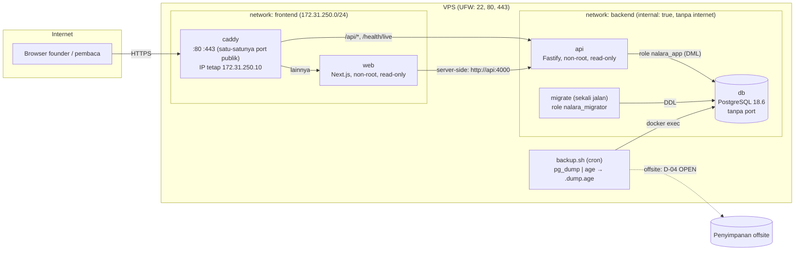
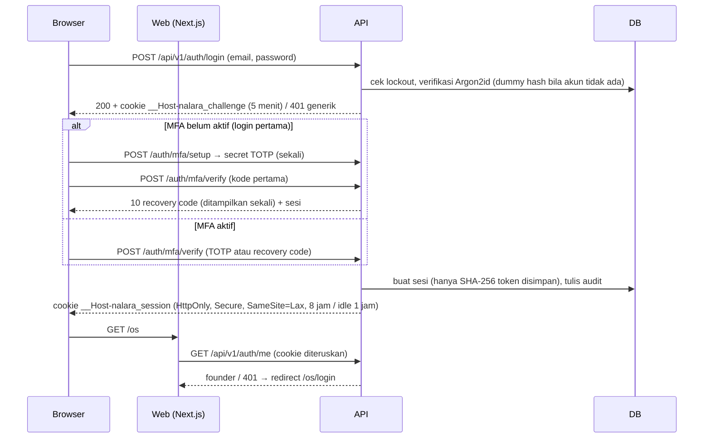

# NALARA — Arsitektur Phase 0 dan batas kepercayaan

Dokumen ini menggambarkan sistem **seperti yang benar-benar dibangun** di Phase 0, bukan rencana. Keputusan di baliknya ada di [ADR](../adr/README.md). Risiko dan mitigasinya ada di [threat model](../security/threat-model.md).

## 1. Topologi produksi (satu VPS, Docker Compose)

`api` ada di dua network: `frontend` (agar bisa dijangkau Caddy dan web) dan `backend` (agar bisa menjangkau db). `web` **tidak** ada di `backend`, jadi tidak bisa menyentuh database sama sekali. Ini diuji di TEST-COMPOSE-02.

## 2. Batas kepercayaan (trust boundaries)

| # | Batas | Yang tidak dipercaya | Penjaga | Bukti tes |
|---|---|---|---|---|
| TB-1 | Internet → Caddy | Semua request, header, cookie | TLS, HTTP→HTTPS, header keamanan, batas body 1 MB, `/health/ready` ditutup, `X-Request-ID` selalu dibuat ulang, log tanpa cookie/token | TEST-OPS-01..04 |
| TB-2 | Caddy → API | `X-Forwarded-For` dari selain Caddy | `TRUSTED_PROXIES=172.31.250.10`; hanya IP itu yang boleh menentukan IP klien | `app.test.ts` (spoofing XFF) |
| TB-3 | Request → route `/api/v1/os/*` | Semua yang belum terbukti founder | `requireFounder` di API (bukan di UI). Sesi dicek ke DB tiap request, gagal tertutup saat DB mati | TEST-SESSION-*, TEST-API-* |
| TB-4 | Request yang mengubah state | Origin lain, request tanpa token | Cek `Origin`/`Sec-Fetch-Site` + token CSRF HMAC + `SameSite=Lax` | TEST-CSRF-01..10 |
| TB-5 | Web → API | Web server tidak dipercaya untuk keputusan auth | Web hanya meneruskan cookie. `proxy.ts` cuma UX redirect, keputusan tetap di API | TEST-WEB-02, 04 |
| TB-6 | API → DB | Bug aplikasi | Role `nalara_app` hanya DML; `audit_events` hanya SELECT + INSERT (append-only di level DB) | TEST-DB-07 (`db.test.ts`) |
| TB-7 | Operator → DB (DDL) | — | Migrasi hanya lewat `migrate` (role `nalara_migrator`), checksum + advisory lock | TEST-DB-01..04 |
| TB-8 | Server → backup | Pencuri file backup / server | Enkripsi `age` dengan kunci publik saja. Kunci privat offline di founder | TEST-BACKUP-01..10 |
| TB-9 | GitHub → CI | Kode PR | Token read-only, action dipin SHA, tanpa `pull_request_target`, tanpa secret produksi | `ci.test.ts`, TEST-CI-* |

## 3. Alur login founder

## 4. Endpoint yang ada di Phase 0

| Method + path | Auth | Catatan |
|---|---|---|
| `GET /health/live` | publik | `{"status":"ok"}` saja |
| `GET /health/ready` | internal (404 di Caddy) | Cek DB + versi migrasi |
| `POST /api/v1/auth/login` | publik, rate limit IP + akun | Pesan gagal generik |
| `POST /api/v1/auth/mfa/setup`, `/mfa/verify` | cookie challenge | Rate limit, challenge sekali pakai |
| `POST /api/v1/auth/mfa/recovery-codes` | founder + CSRF | Rotasi recovery code |
| `GET /api/v1/auth/me` | founder | |
| `POST /api/v1/auth/logout` | founder + CSRF | Mencabut sesi di server |
| `GET /api/v1/os/ping` | founder | Placeholder area OS |

Tidak ada registrasi, tidak ada fitur konten, tidak ada fetch URL eksternal (sesuai batas Phase 0).

## 5. Data

| Tabel | Isi sensitif | Perlindungan |
|---|---|---|
| `users` | hash password, secret TOTP | Argon2id; TOTP AES-256-GCM dengan AAD user id, kunci di luar DB (`MFA_ENCRYPTION_KEY`) |
| `sessions` | token sesi | Hanya SHA-256; token asli hanya di cookie |
| `login_challenges` | token challenge, secret TOTP sementara | Hash + kedaluwarsa 5 menit + sekali pakai |
| `recovery_codes` | kode pemulihan | Hanya SHA-256, sekali pakai |
| `audit_events` | metadata aksi (tanpa secret) | Append-only lewat grant DB |
| `nalara_schema_migrations` | checksum migrasi | Hanya migrator yang bisa menulis |

## 6. Yang sengaja belum ada

- Penyimpanan backup offsite (D-04), deploy ke VPS nyata dan domain (D-08, D-09).
- CSP berbasis nonce (masih `'unsafe-inline'` karena Next.js, dijadwalkan Phase 8).
- `packages/*` bersama: dibuat saat benar-benar dibutuhkan (token desain ada di `apps/web/lib/tokens.ts`).
- Worker, Hermes, Telegram, ingestion: fase berikutnya. Arsitektur ini memberi mereka akses lewat API, tidak pernah lewat kredensial DB.
